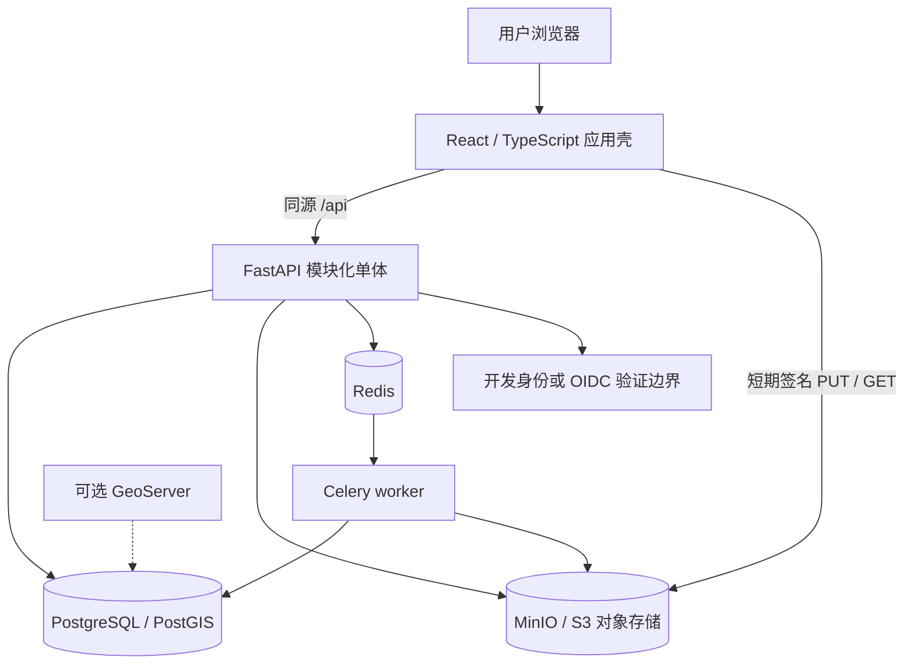
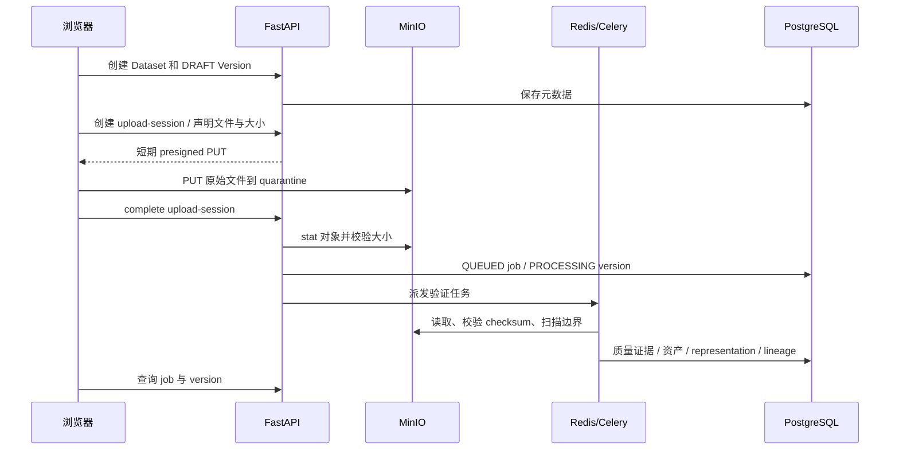

# FAO 气候地理空间数据与决策平台：仓库技术档案

> 源码归档日期：2026-10-19；仓库版整理日期：2026-10-21，Asia/Bangkok。
> 对象：本仓库的系统设计、源代码、部署模板、数据契约和公开说明文档。
> 版本说明：正文和代码摘录保留2026-10-19的技术快照；仓库链接和文件清单按本次同步整理，后续测试与依赖补丁以提交和CI记录为准。
> 用途：技术交接、系统理解、后续开发、架构评审、部署维护和项目留档。
> <a id="repository-scope"></a>公开范围：机构咨询草稿、真实GIS资料、恢复文件和本机文件清单不在此版本内；完整本地档案另行保留。
>
> 阅读边界：当前实现、历史验证结果、配置中声明的能力及未来提案分别标注；源码静态核对不等同于在线验收。本文不收录真实环境密码、令牌、签名 URL 或数据库业务数据。

<a id="toc"></a>
## 目录

1. [档案范围、版本和证据](#s01)
2. [项目背景、产品定位和业务边界](#s02)
3. [工作区组成与系统总体架构](#s03)
4. [技术栈、依赖和代码组织](#s04)
5. [身份、工作空间、角色与权限](#s05)
6. [Data Hub：目录、版本和集合](#s06)
7. [上传、对象存储和异步验证](#s07)
8. [数据 profile、校验规则和预览](#s08)
9. [审核、发布、授权和生命周期](#s09)
10. [Investment：输入、方法和场景治理](#s10)
11. [分析公式、排名、比较和可复现性](#s11)
12. [分析任务、取消、失败与恢复](#s12)
13. [结果物化、导出和血缘](#s13)
14. [Extension：田间支持完整工作流](#s14)
15. [前端页面、交互、地图和 PWA](#s15)
16. [数据库、迁移和不可变性](#s16)
17. [模块契约与扩展机制](#s17)
18. [API 公共约定、错误和审计](#s18)
19. [数据资产、合成数据和真实数据边界](#s19)
20. [配置、运行拓扑和部署](#s20)
21. [运维、备份、恢复和排障](#s21)
22. [测试、CI 与本次核查范围](#s22)
23. [历史材料差异、当前限制和待完成事项](#s23)
24. [管理咨询、机构试点与后续路线](#s24)
25. [交接、术语和档案维护](#s25)

后附可检索的完整清单：

- [附录 A：147 个业务 API 的方法、路径、参数、权限线索和错误](#appendix-a)
- [附录 B：70 张 ORM 表、765 个字段、外键及约束](#appendix-b)
- [附录 C：全部 Pydantic 请求模型与校验器](#appendix-c)
- [附录 D：角色权限矩阵、环境变量和依赖版本](#appendix-d)
- [附录 E：前端路由、类型契约和客户端入口](#appendix-e)
- [附录 F：模块 manifest 与契约 schema 原文](#appendix-f)
- [附录 G：源文件职责、函数和测试索引](#appendix-g)
- [附录 H：仓库文件、大小和 SHA-256 清单](#appendix-h)
- [附录 I：迁移保护、架构决策和核验记录](#appendix-i)

<a id="s01"></a>
## 1. 档案范围、版本和证据

### 1.1 归档代码基线

| 项目 | 快照说明 |
|---|---|
| 仓库 | `MickeyRay0624/fao-climate-geospatial-platform` |
| 代码基线 | `dc13314f88bf6c2232018e5e35410241cf88590f` 加10月19日归档时的功能修改 |
| 基线提交 | 2026-09-01合并演示平台PR #6 |
| Web包版本 | `0.3.0` |
| API版本 | `0.3.0-demo-platform` |
| 预期Alembic head | `20260901_0005` |
| 归档业务HTTP路由 | 147个显式handler，不含FastAPI自动文档 |
| 归档ORM | 70张表，765个mapped_column字段 |
| 归档源码规模 | api/app与web/src下Python/TS/TSX/CSS共26,567物理行 |

源码、请求/响应摘录和静态测试数量属于10月19日快照，不宣称之后的依赖补丁与新增测试已包含在摘录中。源代码链接采用仓库相对路径；文件清单属于10月21日同步范围，文件变化可能造成历史行号偏移。CI运行证据保存在对应Pull Request和GitHub Actions中，不能从静态档案推断服务当前在线。

### 1.2 证据优先级

1. 当前源文件、迁移脚本、实际配置模板：说明代码现在如何工作。
2. 当前测试源码和 CI 配置：说明哪些行为被测试设计覆盖，不能自动证明本次执行通过。
3. 带日期的报告、用户指南、备份目录：说明相应日期和相应实例的历史证据。
4. 蓝图、manifest 中的承诺、IT 咨询和路线图：说明设计目标与规划，必须与代码分别理解。

本文包含数据结构和源码索引，不是数据库内容导出，也不是将全部二进制数据嵌入 Markdown 的文件备份。数据库 dump、MinIO 对象和 GIS 原文件应连同本档案独立保存；文件路径和散列见附录。

<a id="s02"></a>
## 2. 项目背景、产品定位和业务边界

项目起点为 Virtual Fields / frugal digital twin 的探索，最初关注遥感、天气、传感器、土壤、作物模型及推广服务。当前可执行系统收敛为一个共享数据治理基础平台和两个业务模块：投资优先级分析、人工田间支持。

系统英文名称为 **FAO Climate Geospatial Data & Decision Platform**，原目录和 Web package 保留 Cambodia Rice DSS 名称。核心演示问题是：哪些柬埔寨行政区域应优先获得气候适应型水稻投资或推广支持。当前实现使用 111 个合成区域和七个合成指标验证工作流，而不是形成真实资金配置依据。

| 能力层 | 解决的问题 | 当前实现 |
|---|---|---|
| 平台基础 | 谁在什么工作空间操作什么资源 | 开发身份、OIDC 边界、成员、角色、权限、应用开关 |
| Data Hub | 哪个文件、哪个版本可被信任和复用 | 上传、验证、质量、审核、发布、授权、集合、血缘 |
| Investment | 一个结果由哪些输入和方法产生 | 锁定输入、批准方法/场景、异步 WLC 排名、解释、比较、导出 |
| Extension | 人工田间工作如何留痕 | 案例、分配、观察、人工评估、核验、活动、跟进、主管视图 |
| 治理运维 | 如何检查责任、完整性和服务状态 | 作业、审计、权限管理、保留策略说明、健康信息 |

当前没有自动诊断、LLM 调用、实时传感器采集、作物/水文过程模拟、参数同化、遥感时序流水线或经过校准的田块级数字孪生。Extension 的知识批准状态为演示批准，不等同于专家认可；Investment 的 `APPROVED` 和 `FORMAL` 是系统治理状态，不代表业务方法已获机构正式批准。

<a id="s03"></a>
## 3. 工作区组成与系统总体架构

### 3.1 仓库目录

| 目录 | 职责 |
|---|---|
| `api/app/` | API、身份权限、共享模型、Data Hub、Investment和Extension |
| `api/alembic/` | 五级数据库迁移链与保护触发器 |
| `api/tests/` | 单元、契约、集成和数据库完整性验证 |
| `web/` | React/TypeScript、地图、PWA、前端及浏览器测试 |
| `docs/` | 架构、ADR、运行手册、安全、演示和用户指南 |
| `deploy/` | 服务器演示Compose、Nginx和脱敏环境模板 |
| `scripts/` | 契约检查、端到端验证、演示检查和文档工具 |
| `.github/` | CI、issue和PR模板 |

真实外部资料、数据库快照、对象副本、咨询草稿和本机生成的Word/PDF保留在仓库发布范围之外。

### 3.2 组件与数据流



代码采用模块化单体：单个 FastAPI 应用注册平台、Data Hub、Investment、Extension 等 router；Celery worker 使用同一套 Python 代码和数据库模型。没有服务发现、独立微服务发布、Kubernetes 或独立事件总线。

### 3.3 写入权威与边界

- 数据产品、版本、资产、审核和血缘的权威模型为 `catalog.*`。
- 新投资输入、方法、场景、运行和结果的权威模型为 `investment.*`。
- 田间案例及原始媒体记录在 `extension.*`，不会自动注册成可共享 Data Hub 数据集。
- 用户映射在 `iam.*`；组织、工作空间、成员、模块及幂等记录在 `core.*`。
- 角色、权限、授权在 `governance.*`；作业与上传会话在 `jobs.*`；审计在 `audit.*`。
- `integration.legacy_id_mappings` 保存旧整数 ID 到新 UUID 的映射。
- `public.*` 保留旧目录、区域、指标、运行、结果等八张表。旧 API 写入口已返回 410；但 seed、迁移及特定分析 bundle 的兼容读模型填充仍会使用这些表。因此“旧域只读”准确地指新业务写入口和保留的历史证据，不能理解为数据库撤销了这些表的所有写权限。

数据库保存结构化业务状态、空间几何、质量摘要和血缘；对象存储保存原文件、派生文件和媒体字节；Redis 承担消息传输与 Celery backend，数据库中的 `processing_jobs` 才是业务作业状态。浏览器不持有永久 MinIO 凭据。

<a id="s04"></a>
## 4. 技术栈、依赖和代码组织

### 4.1 运行技术

| 层 | 当前声明 |
|---|---|
| API 容器 | Python 3.12，`python:3.12-slim-bookworm`，UID 10001 的 `platform` 用户 |
| Web 构建 | Node 22，`node:22-bookworm-slim` |
| API 框架 | FastAPI 0.141.1、Uvicorn 0.52.4 |
| 数据访问 | SQLAlchemy 2.0.52、GeoAlchemy2 0.20.0、psycopg 3.3.4 |
| 几何与矢量 | Shapely 2.1.2、pyshp 2.3.1；GeoPackage 使用标准库 SQLite 和 WKB 解析 |
| 请求校验 | Pydantic 2.13.4 |
| 队列 | Celery 5.5.3、redis Python client 5.2.1、Redis 7.4 Alpine |
| 对象存储 | MinIO Server `RELEASE.2025-07-23T15-54-02Z`，Python SDK 7.2.16 |
| 数据库镜像 | `postgis/postgis:16-3.4`，显式 `linux/amd64` |
| Web | React 19、React Router 7、TypeScript 5、Vite 7、OpenLayers 10、ECharts 6 |
| 静态服务 | Nginx 1.27 Alpine；宿主机 Nginx 的安装版本未由工作区确定 |
| 数据库迁移 | Alembic 1.16.5 |
| OIDC/JWT | PyJWT 2.10.1 + cryptography 支持；RS256/ES256 |
| 契约 | PyYAML 6.0.2、jsonschema 4.25.1、JSON Schema draft 2020-12 |
| 测试与 lint | pytest、httpx、Ruff、Vitest、Testing Library、Playwright |

Python requirements 使用精确版本；Web package 使用范围声明，实际锁定版本应以 `package-lock.json` 为准。附录 D 同时列出直接声明和锁文件版本，不能把 package 范围当成机器上实际安装结果。

### 4.2 后端关键文件职责

| 文件/目录（相对主仓库） | 职责 |
|---|---|
| `api/app/main.py` | 应用创建、router 注册、CORS、关联 ID、异常信封、健康与旧兼容 API |
| `config.py` / `database.py` | 环境参数、安全配置启动检查、SQLAlchemy engine/session |
| `identity.py` / `authorization.py` | 主体解析、OIDC 映射、有效权限、数据集访问判断 |
| `platform_router.py` / `platform_models.py` | 平台与治理 API；共享数据模型及 Investment ORM |
| `object_store.py` | 内外网客户端、签名、字节读取、写入、复制、对象元数据 |
| `jobs.py` | Celery 初始化、Data Hub 处理任务、作业步骤和 Investment task 注册 |
| `datahub/` | 目录和集合 API、请求模型、文件/profile 校验 |
| `investment/` | 原生运行、输入加载、纯计算引擎、结果注册、迁移和 metrics |
| `extension_models.py` / `extension_router.py` | 田间支持 16 张表与完整人工工作流 API |
| `seed.py` / `platform_seed.py` / `extension_seed.py` | 确定性演示内容与幂等初始化 |
| `models.py` / `data_management.py` / `migrations.py` | 旧模型、旧目录读适配器及早期兼容 schema 修补 |
| `audit_service.py` / `logging_config.py` / `errors.py` | 审计写入与脱敏、JSON 日志、统一业务异常 |

前端从 `web/src/main.tsx` 进入 `App.tsx`，由 `platform/AppShell.tsx` 提供身份能力和全站导航，`pages/` 承载共享页面，`modules/` 承载两个业务模块。旧组件仍留在 `components/`，存在文件不等于仍是主业务页面入口。附录 G 提供每个源文件和函数的定位。

<a id="s05"></a>
## 5. 身份、工作空间、角色与权限

### 5.1 身份模式

开发模式使用 `urn:fao:climate-platform:dev` issuer 和 `X-Dev-User-Subject` 选择预置用户；没有该请求头时默认 `dev-admin`。这是显式演示身份，不验证真实用户的密码。前端把 subject 存在 `localStorage["fao-platform-dev-subject"]`，请求时自动携带。

OIDC 模式要求完整的 `OIDC_ISSUER`、`OIDC_AUDIENCE`、`OIDC_JWKS_URL`；从 Bearer token 获取签名 key，使用 RS256 或 ES256 解码，校验 issuer、audience 及 JWT 库默认验证的 claims，再用 `iss + sub` 对应到已存在的 `iam.users`。未预置或 inactive 的用户会被拒绝。当前没有前端 OIDC 登录跳转、授权码/PKCE、用户自动开户、组织目录同步或完整会话管理。

`config.validate_security_configuration()` 在导入配置时执行：环境不是 development/test 时，拒绝 dev mode、开发身份头和扫描绕过；无效 auth mode 或不完整 OIDC 也会阻止启动。服务器演示 Compose 则明确把 `APP_ENV` 设置为 development，因此文件名带 production 不等于进入正式生产安全模式。

### 5.2 Principal 解析

Principal 包含用户 UUID、subject、issuer、名称、邮箱、当前工作空间 ID/名称、可用成员关系、group IDs、role keys、effective permissions、enabled modules 及 dev_auth。

解析步骤为：

1. 查 active 用户。
2. 查用户 active、未到期的 workspace membership，且 workspace 为 active。
3. `X-Workspace-Id` 可选择 UUID；未指定时选按名称排序的首个可用工作空间。
4. 加载当前工作空间组成员。
5. 汇总直接用户角色及组角色，只取当前工作空间 scope 和有效时间窗口。
6. 汇总角色 permission codes。
7. 只启用 installed、manifest valid、workspace enabled 的模块。

前端没有工作空间切换器，但后端保留请求头选择能力。主体构建不会因为 `platform.admin` 自动绕过数据访问控制。

### 5.3 角色与职责

预置 14 个 persona，对应 13 种 role key；两个 officer 共用 `extension_officer`。管理员角色拥有除 `platform.admin` 外的当前权限集合；具体资源仍接受 workspace、DENY 和敏感分类判断。

| 角色 | 业务职责 |
|---|---|
| `workspace_admin` | 成员、组、角色、应用、数据、审核、审计、健康管理 |
| `contributor` | 创建数据集、上传版本、维护元数据、授权、提交审核、准备输入集 |
| `data_reviewer` | 独立数据审核；不自动拥有发布权 |
| `data_publisher` | 发布已批准版本、弃用和归档 |
| `analyst` | 输入集、分析、取消、比较、导出、结果送审 |
| `viewer` | 授权数据与结果读取、导出、比较 |
| `auditor` | 审计读取/导出与作业、运行证据查看 |
| `method_editor` / `method_approver` | 方法和场景编辑/独立批准 |
| `extension_officer` | 自建或分配案例的观察、评估、核验、活动及跟进 |
| `extension_supervisor` | 全工作空间案例、分配、评估复核、活动批准和关闭 |
| `knowledge_editor` / `knowledge_approver` | 田间知识版本编辑/独立批准 |

### 5.4 数据集访问算法

`can_access_dataset()` 的实际顺序是：工作空间必须一致 → 查询有效 user/group grant → 任何 DENY 即拒绝 → 必须具有角色权限或 ALLOW → 按动作检查所有权、工作范围与可见性。

- 编辑元数据、上传版本、提交审核、管理访问：owner、`workspace_admin` 或显式 ALLOW。
- 元数据、preview、download、lineage：owner 或 ALLOW 可访问；reviewer 可访问其组范围内 open/in-progress review；publisher 可访问有 approved/published 版本的资源。
- 非 `SENSITIVE_FIELD` 且 visibility 是 WORKSPACE/TEAM/FAO_INTERNAL/PUBLIC 的资源，可对具备动作权限的成员开放。
- 非敏感数据还允许具备动作权限的 workspace_admin 访问。
- SENSITIVE_FIELD 不因 workspace 可见性自动开放；显式 DENY 始终更早生效。
- 无权读取与资源不存在统一返回 404，避免暴露资源是否存在。

TEAM 当前没有额外的“仅某个团队”隔离算法，不能从名称推断其已实现细粒度组过滤。`RESTRICTED` 分类也不是全面替代 visibility 的强制授权上限，相关实现差异见第 23 节。

Investment 运行还会逐一检查输入数据集元数据访问权；Extension 按当前工作空间和案例创建者/受派人/主管范围独立判断。隐藏菜单和按钮只是界面提示，后端权限判断是实际边界。

<a id="s06"></a>
## 6. Data Hub：目录、版本和集合

### 6.1 领域对象

Dataset 是长期逻辑数据产品，包含 workspace、slug、title、abstract、data_kind、owner、visibility、classification、licence、lifecycle 和 current published version 指针。Version 是某次确切内容快照，包含 version label、profile、状态、创建/批准/发布时间、元数据快照和乐观锁。

Asset 对应一份文件字节，包含 filename、role、media type、size、SHA-256、object locator、scan status 和存储分类；Representation 对应一种可被浏览或分析消费的表达，例如 GeoJSON preview、指标表、PostGIS 结果或下载文件。MetadataRecord 保存用途、生产方、来源、方法、质量、许可、使用限制、关键词、语言、citation、source URL 等。

Dataset 的 `data_kind` 请求枚举包含 vector、table、document、raster、multidimensional、model_output、derived_product；当前可创建普通上传版本的 profile 仅覆盖六种已实现路径。出现 raster 枚举不代表可以处理 GeoTIFF。

### 6.2 目录与标签

目录 API 支持查询、mine、数据种类、可见性、分类、质量、标签、状态、归属范围和页码等参数；具体签名见附录 A。目录先查询工作空间，再执行资源访问过滤。卡片展示 owner、版本数、published version、质量、标签和空间信息。

`evidence_type` 判断规则：许可为 `UNCONFIRMED-SOURCE-LICENCE` 或关键词含 `real-data-test` 标 REAL_SAMPLE；许可为 `DEMO-ONLY` 或关键词含 synthetic 标 SYNTHETIC_DEMO；其余为 GOVERNED。许可状态按是否声明/是否未确认分别返回 NOT_CONFIRMED、DECLARED、NOT_DECLARED。这些是本地元数据标签，不是来源许可证的外部认证。

### 6.3 集合

Collection 用于把确切 dataset version 组织成专题，不是保存“最新版本”查询，也不是复制文件。成员包含 exact version UUID、role、ordinal；同一 collection/version 组合唯一。集合支持创建、详情、修改、增删成员和归档；更新、删除成员、归档使用 row_version，写操作要求 collection 权限和幂等键。集合读取继续过滤成员数据访问权，归档不物理删除 dataset、version 或 object。

<a id="s07"></a>
## 7. 上传、对象存储和异步验证

### 7.1 端到端上传



单会话请求可声明 1–20 个文件，filename 不可含路径，size 必须大于 0，SHA-256 可选且必须为 64 位十六进制。API 按声明总大小检查 `MAX_DATA_HUB_UPLOAD_BYTES`：配置默认 100 MiB；服务器演示默认 25 MiB。浏览器向导当前只提供一个文件选择和单次 PUT，没有 S3 multipart、断点续传或多文件图层编排。

创建 upload session 只接受 DRAFT 或 VALIDATION_FAILED；生成 `quarantine/<workspace>/<session>/<文件序号UUID>`。版本转 UPLOADING，upload session 有到期时间。完成时验证 session 为 OPEN、未过期、所有对象存在且大小一致，然后建立四步骤作业并将版本转 PROCESSING。

### 7.2 验证任务

任务名 `catalog:validate-version:v1`，队列 `celery`，数据库 `max_attempts=3`，Celery task 本身 `max_retries=0`。四步骤：

| 步骤 | 行为 |
|---|---|
| inspect | 读 quarantine 原始字节，核对大小与可选 SHA-256 |
| scan | 开发扫描绕过或 fail-closed scanner |
| validate | 根据版本 profile 分派校验，写 QualityRun 与 QualityIssue |
| register | 注册 source/derived assets、representation、必要的兼容读模型和 ingestion lineage |

进度大致经过 4、20、36、62、100。QualityIssue 分 BLOCKING/WARNING；有阻断项时 version 为 VALIDATION_FAILED，但只要处理任务正常结束，job 仍为 SUCCEEDED。必须同时读取 job 状态和 `result.validation_status`，不能把“任务成功”理解成“文件可发布”。

通过校验的对象复制到 `catalog/<workspace>/datasets/<dataset>/versions/<version>/source/<file>`，之后移除临时 quarantine 对象；校验不通过的 source 仍可登记在 quarantine，并保留质量证据。Shapefile/GPKG 成功时派生 GeoJSON asset，角色为 derived-vector。同一版本/sha256/role 约束防止重复资产；representation 按版本/类型查询复用。

异常处理记录 FAILED job、错误码、失败步骤及审计；如果版本仍 PROCESSING，则改为 VALIDATION_FAILED。多个阶段之间有数据库 commit，对象存储和 PostgreSQL 不是分布式原子事务，恢复时应同时对账两侧。

### 7.3 对象存储客户端与下载

- 内部客户端使用 INTERNAL_ENDPOINT 与 INTERNAL_SECURE；公网签名客户端使用 PUBLIC_ENDPOINT、SECURE 与 REGION。
- 这种分离允许 API/worker 经容器网络 HTTP 访问 MinIO，同时为浏览器签发 HTTPS 外部 URL。
- GET/PUT 签名默认 900 秒；服务器演示模板为 600 秒。
- Data Hub 下载 `role=source|derived-vector`，在签名生成前再次检查 dataset.download 并写 audit。
- 当前下载头支持 ASCII fallback 和 RFC 5987 UTF-8 filename；过滤 CR/LF、路径分隔符；设置 attachment、content type、private no-store。
- Investment 普通 asset 签名和 Extension 媒体签名没有全部复用 Data Hub attachment 参数。不能假设所有签名链接下载行为完全一致。
- 权限在签发时检查；已签发链接在有效期内作为 bearer URL 使用，不会每次向 FastAPI 重新鉴权，也没有即时撤销机制。

<a id="s08"></a>
## 8. 数据 profile、校验规则和预览

### 8.1 六条源文件校验路径

| profile | 支持内容 | 校验重点 | representation |
|---|---|---|---|
| `analysis-ready-priority-bundle@1.0` | GeoJSON/JSON 或 CSV+geometry_wkt | 区域基本字段、七指标、几何、范围和完整性 | legacy_priority_bundle |
| `administrative-boundary@1.0` | 当前原生路径为 GeoJSON | area_code/name/admin_level、唯一 join key、Polygon/MultiPolygon | administrative_boundary |
| `normalised-indicator-layer@1.0` | CSV 或 GeoJSON 属性 | 单指标、unit、direction、time 字段、唯一区域、0–1 值 | normalised_indicator_table |
| `generic-vector@1.0` | GeoJSON、受控单图层 Shapefile ZIP/GPKG | 结构、几何、CRS、归档和图层限制 | geojson_preview / derived_geojson_preview |
| `generic-table@1.0` | UTF-8 CSV | 表头、重复列、行宽、空行与推断类型 | table_preview |
| `document@1.0` | PDF、DOCX、MD、TXT | 扩展名、MIME 提示、大小元数据 | document_metadata |

`priority-ranking@1.0` 由 Investment 内部生成，作为输出契约注册，不在普通 CreateVersionRequest 的上传 profile 枚举中，也不是 `validate_file()` 的源文件分派分支。

### 8.2 旧分析 bundle 详细规则

必需字段为 `code,name,province,rice_area_ha` 加七指标；CSV 还必须有 geometry_wkt。GeoJSON 必须是 FeatureCollection。几何使用 Shapely `make_valid`，保留面并统一成 MultiPolygon；无面、空几何或超出经纬度合法范围的记录不接受。区域 code 不可重复。

rice area、population 不得为负；data_quality 在 0–1。population 缺省 0、data_quality 缺省 0.8。指标非空值必须是 0–1 数字；指标空值作为 warning 保留；落在柬埔寨演示 bbox `(102,10,108,15)` 外为 warning。该 bbox 是粗略合理性检查，不是官方边界空间匹配。所有 quality check 的代码及字段可通过源码索引追溯。

### 8.3 通用矢量与受控格式

GeoJSON 校验 FeatureCollection、非空 features 和有效几何，汇总字段、geometry types、record_count 与 bbox。未声明 CRS 时警告并假定 EPSG:4326；不会使用完整 CRS 引擎验证或转换任意坐标系。

Shapefile ZIP 的规则为：至多 64 个文件；解压总大小不超过 512 MiB；单项压缩率不超过 200；拒绝绝对路径、`..`、反斜杠歧义路径及嵌套 zip/7z/rar/tar/gz。必须有同 stem 的 shp、shx、dbf、prj；cpg 可决定编码；多个完整图层要求未来显式选择。读取后保留原 ZIP，并创建独立 GeoJSON。

GPKG 要有 SQLite signature，通过临时文件以 read-only/query_only/trusted_schema=OFF 访问；查 gpkg_contents、geometry_columns、spatial_ref_sys，仅支持一个 feature layer；解析 GeoPackage geometry header 与 WKB；SQL 标识符引用作转义。未实现 raster tiles 或任意 GeoPackage 扩展。

受控 ZIP/GPKG 单层上限为 50,000 features；存储预览最多 2,000。当前只接受可确定为 EPSG:4326 的 CRS；非 4326 返回 `VECTOR_PREVIEW_REPROJECTION_REQUIRED`，不静默重投影。普通 GeoJSON 分支没有同样的 50,000 feature 验证上限，不能把这一限制外推到全部矢量路径。

### 8.4 指标与边界

边界要求全局字段集合含 area_code、area_name、admin_level，逐行 code 非空且唯一，几何只能 Polygon/MultiPolygon。Investment 的边界加载还要求 rice_area_ha 数值；因此通过 boundary profile 本身不保证满足当前水稻方法的全部输入字段。

指标层要求 `area_code,value,indicator_code,unit,direction,time_start,time_end`。一个层只能声明一个 indicator code、一个 unit，direction 必须为 higher_is_priority；缺值 warning，重复 code 或非数值/越界 BLOCKING。time_start/end 的存在性校验不等于跨图层时段一致性验证；当前没有全面验证每行必需元数据、日期格式和统一时间窗。

### 8.5 表、文档与预览

CSV 校验器要求 UTF-8（可带 BOM），表头存在，无重复列，行宽一致。空行 warning；有效行前 100 行推断 integer/number/string/empty，前 20 行形成初始预览。文档只做目录化和 MIME 警告，不进行 OCR、全文抽取、病毒扫描实现、PDF 结构真实性或 DOCX 内容验证。

Preview API 默认 page=1、page_size=25，上限 100；矢量 simplify_tolerance 默认 0.002、范围 0–1，preserve_topology=True，仅影响返回显示。可见矢量记录最多 2,000。表格缺失统计最多采样 10,000 行，超出时标 approximate。SENSITIVE_FIELD 表格按字段名正则隐藏 name/phone/email/person/farmer/contact/identifier/id 等直接标识，保留 area_code/admin_code/case_code。

这不是全面隐私去标识：自由文本、几何或不同命名字段可能仍包含敏感内容。Preview 的分页发生在读取对象后，当前不代表数据库/文件的流式或分块读取。ZIP/GPKG 预览解析原始文件失败后回退到存储的 GeoJSON sample。

<a id="s09"></a>
## 9. 审核、发布、授权和生命周期

### 9.1 版本状态

```text
DRAFT → UPLOADING → PROCESSING → VALIDATED → IN_REVIEW → APPROVED → PUBLISHED
                         └→ VALIDATION_FAILED              │            │
VALIDATION_FAILED → 新上传会话                              │            └→ DEPRECATED → ARCHIVED
IN_REVIEW → CHANGES_REQUESTED → 修改/再次送审                │
```

`CHANGES_REQUESTED` 可以编辑元数据并再次送审，但当前 create_upload_session 仅接受 DRAFT/VALIDATION_FAILED，不能假定要求修改后可直接重新上传。修正数据可采用新的版本；不应手改数据库绕过状态机。

### 9.2 送审与决策

送审要求版本 VALIDATED 或 CHANGES_REQUESTED、row_version 匹配及 dataset.submit_review。ReviewRequest 保存 review_type（metadata/technical/domain/publication）、reviewer_group、请求人和策略快照。审核人要有 dataset.review，并能读该数据集；review queue 按组 scope 过滤。

决策支持 APPROVE、CHANGES_REQUESTED、REJECT，均要求 rationale 至少五字符。APPROVE 使版本 APPROVED；后两者使版本 CHANGES_REQUESTED。创建者默认不能独自审核自己的版本；可在演示环境提供 exception_reason，产生高严重度审计。当前字段只检查 truthiness，不代表经过独立的例外批准流程。

### 9.3 发布与冻结

发布要求 dataset.publish、相同 workspace、APPROVED、row_version 匹配、没有 OPEN/BLOCKING quality issue、有 approved review、有资产且 scan policy 满足、必要 metadata 完整。CLEAN 可接受；BYPASSED_DEV 仅在 development/test 可接受。创建者发布自己版本同样需要记录例外原因。

发布时冻结 metadata snapshot，更新 published_by/at 及 dataset.current_published_version_id，增加 dataset row_version。发布快照主要包含 title、abstract、purpose、producer、provenance、licence、use limitation、CRS、methodology、quality statement、keywords、classification 和 visibility；元数据表还有其他字段，并非所有字段都会复制进 snapshot。

已发布、弃用和归档的业务字段及其 assets/representations/metadata 由数据库 trigger 保护。未来纠正内容应创建新版本并记录 supersedes；dataset-level 改名不改写历史版本快照。

### 9.4 授权、弃用与归档

Grant 指向 user/group、permission、ALLOW/DENY、expiry 和 reason；expiry 必须 timezone-aware 且在未来。API 只允许数据元信息、预览、下载、编辑、上传、送审、访问管理、lineage 等八类 resource permission。实际作用域为 dataset；模型虽然保留 dataset_version resource type，授权查询仍用 dataset ID 匹配，不能当成已完成独立版本授权。

PUBLISHED 只能弃用为 DEPRECATED；清除 current 指针并保留对象、引用和审计。归档 dataset 前必须先弃用所有 published versions，且不能有 QUEUED/RUNNING 处理任务。归档会取消 OPEN/IN_PROGRESS 审核和 OPEN 上传，将其余版本变为 ARCHIVED，清除当前发布指针；不删除源文件、失败对象和审计。

<a id="s10"></a>
## 10. Investment：输入、方法和场景治理

### 10.1 输入集

输入模式只有两种：LEGACY_BUNDLE 是一个 analysis-ready-priority-bundle；SEPARATE_LAYERS 是一个 administrative boundary 加七个各自独立的 normalised indicator layers。每个 member 保存 exact dataset version、representation、role、indicator code、join key、value/geometry field、unit、direction、time coverage、transform config、ordinal。

输入集状态为 DRAFT → VALIDATED → LOCKED → RETIRED。DRAFT/VALIDATED 可以修改成员；LOCKED/RETIRED 必须 clone 后编辑。锁定时保存规范化内容 checksum、readiness、warnings、最严格分类和锁定人/时间。分类计算以 FAO_INTERNAL 为最低基线，再选择输入中最高级别，顺序 PUBLIC < FAO_INTERNAL < RESTRICTED < SENSITIVE_FIELD。

验证检查角色数量、profile、版本状态、representation 对应且 READY、dataset.download 权限及资产能重新解析。FORMAL run 要求输入版本全部 PUBLISHED，且输入集允许 FORMAL。真正的 area-code 集合一致性还会在 worker 的 separate-layer preparation 中检查，而非全部在锁定前完成。

### 10.2 方法与场景

MethodDefinition 表示逻辑方法，MethodVersion 表示不可变版本；Scenario 是绑定方法版本的场景版本，另有 scenario_parameters 明细。版本号请求使用 semver 形式。

方法/场景状态均为 DRAFT → UNDER_REVIEW → APPROVED → RETIRED；批准后关键内容不可编辑。编辑与批准权限分开，创建者不能批准自己的版本；这条限制在服务和数据库 check/trigger 中落实，没有 Data Hub 式 pilot exception。

当前唯一实际算法 implementation 为 `investment.score_priority_areas.v1`，方法 key 为 `legacy-weighted-linear-combination`，演示版本 `legacy-wlc-1.0.0`。可创建版本不代表能执行任意用户方法代码；spec validator 只允许当前七指标的规范顺序、0.5 缺值策略及 weights/min_rice_area_ha override 集合。

场景参数包含全部七权重及 minimum rice area。API 允许 threshold 0–10,000 ha；前端 slider 只提供 0–3,000 ha、步长 50。场景权重验证和 run override 验证有不同边界，详见第 23 节与附录 C。

<a id="s11"></a>
## 11. 分析公式、排名、比较和可复现性

### 11.1 指标与预置场景

| 指标 | 中文含义 | Balanced | Productivity | Climate | Equity |
|---|---|---:|---:|---:|---:|
| yield_gap | 产量差距 | 0.22 | 0.38 | 0.12 | 0.14 |
| drought_risk | 干旱风险 | 0.18 | 0.12 | 0.26 | 0.12 |
| flood_risk | 洪涝风险 | 0.12 | 0.08 | 0.20 | 0.10 |
| poverty_index | 贫困/脆弱性 | 0.14 | 0.08 | 0.10 | 0.28 |
| irrigation_gap | 灌溉可及性缺口 | 0.12 | 0.22 | 0.10 | 0.12 |
| market_isolation | 市场隔离程度 | 0.08 | 0.04 | 0.04 | 0.16 |
| nbs_opportunity | 自然解决方案机会 | 0.14 | 0.08 | 0.18 | 0.08 |

所有输入预先在 0–1，方向统一“越高越值得优先考虑”。系统当前不从原始量纲自动计算 min-max、z-score，也不实现 lower-is-priority 的自动反向。

### 11.2 评分精确定义

对区域 a、指标 i、输入权重 w：

```text
w⁺ᵢ = max(0, float(wᵢ))；遗漏权重补 0，未知指标拒绝
ŵᵢ = w⁺ᵢ / Σⱼw⁺ⱼ；权重总和必须大于 0
x'ₐᵢ = xₐᵢ，若缺失则为 0.5
cₐ = 1 − 缺失指标数量 / 7
qₐ = 0.92 + 0.08 × cₐ
rawₐ = Σᵢ(ŵᵢ × x'ₐᵢ × 100)
scoreₐ = round(rawₐ × qₐ, 2)
eligibleₐ = rice_area_haₐ ≥ min_rice_area_ha
```

评分使用全部规范指标，即使某一权重是 0，缺失仍计入 completeness。`data_quality` 字段作为证据展示，不直接进入 q 或 score。components 保存观测值（四位）、归一化权重（四位）、加权贡献（两位）；贡献之和是未乘 completeness adjustment 的分数，不能直接与最终分数逐项相加对齐。quality_adjustment 结果保留十二位，completeness 三位。

示例：某区域六指标值均 0.6、一指标缺失，七权重相同，则 raw = 58.571428…，c = 6/7，q = 0.988571…，score = 57.90。该算例只演示代码公式。

### 11.3 排名和分档

仅 eligible 区域参与排名，按“已四舍五入的 score 降序、area code 升序”排序，因此相同两位分数按 code 决定先后。rank 从 1 开始。percentile = rank / eligible_count：≤0.2 为 Very high，≤0.5 为 High，≤0.8 为 Medium，其余 Lower；不合格区域 rank=null，band=Not eligible。少量区域时某些档可以为空，例如只有一个合格区域时 percentile=1，归 Lower。

### 11.4 结果比较

比较要求同 workspace、两个成功运行、完整相同 area-code 集合；不要求同一方法、场景或完全相同几何。保存 score delta（右减左）、rank delta（右减左，任一未排名时 null）、资格变化和档位变化；同时记录输入/方法/场景 checksum 是否不同及参数。

Top-N 默认 20、上限 200；overlap 是两个 eligible top sets 交集个数，overlap_ratio 实际为交集/并集，即 Jaccard，而非简单除以 N。比较会生成 comparison 证据和审计，但不会新建 analysis run；UI 的“read-only comparison”只表示不重新跑分析。

### 11.5 内容规范化与校验和

canonical JSON 使用 ensure_ascii=False、sort_keys=True、separators=(",",":")；SHA-256 用于方法、场景、输入集、请求、结果和文件字节。结果 checksum 按 area code 排序，只包含区域 code/name、score/rank/eligible/band、components、missing indicators、completeness、quality adjustment，**不包含 geometry、原始 indicators 全部副本或 province 等所有字段**。因此还需依赖资产校验和、输入快照和数据库完整性共同保证可复现。

新运行记录 code_ref、Python app source-tree SHA-256、image tag/digest、build_id、task version。`image_digest_verified` 当前只是根据环境是否提供 digest 置布尔值，没有独立查询镜像仓库或验证实际镜像内容。

<a id="s12"></a>
## 12. 分析任务、取消、失败与恢复

创建运行要求 investment.run.create 和模块 enabled，输入集 LOCKED 且 checksum 存在，FORMAL 输入全部 published，method/scenario APPROVED 且相互绑定，override 在允许范围。提交时冻结 exact member/representation/object key/checksum/config，以及方法、场景、输入集、参数和执行元数据。

接口返回 202，数据库同时创建 `investment.analysis_runs`、`jobs.processing_jobs`、run input snapshots 和六个 JobStep。任务为 `investment:run-prioritisation:v1`，队列 geospatial-analysis，worker concurrency=1，database max_attempts=2；Celery task 自动 max_retries=0。

| 步骤 | 大致进度 | 内容 |
|---|---:|---|
| validate-inputs | 3→15 | 检查输入快照和方法 checksum |
| prepare | 15→35 | 按 exact object key 读字节并核对 SHA；加载 bundle 或边界+指标 |
| score | 35→55 | 纯函数 WLC、eligibility、rank、bands |
| materialise-results | 55→75 | 将完整区域结果写入原生 PostGIS 表并计算 checksum |
| register-output | 75→93 | 写入三个不可变对象、catalog 资产与 representation、血缘 |
| finalise | 93→100 | 成功状态、统计、最终审计 |

运行状态为 queued、running、succeeded、succeeded_with_warnings、failed、cancel_requested、cancelled。Job 状态采用大写，两套状态不能直接等同。Warning 成功取决于 run.warnings_json，不是以任意 quality flag 自动推导。

取消要求 run owner 或 workspace_admin 且有取消权限；register-output/finalise 阶段拒绝。worker 在若干步骤边界检查 cancel_requested，删除尚未注册的 native result 行、保留审计并标 cancelled。取消不是即时中断 Python 计算，也不是撤销已经成功的结果。

失败保留结构化 failure：code、一般化 message、exception_type、correlation_id；job 同步 FAILED 并标当前失败步骤。若尚未登记 output version，尝试清理三个确定性临时输出 key；已 materialise 的中间结果不必然立即清空。失败重试复用原 run/snapshots，只有 FAILED 且 attempt 小于 max_attempts 的 job 可通过 retry API 重新排队。

run 创建先 commit 后派发；broker 派发异常时返回 `dispatch=durable_queue_pending`。当前没有 outbox、自动扫描滞留 queued 作业或定时补派器；“数据库记录持久化”不保证消息必然被消费，应结合队列和日志人工排障。Data Hub 的 complete 派发也在 commit 后执行，具有同类跨系统恢复边界。

<a id="s13"></a>
## 13. 结果物化、导出和血缘

### 13.1 原生结果

`investment.priority_results` 保存 run_id、area code/name、admin level、province、population、rice area、data quality、EPSG:4326 MultiPolygon、score/rank/eligible/band、contributions、indicators、缺值、completeness、quality adjustment 和 source quality flags。服务序列化几何时使用 ST_AsGeoJSON(...,6)。完整字段、外键和索引见附录 B。

results API 支持 eligible/band 和分页，默认每页 200、最大 500；当前先读取全部 result rows 再切片。Web 客户端请求 500 条，没有遍历全部分页的结果加载逻辑；111 条演示可完整展示，规模大于 500 时不能直接视作全量地图和汇总。

### 13.2 三类文件与四类 representation

| 交付物 | 内容 |
|---|---|
| `priority-ranking.csv` | 区域、rank、score、eligible、band、rice area、population、quality、completeness、adjustment、七指标 |
| `priority-ranking.geojson` | 全部区域几何、结果属性、synthetic/operational_use=false 元信息 |
| `run-manifest.json` | exact input references、文件 checksum、方法/场景/参数 checksum、代码镜像构建信息、结果数量和 disclaimer |

四种 representation 是 postgis_table、csv_download、geojson_download、run_manifest。输出 profile 为 priority-ranking@1.0，输出 version 先处于 VALIDATED；结果送审后走 Data Hub 的独立 review/publish。生成文件本身不自动批准发布。

Output dataset ID 基于 workspace+input set 的 UUID5，version ID 基于 run，asset/representation/lineage IDs 也确定性生成。对象重用时先计算预期字节 hash，再读已有对象比较；内容不同报 IMMUTABLE_OBJECT_CONFLICT，拒绝覆盖。

manifest 的 assets 列表包含 CSV/GeoJSON 的字节证据，不通过把自身 checksum 嵌入自身形成递归。数据库资产记录另行保存 manifest checksum。manifest 内部包含 object locators，普通 API payload 通常隐藏 locator；能下载 manifest 的用户仍会看到定位信息。

### 13.3 血缘与导出

每个成功 run 注册 analysis LineageProcess，含 external run ID、方法版本、code ref、parameter/result checksum、时间；每个 input version 一条 INPUT edge，output 一条 OUTPUT edge。legacy bundle 运行通常两条 edge；一边界七指标运行通常九条。

assets/exports 要求 run export 权限并再检查输入可见性，提供短期签名和 audit。Export 这里是对已有文件的授权证据，不是重新异步生成 GeoParquet/PDF；没有 zip 打包导出和报告 PDF 实现。

<a id="s14"></a>
## 14. Extension：田间支持完整工作流

### 14.1 对象和可见范围

该模块为非 AI 的人工流程，16 张表涵盖案例、分配、观察、媒体、知识及版本/来源、核验模板/项目/会话/回答、评估候选、活动计划/步骤、follow-up 和状态历史。案例带 demonstration=true、近似位置、作物、阶段、严重性、影响面积、priority、assignee、next_action 和 row_version。

具备 view_workspace 的用户可见工作空间全部案例；其他具备 view_assigned 的用户可见自己创建或当前分配给自己的案例。主管拥有分配、评估复核、活动批准和关闭权限。case.map 返回近似经纬度 Point，不代表真实田块位置。

### 14.2 精确案例状态机

```text
NEW → ASSIGNED → IN_OBSERVATION → IN_VERIFICATION → ACTION_PLANNED → FOLLOW_UP → CLOSED
上述非终态均可 → CANCELLED
CLOSED / CANCELLED 为终态，不可重新打开
```

每次转换有 reason、changed_by、changed_at、before/after 和 CaseStatusHistory。状态转换要求 row_version；关闭或取消还要求 extension.case.close。通用 transition endpoint 主要检查合法相邻状态，不统一验证所有前置业务证据；不能认为“进入 CLOSED”已自动证明全套核验/活动/跟进证据齐全。

### 14.3 分配、观察与人工评估

新案例编号为 USR-加五位序号，当前由案例总数计算；并发高时应改用安全序列。分配会结束以前 active assignments，设置 current assignee，并对 NEW 自动转 ASSIGNED。当前只检查 assignee 用户存在，未全面验证该用户在相同工作空间的有效 officer 资格。

Observation 支持 DRAFT/COMPLETED、observed_at、severity、affected_area、approximate_location、notes、structured JSON 与 client_uuid。workspace+client_uuid 唯一；completed 后不改写，要新建观察。完成首次观察可使 ASSIGNED → IN_OBSERVATION。PATCH 和创建路径的前置状态检查并不完全相同。

Assessment 由 officer 人工选择 DEMO_APPROVED 的知识版本，并引用本案例已完成 observations、missing information 和说明。生成 PROPOSED 候选，不自动打分；IN_OBSERVATION 自动转 IN_VERIFICATION。独立主管将候选 CONFIRMED 或 REJECTED，选择者不得自己复核。

### 14.4 核验、活动和跟进

核验模板有精确 version；一个案例可以建立多个 revision。回答为 YES/NO/UNKNOWN 和 evidence note。完成时要求所有 required checklist items 已有回答；UNKNOWN 也是一种结构化回答，不代表事实被证实。完成 session 和 responses 受不可变保护；后续应建新 revision。

活动类型为 field_visit、demo、group_session、individual_follow_up，包含 objective、participant_count、responsible officer、due date 和 1–20 steps；可不绑定案例。绑定案例时创建要求 IN_VERIFICATION，创建后进入 ACTION_PLANNED；当前未强制在创建活动前已经存在 COMPLETED verification。计划可 DRAFT 或 PENDING_APPROVAL；批准者不得是创建者，决定 APPROVE/REJECT。

Follow-up 包含 due date、objective、outcome、status；创建要求案例 ACTION_PLANNED，若指定 activity plan 必须属于本案例且 APPROVED；未指定时不强制关联 approved plan。创建使案例 FOLLOW_UP；完成后记录 outcome/time 并提示主管检查关闭证据，不自动关闭案例。

### 14.5 知识版本

KnowledgeItem 是逻辑条目，KnowledgeVersion 保存 content JSON、source summary、创建者、批准者和 version number，KnowledgeSource 保存 citation、URL 和 placeholder。可由 editor 新建版本，由其他 approver 将 DRAFT/UNDER_REVIEW 批准为 DEMO_APPROVED 并更新 current_version 指针。当前没有新建 KnowledgeItem、完整知识生命周期编辑、专家知识检索排序或模型诊断实现。

### 14.6 媒体与隐私

API 直接接收 JPEG、PNG、WebP，单文件最多 10 MiB，按声明 MIME 检查，计算 SHA-256。对象 key 为 `extension/<workspace>/cases/<case>/media/<uuid>.<suffix>`，classification=SENSITIVE_FIELD。开发为 DEV_BYPASS，其余 PENDING；当前没有正式扫描服务将其置 CLEAN，也没有图像解码真实性验证、EXIF 剥离或 thumbnails 生成流程。响应明确 exif_stripped=false。

查看媒体还需专门 media.view_sensitive 和案例读取权，状态仅 CLEAN/DEV_BYPASS 可签名，操作写 WARNING audit。响应硬编码 expires_in_seconds=900，但实际签名期限继承全局配置；服务器配置 600 秒时两者可不一致。PWA 不缓存这些 API/媒体。

### 14.7 离线与同步

前端把新案例草稿和观察文本存 sessionStorage，key 前缀 extension:draft:；切 persona 会清理这些草稿。Sync 页展示 online/offline、draft count、pending=0 和限制，不包含真正持久化队列、后台同步上传或冲突合并。

后端 sync 仅接受 observation.create，单批至多 100 项；使用 request idempotency key 和 client_uuid 返回 CREATED/DUPLICATE_ACKNOWLEDGED。它是一个批量观察接口，不是完整离线复制协议；批次使用同一事务，现有 UUID 复用路径及其案例归属还需进一步强化验证。

<a id="s15"></a>
## 15. 前端页面、交互、地图和 PWA

### 15.1 应用壳

AppShell 启动并行获取 capabilities/personas，按后端 navigation 分组生成侧边栏，显示 workspace、开发身份提示、角色职责说明、global search、当前用户和 job count。每 8 秒刷新作业；切 persona 更新能力、清草稿并按 user ID 重新挂载内容。模块使用 React.lazy/Suspense，加载和失败有专门界面。

前端 RequirePermission/RequireAnyPermission 显示 403 状态页。默认 / → /home；兼容 /analysis、/map、/results 跳到 native Investment。未知全局路径显示 404；模块内未知路径回各自 overview/worklist。HTTP API 通常通过同源 `/api`，本地由 Vite proxy，服务器由宿主 Nginx 路由。

### 15.2 共享页面

| 页面 | 功能与交互 |
|---|---|
| Home | 后端驱动的 workspace 概览、数据/作业/审核/模块、任务入口和证据标签 |
| Search | 通过查询参数调用全站搜索，按资源授权返回 dataset/version/run/collection 等 |
| Catalogue / Mine | 搜索和筛选目录、卡片/列表信息、my-data 范围、上传入口 |
| Collections | 专题集合详情、exact version 成员和可用管理动作 |
| UploadWizard | Dataset→Version→Metadata→Source→Direct upload→Processing→Quality→Review 八步 |
| DatasetDetail | Overview、Downloads、Versions、Metadata、Lineage、Access、Activity；访问 grant 增删和原文件下载 |
| VersionDetail | Summary、Preview、Files、Quality、Review、Lineage、Download；送审、批准/退回、发布 |
| Jobs | 状态、进度、步骤、attempt与手动刷新；实际retry操作通过后端API |
| Reviews | 待审版本、证据提示、详情跳转、rationale和批准/要求修改 |
| Applications | 已安装模块、enabled、路由和入口 |
| Governance | 成员、组、角色、审核队列、policy、quality profile、knowledge approval、应用、retention、health |
| Audit | 事件筛选、资源/actor/correlation/time、before/after、CSV 导出 |
| Help | 产品边界、角色、Data Hub、Investment、Extension、治理、demo guide 等嵌套帮助 |

上传向导用 XMLHttpRequest 跟踪文件字节上传进度；任务每秒轮询，最多约 90 次。超时显示未完成，不主动取消服务器作业。请求工具为 POST/PATCH/DELETE 自动生成新 UUID 幂等键；跨“重新点击/重新调用”不会自动复用上次 key，因此仅服务器幂等能力并不保证所有 UI 重试不会创建新资源。

### 15.3 Investment 页面

Overview、Results map、New run、Run history、Input sets 列表/新建/详情、Compare、Methods/版本详情、Scenarios、Real-data readiness。结果入口从已加载的成功 run 中选择 requested_at 最新者，未有结果时显示 empty state。历史筛选主要在已加载列表内完成；API 客户端多数列表只取前 100。

Run detail 每 1.2 秒轮询非终态 run，成功后取 results、lineage、audit；默认选 rank 1 区域。展示地图、rank/band/score、指标贡献、checksum、执行元数据、输入快照数量和授权下载。Methods/Scenarios 当前前端主要展示；编辑/提交/批准能力主要存在于后端 API，未形成完整可视化编辑审批界面。

### 15.4 地图和图表

OpenLayers 在浏览器把 EPSG:4326 投影至 EPSG:3857，仅显示本地 vector layer，没有默认外部底图和瓦片服务。Investment 使用五段 score/indicator 色阶，不合格/缺值为灰色，选区加粗边框；初次 fit extent，默认 zoom=6.3、范围 5–12，鼠标滚轮缩放关闭以保留页面滚动。

地图颜色按数值 0–1 分箱；业务 priority_band 按 eligible 相对名次分档，两者不是同一种分档。Extension 地图显示近似 Point，按 LOW/NORMAL/HIGH/URGENT 着色。ECharts 与旧 FactorChart 等组件仍在依赖/代码中，但不能推断每个现行页面都渲染 ECharts。

### 15.5 PWA 与浏览器存储

Service worker 仅 production build 注册，缓存名 fao-extension-shell-v2，预缓存 /、manifest、SVG icon；activate 清理其他 cache，navigation 网络优先、断网回 /；同源静态 GET 可缓存。`/api/`、`/objects/`、包含 `/media/` 的路径和非 GET 不缓存；跨域成功响应不存同源静态 cache。

应用 manifest 的启动页为 Extension worklist、standalone 模式和 SVG maskable icon。离线只有 shell 回退和少量 session 草稿，应用启动仍依赖 capabilities API；不能宣称断网后全部业务页面可正常使用。界面语言主要为英语；manifest 支持 locale 声明不等于已提供完整多语言包。

<a id="s16"></a>
## 16. 数据库、迁移和不可变性

### 16.1 数据模型总览

70 张表跨 `public` 及九个命名 schema：iam、core、governance、catalog、jobs、audit、integration、investment、extension。常见主键为 UUID，旧 public 模型主要为整数。JSONB 保存可变结构的参数、快照和质量证据，PostGIS 保存 MultiPolygon。所有表和全部字段见附录 B；ORM 结构不是本次数据库 introspection。

核心关系包括 organization→workspace→membership/group/module；role→role_permission→permission；dataset→version→asset/representation/metadata/quality/review；collection→exact version；input set→member→version/representation；run→run inputs/results/output version；case→observation/assessment/verification/activity/follow-up。

### 16.2 五级 Alembic 链

| revision | 职责 |
|---|---|
| `20260831_0001` | 基础 schemas、PostGIS、兼容旧库/空库、catalog UUID 引用、初始 audit/publication triggers |
| `20260831_0002` | 生命周期 check、published children 双 parent 保护、review decision/audit 防修改与 truncate |
| `20260831_0003` | Investment 11 张原生表、兼容 representation 对账、方法/场景/锁定输入/运行/结果 guards |
| `20260901_0004` | collection tags/status/row_version/updated_at 及 exact-version 唯一索引 |
| `20260901_0005` | extension schema、16 张表、完成观察/核验与案例历史保护 |

0001 使用当前 Base.metadata.create_all(checkfirst=True)，0003 也按当前 metadata convergence。0005 特意在 upgrade 函数内导入 Extension 模型，防止 Alembic 提前导入全部 revision 时在 extension schema 创建前出现表创建顺序问题。不能随意把该导入移到模块顶层。

五个 downgrade 均主动抛异常，要求通过经验证快照恢复，避免删除治理和历史证据。旧 `ensure_schema()` 仍由 seed 使用，包含早期公共表增列、索引和 FK 修补；它不是 Alembic 的替代方案。

### 16.3 数据库保护范围

- Audit events UPDATE/DELETE/TRUNCATE 被拒绝；ReviewDecision 同样保留 append-only 保护。
- Published/deprecated/archived version 的关键字段不可改写；assets、representations、metadata_records 的 insert/update/delete 检查 old/new parent。
- Approved/retired method/scenario 与其参数受冻结保护，且 creator≠approver check。
- Locked/retired input set 及其成员不可修改；只有受控退休状态变化允许。
- 成功 run 不允许 update/delete；其 results 不允许 insert/update/delete。
- run input snapshots 在 run 不再 queued 后冻结。
- completed Extension observations、verification sessions/responses 和案例历史受 trigger 保护。

这些不是 WORM 存储、数据库超级用户防篡改或覆盖所有表全部 SQL 操作的保证。Extension 没有与 audit 同级别的全面 truncate 保护，published version DELETE 也不能仅凭 UPDATE trigger 宣称被全覆盖。参考附录 I 的实际 trigger 清单。

<a id="s17"></a>
## 17. 模块契约与扩展机制

manifest 文件位于 `api/app/module_manifests/`。加载器 yaml.safe_load 后，使用 draft 2020-12 schema 验证；发现错误或没有任何模块文件时抛 RuntimeError。seed 写入 registry 和 workspace_module；Principal 只承认有效并安装/启用的模块。

契约的 20 个必需章节是 contract_version、module、ownership、routes、api、permissions、data、persistence、jobs、events、audit、security、i18n、offline、feature_flags、dependencies、observability、testing、compatibility。当前 Investment manifest version=2.0.0、Extension=0.3.0，contract_version 均 1.0。

manifest 记录 module/owner、screen paths、入口与声明权限、输入输出 profiles、schema/对象前缀、job queue/attempts/steps、events、audit 名称、classification、locale、offline、flags、依赖和退休策略。它是注册及校验契约，不会自动生成业务表/API/UI，也不自动执行所有 security/feature_flag/retention 声明。

当前 Investment 实际通过共享 service 直接注册 catalog 输出，即使 manifest 声明 cross_schema_writes=false，也不能解读为数据库技术上阻止跨 schema 写入。emits/consumes 事件主要是契约与审计命名，没有独立订阅消费、消息 outbox 或统一事件分发服务。完整 YAML 与 schema 作为附录 F 内嵌，避免交接时只留概述。

<a id="s18"></a>
## 18. API 公共约定、错误和审计

### 18.1 认证、关联 ID 和幂等

请求头：X-Dev-User-Subject、X-Workspace-Id、Authorization: Bearer、Idempotency-Key、X-Correlation-ID。correlation ID 允许字母数字及 `-_.`，长度至多 64；无效或缺失则产生 UUID，响应回传同名 header，并写 JSON request.complete 日志。

Data Hub、Investment、Extension 和部分治理 mutation 要求至少八字符的幂等键，截取至多 255。Investment/Extension 保存 canonical request hash，重复 key+不同 payload 返回 409。Data Hub 和普通治理 cache 主要按 actor+key+method+path 保存响应，不统一比较 body hash。模块开关和 job retry 等 mutation 没有同样的幂等依赖；不能把“所有 API mutation 都防重复”作为系统保证。

### 18.2 统一错误

```json
{
  "error": {
    "code": "OPTIMISTIC_LOCK_CONFLICT",
    "message": "The resource changed since it was loaded.",
    "details": {"current_row_version": 2},
    "correlation_id": "example-correlation"
  }
}
```

常用状态：400 请求/幂等参数错误；401 身份问题；403 权限缺失；404 不存在或隐藏；409 状态/并发/职责冲突；410 旧写 API 关闭；413 文件过大；415 媒体不支持；422 Pydantic contract 不符。统一 handler 覆盖 PlatformError、FastAPI HTTPException、RequestValidationError；未捕获普通异常的 500 不一定产生相同 JSON 信封。

### 18.3 审计与日志

AuditEvent 保存 actor/workspace/action/resource/outcome/reason/correlation/before/after/severity/time；脱敏递归处理 dict/list 中精确命中 password、secret、token、access_key、object_key、authorization 的键。它不是任意字段名/自由文本或 signed URL 检测器。

PlatformError 的 403/404 若已有 Principal，handler 用独立 session 尝试记录 security.access.denied；审计失败记日志并继续返回业务错误。GET /api/me、preview、download、asset 请求可写 audit，所以“没有新建分析运行”不等于数据库绝对没有任何写入。

JSON 日志字段为 timestamp（UTC）、level、logger、message，及可选 correlation/action/resource_type/resource_id。没有已配置集中日志平台、SIEM 或外部不可变审计副本。

### 18.4 API 分组

147 个显式 handler 分为：主应用与旧兼容、平台/治理/作业/审计、Data Hub、Investment、Extension。附录 A 逐个列出路径、输入、返回类型、状态声明和权限/错误线索；FastAPI /docs、/redoc、/openapi.json 是运行时自动文档入口。

<a id="s19"></a>
## 19. 数据资产、合成数据和真实数据边界

### 19.1 合成演示数据生成

seed 使用随机种子 260826、经纬格网步长 0.4° 和手绘 Cambodia-like polygon。格网裁剪后保留面积至少为格网 24% 的面，按质心纬度降序/经度升序排序，产生 111 个演示区。province 名由经纬度条件分配，不能作为官方行政归属。

七指标由东西/南北梯度、中心性、到虚构 hub 的距离及固定随机噪声构造；默认 clamp 到 0.04–0.98，每逢 index%19==0 制造一个确定性缺值。rice_area_ha、population、data_quality 也按确定性空间/随机公式生成。以下是核心生成式，G 表示相应标准差的固定种子高斯噪声：

```text
east=(lon−102.35)/(107.72−102.35)
north=(lat−10.42)/(14.55−10.42)
centrality=1−min(1, |east−0.52|×1.9)
distance=min(1, distance((lon,lat),(104.92,11.56))/3.25)
drought=clamp(0.25+0.34×east+0.18×north+G(0.10))
flood=clamp(0.22+0.34×(1−north)+0.22×centrality+G(0.10))
irrigation=clamp(0.25+0.26×drought+0.17×distance+G(0.10))
isolation=clamp(0.12+0.70×distance+G(0.08))
poverty=clamp(0.18+0.38×isolation+0.12×max(drought,flood)+G(0.09))
yield_gap=clamp(0.18+0.36×drought+0.22×irrigation+0.12×isolation+G(0.09))
nbs=clamp(0.18+0.28×drought+0.26×flood+0.16×(1−centrality)+G(0.08))
lowland=clamp(0.72×centrality+0.28×(1−north),0,1)
rice_area=round(420+2950×lowland+620×random(),1)
population=int(4500+28000×centrality+8000×random())
data_quality=round(0.75+0.22×random(),3)
```

seed 在原 source object 已存在时比较完整字节，不同则报错而不覆盖。初始 seed 不自动创造 13 个历史 runs；这些只存在于保留历史实例和相应备份。

### 19.2 不可混淆的历史基线

| 内容 | 历史证据 |
|---|---|
| 原始对象 key | `datasets/1/versions/1/cambodia-rice-priority-synthetic-v1.geojson` |
| 原始大小 | 54,213 bytes |
| 原始 SHA-256 | `c30bb60f2f45ae9374578e25760a46f00257f45766bf5640c67d1cd23a34df9b` |
| Legacy 数量 | 111 areas、777 indicator rows、13 runs、1,443 results |
| 迁移数量 | 13 native runs、1,443 native results、13 output versions、39 assets |
| 后续本地 E2E 历史实例 | 至少曾有 14 native runs、1,554 results；不是空库 seed 的必然数量 |
| 固定回归榜首 | Prey Veng Demo Commune 03，65.32 |
| 合成 separate-layer 基准结果 checksum | `741279cd97aed25f568c4dd8fc02cda6877acf3f65efe922af5d361db1841f54` |

上述来自源码常量、迁移/测试和历史报告，不是 2026-10-19 在线数据库实测。新服务器空库演示在 2026-09-02 用户指南记录为 1 个 native completed run，与本地历史 14 个 runs 并不矛盾。

### 19.3 外部真实资料

项目曾在独立研究环境检查HIH Cambodia行政边界、贫困、农业效率/潜力和仓储选址资料。它们不包含在公开源码仓库，不由clone或seed自动加载。原始文件清单、路径、数据副本和来源许可核对资料保留在各自受控环境。

接入真实资料前需固定来源/许可、空间单元、CRS、时间窗、NoData、字段含义、变换和校验和。技术效率不能直接等同yield_gap，降雨值不能直接等同drought_risk；只有指标语义和方法获批准后才可形成业务运行输入。

### 19.4 两个真实小样本及 readiness

历史 Data Hub 本地保留过 26 条 GAUL level-1 boundary 和 26 条 MPI compatibility sample；MPI 有一个缺值。原生 profile 最初被请求模型拒绝（422），后续源码已修复；历史 generic versions 应保留为证据，不冒充当前 latest native profile。

两个样本许可证仍是 UNCONFIRMED-SOURCE-LICENCE；未形成七指标完整、同空间单元、语义批准的输入。真实 readiness endpoint 当前明确固定 `NOT_READY/ready_to_run=false`，并添加 LICENCE_NOT_CONFIRMED、REAL_METHOD_MAPPING_UNRESOLVED 及缺失角色 reason codes。这个页面只给 gap assessment，不提供真实运行按钮，也不是通用科学有效性验证引擎。

真实文件在本地源目录中存在，并不表示已进入当前实例的 MinIO/PostGIS。2026-09-02 hosted snapshot 记录真实样本为 0；不应把本地数据资料、备份和公网演示的数据内容混为一体。

<a id="s20"></a>
## 20. 配置、运行拓扑和部署

### 20.1 本地 Compose

| 服务 | 容器端口/职责 | 默认宿主访问 |
|---|---|---|
| db | PostgreSQL/PostGIS 5432 | 127.0.0.1:5432 |
| minio | S3 API 9000，console 9001 | 127.0.0.1:9000/9001 |
| redis | Redis 6379，AOF | 127.0.0.1:6379 |
| migrate | Alembic upgrade head，一次性 | 无 |
| seed | 幂等初始化，一次性 | 无 |
| api | Uvicorn 8000，开发 reload | 127.0.0.1:8000 |
| worker | Celery，celery/geospatial-analysis，concurrency=1 | 无 HTTP |
| web | Vite 容器内 3000 | 127.0.0.1:3001，可 WEB_HOST_PORT 覆盖 |
| geoserver | 可选 profile=geoserver，8080 | 127.0.0.1:8080 |

持久卷：postgis_data、minio_data、redis_data、web_node_modules、geoserver_data。启动链为 db healthy→migrate 完成→seed 完成→api/worker，再由 api healthy→web；Redis 有健康依赖。MinIO 本地只要求 started，seed 用重试等待；服务器配置增加 MinIO healthcheck。

首次启动前应确认已有 `.env`；当前工作区已经有该文件，不能直接用模板覆盖：

```bash
cd "/path/to/cambodia-rice-dss"
# 仅在没有本地配置时执行：cp .env.example .env
docker compose up --build -d
docker compose ps -a
```

主页面 `http://localhost:3001/home`，API docs `http://localhost:8000/docs`，健康 `http://localhost:8000/health`。开发宿主 Vite 配置默认 3001；Compose command 显式覆盖容器监听 3000，两者不冲突。

### 20.2 服务器演示配置

仓库 `deploy/` 含服务器演示拓扑，文档记录曾部署于个人 Tencent Cloud Ubuntu/Bangkok 主机。配置使用 app 域名 dss.lmqstudio.com、storage 域名 storage.dss.lmqstudio.com、工作目录 /opt/lmqstudio/dss，历史记录 IP 为 150.109.185.196；这些是本地文档记录，本次未联机核实 DNS、机器或证书有效性。

服务器端 db/redis 不暴露宿主端口；web→3011、api→8011、MinIO→9010/9011 均 bind loopback，宿主 Nginx 提供 TLS。正式构建 Web 多阶段编译后由 Nginx 容器 3000 提供静态 SPA，/healthz=200、静态资源 7 天缓存。GeoServer 不在服务器小规格演示配置中。

宿主 Nginx：HTTP 80 重定向 HTTPS，ACME challenge 单独放行；/api →8011，/health/docs/redoc/openapi.json → API，其他 →3011；storage 保留原 Host、禁 buffering/chunked、反代9010，以兼容 S3 签名。API rate=15r/s、burst=30；client_max_body_size=26m；设 nosniff、referrer policy 和禁 camera/microphone/geolocation。

代码模板当前未启用 Basic Auth，身份仍可切换，扫描仍绕过；这是服务器演示部署，并非已完成机构生产安全配置。部署文档所称“当前”只反映保存时状态。

服务器内存限制：db768m、MinIO512m、Redis256m（内部 maxmemory192mb/noeviction）、migrate/seed各512m、api768m、worker768m、web128m。合计长期服务限额不是实际常驻占用或容量保证；没有本次性能压测。生产 env 文件应独立保管，本文仅收录示例变量名及安全占位含义。

### 20.3 配置注意点

默认 API 上传限制 25 MiB 是旧常量/部分路径设置，Data Hub 另用 100 MiB 默认；服务器 Data Hub 改为25 MiB，Nginx26m。对象内网 HTTP 和外网 HTTPS 分别由两个 secure flag 控制。当前本地 Compose 未传递部分新配置（例如 INTERNAL_SECURE/REGION），未传递项按代码默认值解析；单改 `.env` 不保证变量进入容器，应同步核对 Compose environment。

API/worker 使用同一数据库连接用户，未拆 runtime/migration 最小权限账户。API CORS allow_credentials=true、方法和头全部允许，但 origins 是配置名单；没有匿名 public catalogue。完整配置读取来源与默认值见附录 D。

<a id="s21"></a>
## 21. 运维、备份、恢复和排障

### 21.1 日常操作与诊断

```bash
docker compose ps -a
docker compose logs --tail=200 api worker web
curl -fsS http://localhost:8000/health
docker compose run --rm migrate alembic current
docker compose run --rm migrate alembic heads
```

正常停止使用 `docker compose down`，或按需 stop；不要运行 `docker compose down -v`，它会删除数据库、MinIO、Redis 卷。重建镜像和重跑 seed 不能替代备份。

| 症状 | 排查顺序 |
|---|---|
| Docker socket 不存在 | 先启动 Docker Desktop/配置 daemon；本次遇到此状态 |
| Web 3001 无法访问 | docker ps、api health、seed/migrate exit code、端口占用 |
| 403 / 隐藏资源404 | subject、workspace、role、module enabled、ownership/grant/DENY |
| upload PUT 失败 | public endpoint、TLS、CORS、签名 expiry、Host、大小限制 |
| complete 找不到对象 | 是否上传全部声明文件、session 对应、MinIO stat、大小一致 |
| job 一直 QUEUED | Redis、worker heartbeat、active queues、派发失败与 durable_queue_pending |
| validation failure | 看 quality BLOCKING、profile、CRS、required fields，不只看 job SUCCEEDED |
| 无法 publish | 状态、row version、approved review、BLOCKING issue、scanner、metadata、职责隔离 |
| OIDC 无法启动/登录 | issuer/audience/JWKS 是否配置、token、已预置 user 和 active membership |
| run 失败 | failure code、correlation ID、task steps、输入 checksum、方法绑定、对象完整性 |
| 下载只打开文件 | Data Hub attachment headers、公网反代 Host、路径与实际调用分支 |
| demo_smoke 失败 | 它依赖历史保留数据和真实小样本，空库不满足其固定数量假设 |

### 21.2 健康检查

`/health` 检查 DB、ensure bucket、Redis 和 worker；scanner bypass 或 worker unavailable 会产生 healthy_with_warnings。它不统一因全部依赖异常返回非200，例如 Redis 的失联可能只体现字段，不能把 HTTP200当完整就绪。

治理 system-health 额外显示当前/预期 Alembic、queue depth、scanner 和 latest backup evidence。总体 OK/DEGRADED 汇总数据库、存储、Redis、worker、migration，scanner 单独 REQUIRED/WARNING，不纳入同一汇总判定。queue depth 会查看 extension-sync 字符串，但当前没有该队列的专用 task/worker。

backup evidence 检查本地有无 postgres.dump、对应 checksum、baseline/object inventory 文件，不自动校验 dump 可恢复或对象字节齐备；始终 off_host=false。

### 21.3 备份与恢复

备份应包含一致时间点的 PostgreSQL dump、MinIO 文件字节/版本与清单、相关部署配置标识和 checksum。现有早期 backup 主要为数据库 dump 与对象 inventory；仅有 inventory 不能恢复丢失对象，也不能称作完整灾备副本。

建议沿用项目 runbook 的非破坏顺序：

1. 重大修改前选择唯一 UTC snapshot 文件夹，暂停或协调写入，记录运行基线。
2. `pg_dump -Fc` 保存数据库；记录表数、关键状态、源对象 key/size/hash；不要把插值后的 Compose 配置连同密码保存进报告。
3. 同期保存对象字节副本及 inventory；校验非空、hash 和访问控制。
4. 恢复验证使用独立命名 database/bucket，比较数量、字段、几何、对象 hash、固定排名和 lineage。
5. 仅在验证后选择切换；保留旧实例及故障证据。

历史恢复证据由环境维护者在受控位置保管，不包含在仓库文件清单中。不能把旧备份的历史计数直接当成现时数据库计数，也不要为了清理演示删除审计/作业/版本。

### 21.4 历史迁移复核

```bash
docker compose run --rm --no-deps api \
  python -m app.investment.backfill_legacy --verify --materialise-outputs
```

该命令会写入缺少的迁移记录及对象，不是纯 read-only；应在合适的备份/隔离环境执行。它创建确定性 UUID，逐行比较历史结果而不重算以替代历史；未知 code/image/build 字段标 unknown/not_recorded。历史文档记录首轮 13/1443/39、重复执行零新增；空库无历史 runs 时正确结果是零历史迁移。

<a id="s22"></a>
## 22. 测试、CI 与本次核查范围

### 22.1 当前测试源码

本次静态识别 65 个 Python test_ 函数、11 个前端 it/test 定义、2 个 Playwright test 定义。参数化和执行环境会影响实际测试 case 数，不能直接等同于 pytest 的 passed 数。

后端覆盖：纯评分/缺值、bundle ingestion、六 profiles、ZIP/GPKG、collections、preview/redaction、module contracts、OIDC配置、active/expired membership、跨工作空间 group、敏感范围、deny、legacy read-only、input lock、run幂等/失败/取消、SoD、数据库guards、结果asset授权、比较、Extension案例范围/核验/媒体/历史、治理组/角色/审计和下载 attachment。

前端 Vitest 使用 jsdom/Testing Library；Playwright 两种 Chromium 项目是 desktop 和 390×844 mobile，failure 才保存截图、trace。API E2E 脚本分别覆盖 Data Hub、负面控制、Investment；demo_smoke 用 GET 验证完整历史演示实例，但 GET 可写审计。

### 22.2 CI 四条工作流

| 工作流 | 关键内容 |
|---|---|
| Backend | Python3.12、Ruff、Compose、clean DB migrate、seed两次、backfill、Investment E2E两次、pytest、失败日志 |
| Frontend | Node22、npm ci、11项组件测试入口、typecheck、build、npm audit high |
| Contracts | hygiene/secret patterns/manifests/migration单head、生成OpenAPI、Compose配置、diff whitespace |
| E2E | 启动全栈、backfill、Data Hub正负流程、Investment、桌面/移动浏览器、失败 artifacts |

Actions 采用 contents:read 权限；后端25min、前端15min、Contracts10min、E2E35min超时。CI结束 down 不删除 volumes。没有自动公网部署、镜像签名、SBOM、SAST 全套平台或正式渗透测试声明。

### 22.3 建议复现命令（本次未运行全套）

```bash
docker compose config --quiet
docker compose run --rm --no-deps api python -m pytest -q
python -m ruff check api/app api/tests scripts
python scripts/check_contracts.py
npm --prefix web test
npm --prefix web run typecheck
npm --prefix web run build
npm --prefix web audit --audit-level=high
python scripts/e2e_datahub.py
python scripts/e2e_negative_controls.py
python scripts/e2e_investment.py
python scripts/demo_smoke.py
npm --prefix web run test:e2e
```

Ruff/check_contracts 需要项目 Python 依赖；Web 命令需要 npm ci 与浏览器依赖。E2E 和部分 integration tests 会写持久化业务/审计证据，应使用隔离测试实例。demo_smoke 对历史 13 runs、真实样本和backup有假设，不能未经准备在全新服务器上视作通用健康检查。

### 22.4 本次实际核查

执行了本地目录/文件清点、Git log/status/diff stat、Python AST 全面解析及接口/模型/字段/测试提取、配置和业务代码交叉核对、文件哈希、文档结构/链接/覆盖核验。Docker compose ps 因 daemon 不可连接失败；宿主 Python3.9 未装 FastAPI/SQLAlchemy/Pydantic/pytest。未为生成档案启动或重置数据库、执行有写入的 E2E、请求公网实例或宣称本次全套测试通过。

历史 Phase1报告记录34 passed，Phase2A记录42 passed/8 frontend；9月2日指南静态数为63 backend/11frontend，当前多两个object-store tests为65。各数字属于不同时间点与计数口径；历史 npm audit 0 vulnerabilities 不代表10月19日实时安全扫描结果。

<a id="s23"></a>
## 23. 历史材料差异、当前限制和待完成事项

### 23.1 文档差异对账

| 旧材料中的说法 | 当前证据与应采用的解释 |
|---|---|
| HEAD/head为0003、Extension尚未实现 | 已有0004/0005、Extension模型/API/UI/测试；以当前源码为准 |
| 原生boundary/indicator profile请求返回422 | 当前CreateVersionRequest已允许，且有专门测试；旧报告描述保留为当时问题 |
| 仓库private、draft PR1仍open | 本地HEAD已是main合并PR6；release记述public。远端当前visibility/PR状态本次未查 |
| 系统只有loopback、未部署cloud | 当前deploy/及9月2/7/8文档记录服务器演示；是否现时在线本次未查 |
| 当前native runs必然14 | 这是历史本地实例；hosted clean seed例为1，数量按实例确认 |
| 8个database schema | ORM涉及public+9个命名schema；历史口径可能排除integration/public |
| manifest宣称离线/加密/跨域边界全部完成 | 实际仅shell和session草稿、没有显式对象静态加密配置或独立事件总线 |

### 23.2 当前实现边界

公开版保留产品和运行边界；涉及具体安全问题的报告应遵循SECURITY.md，通过私密渠道处理。

- OIDC验证边界存在，但机构身份、前端登录和用户目录连接尚未完成。
- 当前演示使用扫描绕过；没有已批准的生产扫描实现。
- profile/readiness验证是技术结构检查，不等于来源许可、科学一致性或方法的业务批准。
- 投资算法仍是固定七指标的可解释演示方法，不是任意用户代码或模型执行平台。
- 文件处理、列表和地图面向小规模演示，没有完整大文件、多图层、栅格、流式处理和规模性能验收。
- Celery和PostgreSQL之间没有事务outbox或完整自动滞留作业恢复服务。
- 离线能力只有应用壳、session草稿和受限同步API，没有完整离线业务数据库、冲突合并和远程设备撤销。
- 敏感媒体尚缺正式扫描、EXIF处理和生产隐私方案。
- 数据库不可变性保护、资源权限、审计和职责分离应继续接受独立测试，不能扩展宣称为超级用户防篡改或完整WORM保证。
- metrics为进程内开发计数；没有集中生产遥测和可承诺的SLO。
- 完整对象备份、离机恢复验证、密钥管理、最小权限账户、保留期限和机构运维验收仍待完成。

后续应在机构和数据所有者认可的环境中逐项完善，不能从演示批准状态推断生产就绪。

<a id="s24"></a>
## 24. 机构试点与后续路线

迁入机构环境需要明确compute/storage、PostGIS、私有S3、OIDC、机构域名/HTTPS、部署和迁移账户、数据分类/驻留/许可、配额、保留、扫描、备份与运维责任。具体机构咨询草稿和内部资源估算不作为公开仓库交付物。

建议先完成机构身份、运行安全、完整备份和真实数据/方法批准，再扩展空间互操作、规模、业务验收和生产离线能力。月度scheduler、降雨工作流、AI参数建议及经过校准的数字孪生仍属于未来讨论范围；当前没有Beat、AI服务或传感器集成实现。

<a id="s25"></a>
## 25. 交接、术语和档案维护

新维护者应先读第1/2/3节确定实例和产品边界，再读第5/7/10–14节理解关键流程，然后用附录定位API和字段。数据库迁移或数据导入前先检查第21节和现有runbook；调试某个接口时同时检查route、helper、request model、ORM和trigger，不只看前端按钮。

| 术语 | 在本项目中的确切含义 |
|---|---|
| Dataset / Version | 长期逻辑数据产品 / 确切内容版本 |
| Asset / Representation | 文件字节证据 / 被浏览或分析消费的一种表达 |
| Profile | 版本化数据结构和质量契约，不是科学方法认可 |
| QualityRun / Issue | 一次校验及其结构化问题 |
| Review / Publish | 独立审核决策 / 发布冻结动作 |
| Input set | 指定exact版本和representation的分析输入集合 |
| Method / Scenario | 算法定义版本 / 与方法绑定的权重参数版本 |
| Run / Job | 一次业务分析 / 承载执行与进度的基础设施记录 |
| Lineage | 输入、处理和输出之间的可追溯关系 |
| Idempotency | 同一逻辑请求重试时复用结果，具体强度按模块实现 |
| Row version | 检测过期编辑的乐观锁数字，不是dataset业务版本号 |
| Strangler migration | 新域接管新增写入、旧证据保留并提供兼容读取 |
| Synthetic / Real sample | 人造演示 / 来自外部真实资料的小样本；两者都不自动具有业务可用性 |
| Formal / Approved | 当前系统流程状态，不等同机构正式验收 |

更新本档案时应重新采集HEAD与dirty files、重新提取route/model/schema及锁文件、核对新增迁移、区分历史实例、更新散列，并独立记录实际运行验证。


---

<a id="appendix-a"></a>
## 附录 A：全部业务 API 目录

统计口径：对当前 FastAPI router/app 的 get/post/patch/delete/put 装饰器静态解析，共147个处理器。下表省略所有接口共有的Request、Session、Principal依赖；身份、框架错误、间接导入service中的全部约束须结合正文理解。权限栏是静态调用链线索，可能是条件分支，不表示列出的所有权限都必须同时具备。HTTP返回状态为装饰器声明；业务异常可覆盖它。

| 来源 | handler数量 |
|---|---:|
| [api/app/datahub/router.py](../../api/app/datahub/router.py) | 29 |
| [api/app/extension_router.py](../../api/app/extension_router.py) | 28 |
| [api/app/investment/router.py](../../api/app/investment/router.py) | 47 |
| [api/app/main.py](../../api/app/main.py) | 17 |
| [api/app/platform_router.py](../../api/app/platform_router.py) | 26 |

### A.1 api/app/datahub/router.py


#### GET /api/data/v1/datasets

- 处理器：[list_datasets](../../api/app/datahub/router.py#L325)；默认响应：200；返回类型：`dict[str, Any]`。
- 权限线索：`data.catalog.enter`；资源检查：`require_dataset_access`。

| 参数 | 类型 | 位置 | 默认/校验声明 |
|---|---|---|---|
| `search` | `str \| None` | 查询参数 | `None` |
| `owner_id` | `UUID \| None` | 查询参数 | `None` |
| `data_kind` | `str \| None` | 查询参数 | `None` |
| `state` | `str \| None` | 查询参数 | `None` |
| `visibility` | `str \| None` | 查询参数 | `None` |
| `classification` | `str \| None` | 查询参数 | `None` |
| `quality` | `str \| None` | 查询参数 | `None` |
| `tag` | `str \| None` | 查询参数 | `None` |
| `mine` | `bool` | 查询参数 | `False` |
| `scope` | `str \| None` | 查询参数 | `None` |
| `page` | `int` | 查询参数 | `Query(default=1, ge=1)` |
| `page_size` | `int` | 查询参数 | `Query(default=20, ge=1, le=100)` |
| `sort` | `str` | 查询参数 | `'-updated_at'` |
- 返回JSON顶层键线索（可能含不同分支）：`items`, `meta`。

#### GET /api/data/v1/collections

- 处理器：[list_collections](../../api/app/datahub/router.py#L512)；默认响应：200；返回类型：`dict[str, Any]`。
- 权限线索：`data.catalog.enter`；资源检查：`require_dataset_access`。

| 参数 | 类型 | 位置 | 默认/校验声明 |
|---|---|---|---|
| `search` | `str \| None` | 查询参数 | `None` |
| `status` | `str` | 查询参数 | `'ACTIVE'` |
| `page` | `int` | 查询参数 | `Query(default=1, ge=1)` |
| `page_size` | `int` | 查询参数 | `Query(default=20, ge=1, le=100)` |
- 返回JSON顶层键线索（可能含不同分支）：`items`, `meta`。

#### POST /api/data/v1/collections

- 处理器：[create_collection](../../api/app/datahub/router.py#L543)；默认响应：201；返回类型：`dict[str, Any]`。
- 权限线索：`collection.create`；资源检查：`require_dataset_access`。

| 参数 | 类型 | 位置 | 默认/校验声明 |
|---|---|---|---|
| `body` | `CreateCollectionRequest` | 请求体 | `必填` |
| `key` | `str` | 依赖/Header | `Depends(require_idempotency_key)` |

- 本文件调用链中的错误码线索：`COLLECTION_SLUG_CONFLICT`。

#### GET /api/data/v1/collections/{collection_id}

- 处理器：[get_collection](../../api/app/datahub/router.py#L596)；默认响应：200；返回类型：`dict[str, Any]`。
- 权限线索：`data.catalog.enter`；资源检查：`require_dataset_access`。

| 参数 | 类型 | 位置 | 默认/校验声明 |
|---|---|---|---|
| `collection_id` | `UUID` | 路径 | `必填` |

#### PATCH /api/data/v1/collections/{collection_id}

- 处理器：[update_collection](../../api/app/datahub/router.py#L611)；默认响应：200；返回类型：`dict[str, Any]`。
- 权限线索：`collection.manage`；资源检查：`require_dataset_access`。

| 参数 | 类型 | 位置 | 默认/校验声明 |
|---|---|---|---|
| `collection_id` | `UUID` | 路径 | `必填` |
| `body` | `UpdateCollectionRequest` | 请求体 | `必填` |
| `key` | `str` | 依赖/Header | `Depends(require_idempotency_key)` |

- 本文件调用链中的错误码线索：`COLLECTION_ARCHIVED`、`ROW_VERSION_CONFLICT`。

#### POST /api/data/v1/collections/{collection_id}/members

- 处理器：[add_collection_member](../../api/app/datahub/router.py#L659)；默认响应：201；返回类型：`dict[str, Any]`。
- 权限线索：`collection.manage, dataset.view_metadata`；资源检查：`require_dataset_access`。

| 参数 | 类型 | 位置 | 默认/校验声明 |
|---|---|---|---|
| `collection_id` | `UUID` | 路径 | `必填` |
| `body` | `AddCollectionMemberRequest` | 请求体 | `必填` |
| `key` | `str` | 依赖/Header | `Depends(require_idempotency_key)` |

- 本文件调用链中的错误码线索：`COLLECTION_ARCHIVED`。

#### DELETE /api/data/v1/collections/{collection_id}/members/{member_id}

- 处理器：[remove_collection_member](../../api/app/datahub/router.py#L720)；默认响应：200；返回类型：`dict[str, Any]`。
- 权限线索：`collection.manage`；资源检查：`require_dataset_access`。

| 参数 | 类型 | 位置 | 默认/校验声明 |
|---|---|---|---|
| `collection_id` | `UUID` | 路径 | `必填` |
| `member_id` | `UUID` | 路径 | `必填` |
| `row_version` | `int` | 查询参数 | `Query(ge=1)` |
| `key` | `str` | 依赖/Header | `Depends(require_idempotency_key)` |

- 本文件调用链中的错误码线索：`COLLECTION_ARCHIVED`、`ROW_VERSION_CONFLICT`。

#### POST /api/data/v1/collections/{collection_id}/archive

- 处理器：[archive_collection](../../api/app/datahub/router.py#L766)；默认响应：200；返回类型：`dict[str, Any]`。
- 权限线索：`collection.manage`；资源检查：`require_dataset_access`。

| 参数 | 类型 | 位置 | 默认/校验声明 |
|---|---|---|---|
| `collection_id` | `UUID` | 路径 | `必填` |
| `body` | `ArchiveCollectionRequest` | 请求体 | `必填` |
| `key` | `str` | 依赖/Header | `Depends(require_idempotency_key)` |

- 本文件调用链中的错误码线索：`ROW_VERSION_CONFLICT`。

#### POST /api/data/v1/datasets

- 处理器：[create_dataset](../../api/app/datahub/router.py#L805)；默认响应：201；返回类型：`dict[str, Any]`。
- 权限线索：`dataset.create`。

| 参数 | 类型 | 位置 | 默认/校验声明 |
|---|---|---|---|
| `body` | `CreateDatasetRequest` | 请求体 | `必填` |
| `key` | `str` | 依赖/Header | `Depends(require_idempotency_key)` |

- 本文件调用链中的错误码线索：`DATASET_SLUG_CONFLICT`。

#### GET /api/data/v1/datasets/{dataset_id}

- 处理器：[get_dataset](../../api/app/datahub/router.py#L847)；默认响应：200；返回类型：`dict[str, Any]`。
- 权限线索：`dataset.view_metadata`；资源检查：`require_dataset_access`。

| 参数 | 类型 | 位置 | 默认/校验声明 |
|---|---|---|---|
| `dataset_id` | `UUID` | 路径 | `必填` |

#### PATCH /api/data/v1/datasets/{dataset_id}

- 处理器：[update_dataset](../../api/app/datahub/router.py#L860)；默认响应：200；返回类型：`dict[str, Any]`。
- 权限线索：`dataset.edit_metadata`；资源检查：`require_dataset_access`。

| 参数 | 类型 | 位置 | 默认/校验声明 |
|---|---|---|---|
| `dataset_id` | `UUID` | 路径 | `必填` |
| `body` | `UpdateDatasetRequest` | 请求体 | `必填` |
| `key` | `str` | 依赖/Header | `Depends(require_idempotency_key)` |

- 本文件调用链中的错误码线索：`CLASSIFICATION_VISIBILITY_CONFLICT`、`OPTIMISTIC_LOCK_CONFLICT`。

#### GET /api/data/v1/datasets/{dataset_id}/versions

- 处理器：[list_versions](../../api/app/datahub/router.py#L899)；默认响应：200；返回类型：`dict[str, Any]`。
- 权限线索：`dataset.view_metadata`；资源检查：`require_dataset_access`。

| 参数 | 类型 | 位置 | 默认/校验声明 |
|---|---|---|---|
| `dataset_id` | `UUID` | 路径 | `必填` |
- 返回JSON顶层键线索（可能含不同分支）：`items`, `meta`。

#### POST /api/data/v1/datasets/{dataset_id}/versions

- 处理器：[create_version](../../api/app/datahub/router.py#L906)；默认响应：201；返回类型：`dict[str, Any]`。
- 权限线索：`dataset.upload_version`；资源检查：`require_dataset_access`。

| 参数 | 类型 | 位置 | 默认/校验声明 |
|---|---|---|---|
| `dataset_id` | `UUID` | 路径 | `必填` |
| `body` | `CreateVersionRequest` | 请求体 | `必填` |
| `key` | `str` | 依赖/Header | `Depends(require_idempotency_key)` |

- 本文件调用链中的错误码线索：`DATASET_VERSION_LABEL_CONFLICT`、`INVALID_SUPERSEDED_VERSION`。

#### GET /api/data/v1/versions/{version_id}

- 处理器：[get_version](../../api/app/datahub/router.py#L954)；默认响应：200；返回类型：`dict[str, Any]`。
- 权限线索：`dataset.view_metadata`；资源检查：`require_dataset_access`。

| 参数 | 类型 | 位置 | 默认/校验声明 |
|---|---|---|---|
| `version_id` | `UUID` | 路径 | `必填` |

#### PATCH /api/data/v1/versions/{version_id}

- 处理器：[update_version](../../api/app/datahub/router.py#L961)；默认响应：200；返回类型：`dict[str, Any]`。
- 权限线索：`dataset.edit_metadata`；资源检查：`require_dataset_access`。

| 参数 | 类型 | 位置 | 默认/校验声明 |
|---|---|---|---|
| `version_id` | `UUID` | 路径 | `必填` |
| `body` | `UpdateVersionRequest` | 请求体 | `必填` |
| `key` | `str` | 依赖/Header | `Depends(require_idempotency_key)` |

- 本文件调用链中的错误码线索：`DATASET_VERSION_IMMUTABLE`、`OPTIMISTIC_LOCK_CONFLICT`。

#### POST /api/data/v1/versions/{version_id}/upload-sessions

- 处理器：[create_upload_session](../../api/app/datahub/router.py#L1006)；默认响应：201；返回类型：`dict[str, Any]`。
- 权限线索：`dataset.upload_version`；资源检查：`require_dataset_access`。

| 参数 | 类型 | 位置 | 默认/校验声明 |
|---|---|---|---|
| `version_id` | `UUID` | 路径 | `必填` |
| `body` | `CreateUploadSessionRequest` | 请求体 | `必填` |
| `key` | `str` | 依赖/Header | `Depends(require_idempotency_key)` |

- 本文件调用链中的错误码线索：`INVALID_VERSION_TRANSITION`、`UPLOAD_TOO_LARGE`。

#### POST /api/data/v1/upload-sessions/{upload_session_id}/complete

- 处理器：[complete_upload_session](../../api/app/datahub/router.py#L1082)；默认响应：200；返回类型：`dict[str, Any]`。
- 权限线索：`dataset.upload_version`；资源检查：`require_dataset_access`。

| 参数 | 类型 | 位置 | 默认/校验声明 |
|---|---|---|---|
| `upload_session_id` | `UUID` | 路径 | `必填` |
| `key` | `str` | 依赖/Header | `Depends(require_idempotency_key)` |

- 本文件调用链中的错误码线索：`UPLOAD_OBJECT_MISSING`、`UPLOAD_SESSION_EXPIRED`、`UPLOAD_SESSION_NOT_OPEN`、`UPLOAD_SIZE_MISMATCH`。

#### POST /api/data/v1/versions/{version_id}/submit-review

- 处理器：[submit_review](../../api/app/datahub/router.py#L1170)；默认响应：200；返回类型：`dict[str, Any]`。
- 权限线索：`dataset.submit_review`；资源检查：`require_dataset_access`。

| 参数 | 类型 | 位置 | 默认/校验声明 |
|---|---|---|---|
| `version_id` | `UUID` | 路径 | `必填` |
| `body` | `SubmitReviewRequest` | 请求体 | `必填` |
| `key` | `str` | 依赖/Header | `Depends(require_idempotency_key)` |

- 本文件调用链中的错误码线索：`INVALID_VERSION_TRANSITION`、`OPTIMISTIC_LOCK_CONFLICT`。

#### GET /api/data/v1/reviews

- 处理器：[list_reviews](../../api/app/datahub/router.py#L1212)；默认响应：200；返回类型：`dict[str, Any]`。
- 权限线索：`dataset.review`。

| 参数 | 类型 | 位置 | 默认/校验声明 |
|---|---|---|---|
| `status` | `str \| None` | 查询参数 | `'OPEN'` |
- 返回JSON顶层键线索（可能含不同分支）：`items`, `meta`。

#### POST /api/data/v1/reviews/{review_id}/decisions

- 处理器：[decide_review](../../api/app/datahub/router.py#L1249)；默认响应：200；返回类型：`dict[str, Any]`。
- 权限线索：`dataset.review, dataset.view_metadata`；资源检查：`require_dataset_access`。

| 参数 | 类型 | 位置 | 默认/校验声明 |
|---|---|---|---|
| `review_id` | `UUID` | 路径 | `必填` |
| `body` | `ReviewDecisionRequest` | 请求体 | `必填` |
| `key` | `str` | 依赖/Header | `Depends(require_idempotency_key)` |

- 本文件调用链中的错误码线索：`INVALID_VERSION_TRANSITION`、`SEPARATION_OF_DUTIES`。

#### POST /api/data/v1/versions/{version_id}/publish

- 处理器：[publish_version](../../api/app/datahub/router.py#L1307)；默认响应：200；返回类型：`dict[str, Any]`。
- 权限线索：`dataset.publish`。

| 参数 | 类型 | 位置 | 默认/校验声明 |
|---|---|---|---|
| `version_id` | `UUID` | 路径 | `必填` |
| `body` | `PublishRequest` | 请求体 | `必填` |
| `key` | `str` | 依赖/Header | `Depends(require_idempotency_key)` |

- 本文件调用链中的错误码线索：`APPROVED_REVIEW_REQUIRED`、`BLOCKING_QUALITY_ISSUES`、`FILE_SCAN_POLICY_NOT_MET`、`INVALID_VERSION_TRANSITION`、`METADATA_INCOMPLETE`、`OPTIMISTIC_LOCK_CONFLICT`、`SEPARATION_OF_DUTIES`。

#### POST /api/data/v1/versions/{version_id}/deprecate

- 处理器：[deprecate_version](../../api/app/datahub/router.py#L1388)；默认响应：200；返回类型：`dict[str, Any]`。
- 权限线索：`dataset.deprecate`。

| 参数 | 类型 | 位置 | 默认/校验声明 |
|---|---|---|---|
| `version_id` | `UUID` | 路径 | `必填` |
| `body` | `DeprecateRequest` | 请求体 | `必填` |
| `key` | `str` | 依赖/Header | `Depends(require_idempotency_key)` |

- 本文件调用链中的错误码线索：`INVALID_VERSION_TRANSITION`、`OPTIMISTIC_LOCK_CONFLICT`。

#### POST /api/data/v1/datasets/{dataset_id}/archive

- 处理器：[archive_dataset](../../api/app/datahub/router.py#L1424)；默认响应：200；返回类型：`dict[str, Any]`。
- 权限线索：`dataset.archive`。

| 参数 | 类型 | 位置 | 默认/校验声明 |
|---|---|---|---|
| `dataset_id` | `UUID` | 路径 | `必填` |
| `body` | `DeprecateRequest` | 请求体 | `必填` |
| `key` | `str` | 依赖/Header | `Depends(require_idempotency_key)` |

- 本文件调用链中的错误码线索：`DATASET_HAS_ACTIVE_JOBS`、`DATASET_HAS_PUBLISHED_VERSIONS`、`OPTIMISTIC_LOCK_CONFLICT`。

#### GET /api/data/v1/datasets/{dataset_id}/grants

- 处理器：[list_grants](../../api/app/datahub/router.py#L1515)；默认响应：200；返回类型：`dict[str, Any]`。
- 权限线索：`dataset.manage_access`；资源检查：`require_dataset_access`。

| 参数 | 类型 | 位置 | 默认/校验声明 |
|---|---|---|---|
| `dataset_id` | `UUID` | 路径 | `必填` |
- 返回JSON顶层键线索（可能含不同分支）：`items`, `meta`。

#### POST /api/data/v1/datasets/{dataset_id}/grants

- 处理器：[create_grant](../../api/app/datahub/router.py#L1532)；默认响应：201；返回类型：`dict[str, Any]`。
- 权限线索：`dataset.manage_access`；资源检查：`require_dataset_access`。

| 参数 | 类型 | 位置 | 默认/校验声明 |
|---|---|---|---|
| `dataset_id` | `UUID` | 路径 | `必填` |
| `body` | `CreateGrantRequest` | 请求体 | `必填` |
| `key` | `str` | 依赖/Header | `Depends(require_idempotency_key)` |

#### DELETE /api/data/v1/datasets/{dataset_id}/grants/{grant_id}

- 处理器：[delete_grant](../../api/app/datahub/router.py#L1591)；默认响应：200；返回类型：`dict[str, Any]`。
- 权限线索：`dataset.manage_access`；资源检查：`require_dataset_access`。

| 参数 | 类型 | 位置 | 默认/校验声明 |
|---|---|---|---|
| `dataset_id` | `UUID` | 路径 | `必填` |
| `grant_id` | `UUID` | 路径 | `必填` |
| `key` | `str` | 依赖/Header | `Depends(require_idempotency_key)` |

#### GET /api/data/v1/versions/{version_id}/download

- 处理器：[download_version](../../api/app/datahub/router.py#L1626)；默认响应：200；返回类型：`dict[str, Any]`。
- 权限线索：`dataset.download`；资源检查：`require_dataset_access`。

| 参数 | 类型 | 位置 | 默认/校验声明 |
|---|---|---|---|
| `version_id` | `UUID` | 路径 | `必填` |
| `role` | `str` | 查询参数 | `Query(default='source', pattern='^(source\|derived-vector)$')` |
- 返回JSON顶层键线索（可能含不同分支）：`expires_at`, `filename`, `media_type`, `url`。

#### GET /api/data/v1/versions/{version_id}/preview

- 处理器：[preview_version](../../api/app/datahub/router.py#L1722)；默认响应：200；返回类型：`dict[str, Any]`。
- 权限线索：`dataset.preview`；资源检查：`require_dataset_access`。

| 参数 | 类型 | 位置 | 默认/校验声明 |
|---|---|---|---|
| `version_id` | `UUID` | 路径 | `必填` |
| `page` | `int` | 查询参数 | `Query(default=1, ge=1)` |
| `page_size` | `int` | 查询参数 | `Query(default=25, ge=1, le=100)` |
| `simplify_tolerance` | `float` | 查询参数 | `Query(default=0.002, ge=0, le=1)` |
- 返回JSON顶层键线索（可能含不同分支）：`bbox`, `crs`, `display_cap`, `geometry_type`, `page`, `preview`, `preview_kind`, `representation_type`, `schema`, `simplified`, `source_asset_unchanged`, `statistics`。

#### GET /api/data/v1/versions/{version_id}/lineage

- 处理器：[get_lineage](../../api/app/datahub/router.py#L1825)；默认响应：200；返回类型：`dict[str, Any]`。
- 权限线索：`lineage.view`；资源检查：`require_dataset_access`。

| 参数 | 类型 | 位置 | 默认/校验声明 |
|---|---|---|---|
| `version_id` | `UUID` | 路径 | `必填` |
- 返回JSON顶层键线索（可能含不同分支）：`dataset_version_id`, `processes`。

### A.2 api/app/extension_router.py


#### GET /api/apps/extension-field-support/v1/overview

- 处理器：[overview](../../api/app/extension_router.py#L594)；默认响应：200；返回类型：`dict[str, Any]`。
- 权限线索：`apps.extension.use`；资源检查：`_can_view_case`。
- 业务输入：无额外显式参数。
- 返回JSON顶层键线索（可能含不同分支）：`counts`, `demonstration`, `disclaimer`, `module`, `non_ai`, `scanner_mode`。

#### GET /api/apps/extension-field-support/v1/cases

- 处理器：[list_cases](../../api/app/extension_router.py#L633)；默认响应：200；返回类型：`dict[str, Any]`。
- 权限线索：`apps.extension.use`；资源检查：`_can_view_case`。

| 参数 | 类型 | 位置 | 默认/校验声明 |
|---|---|---|---|
| `status` | `str \| None` | 查询参数 | `None` |
| `priority` | `str \| None` | 查询参数 | `None` |
| `assigned_to_me` | `bool` | 查询参数 | `False` |
| `search` | `str \| None` | 查询参数 | `None` |
- 返回JSON顶层键线索（可能含不同分支）：`items`, `meta`。

#### GET /api/apps/extension-field-support/v1/worklist

- 处理器：[worklist](../../api/app/extension_router.py#L668)；默认响应：200；返回类型：`dict[str, Any]`。
- 权限线索：`apps.extension.use`；资源检查：`_can_view_case`。
- 业务输入：无额外显式参数。

#### GET /api/apps/extension-field-support/v1/map

- 处理器：[case_map](../../api/app/extension_router.py#L676)；默认响应：200；返回类型：`dict[str, Any]`。
- 权限线索：`apps.extension.use`；资源检查：`_can_view_case`。
- 业务输入：无额外显式参数。
- 返回JSON顶层键线索（可能含不同分支）：`approximate_only`, `features`, `type`。

#### POST /api/apps/extension-field-support/v1/cases

- 处理器：[create_case](../../api/app/extension_router.py#L710)；默认响应：201；返回类型：`dict[str, Any]`。
- 权限线索：`extension.case.create`。

| 参数 | 类型 | 位置 | 默认/校验声明 |
|---|---|---|---|
| `body` | `CaseCreateRequest` | 请求体 | `必填` |
| `key` | `str` | 依赖/Header | `Depends(require_idempotency_key)` |

- 本文件调用链中的错误码线索：`EXTENSION_IDEMPOTENCY_KEY_CONFLICT`。

#### GET /api/apps/extension-field-support/v1/cases/{case_id}

- 处理器：[get_case](../../api/app/extension_router.py#L774)；默认响应：200；返回类型：`dict[str, Any]`。
- 权限线索：`apps.extension.use, extension.case.update_assigned`；资源检查：`_can_view_case, _require_case`。

| 参数 | 类型 | 位置 | 默认/校验声明 |
|---|---|---|---|
| `case_id` | `uuid.UUID` | 路径 | `必填` |

#### POST /api/apps/extension-field-support/v1/cases/{case_id}/assign

- 处理器：[assign_case](../../api/app/extension_router.py#L784)；默认响应：200；返回类型：`dict[str, Any]`。
- 权限线索：`extension.case.assign, extension.case.update_assigned`；资源检查：`_can_view_case, _require_case`。

| 参数 | 类型 | 位置 | 默认/校验声明 |
|---|---|---|---|
| `case_id` | `uuid.UUID` | 路径 | `必填` |
| `body` | `AssignRequest` | 请求体 | `必填` |
| `key` | `str` | 依赖/Header | `Depends(require_idempotency_key)` |

- 本文件调用链中的错误码线索：`EXTENSION_CASE_TRANSITION_INVALID`、`EXTENSION_IDEMPOTENCY_KEY_CONFLICT`、`EXTENSION_ROW_VERSION_CONFLICT`。

#### POST /api/apps/extension-field-support/v1/cases/{case_id}/transition

- 处理器：[transition_case](../../api/app/extension_router.py#L844)；默认响应：200；返回类型：`dict[str, Any]`。
- 权限线索：`extension.case.close, extension.case.update_assigned`；资源检查：`_can_view_case, _require_case`。

| 参数 | 类型 | 位置 | 默认/校验声明 |
|---|---|---|---|
| `case_id` | `uuid.UUID` | 路径 | `必填` |
| `body` | `TransitionRequest` | 请求体 | `必填` |
| `key` | `str` | 依赖/Header | `Depends(require_idempotency_key)` |

- 本文件调用链中的错误码线索：`EXTENSION_CASE_TRANSITION_INVALID`、`EXTENSION_IDEMPOTENCY_KEY_CONFLICT`、`EXTENSION_ROW_VERSION_CONFLICT`。

#### POST /api/apps/extension-field-support/v1/cases/{case_id}/observations

- 处理器：[create_observation](../../api/app/extension_router.py#L931)；默认响应：201；返回类型：`dict[str, Any]`。
- 权限线索：`extension.case.update_assigned, extension.observation.create`；资源检查：`_can_view_case, _require_case`。

| 参数 | 类型 | 位置 | 默认/校验声明 |
|---|---|---|---|
| `case_id` | `uuid.UUID` | 路径 | `必填` |
| `body` | `ObservationRequest` | 请求体 | `必填` |
| `key` | `str` | 依赖/Header | `Depends(require_idempotency_key)` |

- 本文件调用链中的错误码线索：`EXTENSION_CASE_TRANSITION_INVALID`、`EXTENSION_CLIENT_UUID_CONFLICT`、`EXTENSION_IDEMPOTENCY_KEY_CONFLICT`、`EXTENSION_OBSERVATION_STATE_INVALID`。

#### PATCH /api/apps/extension-field-support/v1/observations/{observation_id}

- 处理器：[patch_observation](../../api/app/extension_router.py#L963)；默认响应：200；返回类型：`dict[str, Any]`。
- 权限线索：`extension.case.update_assigned, extension.observation.create`；资源检查：`_can_view_case, _require_case`。

| 参数 | 类型 | 位置 | 默认/校验声明 |
|---|---|---|---|
| `observation_id` | `uuid.UUID` | 路径 | `必填` |
| `body` | `ObservationPatchRequest` | 请求体 | `必填` |
| `key` | `str` | 依赖/Header | `Depends(require_idempotency_key)` |

- 本文件调用链中的错误码线索：`EXTENSION_CASE_TRANSITION_INVALID`、`EXTENSION_IDEMPOTENCY_KEY_CONFLICT`、`EXTENSION_OBSERVATION_IMMUTABLE`、`EXTENSION_ROW_VERSION_CONFLICT`。

#### POST /api/apps/extension-field-support/v1/cases/{case_id}/media

- 处理器：[upload_media](../../api/app/extension_router.py#L1009)；默认响应：201；返回类型：`dict[str, Any]`。
- 权限线索：`extension.case.update_assigned, extension.media.upload`；资源检查：`_can_view_case, _require_case`。

| 参数 | 类型 | 位置 | 默认/校验声明 |
|---|---|---|---|
| `case_id` | `uuid.UUID` | 路径 | `必填` |
| `file` | `UploadFile` | File/Form | `File(...)` |
| `observation_id` | `uuid.UUID \| None` | 查询参数 | `Query(default=None)` |
| `key` | `str` | 依赖/Header | `Depends(require_idempotency_key)` |

- 本文件调用链中的错误码线索：`EXTENSION_IDEMPOTENCY_KEY_CONFLICT`、`EXTENSION_MEDIA_TOO_LARGE`、`EXTENSION_MEDIA_TYPE_UNSUPPORTED`。

#### GET /api/apps/extension-field-support/v1/media/{media_id}/view

- 处理器：[view_media](../../api/app/extension_router.py#L1101)；默认响应：200；返回类型：`dict[str, Any]`。
- 权限线索：`extension.case.update_assigned, extension.media.view_sensitive`；资源检查：`_can_view_case, _require_case`。

| 参数 | 类型 | 位置 | 默认/校验声明 |
|---|---|---|---|
| `media_id` | `uuid.UUID` | 路径 | `必填` |

- 本文件调用链中的错误码线索：`EXTENSION_MEDIA_NOT_CLEAN`。
- 返回JSON顶层键线索（可能含不同分支）：`expires_in_seconds`, `url`。

#### GET /api/apps/extension-field-support/v1/knowledge

- 处理器：[list_knowledge](../../api/app/extension_router.py#L1131)；默认响应：200；返回类型：`dict[str, Any]`。
- 权限线索：`extension.knowledge.view`。
- 业务输入：无额外显式参数。
- 返回JSON顶层键线索（可能含不同分支）：`items`, `meta`, `warning`。

#### POST /api/apps/extension-field-support/v1/knowledge/{knowledge_id}/versions

- 处理器：[create_knowledge_version](../../api/app/extension_router.py#L1152)；默认响应：201；返回类型：`dict[str, Any]`。
- 权限线索：`extension.knowledge.edit`。

| 参数 | 类型 | 位置 | 默认/校验声明 |
|---|---|---|---|
| `knowledge_id` | `uuid.UUID` | 路径 | `必填` |
| `body` | `KnowledgeVersionCreateRequest` | 请求体 | `必填` |
| `key` | `str` | 依赖/Header | `Depends(require_idempotency_key)` |

- 本文件调用链中的错误码线索：`EXTENSION_IDEMPOTENCY_KEY_CONFLICT`。

#### POST /api/apps/extension-field-support/v1/knowledge-versions/{version_id}/approve

- 处理器：[approve_knowledge_version](../../api/app/extension_router.py#L1190)；默认响应：200；返回类型：`dict[str, Any]`。
- 权限线索：`extension.knowledge.approve`。

| 参数 | 类型 | 位置 | 默认/校验声明 |
|---|---|---|---|
| `version_id` | `uuid.UUID` | 路径 | `必填` |
| `body` | `KnowledgeApproveRequest` | 请求体 | `必填` |
| `key` | `str` | 依赖/Header | `Depends(require_idempotency_key)` |

- 本文件调用链中的错误码线索：`EXTENSION_IDEMPOTENCY_KEY_CONFLICT`、`EXTENSION_KNOWLEDGE_NOT_APPROVABLE`、`EXTENSION_ROW_VERSION_CONFLICT`、`EXTENSION_SEPARATION_OF_DUTIES`。

#### POST /api/apps/extension-field-support/v1/cases/{case_id}/assessments

- 处理器：[create_assessment](../../api/app/extension_router.py#L1240)；默认响应：201；返回类型：`dict[str, Any]`。
- 权限线索：`extension.assessment.record, extension.case.update_assigned`；资源检查：`_can_view_case, _require_case`。

| 参数 | 类型 | 位置 | 默认/校验声明 |
|---|---|---|---|
| `case_id` | `uuid.UUID` | 路径 | `必填` |
| `body` | `AssessmentRequest` | 请求体 | `必填` |
| `key` | `str` | 依赖/Header | `Depends(require_idempotency_key)` |

- 本文件调用链中的错误码线索：`EXTENSION_ASSESSMENT_EVIDENCE_INVALID`、`EXTENSION_ASSESSMENT_STATE_INVALID`、`EXTENSION_CASE_TRANSITION_INVALID`、`EXTENSION_IDEMPOTENCY_KEY_CONFLICT`。

#### POST /api/apps/extension-field-support/v1/assessments/{assessment_id}/review

- 处理器：[review_assessment](../../api/app/extension_router.py#L1325)；默认响应：200；返回类型：`dict[str, Any]`。
- 权限线索：`extension.assessment.review`。

| 参数 | 类型 | 位置 | 默认/校验声明 |
|---|---|---|---|
| `assessment_id` | `uuid.UUID` | 路径 | `必填` |
| `body` | `AssessmentReviewRequest` | 请求体 | `必填` |
| `key` | `str` | 依赖/Header | `Depends(require_idempotency_key)` |

- 本文件调用链中的错误码线索：`EXTENSION_ASSESSMENT_NOT_REVIEWABLE`、`EXTENSION_IDEMPOTENCY_KEY_CONFLICT`、`EXTENSION_SEPARATION_OF_DUTIES`。

#### GET /api/apps/extension-field-support/v1/verification-templates

- 处理器：[list_verification_templates](../../api/app/extension_router.py#L1370)；默认响应：200；返回类型：`dict[str, Any]`。
- 权限线索：`apps.extension.use`。
- 业务输入：无额外显式参数。
- 返回JSON顶层键线索（可能含不同分支）：`items`。

#### POST /api/apps/extension-field-support/v1/cases/{case_id}/verifications

- 处理器：[start_verification](../../api/app/extension_router.py#L1396)；默认响应：201；返回类型：`dict[str, Any]`。
- 权限线索：`extension.case.update_assigned, extension.verification.complete`；资源检查：`_can_view_case, _require_case`。

| 参数 | 类型 | 位置 | 默认/校验声明 |
|---|---|---|---|
| `case_id` | `uuid.UUID` | 路径 | `必填` |
| `body` | `VerificationStartRequest` | 请求体 | `必填` |
| `key` | `str` | 依赖/Header | `Depends(require_idempotency_key)` |

- 本文件调用链中的错误码线索：`EXTENSION_IDEMPOTENCY_KEY_CONFLICT`、`EXTENSION_VERIFICATION_STATE_INVALID`。

#### PATCH /api/apps/extension-field-support/v1/verifications/{verification_id}

- 处理器：[save_verification](../../api/app/extension_router.py#L1436)；默认响应：200；返回类型：`dict[str, Any]`。
- 权限线索：`extension.case.update_assigned, extension.verification.complete`；资源检查：`_can_view_case, _require_case`。

| 参数 | 类型 | 位置 | 默认/校验声明 |
|---|---|---|---|
| `verification_id` | `uuid.UUID` | 路径 | `必填` |
| `body` | `VerificationSaveRequest` | 请求体 | `必填` |
| `key` | `str` | 依赖/Header | `Depends(require_idempotency_key)` |

- 本文件调用链中的错误码线索：`EXTENSION_IDEMPOTENCY_KEY_CONFLICT`、`EXTENSION_ROW_VERSION_CONFLICT`、`EXTENSION_VERIFICATION_IMMUTABLE`、`EXTENSION_VERIFICATION_INCOMPLETE`、`EXTENSION_VERIFICATION_ITEM_INVALID`。

#### GET /api/apps/extension-field-support/v1/activities

- 处理器：[list_activities](../../api/app/extension_router.py#L1528)；默认响应：200；返回类型：`dict[str, Any]`。
- 权限线索：`apps.extension.use`；资源检查：`_can_view_case`。

| 参数 | 类型 | 位置 | 默认/校验声明 |
|---|---|---|---|
| `status` | `str \| None` | 查询参数 | `None` |
- 返回JSON顶层键线索（可能含不同分支）：`items`, `meta`。

#### POST /api/apps/extension-field-support/v1/activities

- 处理器：[create_activity](../../api/app/extension_router.py#L1550)；默认响应：201；返回类型：`dict[str, Any]`。
- 权限线索：`extension.activity.plan, extension.case.update_assigned`；资源检查：`_can_view_case, _require_case`。

| 参数 | 类型 | 位置 | 默认/校验声明 |
|---|---|---|---|
| `body` | `ActivityCreateRequest` | 请求体 | `必填` |
| `key` | `str` | 依赖/Header | `Depends(require_idempotency_key)` |

- 本文件调用链中的错误码线索：`EXTENSION_ACTIVITY_STATE_INVALID`、`EXTENSION_CASE_TRANSITION_INVALID`、`EXTENSION_IDEMPOTENCY_KEY_CONFLICT`。

#### POST /api/apps/extension-field-support/v1/activities/{activity_id}/approval

- 处理器：[approve_activity](../../api/app/extension_router.py#L1605)；默认响应：200；返回类型：`dict[str, Any]`。
- 权限线索：`extension.activity.approve`。

| 参数 | 类型 | 位置 | 默认/校验声明 |
|---|---|---|---|
| `activity_id` | `uuid.UUID` | 路径 | `必填` |
| `body` | `ActivityApprovalRequest` | 请求体 | `必填` |
| `key` | `str` | 依赖/Header | `Depends(require_idempotency_key)` |

- 本文件调用链中的错误码线索：`EXTENSION_ACTIVITY_NOT_APPROVABLE`、`EXTENSION_IDEMPOTENCY_KEY_CONFLICT`、`EXTENSION_SEPARATION_OF_DUTIES`。

#### POST /api/apps/extension-field-support/v1/cases/{case_id}/follow-ups

- 处理器：[create_follow_up](../../api/app/extension_router.py#L1650)；默认响应：201；返回类型：`dict[str, Any]`。
- 权限线索：`extension.case.update_assigned, extension.followup.manage`；资源检查：`_can_view_case, _require_case`。

| 参数 | 类型 | 位置 | 默认/校验声明 |
|---|---|---|---|
| `case_id` | `uuid.UUID` | 路径 | `必填` |
| `body` | `FollowUpCreateRequest` | 请求体 | `必填` |
| `key` | `str` | 依赖/Header | `Depends(require_idempotency_key)` |

- 本文件调用链中的错误码线索：`EXTENSION_CASE_TRANSITION_INVALID`、`EXTENSION_FOLLOWUP_STATE_INVALID`、`EXTENSION_IDEMPOTENCY_KEY_CONFLICT`。

#### POST /api/apps/extension-field-support/v1/follow-ups/{follow_up_id}/complete

- 处理器：[complete_follow_up](../../api/app/extension_router.py#L1696)；默认响应：200；返回类型：`dict[str, Any]`。
- 权限线索：`extension.case.update_assigned, extension.followup.manage`；资源检查：`_can_view_case, _require_case`。

| 参数 | 类型 | 位置 | 默认/校验声明 |
|---|---|---|---|
| `follow_up_id` | `uuid.UUID` | 路径 | `必填` |
| `body` | `FollowUpCompleteRequest` | 请求体 | `必填` |
| `key` | `str` | 依赖/Header | `Depends(require_idempotency_key)` |

- 本文件调用链中的错误码线索：`EXTENSION_FOLLOWUP_NOT_OPEN`、`EXTENSION_IDEMPOTENCY_KEY_CONFLICT`。

#### GET /api/apps/extension-field-support/v1/supervision

- 处理器：[supervision](../../api/app/extension_router.py#L1737)；默认响应：200；返回类型：`dict[str, Any]`。
- 权限线索：`apps.extension.supervise`。
- 业务输入：无额外显式参数。
- 返回JSON顶层键线索（可能含不同分支）：`case_map_path`, `overdue_follow_ups`, `pending_activity_approvals`, `team_workload`, `unassigned_cases`。

#### GET /api/apps/extension-field-support/v1/sync

- 处理器：[sync_status](../../api/app/extension_router.py#L1783)；默认响应：200；返回类型：`dict[str, Any]`。
- 权限线索：`apps.extension.use`。
- 业务输入：无额外显式参数。
- 返回JSON顶层键线索（可能含不同分支）：`accepted_mutations`, `idempotency`, `limitations`, `server`。

#### POST /api/apps/extension-field-support/v1/sync

- 处理器：[sync_mutations](../../api/app/extension_router.py#L1798)；默认响应：200；返回类型：`dict[str, Any]`。
- 权限线索：`extension.case.update_assigned, extension.observation.create`；资源检查：`_can_view_case, _require_case`。

| 参数 | 类型 | 位置 | 默认/校验声明 |
|---|---|---|---|
| `body` | `SyncRequest` | 请求体 | `必填` |
| `key` | `str` | 依赖/Header | `Depends(require_idempotency_key)` |

- 本文件调用链中的错误码线索：`EXTENSION_CASE_TRANSITION_INVALID`、`EXTENSION_CLIENT_UUID_CONFLICT`、`EXTENSION_IDEMPOTENCY_KEY_CONFLICT`、`EXTENSION_OBSERVATION_STATE_INVALID`。

### A.3 api/app/investment/router.py


#### GET /api/apps/investment-prioritisation/v1/overview

- 处理器：[overview](../../api/app/investment/router.py#L516)；默认响应：200；返回类型：`dict[str, Any]`。
- 权限线索：`apps.investment.use`；资源检查：`can_access_run`。
- 业务输入：无额外显式参数。
- 返回JSON顶层键线索（可能含不同分支）：`business_validation`, `counts`, `disclaimer`, `module`, `native_write_authority`, `phase`, `recent_runs`, `synthetic`。

#### GET /api/apps/investment-prioritisation/v1/capabilities

- 处理器：[capabilities](../../api/app/investment/router.py#L563)；默认响应：200；返回类型：`dict[str, Any]`。
- 权限线索：`apps.investment.use`。
- 业务输入：无额外显式参数。
- 返回JSON顶层键线索（可能含不同分支）：`asynchronous_runs`, `capabilities`, `legacy_writes`, `roles`, `workspace_id`。

#### GET /api/apps/investment-prioritisation/v1/data-profiles

- 处理器：[data_profiles](../../api/app/investment/router.py#L589)；默认响应：200；返回类型：`dict[str, Any]`。
- 权限线索：`apps.investment.use, dataset.view_metadata`；资源检查：`can_access_dataset`。
- 业务输入：无额外显式参数。
- 返回JSON顶层键线索（可能含不同分支）：`candidates`, `indicators`, `profiles`。

#### GET /api/apps/investment-prioritisation/v1/readiness

- 处理器：[real_pilot_readiness](../../api/app/investment/router.py#L636)；默认响应：200；返回类型：`dict[str, Any]`。
- 权限线索：`apps.investment.use, dataset.view_metadata`；资源检查：`can_access_dataset`。
- 业务输入：无额外显式参数。

#### GET /api/apps/investment-prioritisation/v1/input-sets

- 处理器：[list_input_sets](../../api/app/investment/router.py#L646)；默认响应：200；返回类型：`dict[str, Any]`。
- 权限线索：`apps.investment.use, dataset.view_metadata`；资源检查：`_input_access, can_access_dataset`。

| 参数 | 类型 | 位置 | 默认/校验声明 |
|---|---|---|---|
| `status` | `str \| None` | 查询参数 | `None` |
| `page` | `int` | 查询参数 | `Query(default=1, ge=1)` |
| `page_size` | `int` | 查询参数 | `Query(default=20, ge=1, le=100)` |
- 返回JSON顶层键线索（可能含不同分支）：`items`, `meta`。

#### POST /api/apps/investment-prioritisation/v1/input-sets

- 处理器：[create_input_set](../../api/app/investment/router.py#L666)；默认响应：201；返回类型：`dict[str, Any]`。
- 权限线索：`investment.input_set.create`。

| 参数 | 类型 | 位置 | 默认/校验声明 |
|---|---|---|---|
| `body` | `CreateInputSetRequest` | 请求体 | `必填` |
| `key` | `str` | 依赖/Header | `Depends(require_idempotency_key)` |

- 本文件调用链中的错误码线索：`IDEMPOTENCY_KEY_CONFLICT`。

#### GET /api/apps/investment-prioritisation/v1/input-sets/{input_set_id}

- 处理器：[get_input_set](../../api/app/investment/router.py#L703)；默认响应：200；返回类型：`dict[str, Any]`。
- 权限线索：`apps.investment.use, dataset.view_metadata`；资源检查：`_input_access, _require_input, can_access_dataset`。

| 参数 | 类型 | 位置 | 默认/校验声明 |
|---|---|---|---|
| `input_set_id` | `uuid.UUID` | 路径 | `必填` |

#### PATCH /api/apps/investment-prioritisation/v1/input-sets/{input_set_id}

- 处理器：[patch_input_set](../../api/app/investment/router.py#L713)；默认响应：200；返回类型：`dict[str, Any]`。
- 权限线索：`dataset.view_metadata, investment.input_set.create`；资源检查：`_input_access, _require_input, can_access_dataset`。

| 参数 | 类型 | 位置 | 默认/校验声明 |
|---|---|---|---|
| `input_set_id` | `uuid.UUID` | 路径 | `必填` |
| `body` | `PatchInputSetRequest` | 请求体 | `必填` |
| `key` | `str` | 依赖/Header | `Depends(require_idempotency_key)` |

- 本文件调用链中的错误码线索：`IDEMPOTENCY_KEY_CONFLICT`、`INPUT_SET_IMMUTABLE`、`OPTIMISTIC_LOCK_CONFLICT`。

#### POST /api/apps/investment-prioritisation/v1/input-sets/{input_set_id}/members

- 处理器：[add_input_member](../../api/app/investment/router.py#L766)；默认响应：201；返回类型：`dict[str, Any]`。
- 权限线索：`dataset.download, dataset.view_metadata, investment.input_set.create`；资源检查：`_input_access, _require_input, can_access_dataset`。

| 参数 | 类型 | 位置 | 默认/校验声明 |
|---|---|---|---|
| `input_set_id` | `uuid.UUID` | 路径 | `必填` |
| `body` | `InputMemberRequest` | 请求体 | `必填` |
| `key` | `str` | 依赖/Header | `Depends(require_idempotency_key)` |

- 本文件调用链中的错误码线索：`IDEMPOTENCY_KEY_CONFLICT`、`INPUT_SET_IMMUTABLE`。

#### PATCH /api/apps/investment-prioritisation/v1/input-sets/{input_set_id}/members/{member_id}

- 处理器：[patch_input_member](../../api/app/investment/router.py#L795)；默认响应：200；返回类型：`dict[str, Any]`。
- 权限线索：`dataset.download, dataset.view_metadata, investment.input_set.create`；资源检查：`_input_access, _require_input, can_access_dataset`。

| 参数 | 类型 | 位置 | 默认/校验声明 |
|---|---|---|---|
| `input_set_id` | `uuid.UUID` | 路径 | `必填` |
| `member_id` | `uuid.UUID` | 路径 | `必填` |
| `body` | `PatchInputMemberRequest` | 请求体 | `必填` |
| `key` | `str` | 依赖/Header | `Depends(require_idempotency_key)` |

- 本文件调用链中的错误码线索：`IDEMPOTENCY_KEY_CONFLICT`、`INPUT_SET_IMMUTABLE`、`OPTIMISTIC_LOCK_CONFLICT`。

#### DELETE /api/apps/investment-prioritisation/v1/input-sets/{input_set_id}/members/{member_id}

- 处理器：[delete_input_member](../../api/app/investment/router.py#L834)；默认响应：200；返回类型：`dict[str, Any]`。
- 权限线索：`dataset.view_metadata, investment.input_set.create`；资源检查：`_input_access, _require_input, can_access_dataset`。

| 参数 | 类型 | 位置 | 默认/校验声明 |
|---|---|---|---|
| `input_set_id` | `uuid.UUID` | 路径 | `必填` |
| `member_id` | `uuid.UUID` | 路径 | `必填` |
| `row_version` | `int` | 查询参数 | `Query(ge=1)` |
| `key` | `str` | 依赖/Header | `Depends(require_idempotency_key)` |

- 本文件调用链中的错误码线索：`IDEMPOTENCY_KEY_CONFLICT`、`INPUT_SET_IMMUTABLE`、`OPTIMISTIC_LOCK_CONFLICT`。

#### POST /api/apps/investment-prioritisation/v1/input-sets/{input_set_id}/validate

- 处理器：[validate_input_set_endpoint](../../api/app/investment/router.py#L866)；默认响应：200；返回类型：`dict[str, Any]`。
- 权限线索：`dataset.view_metadata, investment.input_set.create`；资源检查：`_input_access, _require_input, can_access_dataset`。

| 参数 | 类型 | 位置 | 默认/校验声明 |
|---|---|---|---|
| `input_set_id` | `uuid.UUID` | 路径 | `必填` |
| `key` | `str` | 依赖/Header | `Depends(require_idempotency_key)` |

- 本文件调用链中的错误码线索：`IDEMPOTENCY_KEY_CONFLICT`、`INPUT_SET_IMMUTABLE`。

#### POST /api/apps/investment-prioritisation/v1/input-sets/{input_set_id}/lock

- 处理器：[lock_input_set](../../api/app/investment/router.py#L892)；默认响应：200；返回类型：`dict[str, Any]`。
- 权限线索：`dataset.view_metadata, investment.input_set.lock`；资源检查：`_input_access, _require_input, can_access_dataset`。

| 参数 | 类型 | 位置 | 默认/校验声明 |
|---|---|---|---|
| `input_set_id` | `uuid.UUID` | 路径 | `必填` |
| `body` | `WorkflowRequest` | 请求体 | `必填` |
| `key` | `str` | 依赖/Header | `Depends(require_idempotency_key)` |

- 本文件调用链中的错误码线索：`IDEMPOTENCY_KEY_CONFLICT`、`INPUT_SET_IMMUTABLE`、`INPUT_SET_NOT_READY`、`OPTIMISTIC_LOCK_CONFLICT`。

#### POST /api/apps/investment-prioritisation/v1/input-sets/{input_set_id}/clone

- 处理器：[clone_input_set](../../api/app/investment/router.py#L937)；默认响应：201；返回类型：`dict[str, Any]`。
- 权限线索：`dataset.view_metadata, investment.input_set.create`；资源检查：`_input_access, _require_input, can_access_dataset`。

| 参数 | 类型 | 位置 | 默认/校验声明 |
|---|---|---|---|
| `input_set_id` | `uuid.UUID` | 路径 | `必填` |
| `body` | `CloneInputSetRequest` | 请求体 | `必填` |
| `key` | `str` | 依赖/Header | `Depends(require_idempotency_key)` |

- 本文件调用链中的错误码线索：`IDEMPOTENCY_KEY_CONFLICT`。

#### POST /api/apps/investment-prioritisation/v1/input-sets/{input_set_id}/retire

- 处理器：[retire_input_set](../../api/app/investment/router.py#L982)；默认响应：200；返回类型：`dict[str, Any]`。
- 权限线索：`dataset.view_metadata, investment.input_set.lock`；资源检查：`_input_access, _require_input, can_access_dataset`。

| 参数 | 类型 | 位置 | 默认/校验声明 |
|---|---|---|---|
| `input_set_id` | `uuid.UUID` | 路径 | `必填` |
| `body` | `RetireRequest` | 请求体 | `必填` |
| `key` | `str` | 依赖/Header | `Depends(require_idempotency_key)` |

- 本文件调用链中的错误码线索：`IDEMPOTENCY_KEY_CONFLICT`、`INPUT_SET_NOT_RETIRABLE`、`OPTIMISTIC_LOCK_CONFLICT`。

#### GET /api/apps/investment-prioritisation/v1/methods

- 处理器：[list_methods](../../api/app/investment/router.py#L1045)；默认响应：200；返回类型：`dict[str, Any]`。
- 权限线索：`apps.investment.use`。

| 参数 | 类型 | 位置 | 默认/校验声明 |
|---|---|---|---|
| `page` | `int` | 查询参数 | `Query(default=1, ge=1)` |
| `page_size` | `int` | 查询参数 | `Query(default=20, ge=1, le=100)` |
- 返回JSON顶层键线索（可能含不同分支）：`items`, `meta`。

#### GET /api/apps/investment-prioritisation/v1/methods/{method_id}

- 处理器：[get_method](../../api/app/investment/router.py#L1062)；默认响应：200；返回类型：`dict[str, Any]`。
- 权限线索：`apps.investment.use`。

| 参数 | 类型 | 位置 | 默认/校验声明 |
|---|---|---|---|
| `method_id` | `uuid.UUID` | 路径 | `必填` |

#### POST /api/apps/investment-prioritisation/v1/methods

- 处理器：[create_method](../../api/app/investment/router.py#L1075)；默认响应：201；返回类型：`dict[str, Any]`。
- 权限线索：`investment.method.edit`。

| 参数 | 类型 | 位置 | 默认/校验声明 |
|---|---|---|---|
| `body` | `CreateMethodRequest` | 请求体 | `必填` |
| `key` | `str` | 依赖/Header | `Depends(require_idempotency_key)` |

- 本文件调用链中的错误码线索：`IDEMPOTENCY_KEY_CONFLICT`、`METHOD_KEY_EXISTS`。

#### POST /api/apps/investment-prioritisation/v1/methods/{method_id}/versions

- 处理器：[create_method_version](../../api/app/investment/router.py#L1116)；默认响应：201；返回类型：`dict[str, Any]`。
- 权限线索：`investment.method.edit`。

| 参数 | 类型 | 位置 | 默认/校验声明 |
|---|---|---|---|
| `method_id` | `uuid.UUID` | 路径 | `必填` |
| `body` | `CreateMethodVersionRequest` | 请求体 | `必填` |
| `key` | `str` | 依赖/Header | `Depends(require_idempotency_key)` |

- 本文件调用链中的错误码线索：`IDEMPOTENCY_KEY_CONFLICT`、`METHOD_IMPLEMENTATION_UNSUPPORTED`、`METHOD_VERSION_EXISTS`。

#### GET /api/apps/investment-prioritisation/v1/method-versions/{method_version_id}

- 处理器：[get_method_version](../../api/app/investment/router.py#L1166)；默认响应：200；返回类型：`dict[str, Any]`。
- 权限线索：`apps.investment.use`。

| 参数 | 类型 | 位置 | 默认/校验声明 |
|---|---|---|---|
| `method_version_id` | `uuid.UUID` | 路径 | `必填` |

#### PATCH /api/apps/investment-prioritisation/v1/method-versions/{method_version_id}

- 处理器：[patch_method_version](../../api/app/investment/router.py#L1176)；默认响应：200；返回类型：`dict[str, Any]`。
- 权限线索：`investment.method.edit`。

| 参数 | 类型 | 位置 | 默认/校验声明 |
|---|---|---|---|
| `method_version_id` | `uuid.UUID` | 路径 | `必填` |
| `body` | `PatchMethodVersionRequest` | 请求体 | `必填` |
| `key` | `str` | 依赖/Header | `Depends(require_idempotency_key)` |

- 本文件调用链中的错误码线索：`IDEMPOTENCY_KEY_CONFLICT`、`METHOD_VERSION_IMMUTABLE`、`OPTIMISTIC_LOCK_CONFLICT`。

#### POST /api/apps/investment-prioritisation/v1/method-versions/{method_version_id}/submit

- 处理器：[submit_method_version](../../api/app/investment/router.py#L1269)；默认响应：200；返回类型：`dict[str, Any]`。
- 权限线索：`investment.method.approve, investment.method.edit`。

| 参数 | 类型 | 位置 | 默认/校验声明 |
|---|---|---|---|
| `method_version_id` | `uuid.UUID` | 路径 | `必填` |
| `body` | `WorkflowRequest` | 请求体 | `必填` |
| `key` | `str` | 依赖/Header | `Depends(require_idempotency_key)` |

- 本文件调用链中的错误码线索：`IDEMPOTENCY_KEY_CONFLICT`、`METHOD_NOT_APPROVABLE`、`METHOD_NOT_RETIRABLE`、`METHOD_VERSION_IMMUTABLE`、`OPTIMISTIC_LOCK_CONFLICT`、`SEPARATION_OF_DUTIES`。

#### POST /api/apps/investment-prioritisation/v1/method-versions/{method_version_id}/approve

- 处理器：[approve_method_version](../../api/app/investment/router.py#L1278)；默认响应：200；返回类型：`dict[str, Any]`。
- 权限线索：`investment.method.approve, investment.method.edit`。

| 参数 | 类型 | 位置 | 默认/校验声明 |
|---|---|---|---|
| `method_version_id` | `uuid.UUID` | 路径 | `必填` |
| `body` | `WorkflowRequest` | 请求体 | `必填` |
| `key` | `str` | 依赖/Header | `Depends(require_idempotency_key)` |

- 本文件调用链中的错误码线索：`IDEMPOTENCY_KEY_CONFLICT`、`METHOD_NOT_APPROVABLE`、`METHOD_NOT_RETIRABLE`、`METHOD_VERSION_IMMUTABLE`、`OPTIMISTIC_LOCK_CONFLICT`、`SEPARATION_OF_DUTIES`。

#### POST /api/apps/investment-prioritisation/v1/method-versions/{method_version_id}/retire

- 处理器：[retire_method_version](../../api/app/investment/router.py#L1287)；默认响应：200；返回类型：`dict[str, Any]`。
- 权限线索：`investment.method.approve, investment.method.edit`。

| 参数 | 类型 | 位置 | 默认/校验声明 |
|---|---|---|---|
| `method_version_id` | `uuid.UUID` | 路径 | `必填` |
| `body` | `WorkflowRequest` | 请求体 | `必填` |
| `key` | `str` | 依赖/Header | `Depends(require_idempotency_key)` |

- 本文件调用链中的错误码线索：`IDEMPOTENCY_KEY_CONFLICT`、`METHOD_NOT_APPROVABLE`、`METHOD_NOT_RETIRABLE`、`METHOD_VERSION_IMMUTABLE`、`OPTIMISTIC_LOCK_CONFLICT`、`SEPARATION_OF_DUTIES`。

#### GET /api/apps/investment-prioritisation/v1/scenarios

- 处理器：[list_scenarios](../../api/app/investment/router.py#L1336)；默认响应：200；返回类型：`dict[str, Any]`。
- 权限线索：`apps.investment.use`。

| 参数 | 类型 | 位置 | 默认/校验声明 |
|---|---|---|---|
| `state` | `str \| None` | 查询参数 | `None` |
| `page` | `int` | 查询参数 | `Query(default=1, ge=1)` |
| `page_size` | `int` | 查询参数 | `Query(default=20, ge=1, le=100)` |
- 返回JSON顶层键线索（可能含不同分支）：`items`, `meta`。

#### GET /api/apps/investment-prioritisation/v1/scenarios/{scenario_id}

- 处理器：[get_scenario](../../api/app/investment/router.py#L1354)；默认响应：200；返回类型：`dict[str, Any]`。
- 权限线索：`apps.investment.use`。

| 参数 | 类型 | 位置 | 默认/校验声明 |
|---|---|---|---|
| `scenario_id` | `uuid.UUID` | 路径 | `必填` |

#### POST /api/apps/investment-prioritisation/v1/scenarios

- 处理器：[create_scenario](../../api/app/investment/router.py#L1364)；默认响应：201；返回类型：`dict[str, Any]`。
- 权限线索：`investment.scenario.edit`。

| 参数 | 类型 | 位置 | 默认/校验声明 |
|---|---|---|---|
| `body` | `CreateScenarioRequest` | 请求体 | `必填` |
| `key` | `str` | 依赖/Header | `Depends(require_idempotency_key)` |

- 本文件调用链中的错误码线索：`APPROVED_METHOD_REQUIRED`、`IDEMPOTENCY_KEY_CONFLICT`、`SCENARIO_VERSION_EXISTS`。

#### PATCH /api/apps/investment-prioritisation/v1/scenarios/{scenario_id}

- 处理器：[patch_scenario](../../api/app/investment/router.py#L1405)；默认响应：200；返回类型：`dict[str, Any]`。
- 权限线索：`investment.scenario.edit`。

| 参数 | 类型 | 位置 | 默认/校验声明 |
|---|---|---|---|
| `scenario_id` | `uuid.UUID` | 路径 | `必填` |
| `body` | `PatchScenarioRequest` | 请求体 | `必填` |
| `key` | `str` | 依赖/Header | `Depends(require_idempotency_key)` |

- 本文件调用链中的错误码线索：`IDEMPOTENCY_KEY_CONFLICT`、`OPTIMISTIC_LOCK_CONFLICT`、`SCENARIO_IMMUTABLE`。

#### POST /api/apps/investment-prioritisation/v1/scenarios/{scenario_id}/submit

- 处理器：[submit_scenario](../../api/app/investment/router.py#L1488)；默认响应：200；返回类型：`dict[str, Any]`。
- 权限线索：`investment.scenario.approve, investment.scenario.edit`。

| 参数 | 类型 | 位置 | 默认/校验声明 |
|---|---|---|---|
| `scenario_id` | `uuid.UUID` | 路径 | `必填` |
| `body` | `WorkflowRequest` | 请求体 | `必填` |
| `key` | `str` | 依赖/Header | `Depends(require_idempotency_key)` |

- 本文件调用链中的错误码线索：`IDEMPOTENCY_KEY_CONFLICT`、`OPTIMISTIC_LOCK_CONFLICT`、`SCENARIO_IMMUTABLE`、`SCENARIO_NOT_APPROVABLE`、`SCENARIO_NOT_RETIRABLE`、`SEPARATION_OF_DUTIES`。

#### POST /api/apps/investment-prioritisation/v1/scenarios/{scenario_id}/approve

- 处理器：[approve_scenario](../../api/app/investment/router.py#L1497)；默认响应：200；返回类型：`dict[str, Any]`。
- 权限线索：`investment.scenario.approve, investment.scenario.edit`。

| 参数 | 类型 | 位置 | 默认/校验声明 |
|---|---|---|---|
| `scenario_id` | `uuid.UUID` | 路径 | `必填` |
| `body` | `WorkflowRequest` | 请求体 | `必填` |
| `key` | `str` | 依赖/Header | `Depends(require_idempotency_key)` |

- 本文件调用链中的错误码线索：`IDEMPOTENCY_KEY_CONFLICT`、`OPTIMISTIC_LOCK_CONFLICT`、`SCENARIO_IMMUTABLE`、`SCENARIO_NOT_APPROVABLE`、`SCENARIO_NOT_RETIRABLE`、`SEPARATION_OF_DUTIES`。

#### POST /api/apps/investment-prioritisation/v1/scenarios/{scenario_id}/retire

- 处理器：[retire_scenario](../../api/app/investment/router.py#L1506)；默认响应：200；返回类型：`dict[str, Any]`。
- 权限线索：`investment.scenario.approve, investment.scenario.edit`。

| 参数 | 类型 | 位置 | 默认/校验声明 |
|---|---|---|---|
| `scenario_id` | `uuid.UUID` | 路径 | `必填` |
| `body` | `WorkflowRequest` | 请求体 | `必填` |
| `key` | `str` | 依赖/Header | `Depends(require_idempotency_key)` |

- 本文件调用链中的错误码线索：`IDEMPOTENCY_KEY_CONFLICT`、`OPTIMISTIC_LOCK_CONFLICT`、`SCENARIO_IMMUTABLE`、`SCENARIO_NOT_APPROVABLE`、`SCENARIO_NOT_RETIRABLE`、`SEPARATION_OF_DUTIES`。

#### GET /api/apps/investment-prioritisation/v1/runs

- 处理器：[list_runs](../../api/app/investment/router.py#L1515)；默认响应：200；返回类型：`dict[str, Any]`。
- 权限线索：`investment.run.view`；资源检查：`can_access_run`。

| 参数 | 类型 | 位置 | 默认/校验声明 |
|---|---|---|---|
| `status` | `str \| None` | 查询参数 | `None` |
| `scenario_id` | `uuid.UUID \| None` | 查询参数 | `None` |
| `requested_by` | `uuid.UUID \| None` | 查询参数 | `None` |
| `migration_source` | `str \| None` | 查询参数 | `None` |
| `page` | `int` | 查询参数 | `Query(default=1, ge=1)` |
| `page_size` | `int` | 查询参数 | `Query(default=20, ge=1, le=100)` |
- 返回JSON顶层键线索（可能含不同分支）：`items`, `meta`。

#### POST /api/apps/investment-prioritisation/v1/runs

- 处理器：[create_run](../../api/app/investment/router.py#L1545)；默认响应：202；返回类型：`dict[str, Any]`。
- 权限线索：`dataset.view_metadata, investment.run.create`；资源检查：`_input_access, _require_input, can_access_dataset`。

| 参数 | 类型 | 位置 | 默认/校验声明 |
|---|---|---|---|
| `body` | `CreateRunRequest` | 请求体 | `必填` |
| `key` | `str` | 依赖/Header | `Depends(require_idempotency_key)` |

- 本文件调用链中的错误码线索：`APPROVED_GOVERNANCE_REQUIRED`、`IDEMPOTENCY_KEY_CONFLICT`、`INPUT_SET_NOT_READY`、`LOCKED_INPUT_SET_REQUIRED`、`OVERRIDE_NOT_ALLOWED`、`RUN_MODE_NOT_SUPPORTED`、`SCENARIO_METHOD_MISMATCH`。

#### GET /api/apps/investment-prioritisation/v1/runs/{run_id}

- 处理器：[get_run](../../api/app/investment/router.py#L1691)；默认响应：200；返回类型：`dict[str, Any]`。
- 权限线索：`investment.run.view`；资源检查：`require_run_access`。

| 参数 | 类型 | 位置 | 默认/校验声明 |
|---|---|---|---|
| `run_id` | `uuid.UUID` | 路径 | `必填` |

#### POST /api/apps/investment-prioritisation/v1/runs/{run_id}/cancel

- 处理器：[cancel_run](../../api/app/investment/router.py#L1701)；默认响应：200；返回类型：`dict[str, Any]`。
- 权限线索：`investment.run.cancel`；资源检查：`require_run_access`。

| 参数 | 类型 | 位置 | 默认/校验声明 |
|---|---|---|---|
| `run_id` | `uuid.UUID` | 路径 | `必填` |
| `body` | `CancelRunRequest` | 请求体 | `必填` |
| `key` | `str` | 依赖/Header | `Depends(require_idempotency_key)` |

- 本文件调用链中的错误码线索：`IDEMPOTENCY_KEY_CONFLICT`、`RUN_CANCELLATION_TOO_LATE`、`RUN_CANCEL_DENIED`、`RUN_NOT_CANCELLABLE`。

#### GET /api/apps/investment-prioritisation/v1/runs/{run_id}/results

- 处理器：[get_run_results](../../api/app/investment/router.py#L1735)；默认响应：200；返回类型：`dict[str, Any]`。
- 权限线索：`investment.run.view`；资源检查：`require_run_access`。

| 参数 | 类型 | 位置 | 默认/校验声明 |
|---|---|---|---|
| `run_id` | `uuid.UUID` | 路径 | `必填` |
| `eligible` | `bool \| None` | 查询参数 | `None` |
| `priority_band` | `str \| None` | 查询参数 | `None` |
| `page` | `int` | 查询参数 | `Query(default=1, ge=1)` |
| `page_size` | `int` | 查询参数 | `Query(default=200, ge=1, le=500)` |
- 返回JSON顶层键线索（可能含不同分支）：`disclaimer`, `geojson`, `items`, `meta`, `result_checksum`, `run_id`, `status`。

#### GET /api/apps/investment-prioritisation/v1/runs/{run_id}/areas/{area_code}

- 处理器：[get_run_area](../../api/app/investment/router.py#L1772)；默认响应：200；返回类型：`dict[str, Any]`。
- 权限线索：`investment.run.view`；资源检查：`require_run_access`。

| 参数 | 类型 | 位置 | 默认/校验声明 |
|---|---|---|---|
| `run_id` | `uuid.UUID` | 路径 | `必填` |
| `area_code` | `str` | 路径 | `必填` |

#### GET /api/apps/investment-prioritisation/v1/runs/{run_id}/lineage

- 处理器：[get_run_lineage](../../api/app/investment/router.py#L1787)；默认响应：200；返回类型：`dict[str, Any]`。
- 权限线索：`investment.run.view`；资源检查：`require_run_access`。

| 参数 | 类型 | 位置 | 默认/校验声明 |
|---|---|---|---|
| `run_id` | `uuid.UUID` | 路径 | `必填` |

#### GET /api/apps/investment-prioritisation/v1/runs/{run_id}/audit

- 处理器：[get_run_audit](../../api/app/investment/router.py#L1797)；默认响应：200；返回类型：`dict[str, Any]`。
- 权限线索：`investment.run.view`；资源检查：`require_run_access`。

| 参数 | 类型 | 位置 | 默认/校验声明 |
|---|---|---|---|
| `run_id` | `uuid.UUID` | 路径 | `必填` |

#### POST /api/apps/investment-prioritisation/v1/runs/{run_id}/submit-result-review

- 处理器：[submit_result_review](../../api/app/investment/router.py#L1807)；默认响应：201；返回类型：`dict[str, Any]`。
- 权限线索：`investment.result.submit_review`；资源检查：`require_run_access`。

| 参数 | 类型 | 位置 | 默认/校验声明 |
|---|---|---|---|
| `run_id` | `uuid.UUID` | 路径 | `必填` |
| `body` | `WorkflowRequest` | 请求体 | `必填` |
| `key` | `str` | 依赖/Header | `Depends(require_idempotency_key)` |

- 本文件调用链中的错误码线索：`IDEMPOTENCY_KEY_CONFLICT`、`OPTIMISTIC_LOCK_CONFLICT`、`RESULT_NOT_REVIEWABLE`。

#### GET /api/apps/investment-prioritisation/v1/runs/{run_id}/assets

- 处理器：[get_run_assets](../../api/app/investment/router.py#L1864)；默认响应：200；返回类型：`dict[str, Any]`。
- 权限线索：`investment.run.export`；资源检查：`require_run_access`。

| 参数 | 类型 | 位置 | 默认/校验声明 |
|---|---|---|---|
| `run_id` | `uuid.UUID` | 路径 | `必填` |
- 返回JSON顶层键线索（可能含不同分支）：`items`, `meta`。

#### POST /api/apps/investment-prioritisation/v1/runs/{run_id}/exports

- 处理器：[create_export](../../api/app/investment/router.py#L1884)；默认响应：201；返回类型：`dict[str, Any]`。
- 权限线索：`investment.run.export`；资源检查：`require_run_access`。

| 参数 | 类型 | 位置 | 默认/校验声明 |
|---|---|---|---|
| `run_id` | `uuid.UUID` | 路径 | `必填` |
| `body` | `CreateExportRequest` | 请求体 | `必填` |
| `key` | `str` | 依赖/Header | `Depends(require_idempotency_key)` |

- 本文件调用链中的错误码线索：`IDEMPOTENCY_KEY_CONFLICT`、`RUN_OUTPUT_UNAVAILABLE`。
- 返回JSON顶层键线索（可能含不同分支）：`asset_id`, `id`, `run_id`, `status`。

#### GET /api/apps/investment-prioritisation/v1/exports/{export_id}

- 处理器：[get_export](../../api/app/investment/router.py#L1935)；默认响应：200；返回类型：`dict[str, Any]`。
- 权限线索：`investment.run.export`；资源检查：`require_run_access`。

| 参数 | 类型 | 位置 | 默认/校验声明 |
|---|---|---|---|
| `export_id` | `uuid.UUID` | 路径 | `必填` |
- 返回JSON顶层键线索（可能含不同分支）：`asset`, `id`, `status`。

#### GET /api/apps/investment-prioritisation/v1/comparisons

- 处理器：[list_comparisons](../../api/app/investment/router.py#L1965)；默认响应：200；返回类型：`dict[str, Any]`。
- 权限线索：`investment.run.compare`；资源检查：`can_access_run`。

| 参数 | 类型 | 位置 | 默认/校验声明 |
|---|---|---|---|
| `page` | `int` | 查询参数 | `Query(default=1, ge=1)` |
| `page_size` | `int` | 查询参数 | `Query(default=20, ge=1, le=100)` |
- 返回JSON顶层键线索（可能含不同分支）：`items`, `meta`。

#### POST /api/apps/investment-prioritisation/v1/comparisons

- 处理器：[create_run_comparison](../../api/app/investment/router.py#L1990)；默认响应：201；返回类型：`dict[str, Any]`。
- 权限线索：`investment.run.compare`；资源检查：`require_run_access`。

| 参数 | 类型 | 位置 | 默认/校验声明 |
|---|---|---|---|
| `body` | `CreateComparisonRequest` | 请求体 | `必填` |
| `key` | `str` | 依赖/Header | `Depends(require_idempotency_key)` |

- 本文件调用链中的错误码线索：`IDEMPOTENCY_KEY_CONFLICT`。

#### GET /api/apps/investment-prioritisation/v1/comparisons/{comparison_id}

- 处理器：[get_comparison](../../api/app/investment/router.py#L2027)；默认响应：200；返回类型：`dict[str, Any]`。
- 权限线索：`investment.run.compare`；资源检查：`require_run_access`。

| 参数 | 类型 | 位置 | 默认/校验声明 |
|---|---|---|---|
| `comparison_id` | `uuid.UUID` | 路径 | `必填` |

#### GET /api/apps/investment-prioritisation/v1/metrics

- 处理器：[investment_metrics](../../api/app/investment/router.py#L2042)；默认响应：200；返回类型：`str`。
- 权限线索：`system.health.view`。
- 业务输入：无额外显式参数。

### A.4 api/app/main.py


#### GET /

- 处理器：[root](../../api/app/main.py#L361)；默认响应：200；返回类型：`dict[str, str]`。
- 权限线索：`未直接声明业务permission；按公共边界/资源helper检查`。
- 业务输入：无额外显式参数。
- 返回JSON顶层键线索（可能含不同分支）：`docs`, `health`, `name`。

#### GET /health

- 处理器：[health](../../api/app/main.py#L370)；默认响应：200；返回类型：`dict[str, Any]`。
- 权限线索：`未直接声明业务permission；按公共边界/资源helper检查`。
- 业务输入：无额外显式参数。
- 返回JSON顶层键线索（可能含不同分支）：`auth_mode`, `database`, `file_scanner`, `object_storage`, `status`, `warnings`。

#### GET /api/catalog

- 处理器：[catalog](../../api/app/main.py#L391)；默认响应：200；返回类型：`dict[str, Any]`。
- 权限线索：`apps.investment.use`。
- 业务输入：无额外显式参数。
- 返回JSON顶层键线索（可能含不同分支）：`datasets`, `disclaimer`, `indicators`, `method`, `scenarios`。

#### GET /api/data-catalog

- 处理器：[data_catalog](../../api/app/main.py#L425)；默认响应：200；返回类型：`dict[str, Any]`。
- 权限线索：`data.catalog.enter`。
- 业务输入：无额外显式参数。

#### GET /api/data-versions/available

- 处理器：[analysis_versions](../../api/app/main.py#L434)；默认响应：200；返回类型：`list[dict[str, Any]]`。
- 权限线索：`apps.investment.use`。
- 业务输入：无额外显式参数。

#### POST /api/data-catalog/upload

- 处理器：[upload_dataset_version](../../api/app/main.py#L443)；默认响应：200；返回类型：`dict[str, Any]`。 **已标 deprecated。**
- 权限线索：`dataset.upload_version`。

| 参数 | 类型 | 位置 | 默认/校验声明 |
|---|---|---|---|
| `file` | `UploadFile` | File/Form | `File(...)` |
| `dataset_name` | `str` | File/Form | `Form('')` |
| `description` | `str` | File/Form | `Form('')` |
| `version_label` | `str` | File/Form | `Form(...)` |
| `dataset_id` | `int \| None` | File/Form | `Form(None)` |
| `notes` | `str` | File/Form | `Form('')` |
| `uploaded_by` | `str` | File/Form | `Form('Mickey Lei')` |

- 本文件调用链中的错误码线索：`LEGACY_CATALOG_READ_ONLY`。

#### POST /api/data-versions/{version_id}/publish

- 处理器：[publish_dataset_version](../../api/app/main.py#L464)；默认响应：200；返回类型：`dict[str, Any]`。 **已标 deprecated。**
- 权限线索：`dataset.publish`。

| 参数 | 类型 | 位置 | 默认/校验声明 |
|---|---|---|---|
| `version_id` | `int` | 路径 | `必填` |

- 本文件调用链中的错误码线索：`LEGACY_CATALOG_READ_ONLY`。

#### GET /api/data-versions/{version_id}/preview

- 处理器：[preview_dataset_version](../../api/app/main.py#L479)；默认响应：200；返回类型：`dict[str, Any]`。
- 权限线索：`dataset.preview`。

| 参数 | 类型 | 位置 | 默认/校验声明 |
|---|---|---|---|
| `version_id` | `int` | 路径 | `必填` |

#### GET /api/data-versions/{version_id}/download

- 处理器：[download_dataset_version](../../api/app/main.py#L490)；默认响应：200；返回类型：`Response`。
- 权限线索：`dataset.download`。

| 参数 | 类型 | 位置 | 默认/校验声明 |
|---|---|---|---|
| `version_id` | `int` | 路径 | `必填` |

#### GET /api/areas

- 处理器：[areas](../../api/app/main.py#L510)；默认响应：200；返回类型：`dict[str, Any]`。
- 权限线索：`apps.investment.use`。

| 参数 | 类型 | 位置 | 默认/校验声明 |
|---|---|---|---|
| `dataset_version_id` | `int` | 查询参数 | `必填` |

#### GET /api/scenarios

- 处理器：[scenarios](../../api/app/main.py#L521)；默认响应：200；返回类型：`dict[str, Any]`。
- 权限线索：`apps.investment.use`。
- 业务输入：无额外显式参数。

#### POST /api/analysis/run

- 处理器：[run_analysis](../../api/app/main.py#L527)；默认响应：200；返回类型：`dict[str, Any]`。
- 权限线索：`investment.run.create`。

| 参数 | 类型 | 位置 | 默认/校验声明 |
|---|---|---|---|
| `request` | `AnalysisRequest` | 请求体 | `必填` |

- 本文件调用链中的错误码线索：`LEGACY_ANALYSIS_READ_ONLY`。

#### POST /api/analysis/preview

- 处理器：[preview_analysis](../../api/app/main.py#L543)；默认响应：200；返回类型：`dict[str, Any]`。
- 权限线索：`apps.investment.use`。

| 参数 | 类型 | 位置 | 默认/校验声明 |
|---|---|---|---|
| `request` | `AnalysisRequest` | 请求体 | `必填` |
- 返回JSON顶层键线索（可能含不同分支）：`created_at`, `dataset_version`, `disclaimer`, `geojson`, `min_rice_area_ha`, `persisted`, `ranking`, `run_id`, `scenario_key`, `summary`, `weights`。

#### GET /api/analysis/{run_id}

- 处理器：[get_analysis](../../api/app/main.py#L575)；默认响应：200；返回类型：`dict[str, Any]`。
- 权限线索：`investment.run.view`。

| 参数 | 类型 | 位置 | 默认/校验声明 |
|---|---|---|---|
| `run_id` | `int` | 路径 | `必填` |

#### GET /api/analysis/{run_id}/ranking

- 处理器：[get_ranking](../../api/app/main.py#L586)；默认响应：200；返回类型：`list[dict[str, Any]]`。
- 权限线索：`investment.run.view`。

| 参数 | 类型 | 位置 | 默认/校验声明 |
|---|---|---|---|
| `run_id` | `int` | 路径 | `必填` |

#### GET /api/analysis/{run_id}/export.csv

- 处理器：[export_csv](../../api/app/main.py#L597)；默认响应：200；返回类型：`Response`。
- 权限线索：`investment.run.export`。

| 参数 | 类型 | 位置 | 默认/校验声明 |
|---|---|---|---|
| `run_id` | `int` | 路径 | `必填` |

#### GET /api/analysis/{run_id}/export.geojson

- 处理器：[export_geojson](../../api/app/main.py#L650)；默认响应：200；返回类型：`Response`。
- 权限线索：`investment.run.export`。

| 参数 | 类型 | 位置 | 默认/校验声明 |
|---|---|---|---|
| `run_id` | `int` | 路径 | `必填` |

### A.5 api/app/platform_router.py


#### GET /api/me

- 处理器：[me](../../api/app/platform_router.py#L187)；默认响应：200；返回类型：`dict[str, Any]`。
- 权限线索：`未直接声明业务permission；按公共边界/资源helper检查`。
- 业务输入：无额外显式参数。

#### GET /api/me/capabilities

- 处理器：[capabilities](../../api/app/platform_router.py#L239)；默认响应：200；返回类型：`dict[str, Any]`。
- 权限线索：`未直接声明业务permission；按公共边界/资源helper检查`。

| 参数 | 类型 | 位置 | 默认/校验声明 |
|---|---|---|---|
| `workspace_id` | `UUID \| None` | 查询参数 | `None` |
- 返回JSON顶层键线索（可能含不同分支）：`active_workspace`, `auth_mode`, `current_user`, `development_identity`, `effective_permissions`, `enabled_modules`, `feature_flags`, `navigation`。

#### GET /api/home

- 处理器：[home_dashboard](../../api/app/platform_router.py#L264)；默认响应：200；返回类型：`dict[str, Any]`。
- 权限线索：`dataset.view_metadata, workspace.view`；资源检查：`can_access_dataset`。
- 业务输入：无额外显式参数。
- 返回JSON顶层键线索（可能含不同分支）：`catalogue`, `disclaimer`, `jobs`, `role_cards`, `workspace`。

#### GET /api/search

- 处理器：[platform_search](../../api/app/platform_router.py#L487)；默认响应：200；返回类型：`dict[str, Any]`。
- 权限线索：`dataset.view_metadata, workspace.view`；资源检查：`can_access_dataset`。

| 参数 | 类型 | 位置 | 默认/校验声明 |
|---|---|---|---|
| `q` | `str` | 查询参数 | `Query(min_length=2, max_length=200)` |
| `page_size` | `int` | 查询参数 | `Query(default=25, ge=1, le=50)` |
- 返回JSON顶层键线索（可能含不同分支）：`items`, `meta`, `query`。

#### GET /api/modules

- 处理器：[modules](../../api/app/platform_router.py#L650)；默认响应：200；返回类型：`dict[str, Any]`。
- 权限线索：`workspace.view`。
- 业务输入：无额外显式参数。
- 返回JSON顶层键线索（可能含不同分支）：`items`。

#### GET /api/dev/personas

- 处理器：[dev_personas](../../api/app/platform_router.py#L697)；默认响应：200；返回类型：`dict[str, Any]`。
- 权限线索：`开发环境条件开放`。
- 业务输入：无额外显式参数。
- 返回JSON顶层键线索（可能含不同分支）：`development_only`, `items`。

#### PATCH /api/modules/{module_key}

- 处理器：[update_module](../../api/app/platform_router.py#L712)；默认响应：200；返回类型：`dict[str, Any]`。
- 权限线索：`workspace.enable_modules`。

| 参数 | 类型 | 位置 | 默认/校验声明 |
|---|---|---|---|
| `module_key` | `str` | 路径 | `必填` |
| `body` | `ModuleStateRequest` | 请求体 | `必填` |

- 本文件调用链中的错误码线索：`MODULE_MANIFEST_INVALID`。
- 返回JSON顶层键线索（可能含不同分支）：`enabled`, `module_key`。

#### GET /api/jobs/v1/jobs

- 处理器：[list_jobs](../../api/app/platform_router.py#L775)；默认响应：200；返回类型：`dict[str, Any]`。
- 权限线索：`条件权限变量:permission`。

| 参数 | 类型 | 位置 | 默认/校验声明 |
|---|---|---|---|
| `status` | `str \| None` | 查询参数 | `None` |
| `mine` | `bool` | 查询参数 | `False` |
| `page` | `int` | 查询参数 | `Query(default=1, ge=1)` |
| `page_size` | `int` | 查询参数 | `Query(default=20, ge=1, le=100)` |
- 返回JSON顶层键线索（可能含不同分支）：`items`, `meta`。

#### GET /api/jobs/v1/jobs/{job_id}

- 处理器：[get_job](../../api/app/platform_router.py#L796)；默认响应：200；返回类型：`dict[str, Any]`。
- 权限线索：`jobs.view_own, jobs.view_workspace`。

| 参数 | 类型 | 位置 | 默认/校验声明 |
|---|---|---|---|
| `job_id` | `UUID` | 路径 | `必填` |

#### POST /api/jobs/v1/jobs/{job_id}/retry

- 处理器：[retry_job](../../api/app/platform_router.py#L812)；默认响应：200；返回类型：`dict[str, Any]`。
- 权限线索：`jobs.retry`。

| 参数 | 类型 | 位置 | 默认/校验声明 |
|---|---|---|---|
| `job_id` | `UUID` | 路径 | `必填` |
| `body` | `RetryRequest` | 请求体 | `必填` |

- 本文件调用链中的错误码线索：`JOB_NOT_RETRYABLE`。

#### GET /api/audit/v1/events

- 处理器：[list_audit_events](../../api/app/platform_router.py#L875)；默认响应：200；返回类型：`dict[str, Any]`。
- 权限线索：`audit.view`。

| 参数 | 类型 | 位置 | 默认/校验声明 |
|---|---|---|---|
| `action` | `str \| None` | 查询参数 | `None` |
| `outcome` | `str \| None` | 查询参数 | `None` |
| `resource_type` | `str \| None` | 查询参数 | `None` |
| `resource_id` | `str \| None` | 查询参数 | `None` |
| `correlation_id` | `str \| None` | 查询参数 | `None` |
| `actor_id` | `UUID \| None` | 查询参数 | `None` |
| `date_from` | `datetime \| None` | 查询参数 | `None` |
| `date_to` | `datetime \| None` | 查询参数 | `None` |
| `search` | `str \| None` | 查询参数 | `None` |
| `page` | `int` | 查询参数 | `Query(default=1, ge=1)` |
| `page_size` | `int` | 查询参数 | `Query(default=50, ge=1, le=200)` |
- 返回JSON顶层键线索（可能含不同分支）：`items`, `meta`。

#### GET /api/audit/v1/events/export

- 处理器：[export_audit_events](../../api/app/platform_router.py#L931)；默认响应：200；返回类型：`Response`。
- 权限线索：`audit.export`。

| 参数 | 类型 | 位置 | 默认/校验声明 |
|---|---|---|---|
| `action` | `str \| None` | 查询参数 | `None` |
| `outcome` | `str \| None` | 查询参数 | `None` |
| `resource_type` | `str \| None` | 查询参数 | `None` |
| `resource_id` | `str \| None` | 查询参数 | `None` |
| `correlation_id` | `str \| None` | 查询参数 | `None` |
| `actor_id` | `UUID \| None` | 查询参数 | `None` |
| `date_from` | `datetime \| None` | 查询参数 | `None` |
| `date_to` | `datetime \| None` | 查询参数 | `None` |
| `search` | `str \| None` | 查询参数 | `None` |

#### GET /api/governance/v1/members

- 处理器：[list_members](../../api/app/platform_router.py#L1015)；默认响应：200；返回类型：`dict[str, Any]`。
- 权限线索：`workspace.manage_members`。

| 参数 | 类型 | 位置 | 默认/校验声明 |
|---|---|---|---|
| `search` | `str \| None` | 查询参数 | `None` |
- 返回JSON顶层键线索（可能含不同分支）：`items`, `meta`。

#### GET /api/governance/v1/groups

- 处理器：[list_groups](../../api/app/platform_router.py#L1077)；默认响应：200；返回类型：`dict[str, Any]`。
- 权限线索：`workspace.manage_groups`。

| 参数 | 类型 | 位置 | 默认/校验声明 |
|---|---|---|---|
| `search` | `str \| None` | 查询参数 | `None` |
- 返回JSON顶层键线索（可能含不同分支）：`items`。

#### GET /api/governance/v1/roles

- 处理器：[list_roles](../../api/app/platform_router.py#L1110)；默认响应：200；返回类型：`dict[str, Any]`。
- 权限线索：`workspace.manage_roles`。

| 参数 | 类型 | 位置 | 默认/校验声明 |
|---|---|---|---|
| `search` | `str \| None` | 查询参数 | `None` |
- 返回JSON顶层键线索（可能含不同分支）：`items`。

#### POST /api/governance/v1/groups

- 处理器：[create_group](../../api/app/platform_router.py#L1167)；默认响应：201；返回类型：`dict[str, Any]`。
- 权限线索：`workspace.manage_groups`。

| 参数 | 类型 | 位置 | 默认/校验声明 |
|---|---|---|---|
| `body` | `CreateGroupRequest` | 请求体 | `必填` |
| `key` | `str` | 依赖/Header | `Depends(require_governance_idempotency_key)` |

- 本文件调用链中的错误码线索：`GROUP_SLUG_EXISTS`。

#### POST /api/governance/v1/groups/{group_id}/members

- 处理器：[add_group_member](../../api/app/platform_router.py#L1213)；默认响应：200；返回类型：`dict[str, Any]`。
- 权限线索：`workspace.manage_groups`。

| 参数 | 类型 | 位置 | 默认/校验声明 |
|---|---|---|---|
| `group_id` | `UUID` | 路径 | `必填` |
| `body` | `GroupMemberRequest` | 请求体 | `必填` |
| `key` | `str` | 依赖/Header | `Depends(require_governance_idempotency_key)` |

#### POST /api/governance/v1/groups/{group_id}/members/{user_id}/remove

- 处理器：[remove_group_member](../../api/app/platform_router.py#L1266)；默认响应：200；返回类型：`dict[str, Any]`。
- 权限线索：`workspace.manage_groups`。

| 参数 | 类型 | 位置 | 默认/校验声明 |
|---|---|---|---|
| `group_id` | `UUID` | 路径 | `必填` |
| `user_id` | `UUID` | 路径 | `必填` |
| `body` | `GovernanceReasonRequest` | 请求体 | `必填` |
| `key` | `str` | 依赖/Header | `Depends(require_governance_idempotency_key)` |

#### POST /api/governance/v1/roles/{role_id}/assignments

- 处理器：[create_role_assignment](../../api/app/platform_router.py#L1311)；默认响应：201；返回类型：`dict[str, Any]`。
- 权限线索：`workspace.manage_roles`。

| 参数 | 类型 | 位置 | 默认/校验声明 |
|---|---|---|---|
| `role_id` | `UUID` | 路径 | `必填` |
| `body` | `RoleAssignmentRequest` | 请求体 | `必填` |
| `key` | `str` | 依赖/Header | `Depends(require_governance_idempotency_key)` |

- 本文件调用链中的错误码线索：`ROLE_ASSIGNMENT_EXISTS`、`ROLE_ASSIGNMENT_EXPIRY_INVALID`。

#### GET /api/governance/v1/reviews

- 处理器：[governance_review_queues](../../api/app/platform_router.py#L1405)；默认响应：200；返回类型：`dict[str, Any]`。
- 权限线索：`dataset.review, extension.knowledge.approve, workspace.manage_settings, 条件权限变量:codes[0]`；资源检查：`_assert_any_permission`。
- 业务输入：无额外显式参数。
- 返回JSON顶层键线索（可能含不同分支）：`meta`, `queues`。

#### GET /api/governance/v1/data-policies

- 处理器：[governance_data_policies](../../api/app/platform_router.py#L1501)；默认响应：200；返回类型：`dict[str, Any]`。
- 权限线索：`workspace.manage_settings`。
- 业务输入：无额外显式参数。
- 返回JSON顶层键线索（可能含不同分支）：`blocked_combinations`, `classification_definitions`, `default_workspace_policy`, `mode`, `visibility_definitions`。

#### GET /api/governance/v1/quality-profiles

- 处理器：[governance_quality_profiles](../../api/app/platform_router.py#L1541)；默认响应：200；返回类型：`dict[str, Any]`。
- 权限线索：`quality.manage_profiles`。
- 业务输入：无额外显式参数。
- 返回JSON顶层键线索（可能含不同分支）：`items`, `meta`。

#### GET /api/governance/v1/knowledge-approvals

- 处理器：[governance_knowledge_approvals](../../api/app/platform_router.py#L1582)；默认响应：200；返回类型：`dict[str, Any]`。
- 权限线索：`extension.knowledge.approve`。
- 业务输入：无额外显式参数。
- 返回JSON顶层键线索（可能含不同分支）：`items`, `warning`。

#### GET /api/governance/v1/applications

- 处理器：[governance_applications](../../api/app/platform_router.py#L1621)；默认响应：200；返回类型：`dict[str, Any]`。
- 权限线索：`workspace.enable_modules, workspace.view`。
- 业务输入：无额外显式参数。
- 返回JSON顶层键线索（可能含不同分支）：`items`, `planned`。

#### GET /api/governance/v1/retention

- 处理器：[governance_retention](../../api/app/platform_router.py#L1653)；默认响应：200；返回类型：`dict[str, Any]`。
- 权限线索：`workspace.manage_settings`。
- 业务输入：无额外显式参数。
- 返回JSON顶层键线索（可能含不同分支）：`gaps`, `guidance`, `policies`。

#### GET /api/governance/v1/system-health

- 处理器：[governance_system_health](../../api/app/platform_router.py#L1734)；默认响应：200；返回类型：`dict[str, Any]`。
- 权限线索：`system.health.view`。
- 业务输入：无额外显式参数。
- 返回JSON顶层键线索（可能含不同分支）：`environment`, `latest_backup_evidence`, `queue_depth`, `secrets_exposed`, `services`, `status`。

---

<a id="appendix-b"></a>
## 附录 B：完整数据库字段字典

以下765个字段来自70个SQLAlchemy模型的当前定义，保留Python注解和mapped_column原声明，包含外键、长度、nullable、unique/index及default/server_default。`default=`由ORM生成，`server_default=`由数据库生成；未显式声明SQL类型的外键/字段可能由SQLAlchemy关联或注解推断。表级约束、关系与迁移额外SQL分别列出；这不是对正在运行数据库的反射结果。

| Schema | 表数 | 字段数 |
|---|---:|---:|
| audit | 1 | 14 |
| catalog | 15 | 160 |
| core | 8 | 59 |
| extension | 16 | 179 |
| governance | 5 | 34 |
| iam | 1 | 9 |
| integration | 1 | 6 |
| investment | 11 | 189 |
| jobs | 4 | 46 |
| public | 8 | 69 |

### audit.events

用途：追加审计事件。ORM：[AuditEvent](../../api/app/platform_models.py#L596)；字段数：14。

| 字段 | Python类型注解 | SQL/外键/默认/索引声明 |
|---|---|---|
| `id` | `Mapped[uuid.UUID]` | `mapped_column(UUID(as_uuid=True), primary_key=True, default=uuid4)` |
| `event_time` | `Mapped[datetime]` | `mapped_column(DateTime(timezone=True), server_default=func.now(), index=True)` |
| `actor_type` | `Mapped[str]` | `mapped_column(String(32), default='user')` |
| `actor_id` | `Mapped[uuid.UUID \| None]` | `mapped_column(UUID(as_uuid=True), index=True)` |
| `workspace_id` | `Mapped[uuid.UUID \| None]` | `mapped_column(UUID(as_uuid=True), index=True)` |
| `action` | `Mapped[str]` | `mapped_column(String(200), nullable=False, index=True)` |
| `resource_type` | `Mapped[str]` | `mapped_column(String(80), nullable=False)` |
| `resource_id` | `Mapped[str]` | `mapped_column(String(240), nullable=False, index=True)` |
| `outcome` | `Mapped[str]` | `mapped_column(String(32), nullable=False)` |
| `reason` | `Mapped[str \| None]` | `mapped_column(Text)` |
| `correlation_id` | `Mapped[str]` | `mapped_column(String(64), nullable=False, index=True)` |
| `before_json` | `Mapped[dict[str, Any]]` | `mapped_column(JSONB, default=dict)` |
| `after_json` | `Mapped[dict[str, Any]]` | `mapped_column(JSONB, default=dict)` |
| `severity` | `Mapped[str]` | `mapped_column(String(32), default='INFO')` |

表级声明：

```python
({'schema': 'audit'},)
```

### catalog.assets

用途：原始或派生文件字节证据。ORM：[CatalogAsset](../../api/app/platform_models.py#L310)；字段数：12。

| 字段 | Python类型注解 | SQL/外键/默认/索引声明 |
|---|---|---|
| `id` | `Mapped[uuid.UUID]` | `mapped_column(UUID(as_uuid=True), primary_key=True, default=uuid4)` |
| `dataset_version_id` | `Mapped[uuid.UUID]` | `mapped_column(ForeignKey('catalog.dataset_versions.id', ondelete='RESTRICT'), index=True)` |
| `role` | `Mapped[str]` | `mapped_column(String(64), default='source')` |
| `filename` | `Mapped[str]` | `mapped_column(String(500), nullable=False)` |
| `object_key` | `Mapped[str]` | `mapped_column(String(1000), nullable=False, unique=True)` |
| `media_type` | `Mapped[str]` | `mapped_column(String(255), nullable=False)` |
| `size_bytes` | `Mapped[int]` | `mapped_column(BigInteger, nullable=False)` |
| `sha256` | `Mapped[str]` | `mapped_column(String(64), nullable=False)` |
| `upload_session_id` | `Mapped[uuid.UUID \| None]` | `mapped_column(UUID(as_uuid=True))` |
| `scan_status` | `Mapped[str]` | `mapped_column(String(32), default='PENDING')` |
| `storage_class` | `Mapped[str]` | `mapped_column(String(32), default='STANDARD')` |
| `created_at` | `Mapped[datetime]` | `mapped_column(DateTime(timezone=True), server_default=func.now())` |

表级声明：

```python
(UniqueConstraint('dataset_version_id', 'sha256', 'role', name='uq_catalog_asset_content_role'), {'schema': 'catalog'})
```

### catalog.collection_members

用途：集合中的确切版本。ORM：[CollectionMember](../../api/app/platform_models.py#L404)；字段数：6。

| 字段 | Python类型注解 | SQL/外键/默认/索引声明 |
|---|---|---|
| `id` | `Mapped[uuid.UUID]` | `mapped_column(UUID(as_uuid=True), primary_key=True, default=uuid4)` |
| `collection_id` | `Mapped[uuid.UUID]` | `mapped_column(ForeignKey('catalog.collections.id', ondelete='CASCADE'), index=True)` |
| `dataset_id` | `Mapped[uuid.UUID \| None]` | `mapped_column(UUID(as_uuid=True))` |
| `dataset_version_id` | `Mapped[uuid.UUID \| None]` | `mapped_column(UUID(as_uuid=True))` |
| `role` | `Mapped[str]` | `mapped_column(String(80), default='member')` |
| `ordinal` | `Mapped[int]` | `mapped_column(Integer, default=0)` |

表级声明：

```python
(UniqueConstraint('collection_id', 'dataset_version_id', name='uq_collection_exact_version'), {'schema': 'catalog'})
```

### catalog.collections

用途：专题集合。ORM：[Collection](../../api/app/platform_models.py#L384)；字段数：11。

| 字段 | Python类型注解 | SQL/外键/默认/索引声明 |
|---|---|---|
| `id` | `Mapped[uuid.UUID]` | `mapped_column(UUID(as_uuid=True), primary_key=True, default=uuid4)` |
| `workspace_id` | `Mapped[uuid.UUID]` | `mapped_column(UUID(as_uuid=True), index=True)` |
| `slug` | `Mapped[str]` | `mapped_column(String(160), nullable=False)` |
| `title` | `Mapped[str]` | `mapped_column(String(300), nullable=False)` |
| `description` | `Mapped[str]` | `mapped_column(Text, default='')` |
| `tags` | `Mapped[list[str]]` | `mapped_column(JSONB, default=list)` |
| `status` | `Mapped[str]` | `mapped_column(String(32), default='ACTIVE', index=True)` |
| `owner_user_id` | `Mapped[uuid.UUID]` | `mapped_column(UUID(as_uuid=True), nullable=False)` |
| `row_version` | `Mapped[int]` | `mapped_column(BigInteger, default=1)` |
| `created_at` | `Mapped[datetime]` | `mapped_column(DateTime(timezone=True), server_default=func.now())` |
| `updated_at` | `Mapped[datetime]` | `mapped_column(DateTime(timezone=True), server_default=func.now(), onupdate=func.now())` |

表级声明：

```python
(UniqueConstraint('workspace_id', 'slug', name='uq_collection_workspace_slug'), {'schema': 'catalog'})
```

### catalog.dataset_versions

用途：确切数据版本。ORM：[CatalogDatasetVersion](../../api/app/platform_models.py#L278)；字段数：18。

| 字段 | Python类型注解 | SQL/外键/默认/索引声明 |
|---|---|---|
| `id` | `Mapped[uuid.UUID]` | `mapped_column(UUID(as_uuid=True), primary_key=True, default=uuid4)` |
| `dataset_id` | `Mapped[uuid.UUID]` | `mapped_column(ForeignKey('catalog.datasets.id', ondelete='RESTRICT'), nullable=False, index=True)` |
| `version_label` | `Mapped[str]` | `mapped_column(String(120), nullable=False)` |
| `state` | `Mapped[str]` | `mapped_column(String(32), default='DRAFT', index=True)` |
| `profile_key` | `Mapped[str]` | `mapped_column(String(160), nullable=False)` |
| `change_summary` | `Mapped[str]` | `mapped_column(Text, default='')` |
| `supersedes_version_id` | `Mapped[uuid.UUID \| None]` | `mapped_column(UUID(as_uuid=True))` |
| `metadata_snapshot` | `Mapped[dict[str, Any]]` | `mapped_column(JSONB, default=dict)` |
| `created_by` | `Mapped[uuid.UUID]` | `mapped_column(UUID(as_uuid=True), nullable=False, index=True)` |
| `approved_by` | `Mapped[uuid.UUID \| None]` | `mapped_column(UUID(as_uuid=True))` |
| `published_by` | `Mapped[uuid.UUID \| None]` | `mapped_column(UUID(as_uuid=True))` |
| `row_version` | `Mapped[int]` | `mapped_column(BigInteger, default=1)` |
| `created_at` | `Mapped[datetime]` | `mapped_column(DateTime(timezone=True), server_default=func.now())` |
| `submitted_at` | `Mapped[datetime \| None]` | `mapped_column(DateTime(timezone=True))` |
| `approved_at` | `Mapped[datetime \| None]` | `mapped_column(DateTime(timezone=True))` |
| `published_at` | `Mapped[datetime \| None]` | `mapped_column(DateTime(timezone=True))` |
| `deprecated_at` | `Mapped[datetime \| None]` | `mapped_column(DateTime(timezone=True))` |
| `archived_at` | `Mapped[datetime \| None]` | `mapped_column(DateTime(timezone=True))` |

表级声明：

```python
(UniqueConstraint('dataset_id', 'version_label', name='uq_catalog_dataset_version'), CheckConstraint("state IN ('DRAFT','UPLOADING','PROCESSING','VALIDATION_FAILED','VALIDATED','IN_REVIEW','CHANGES_REQUESTED','APPROVED','PUBLISHED','DEPRECATED','ARCHIVED')", name='ck_catalog_dataset_version_state'), {'schema': 'catalog'})
```

### catalog.datasets

用途：逻辑数据产品。ORM：[CatalogDataset](../../api/app/platform_models.py#L234)；字段数：19。

| 字段 | Python类型注解 | SQL/外键/默认/索引声明 |
|---|---|---|
| `id` | `Mapped[uuid.UUID]` | `mapped_column(UUID(as_uuid=True), primary_key=True, default=uuid4)` |
| `workspace_id` | `Mapped[uuid.UUID]` | `mapped_column(UUID(as_uuid=True), nullable=False, index=True)` |
| `slug` | `Mapped[str]` | `mapped_column(String(160), nullable=False)` |
| `title` | `Mapped[str]` | `mapped_column(String(300), nullable=False)` |
| `abstract` | `Mapped[str]` | `mapped_column(Text, default='')` |
| `data_kind` | `Mapped[str]` | `mapped_column(String(64), nullable=False)` |
| `owner_user_id` | `Mapped[uuid.UUID]` | `mapped_column(UUID(as_uuid=True), nullable=False, index=True)` |
| `steward_group_id` | `Mapped[uuid.UUID \| None]` | `mapped_column(UUID(as_uuid=True), index=True)` |
| `visibility` | `Mapped[str]` | `mapped_column(String(32), default='PRIVATE', index=True)` |
| `classification` | `Mapped[str]` | `mapped_column(String(32), default='FAO_INTERNAL', index=True)` |
| `lifecycle_status` | `Mapped[str]` | `mapped_column(String(32), default='ACTIVE', index=True)` |
| `current_published_version_id` | `Mapped[uuid.UUID \| None]` | `mapped_column(UUID(as_uuid=True), index=True)` |
| `default_quality_profile_id` | `Mapped[uuid.UUID \| None]` | `mapped_column(UUID(as_uuid=True))` |
| `licence_code` | `Mapped[str \| None]` | `mapped_column(String(120))` |
| `created_by` | `Mapped[uuid.UUID]` | `mapped_column(UUID(as_uuid=True), nullable=False)` |
| `updated_by` | `Mapped[uuid.UUID]` | `mapped_column(UUID(as_uuid=True), nullable=False)` |
| `row_version` | `Mapped[int]` | `mapped_column(BigInteger, default=1)` |
| `created_at` | `Mapped[datetime]` | `mapped_column(DateTime(timezone=True), server_default=func.now())` |
| `updated_at` | `Mapped[datetime]` | `mapped_column(DateTime(timezone=True), server_default=func.now(), onupdate=func.now())` |

表级声明：

```python
(UniqueConstraint('workspace_id', 'slug', name='uq_catalog_dataset_workspace_slug'), CheckConstraint("NOT (classification = 'SENSITIVE_FIELD' AND visibility = 'PUBLIC')", name='ck_dataset_sensitive_not_public'), CheckConstraint("visibility IN ('PRIVATE','RESTRICTED','WORKSPACE','TEAM','FAO_INTERNAL','PUBLIC')", name='ck_catalog_dataset_visibility'), CheckConstraint("classification IN ('PUBLIC','FAO_INTERNAL','RESTRICTED','SENSITIVE_FIELD')", name='ck_catalog_dataset_classification'), CheckConstraint("lifecycle_status IN ('ACTIVE','ARCHIVED')", name='ck_catalog_dataset_lifecycle'), {'schema': 'catalog'})
```

### catalog.lineage_edges

用途：输入/输出血缘边。ORM：[LineageEdge](../../api/app/platform_models.py#L511)；字段数：6。

| 字段 | Python类型注解 | SQL/外键/默认/索引声明 |
|---|---|---|
| `id` | `Mapped[uuid.UUID]` | `mapped_column(UUID(as_uuid=True), primary_key=True, default=uuid4)` |
| `process_id` | `Mapped[uuid.UUID]` | `mapped_column(ForeignKey('catalog.lineage_processes.id', ondelete='CASCADE'), index=True)` |
| `direction` | `Mapped[str]` | `mapped_column(String(16), nullable=False)` |
| `dataset_version_id` | `Mapped[uuid.UUID]` | `mapped_column(ForeignKey('catalog.dataset_versions.id', ondelete='RESTRICT'), index=True)` |
| `role` | `Mapped[str]` | `mapped_column(String(80), nullable=False)` |
| `ordinal` | `Mapped[int]` | `mapped_column(Integer, default=0)` |

表级声明：

```python
({'schema': 'catalog'},)
```

### catalog.lineage_processes

用途：数据处理/分析血缘过程。ORM：[LineageProcess](../../api/app/platform_models.py#L492)；字段数：13。

| 字段 | Python类型注解 | SQL/外键/默认/索引声明 |
|---|---|---|
| `id` | `Mapped[uuid.UUID]` | `mapped_column(UUID(as_uuid=True), primary_key=True, default=uuid4)` |
| `workspace_id` | `Mapped[uuid.UUID]` | `mapped_column(UUID(as_uuid=True), index=True)` |
| `process_type` | `Mapped[str]` | `mapped_column(String(64), nullable=False)` |
| `module_key` | `Mapped[str]` | `mapped_column(String(120), default='data-hub')` |
| `external_run_type` | `Mapped[str \| None]` | `mapped_column(String(120))` |
| `external_run_id` | `Mapped[str \| None]` | `mapped_column(String(240))` |
| `method_identifier` | `Mapped[str \| None]` | `mapped_column(String(200))` |
| `method_version` | `Mapped[str \| None]` | `mapped_column(String(64))` |
| `code_ref` | `Mapped[str \| None]` | `mapped_column(String(240))` |
| `parameters_json` | `Mapped[dict[str, Any]]` | `mapped_column(JSONB, default=dict)` |
| `status` | `Mapped[str]` | `mapped_column(String(32), default='SUCCEEDED')` |
| `started_at` | `Mapped[datetime]` | `mapped_column(DateTime(timezone=True), server_default=func.now())` |
| `completed_at` | `Mapped[datetime \| None]` | `mapped_column(DateTime(timezone=True))` |

表级声明：

```python
({'schema': 'catalog'},)
```

### catalog.metadata_contacts

用途：元数据联系人。ORM：[MetadataContact](../../api/app/platform_models.py#L373)；字段数：5。

| 字段 | Python类型注解 | SQL/外键/默认/索引声明 |
|---|---|---|
| `id` | `Mapped[uuid.UUID]` | `mapped_column(UUID(as_uuid=True), primary_key=True, default=uuid4)` |
| `metadata_record_id` | `Mapped[uuid.UUID]` | `mapped_column(ForeignKey('catalog.metadata_records.id', ondelete='CASCADE'), index=True)` |
| `role` | `Mapped[str]` | `mapped_column(String(64), nullable=False)` |
| `user_id` | `Mapped[uuid.UUID \| None]` | `mapped_column(UUID(as_uuid=True))` |
| `organization_name` | `Mapped[str \| None]` | `mapped_column(String(300))` |

表级声明：

```python
({'schema': 'catalog'},)
```

### catalog.metadata_records

用途：版本元数据。ORM：[MetadataRecord](../../api/app/platform_models.py#L349)；字段数：18。

| 字段 | Python类型注解 | SQL/外键/默认/索引声明 |
|---|---|---|
| `id` | `Mapped[uuid.UUID]` | `mapped_column(UUID(as_uuid=True), primary_key=True, default=uuid4)` |
| `dataset_version_id` | `Mapped[uuid.UUID]` | `mapped_column(ForeignKey('catalog.dataset_versions.id', ondelete='CASCADE'), unique=True)` |
| `title` | `Mapped[str]` | `mapped_column(String(300), nullable=False)` |
| `abstract` | `Mapped[str]` | `mapped_column(Text, nullable=False)` |
| `purpose` | `Mapped[str]` | `mapped_column(Text, default='')` |
| `producer` | `Mapped[str]` | `mapped_column(String(300), default='')` |
| `provenance` | `Mapped[str]` | `mapped_column(Text, default='')` |
| `licence_code` | `Mapped[str \| None]` | `mapped_column(String(120))` |
| `use_limitation` | `Mapped[str]` | `mapped_column(Text, default='')` |
| `crs` | `Mapped[str \| None]` | `mapped_column(String(80))` |
| `methodology` | `Mapped[str]` | `mapped_column(Text, default='')` |
| `quality_statement` | `Mapped[str]` | `mapped_column(Text, default='')` |
| `keywords` | `Mapped[list[str]]` | `mapped_column(JSONB, default=list)` |
| `language` | `Mapped[str]` | `mapped_column(String(16), default='en')` |
| `sensitive_data_declaration` | `Mapped[str]` | `mapped_column(Text, default='None declared')` |
| `citation` | `Mapped[str]` | `mapped_column(Text, default='')` |
| `source_url` | `Mapped[str \| None]` | `mapped_column(String(1000))` |
| `created_at` | `Mapped[datetime]` | `mapped_column(DateTime(timezone=True), server_default=func.now())` |

表级声明：

```python
({'schema': 'catalog'},)
```

### catalog.quality_issues

用途：质量问题。ORM：[QualityIssue](../../api/app/platform_models.py#L448)；字段数：10。

| 字段 | Python类型注解 | SQL/外键/默认/索引声明 |
|---|---|---|
| `id` | `Mapped[uuid.UUID]` | `mapped_column(UUID(as_uuid=True), primary_key=True, default=uuid4)` |
| `quality_run_id` | `Mapped[uuid.UUID]` | `mapped_column(ForeignKey('catalog.quality_runs.id', ondelete='CASCADE'), index=True)` |
| `code` | `Mapped[str]` | `mapped_column(String(160), nullable=False)` |
| `name` | `Mapped[str]` | `mapped_column(String(240), nullable=False)` |
| `severity` | `Mapped[str]` | `mapped_column(String(32), nullable=False)` |
| `affected_count` | `Mapped[int]` | `mapped_column(Integer, default=0)` |
| `location_ref` | `Mapped[str \| None]` | `mapped_column(String(500))` |
| `details_json` | `Mapped[dict[str, Any]]` | `mapped_column(JSONB, default=dict)` |
| `resolution_status` | `Mapped[str]` | `mapped_column(String(32), default='OPEN')` |
| `created_at` | `Mapped[datetime]` | `mapped_column(DateTime(timezone=True), server_default=func.now())` |

表级声明：

```python
({'schema': 'catalog'},)
```

### catalog.quality_profiles

用途：版本化校验规则。ORM：[QualityProfile](../../api/app/platform_models.py#L419)；字段数：6。

| 字段 | Python类型注解 | SQL/外键/默认/索引声明 |
|---|---|---|
| `id` | `Mapped[uuid.UUID]` | `mapped_column(UUID(as_uuid=True), primary_key=True, default=uuid4)` |
| `profile_key` | `Mapped[str]` | `mapped_column(String(160), nullable=False)` |
| `profile_version` | `Mapped[str]` | `mapped_column(String(32), nullable=False)` |
| `data_kind` | `Mapped[str]` | `mapped_column(String(64), nullable=False)` |
| `rules_json` | `Mapped[dict[str, Any]]` | `mapped_column(JSONB, default=dict)` |
| `active` | `Mapped[bool]` | `mapped_column(Boolean, default=True)` |

表级声明：

```python
(UniqueConstraint('profile_key', 'profile_version', name='uq_quality_profile_version'), {'schema': 'catalog'})
```

### catalog.quality_runs

用途：一次质量检查。ORM：[QualityRun](../../api/app/platform_models.py#L434)；字段数：8。

| 字段 | Python类型注解 | SQL/外键/默认/索引声明 |
|---|---|---|
| `id` | `Mapped[uuid.UUID]` | `mapped_column(UUID(as_uuid=True), primary_key=True, default=uuid4)` |
| `dataset_version_id` | `Mapped[uuid.UUID]` | `mapped_column(ForeignKey('catalog.dataset_versions.id', ondelete='RESTRICT'), index=True)` |
| `quality_profile_id` | `Mapped[uuid.UUID]` | `mapped_column(ForeignKey('catalog.quality_profiles.id', ondelete='RESTRICT'))` |
| `engine_version` | `Mapped[str]` | `mapped_column(String(64), default='platform-validator/1.0')` |
| `status` | `Mapped[str]` | `mapped_column(String(32), default='QUEUED', index=True)` |
| `started_at` | `Mapped[datetime \| None]` | `mapped_column(DateTime(timezone=True))` |
| `completed_at` | `Mapped[datetime \| None]` | `mapped_column(DateTime(timezone=True))` |
| `summary_json` | `Mapped[dict[str, Any]]` | `mapped_column(JSONB, default=dict)` |

表级声明：

```python
({'schema': 'catalog'},)
```

### catalog.representations

用途：可浏览/分析消费的表达。ORM：[Representation](../../api/app/platform_models.py#L331)；字段数：12。

| 字段 | Python类型注解 | SQL/外键/默认/索引声明 |
|---|---|---|
| `id` | `Mapped[uuid.UUID]` | `mapped_column(UUID(as_uuid=True), primary_key=True, default=uuid4)` |
| `dataset_version_id` | `Mapped[uuid.UUID]` | `mapped_column(ForeignKey('catalog.dataset_versions.id', ondelete='RESTRICT'), index=True)` |
| `representation_type` | `Mapped[str]` | `mapped_column(String(80), nullable=False)` |
| `locator` | `Mapped[str]` | `mapped_column(String(1000), nullable=False)` |
| `status` | `Mapped[str]` | `mapped_column(String(32), default='READY')` |
| `crs` | `Mapped[str \| None]` | `mapped_column(String(80))` |
| `geometry_type` | `Mapped[str \| None]` | `mapped_column(String(80))` |
| `bbox_json` | `Mapped[list[float] \| None]` | `mapped_column(JSONB)` |
| `schema_json` | `Mapped[dict[str, Any]]` | `mapped_column(JSONB, default=dict)` |
| `statistics_json` | `Mapped[dict[str, Any]]` | `mapped_column(JSONB, default=dict)` |
| `preview_json` | `Mapped[dict[str, Any] \| list[Any] \| None]` | `mapped_column(JSONB)` |
| `created_at` | `Mapped[datetime]` | `mapped_column(DateTime(timezone=True), server_default=func.now())` |

表级声明：

```python
({'schema': 'catalog'},)
```

### catalog.review_decisions

用途：不可改写审核决定。ORM：[ReviewDecision](../../api/app/platform_models.py#L478)；字段数：8。

| 字段 | Python类型注解 | SQL/外键/默认/索引声明 |
|---|---|---|
| `id` | `Mapped[uuid.UUID]` | `mapped_column(UUID(as_uuid=True), primary_key=True, default=uuid4)` |
| `review_request_id` | `Mapped[uuid.UUID]` | `mapped_column(ForeignKey('catalog.review_requests.id', ondelete='RESTRICT'), index=True)` |
| `reviewer_id` | `Mapped[uuid.UUID]` | `mapped_column(UUID(as_uuid=True), nullable=False)` |
| `decision` | `Mapped[str]` | `mapped_column(String(32), nullable=False)` |
| `rationale` | `Mapped[str]` | `mapped_column(Text, nullable=False)` |
| `checklist_snapshot` | `Mapped[dict[str, Any]]` | `mapped_column(JSONB, default=dict)` |
| `exception_reason` | `Mapped[str \| None]` | `mapped_column(Text)` |
| `decided_at` | `Mapped[datetime]` | `mapped_column(DateTime(timezone=True), server_default=func.now())` |

表级声明：

```python
({'schema': 'catalog'},)
```

### catalog.review_requests

用途：独立审核请求。ORM：[ReviewRequest](../../api/app/platform_models.py#L464)；字段数：8。

| 字段 | Python类型注解 | SQL/外键/默认/索引声明 |
|---|---|---|
| `id` | `Mapped[uuid.UUID]` | `mapped_column(UUID(as_uuid=True), primary_key=True, default=uuid4)` |
| `dataset_version_id` | `Mapped[uuid.UUID]` | `mapped_column(ForeignKey('catalog.dataset_versions.id', ondelete='RESTRICT'), index=True)` |
| `review_type` | `Mapped[str]` | `mapped_column(String(32), default='publication')` |
| `requested_by` | `Mapped[uuid.UUID]` | `mapped_column(UUID(as_uuid=True), nullable=False)` |
| `requested_at` | `Mapped[datetime]` | `mapped_column(DateTime(timezone=True), server_default=func.now())` |
| `reviewer_group_id` | `Mapped[uuid.UUID \| None]` | `mapped_column(UUID(as_uuid=True))` |
| `status` | `Mapped[str]` | `mapped_column(String(32), default='OPEN', index=True)` |
| `policy_snapshot` | `Mapped[dict[str, Any]]` | `mapped_column(JSONB, default=dict)` |

表级声明：

```python
({'schema': 'catalog'},)
```

### core.group_memberships

用途：组成员。ORM：[GroupMembership](../../api/app/platform_models.py#L116)；字段数：4。

| 字段 | Python类型注解 | SQL/外键/默认/索引声明 |
|---|---|---|
| `id` | `Mapped[uuid.UUID]` | `mapped_column(UUID(as_uuid=True), primary_key=True, default=uuid4)` |
| `group_id` | `Mapped[uuid.UUID]` | `mapped_column(ForeignKey('core.groups.id', ondelete='CASCADE'), index=True)` |
| `user_id` | `Mapped[uuid.UUID]` | `mapped_column(ForeignKey('iam.users.id', ondelete='CASCADE'), index=True)` |
| `created_at` | `Mapped[datetime]` | `mapped_column(DateTime(timezone=True), server_default=func.now())` |

表级声明：

```python
(UniqueConstraint('group_id', 'user_id', name='uq_group_membership'), {'schema': 'core'})
```

### core.groups

用途：工作空间组。ORM：[Group](../../api/app/platform_models.py#L101)；字段数：6。

| 字段 | Python类型注解 | SQL/外键/默认/索引声明 |
|---|---|---|
| `id` | `Mapped[uuid.UUID]` | `mapped_column(UUID(as_uuid=True), primary_key=True, default=uuid4)` |
| `workspace_id` | `Mapped[uuid.UUID]` | `mapped_column(ForeignKey('core.workspaces.id', ondelete='CASCADE'), index=True)` |
| `slug` | `Mapped[str]` | `mapped_column(String(120), nullable=False)` |
| `name` | `Mapped[str]` | `mapped_column(String(240), nullable=False)` |
| `description` | `Mapped[str]` | `mapped_column(Text, default='')` |
| `created_at` | `Mapped[datetime]` | `mapped_column(DateTime(timezone=True), server_default=func.now())` |

表级声明：

```python
(UniqueConstraint('workspace_id', 'slug', name='uq_group_workspace_slug'), {'schema': 'core'})
```

### core.idempotency_records

用途：请求幂等缓存。ORM：[IdempotencyRecord](../../api/app/platform_models.py#L631)；字段数：8。

| 字段 | Python类型注解 | SQL/外键/默认/索引声明 |
|---|---|---|
| `id` | `Mapped[uuid.UUID]` | `mapped_column(UUID(as_uuid=True), primary_key=True, default=uuid4)` |
| `actor_id` | `Mapped[uuid.UUID]` | `mapped_column(UUID(as_uuid=True), nullable=False)` |
| `idempotency_key` | `Mapped[str]` | `mapped_column(String(255), nullable=False)` |
| `method` | `Mapped[str]` | `mapped_column(String(16), nullable=False)` |
| `path` | `Mapped[str]` | `mapped_column(String(500), nullable=False)` |
| `response_status` | `Mapped[int]` | `mapped_column(Integer, nullable=False)` |
| `response_json` | `Mapped[dict[str, Any]]` | `mapped_column(JSONB, nullable=False)` |
| `created_at` | `Mapped[datetime]` | `mapped_column(DateTime(timezone=True), server_default=func.now())` |

表级声明：

```python
(UniqueConstraint('actor_id', 'idempotency_key', 'method', 'path', name='uq_idempotency_request'), {'schema': 'core'})
```

### core.modules

用途：模块安装与契约。ORM：[Module](../../api/app/platform_models.py#L129)；字段数：10。

| 字段 | Python类型注解 | SQL/外键/默认/索引声明 |
|---|---|---|
| `id` | `Mapped[uuid.UUID]` | `mapped_column(UUID(as_uuid=True), primary_key=True, default=uuid4)` |
| `module_key` | `Mapped[str]` | `mapped_column(String(120), unique=True, nullable=False)` |
| `name` | `Mapped[str]` | `mapped_column(String(240), nullable=False)` |
| `description` | `Mapped[str]` | `mapped_column(Text, default='')` |
| `contract_version` | `Mapped[str]` | `mapped_column(String(32), nullable=False)` |
| `module_version` | `Mapped[str]` | `mapped_column(String(32), nullable=False)` |
| `manifest` | `Mapped[dict[str, Any]]` | `mapped_column(JSONB, nullable=False)` |
| `status` | `Mapped[str]` | `mapped_column(String(32), default='installed')` |
| `manifest_valid` | `Mapped[bool]` | `mapped_column(Boolean, default=True)` |
| `created_at` | `Mapped[datetime]` | `mapped_column(DateTime(timezone=True), server_default=func.now())` |

表级声明：

```python
({'schema': 'core'},)
```

### core.organizations

用途：组织。ORM：[Organization](../../api/app/platform_models.py#L51)；字段数：5。

| 字段 | Python类型注解 | SQL/外键/默认/索引声明 |
|---|---|---|
| `id` | `Mapped[uuid.UUID]` | `mapped_column(UUID(as_uuid=True), primary_key=True, default=uuid4)` |
| `slug` | `Mapped[str]` | `mapped_column(String(120), unique=True, nullable=False)` |
| `name` | `Mapped[str]` | `mapped_column(String(240), nullable=False)` |
| `status` | `Mapped[str]` | `mapped_column(String(32), default='active')` |
| `created_at` | `Mapped[datetime]` | `mapped_column(DateTime(timezone=True), server_default=func.now())` |

表级声明：

```python
({'schema': 'core'},)
```

### core.workspace_memberships

用途：工作空间成员及到期状态。ORM：[WorkspaceMembership](../../api/app/platform_models.py#L85)；字段数：7。

| 字段 | Python类型注解 | SQL/外键/默认/索引声明 |
|---|---|---|
| `id` | `Mapped[uuid.UUID]` | `mapped_column(UUID(as_uuid=True), primary_key=True, default=uuid4)` |
| `workspace_id` | `Mapped[uuid.UUID]` | `mapped_column(ForeignKey('core.workspaces.id', ondelete='CASCADE'), index=True)` |
| `user_id` | `Mapped[uuid.UUID]` | `mapped_column(ForeignKey('iam.users.id', ondelete='CASCADE'), index=True)` |
| `status` | `Mapped[str]` | `mapped_column(String(32), default='active', index=True)` |
| `joined_at` | `Mapped[datetime]` | `mapped_column(DateTime(timezone=True), server_default=func.now())` |
| `expires_at` | `Mapped[datetime \| None]` | `mapped_column(DateTime(timezone=True))` |
| `invited_by` | `Mapped[uuid.UUID \| None]` | `mapped_column(UUID(as_uuid=True))` |

表级声明：

```python
(UniqueConstraint('workspace_id', 'user_id', name='uq_workspace_membership'), {'schema': 'core'})
```

### core.workspace_modules

用途：工作空间模块开关及参数。ORM：[WorkspaceModule](../../api/app/platform_models.py#L145)；字段数：7。

| 字段 | Python类型注解 | SQL/外键/默认/索引声明 |
|---|---|---|
| `id` | `Mapped[uuid.UUID]` | `mapped_column(UUID(as_uuid=True), primary_key=True, default=uuid4)` |
| `workspace_id` | `Mapped[uuid.UUID]` | `mapped_column(ForeignKey('core.workspaces.id', ondelete='CASCADE'), index=True)` |
| `module_id` | `Mapped[uuid.UUID]` | `mapped_column(ForeignKey('core.modules.id', ondelete='CASCADE'), index=True)` |
| `enabled` | `Mapped[bool]` | `mapped_column(Boolean, default=False)` |
| `feature_flags` | `Mapped[dict[str, bool]]` | `mapped_column(JSONB, default=dict)` |
| `config_version` | `Mapped[int]` | `mapped_column(Integer, default=1)` |
| `updated_at` | `Mapped[datetime]` | `mapped_column(DateTime(timezone=True), server_default=func.now(), onupdate=func.now())` |

表级声明：

```python
(UniqueConstraint('workspace_id', 'module_id', name='uq_workspace_module'), {'schema': 'core'})
```

### core.workspaces

用途：工作空间和默认策略。ORM：[Workspace](../../api/app/platform_models.py#L62)；字段数：12。

| 字段 | Python类型注解 | SQL/外键/默认/索引声明 |
|---|---|---|
| `id` | `Mapped[uuid.UUID]` | `mapped_column(UUID(as_uuid=True), primary_key=True, default=uuid4)` |
| `organization_id` | `Mapped[uuid.UUID]` | `mapped_column(ForeignKey('core.organizations.id', ondelete='RESTRICT'), nullable=False, index=True)` |
| `slug` | `Mapped[str]` | `mapped_column(String(120), nullable=False)` |
| `name` | `Mapped[str]` | `mapped_column(String(240), nullable=False)` |
| `description` | `Mapped[str]` | `mapped_column(Text, default='')` |
| `country_codes` | `Mapped[list[str]]` | `mapped_column(JSONB, default=list)` |
| `default_visibility` | `Mapped[str]` | `mapped_column(String(32), default='PRIVATE')` |
| `default_classification` | `Mapped[str]` | `mapped_column(String(32), default='FAO_INTERNAL')` |
| `status` | `Mapped[str]` | `mapped_column(String(32), default='active', index=True)` |
| `row_version` | `Mapped[int]` | `mapped_column(BigInteger, default=1, nullable=False)` |
| `created_at` | `Mapped[datetime]` | `mapped_column(DateTime(timezone=True), server_default=func.now())` |
| `updated_at` | `Mapped[datetime]` | `mapped_column(DateTime(timezone=True), server_default=func.now(), onupdate=func.now())` |

表级声明：

```python
(UniqueConstraint('organization_id', 'slug', name='uq_workspace_org_slug'), {'schema': 'core'})
```

### extension.activity_plans

用途：活动计划及批准。ORM：[ActivityPlan](../../api/app/extension_models.py#L252)；字段数：16。

| 字段 | Python类型注解 | SQL/外键/默认/索引声明 |
|---|---|---|
| `id` | `Mapped[uuid.UUID]` | `mapped_column(UUID(as_uuid=True), primary_key=True, default=uuid4)` |
| `workspace_id` | `Mapped[uuid.UUID]` | `mapped_column(UUID(as_uuid=True), nullable=False, index=True)` |
| `case_id` | `Mapped[uuid.UUID \| None]` | `mapped_column(ForeignKey('extension.cases.id', ondelete='RESTRICT'), index=True)` |
| `activity_type` | `Mapped[str]` | `mapped_column(String(64), nullable=False)` |
| `objective` | `Mapped[str]` | `mapped_column(Text, nullable=False)` |
| `participant_count` | `Mapped[int]` | `mapped_column(Integer, default=0)` |
| `responsible_officer_id` | `Mapped[uuid.UUID]` | `mapped_column(UUID(as_uuid=True), nullable=False)` |
| `due_date` | `Mapped[date]` | `mapped_column(Date, nullable=False, index=True)` |
| `status` | `Mapped[str]` | `mapped_column(String(32), default='DRAFT', index=True)` |
| `outcome` | `Mapped[str]` | `mapped_column(Text, default='')` |
| `closure_evidence` | `Mapped[str]` | `mapped_column(Text, default='')` |
| `created_by` | `Mapped[uuid.UUID]` | `mapped_column(UUID(as_uuid=True), nullable=False)` |
| `approved_by` | `Mapped[uuid.UUID \| None]` | `mapped_column(UUID(as_uuid=True))` |
| `row_version` | `Mapped[int]` | `mapped_column(BigInteger, default=1)` |
| `created_at` | `Mapped[datetime]` | `mapped_column(DateTime(timezone=True), server_default=func.now())` |
| `approved_at` | `Mapped[datetime \| None]` | `mapped_column(DateTime(timezone=True))` |

表级声明：

```python
({'schema': 'extension'},)
```

### extension.activity_steps

用途：活动步骤。ORM：[ActivityStep](../../api/app/extension_models.py#L274)；字段数：7。

| 字段 | Python类型注解 | SQL/外键/默认/索引声明 |
|---|---|---|
| `id` | `Mapped[uuid.UUID]` | `mapped_column(UUID(as_uuid=True), primary_key=True, default=uuid4)` |
| `activity_plan_id` | `Mapped[uuid.UUID]` | `mapped_column(ForeignKey('extension.activity_plans.id', ondelete='RESTRICT'), index=True)` |
| `ordinal` | `Mapped[int]` | `mapped_column(Integer, nullable=False)` |
| `description` | `Mapped[str]` | `mapped_column(Text, nullable=False)` |
| `status` | `Mapped[str]` | `mapped_column(String(32), default='PENDING')` |
| `responsible_officer_id` | `Mapped[uuid.UUID \| None]` | `mapped_column(UUID(as_uuid=True))` |
| `due_date` | `Mapped[date \| None]` | `mapped_column(Date)` |

表级声明：

```python
(UniqueConstraint('activity_plan_id', 'ordinal', name='uq_extension_activity_step_order'), {'schema': 'extension'})
```

### extension.assessment_candidates

用途：人工选择的待复核分类。ORM：[AssessmentCandidate](../../api/app/extension_models.py#L321)；字段数：12。

| 字段 | Python类型注解 | SQL/外键/默认/索引声明 |
|---|---|---|
| `id` | `Mapped[uuid.UUID]` | `mapped_column(UUID(as_uuid=True), primary_key=True, default=uuid4)` |
| `workspace_id` | `Mapped[uuid.UUID]` | `mapped_column(UUID(as_uuid=True), nullable=False, index=True)` |
| `case_id` | `Mapped[uuid.UUID]` | `mapped_column(ForeignKey('extension.cases.id', ondelete='RESTRICT'), index=True)` |
| `knowledge_version_id` | `Mapped[uuid.UUID]` | `mapped_column(ForeignKey('extension.knowledge_versions.id', ondelete='RESTRICT'))` |
| `status` | `Mapped[str]` | `mapped_column(String(32), default='PROPOSED')` |
| `supporting_observation_ids` | `Mapped[list[str]]` | `mapped_column(JSONB, default=list)` |
| `missing_information` | `Mapped[list[str]]` | `mapped_column(JSONB, default=list)` |
| `selected_by` | `Mapped[uuid.UUID]` | `mapped_column(UUID(as_uuid=True), nullable=False)` |
| `reviewed_by` | `Mapped[uuid.UUID \| None]` | `mapped_column(UUID(as_uuid=True))` |
| `review_reason` | `Mapped[str]` | `mapped_column(Text, default='')` |
| `row_version` | `Mapped[int]` | `mapped_column(BigInteger, default=1)` |
| `created_at` | `Mapped[datetime]` | `mapped_column(DateTime(timezone=True), server_default=func.now())` |

表级声明：

```python
({'schema': 'extension'},)
```

### extension.case_assignments

用途：案例分配历史。ORM：[CaseAssignment](../../api/app/extension_models.py#L71)；字段数：10。

| 字段 | Python类型注解 | SQL/外键/默认/索引声明 |
|---|---|---|
| `id` | `Mapped[uuid.UUID]` | `mapped_column(UUID(as_uuid=True), primary_key=True, default=uuid4)` |
| `workspace_id` | `Mapped[uuid.UUID]` | `mapped_column(UUID(as_uuid=True), nullable=False, index=True)` |
| `case_id` | `Mapped[uuid.UUID]` | `mapped_column(ForeignKey('extension.cases.id', ondelete='RESTRICT'), index=True)` |
| `officer_id` | `Mapped[uuid.UUID]` | `mapped_column(UUID(as_uuid=True), nullable=False, index=True)` |
| `assigned_by` | `Mapped[uuid.UUID]` | `mapped_column(UUID(as_uuid=True), nullable=False)` |
| `reason` | `Mapped[str]` | `mapped_column(Text, nullable=False)` |
| `active` | `Mapped[bool]` | `mapped_column(Boolean, default=True, index=True)` |
| `assigned_at` | `Mapped[datetime]` | `mapped_column(DateTime(timezone=True), server_default=func.now())` |
| `ended_at` | `Mapped[datetime \| None]` | `mapped_column(DateTime(timezone=True))` |
| `row_version` | `Mapped[int]` | `mapped_column(BigInteger, default=1)` |

表级声明：

```python
({'schema': 'extension'},)
```

### extension.case_status_history

用途：案例状态历史。ORM：[CaseStatusHistory](../../api/app/extension_models.py#L307)；字段数：8。

| 字段 | Python类型注解 | SQL/外键/默认/索引声明 |
|---|---|---|
| `id` | `Mapped[uuid.UUID]` | `mapped_column(UUID(as_uuid=True), primary_key=True, default=uuid4)` |
| `workspace_id` | `Mapped[uuid.UUID]` | `mapped_column(UUID(as_uuid=True), nullable=False, index=True)` |
| `case_id` | `Mapped[uuid.UUID]` | `mapped_column(ForeignKey('extension.cases.id', ondelete='RESTRICT'), index=True)` |
| `from_status` | `Mapped[str \| None]` | `mapped_column(String(32))` |
| `to_status` | `Mapped[str]` | `mapped_column(String(32), nullable=False)` |
| `reason` | `Mapped[str]` | `mapped_column(Text, nullable=False)` |
| `changed_by` | `Mapped[uuid.UUID]` | `mapped_column(UUID(as_uuid=True), nullable=False)` |
| `changed_at` | `Mapped[datetime]` | `mapped_column(DateTime(timezone=True), server_default=func.now())` |

表级声明：

```python
({'schema': 'extension'},)
```

### extension.cases

用途：人工田间案例。ORM：[ExtensionCase](../../api/app/extension_models.py#L31)；字段数：26。

| 字段 | Python类型注解 | SQL/外键/默认/索引声明 |
|---|---|---|
| `id` | `Mapped[uuid.UUID]` | `mapped_column(UUID(as_uuid=True), primary_key=True, default=uuid4)` |
| `workspace_id` | `Mapped[uuid.UUID]` | `mapped_column(UUID(as_uuid=True), nullable=False, index=True)` |
| `case_number` | `Mapped[str]` | `mapped_column(String(80), nullable=False)` |
| `title` | `Mapped[str]` | `mapped_column(String(300), nullable=False)` |
| `crop` | `Mapped[str]` | `mapped_column(String(120), default='Rice')` |
| `growth_stage` | `Mapped[str]` | `mapped_column(String(120), default='Not recorded')` |
| `severity` | `Mapped[str]` | `mapped_column(String(32), default='MODERATE')` |
| `affected_area_ha` | `Mapped[float \| None]` | `mapped_column(Float)` |
| `location_label` | `Mapped[str]` | `mapped_column(String(240), default='Approximate demo location')` |
| `approximate_lat` | `Mapped[float \| None]` | `mapped_column(Float)` |
| `approximate_lon` | `Mapped[float \| None]` | `mapped_column(Float)` |
| `priority` | `Mapped[str]` | `mapped_column(String(32), default='NORMAL', index=True)` |
| `status` | `Mapped[str]` | `mapped_column(String(32), default='NEW', index=True)` |
| `notes` | `Mapped[str]` | `mapped_column(Text, default='')` |
| `assessment_json` | `Mapped[dict[str, Any]]` | `mapped_column(JSONB, default=dict)` |
| `demonstration` | `Mapped[bool]` | `mapped_column(Boolean, default=True, index=True)` |
| `created_by` | `Mapped[uuid.UUID]` | `mapped_column(UUID(as_uuid=True), nullable=False, index=True)` |
| `current_assignee_id` | `Mapped[uuid.UUID \| None]` | `mapped_column(UUID(as_uuid=True), index=True)` |
| `last_observation_at` | `Mapped[datetime \| None]` | `mapped_column(DateTime(timezone=True))` |
| `next_action` | `Mapped[str]` | `mapped_column(String(300), default='Await assignment')` |
| `sync_status` | `Mapped[str]` | `mapped_column(String(32), default='SYNCED')` |
| `cancellation_reason` | `Mapped[str \| None]` | `mapped_column(Text)` |
| `row_version` | `Mapped[int]` | `mapped_column(BigInteger, default=1)` |
| `created_at` | `Mapped[datetime]` | `mapped_column(DateTime(timezone=True), server_default=func.now())` |
| `updated_at` | `Mapped[datetime]` | `mapped_column(DateTime(timezone=True), server_default=func.now(), onupdate=func.now())` |
| `closed_at` | `Mapped[datetime \| None]` | `mapped_column(DateTime(timezone=True))` |

表级声明：

```python
(UniqueConstraint('workspace_id', 'case_number', name='uq_extension_case_number'), CheckConstraint("status IN ('NEW','ASSIGNED','IN_OBSERVATION','IN_VERIFICATION','ACTION_PLANNED','FOLLOW_UP','CLOSED','CANCELLED')", name='ck_extension_case_status'), {'schema': 'extension'})
```

### extension.follow_ups

用途：预约跟进和完成结果。ORM：[FollowUp](../../api/app/extension_models.py#L290)；字段数：11。

| 字段 | Python类型注解 | SQL/外键/默认/索引声明 |
|---|---|---|
| `id` | `Mapped[uuid.UUID]` | `mapped_column(UUID(as_uuid=True), primary_key=True, default=uuid4)` |
| `workspace_id` | `Mapped[uuid.UUID]` | `mapped_column(UUID(as_uuid=True), nullable=False, index=True)` |
| `case_id` | `Mapped[uuid.UUID]` | `mapped_column(ForeignKey('extension.cases.id', ondelete='RESTRICT'), index=True)` |
| `activity_plan_id` | `Mapped[uuid.UUID \| None]` | `mapped_column(ForeignKey('extension.activity_plans.id', ondelete='RESTRICT'))` |
| `due_date` | `Mapped[date]` | `mapped_column(Date, nullable=False, index=True)` |
| `status` | `Mapped[str]` | `mapped_column(String(32), default='OPEN', index=True)` |
| `objective` | `Mapped[str]` | `mapped_column(Text, nullable=False)` |
| `outcome` | `Mapped[str]` | `mapped_column(Text, default='')` |
| `created_by` | `Mapped[uuid.UUID]` | `mapped_column(UUID(as_uuid=True), nullable=False)` |
| `completed_at` | `Mapped[datetime \| None]` | `mapped_column(DateTime(timezone=True))` |
| `row_version` | `Mapped[int]` | `mapped_column(BigInteger, default=1)` |

表级声明：

```python
({'schema': 'extension'},)
```

### extension.knowledge_items

用途：知识逻辑条目。ORM：[KnowledgeItem](../../api/app/extension_models.py#L133)；字段数：10。

| 字段 | Python类型注解 | SQL/外键/默认/索引声明 |
|---|---|---|
| `id` | `Mapped[uuid.UUID]` | `mapped_column(UUID(as_uuid=True), primary_key=True, default=uuid4)` |
| `workspace_id` | `Mapped[uuid.UUID]` | `mapped_column(UUID(as_uuid=True), nullable=False, index=True)` |
| `item_key` | `Mapped[str]` | `mapped_column(String(160), nullable=False)` |
| `title` | `Mapped[str]` | `mapped_column(String(300), nullable=False)` |
| `category` | `Mapped[str]` | `mapped_column(String(120), nullable=False)` |
| `status` | `Mapped[str]` | `mapped_column(String(32), default='ACTIVE')` |
| `demonstration` | `Mapped[bool]` | `mapped_column(Boolean, default=True)` |
| `current_version_id` | `Mapped[uuid.UUID \| None]` | `mapped_column(UUID(as_uuid=True))` |
| `row_version` | `Mapped[int]` | `mapped_column(BigInteger, default=1)` |
| `created_at` | `Mapped[datetime]` | `mapped_column(DateTime(timezone=True), server_default=func.now())` |

表级声明：

```python
(UniqueConstraint('workspace_id', 'item_key', name='uq_extension_knowledge_key'), {'schema': 'extension'})
```

### extension.knowledge_sources

用途：知识来源与占位声明。ORM：[KnowledgeSource](../../api/app/extension_models.py#L173)；字段数：6。

| 字段 | Python类型注解 | SQL/外键/默认/索引声明 |
|---|---|---|
| `id` | `Mapped[uuid.UUID]` | `mapped_column(UUID(as_uuid=True), primary_key=True, default=uuid4)` |
| `knowledge_version_id` | `Mapped[uuid.UUID]` | `mapped_column(ForeignKey('extension.knowledge_versions.id', ondelete='RESTRICT'), index=True)` |
| `title` | `Mapped[str]` | `mapped_column(String(500), nullable=False)` |
| `citation` | `Mapped[str]` | `mapped_column(Text, default='')` |
| `source_url` | `Mapped[str \| None]` | `mapped_column(String(1000))` |
| `placeholder` | `Mapped[bool]` | `mapped_column(Boolean, default=True)` |

表级声明：

```python
({'schema': 'extension'},)
```

### extension.knowledge_versions

用途：演示知识版本。ORM：[KnowledgeVersion](../../api/app/extension_models.py#L152)；字段数：12。

| 字段 | Python类型注解 | SQL/外键/默认/索引声明 |
|---|---|---|
| `id` | `Mapped[uuid.UUID]` | `mapped_column(UUID(as_uuid=True), primary_key=True, default=uuid4)` |
| `workspace_id` | `Mapped[uuid.UUID]` | `mapped_column(UUID(as_uuid=True), nullable=False, index=True)` |
| `knowledge_item_id` | `Mapped[uuid.UUID]` | `mapped_column(ForeignKey('extension.knowledge_items.id', ondelete='RESTRICT'), index=True)` |
| `version_number` | `Mapped[int]` | `mapped_column(Integer, nullable=False)` |
| `status` | `Mapped[str]` | `mapped_column(String(32), default='DRAFT', index=True)` |
| `content_json` | `Mapped[dict[str, Any]]` | `mapped_column(JSONB, default=dict)` |
| `source_summary` | `Mapped[str]` | `mapped_column(Text, default='Placeholder source metadata for demonstration only.')` |
| `created_by` | `Mapped[uuid.UUID]` | `mapped_column(UUID(as_uuid=True), nullable=False)` |
| `approved_by` | `Mapped[uuid.UUID \| None]` | `mapped_column(UUID(as_uuid=True))` |
| `row_version` | `Mapped[int]` | `mapped_column(BigInteger, default=1)` |
| `created_at` | `Mapped[datetime]` | `mapped_column(DateTime(timezone=True), server_default=func.now())` |
| `approved_at` | `Mapped[datetime \| None]` | `mapped_column(DateTime(timezone=True))` |

表级声明：

```python
(UniqueConstraint('knowledge_item_id', 'version_number', name='uq_extension_knowledge_version'), {'schema': 'extension'})
```

### extension.media_assets

用途：敏感田间媒体。ORM：[MediaAsset](../../api/app/extension_models.py#L112)；字段数：15。

| 字段 | Python类型注解 | SQL/外键/默认/索引声明 |
|---|---|---|
| `id` | `Mapped[uuid.UUID]` | `mapped_column(UUID(as_uuid=True), primary_key=True, default=uuid4)` |
| `workspace_id` | `Mapped[uuid.UUID]` | `mapped_column(UUID(as_uuid=True), nullable=False, index=True)` |
| `case_id` | `Mapped[uuid.UUID]` | `mapped_column(ForeignKey('extension.cases.id', ondelete='RESTRICT'), index=True)` |
| `observation_id` | `Mapped[uuid.UUID \| None]` | `mapped_column(ForeignKey('extension.observations.id', ondelete='RESTRICT'), index=True)` |
| `object_key` | `Mapped[str]` | `mapped_column(String(1000), nullable=False, unique=True)` |
| `thumbnail_object_key` | `Mapped[str \| None]` | `mapped_column(String(1000))` |
| `filename` | `Mapped[str]` | `mapped_column(String(500), nullable=False)` |
| `media_type` | `Mapped[str]` | `mapped_column(String(255), nullable=False)` |
| `size_bytes` | `Mapped[int]` | `mapped_column(BigInteger, nullable=False)` |
| `sha256` | `Mapped[str]` | `mapped_column(String(64), nullable=False)` |
| `scan_status` | `Mapped[str]` | `mapped_column(String(32), default='PENDING')` |
| `exif_stripped` | `Mapped[bool]` | `mapped_column(Boolean, default=False)` |
| `classification` | `Mapped[str]` | `mapped_column(String(32), default='SENSITIVE_FIELD')` |
| `created_by` | `Mapped[uuid.UUID]` | `mapped_column(UUID(as_uuid=True), nullable=False)` |
| `created_at` | `Mapped[datetime]` | `mapped_column(DateTime(timezone=True), server_default=func.now())` |

表级声明：

```python
({'schema': 'extension'},)
```

### extension.observations

用途：人工结构化观察。ORM：[Observation](../../api/app/extension_models.py#L87)；字段数：15。

| 字段 | Python类型注解 | SQL/外键/默认/索引声明 |
|---|---|---|
| `id` | `Mapped[uuid.UUID]` | `mapped_column(UUID(as_uuid=True), primary_key=True, default=uuid4)` |
| `workspace_id` | `Mapped[uuid.UUID]` | `mapped_column(UUID(as_uuid=True), nullable=False, index=True)` |
| `case_id` | `Mapped[uuid.UUID]` | `mapped_column(ForeignKey('extension.cases.id', ondelete='RESTRICT'), index=True)` |
| `client_uuid` | `Mapped[uuid.UUID]` | `mapped_column(UUID(as_uuid=True), nullable=False)` |
| `status` | `Mapped[str]` | `mapped_column(String(32), default='DRAFT', index=True)` |
| `observed_at` | `Mapped[datetime]` | `mapped_column(DateTime(timezone=True), nullable=False)` |
| `severity` | `Mapped[str]` | `mapped_column(String(32), default='MODERATE')` |
| `affected_area_ha` | `Mapped[float \| None]` | `mapped_column(Float)` |
| `approximate_location` | `Mapped[str]` | `mapped_column(String(300), default='')` |
| `notes` | `Mapped[str]` | `mapped_column(Text, default='')` |
| `structured_json` | `Mapped[dict[str, Any]]` | `mapped_column(JSONB, default=dict)` |
| `created_by` | `Mapped[uuid.UUID]` | `mapped_column(UUID(as_uuid=True), nullable=False, index=True)` |
| `row_version` | `Mapped[int]` | `mapped_column(BigInteger, default=1)` |
| `created_at` | `Mapped[datetime]` | `mapped_column(DateTime(timezone=True), server_default=func.now())` |
| `completed_at` | `Mapped[datetime \| None]` | `mapped_column(DateTime(timezone=True))` |

表级声明：

```python
(UniqueConstraint('workspace_id', 'client_uuid', name='uq_extension_observation_client'), CheckConstraint("status IN ('DRAFT','COMPLETED')", name='ck_extension_observation_status'), {'schema': 'extension'})
```

### extension.verification_items

用途：模板检查项。ORM：[VerificationItem](../../api/app/extension_models.py#L203)；字段数：7。

| 字段 | Python类型注解 | SQL/外键/默认/索引声明 |
|---|---|---|
| `id` | `Mapped[uuid.UUID]` | `mapped_column(UUID(as_uuid=True), primary_key=True, default=uuid4)` |
| `template_version_id` | `Mapped[uuid.UUID]` | `mapped_column(ForeignKey('extension.verification_template_versions.id', ondelete='RESTRICT'), index=True)` |
| `ordinal` | `Mapped[int]` | `mapped_column(Integer, nullable=False)` |
| `prompt` | `Mapped[str]` | `mapped_column(Text, nullable=False)` |
| `response_type` | `Mapped[str]` | `mapped_column(String(64), default='YES_NO_UNKNOWN')` |
| `required` | `Mapped[bool]` | `mapped_column(Boolean, default=True)` |
| `required_evidence` | `Mapped[str]` | `mapped_column(Text, default='')` |

表级声明：

```python
(UniqueConstraint('template_version_id', 'ordinal', name='uq_extension_verification_item_order'), {'schema': 'extension'})
```

### extension.verification_responses

用途：逐项结构化回答。ORM：[VerificationResponse](../../api/app/extension_models.py#L238)；字段数：5。

| 字段 | Python类型注解 | SQL/外键/默认/索引声明 |
|---|---|---|
| `id` | `Mapped[uuid.UUID]` | `mapped_column(UUID(as_uuid=True), primary_key=True, default=uuid4)` |
| `verification_session_id` | `Mapped[uuid.UUID]` | `mapped_column(ForeignKey('extension.verification_sessions.id', ondelete='RESTRICT'), index=True)` |
| `verification_item_id` | `Mapped[uuid.UUID]` | `mapped_column(ForeignKey('extension.verification_items.id', ondelete='RESTRICT'))` |
| `response_json` | `Mapped[dict[str, Any]]` | `mapped_column(JSONB, default=dict)` |
| `evidence_note` | `Mapped[str]` | `mapped_column(Text, default='')` |

表级声明：

```python
(UniqueConstraint('verification_session_id', 'verification_item_id', name='uq_extension_verification_response'), {'schema': 'extension'})
```

### extension.verification_sessions

用途：案例核验revision。ORM：[VerificationSession](../../api/app/extension_models.py#L219)；字段数：10。

| 字段 | Python类型注解 | SQL/外键/默认/索引声明 |
|---|---|---|
| `id` | `Mapped[uuid.UUID]` | `mapped_column(UUID(as_uuid=True), primary_key=True, default=uuid4)` |
| `workspace_id` | `Mapped[uuid.UUID]` | `mapped_column(UUID(as_uuid=True), nullable=False, index=True)` |
| `case_id` | `Mapped[uuid.UUID]` | `mapped_column(ForeignKey('extension.cases.id', ondelete='RESTRICT'), index=True)` |
| `template_version_id` | `Mapped[uuid.UUID]` | `mapped_column(ForeignKey('extension.verification_template_versions.id', ondelete='RESTRICT'))` |
| `revision_number` | `Mapped[int]` | `mapped_column(Integer, nullable=False)` |
| `status` | `Mapped[str]` | `mapped_column(String(32), default='DRAFT')` |
| `created_by` | `Mapped[uuid.UUID]` | `mapped_column(UUID(as_uuid=True), nullable=False)` |
| `row_version` | `Mapped[int]` | `mapped_column(BigInteger, default=1)` |
| `created_at` | `Mapped[datetime]` | `mapped_column(DateTime(timezone=True), server_default=func.now())` |
| `completed_at` | `Mapped[datetime \| None]` | `mapped_column(DateTime(timezone=True))` |

表级声明：

```python
(UniqueConstraint('case_id', 'revision_number', name='uq_extension_verification_revision'), {'schema': 'extension'})
```

### extension.verification_template_versions

用途：版本化核验模板。ORM：[VerificationTemplateVersion](../../api/app/extension_models.py#L185)；字段数：9。

| 字段 | Python类型注解 | SQL/外键/默认/索引声明 |
|---|---|---|
| `id` | `Mapped[uuid.UUID]` | `mapped_column(UUID(as_uuid=True), primary_key=True, default=uuid4)` |
| `workspace_id` | `Mapped[uuid.UUID]` | `mapped_column(UUID(as_uuid=True), nullable=False, index=True)` |
| `template_key` | `Mapped[str]` | `mapped_column(String(160), nullable=False)` |
| `name` | `Mapped[str]` | `mapped_column(String(300), nullable=False)` |
| `version_number` | `Mapped[int]` | `mapped_column(Integer, nullable=False)` |
| `status` | `Mapped[str]` | `mapped_column(String(32), default='DEMO_APPROVED')` |
| `created_by` | `Mapped[uuid.UUID]` | `mapped_column(UUID(as_uuid=True), nullable=False)` |
| `approved_by` | `Mapped[uuid.UUID \| None]` | `mapped_column(UUID(as_uuid=True))` |
| `created_at` | `Mapped[datetime]` | `mapped_column(DateTime(timezone=True), server_default=func.now())` |

表级声明：

```python
(UniqueConstraint('workspace_id', 'template_key', 'version_number', name='uq_extension_template_version'), {'schema': 'extension'})
```

### governance.permission_grants

用途：资源级允许/拒绝授权。ORM：[PermissionGrant](../../api/app/platform_models.py#L213)；字段数：12。

| 字段 | Python类型注解 | SQL/外键/默认/索引声明 |
|---|---|---|
| `id` | `Mapped[uuid.UUID]` | `mapped_column(UUID(as_uuid=True), primary_key=True, default=uuid4)` |
| `workspace_id` | `Mapped[uuid.UUID]` | `mapped_column(UUID(as_uuid=True), nullable=False, index=True)` |
| `subject_type` | `Mapped[str]` | `mapped_column(String(16), nullable=False)` |
| `subject_id` | `Mapped[uuid.UUID]` | `mapped_column(UUID(as_uuid=True), nullable=False, index=True)` |
| `resource_type` | `Mapped[str]` | `mapped_column(String(64), nullable=False)` |
| `resource_id` | `Mapped[uuid.UUID]` | `mapped_column(UUID(as_uuid=True), nullable=False, index=True)` |
| `permission_code` | `Mapped[str]` | `mapped_column(String(160), nullable=False)` |
| `effect` | `Mapped[str]` | `mapped_column(String(8), nullable=False)` |
| `expires_at` | `Mapped[datetime \| None]` | `mapped_column(DateTime(timezone=True))` |
| `created_by` | `Mapped[uuid.UUID]` | `mapped_column(UUID(as_uuid=True), nullable=False)` |
| `reason` | `Mapped[str]` | `mapped_column(Text, nullable=False)` |
| `created_at` | `Mapped[datetime]` | `mapped_column(DateTime(timezone=True), server_default=func.now())` |

表级声明：

```python
(CheckConstraint("effect IN ('ALLOW','DENY')", name='ck_permission_grant_effect'), {'schema': 'governance'})
```

### governance.permissions

用途：原子权限定义。ORM：[Permission](../../api/app/platform_models.py#L161)；字段数：3。

| 字段 | Python类型注解 | SQL/外键/默认/索引声明 |
|---|---|---|
| `id` | `Mapped[uuid.UUID]` | `mapped_column(UUID(as_uuid=True), primary_key=True, default=uuid4)` |
| `code` | `Mapped[str]` | `mapped_column(String(160), unique=True, nullable=False)` |
| `description` | `Mapped[str]` | `mapped_column(Text, default='')` |

表级声明：

```python
({'schema': 'governance'},)
```

### governance.role_assignments

用途：用户/组角色分配与有效期。ORM：[RoleAssignment](../../api/app/platform_models.py#L197)；字段数：10。

| 字段 | Python类型注解 | SQL/外键/默认/索引声明 |
|---|---|---|
| `id` | `Mapped[uuid.UUID]` | `mapped_column(UUID(as_uuid=True), primary_key=True, default=uuid4)` |
| `subject_type` | `Mapped[str]` | `mapped_column(String(16), nullable=False)` |
| `subject_id` | `Mapped[uuid.UUID]` | `mapped_column(UUID(as_uuid=True), nullable=False, index=True)` |
| `role_id` | `Mapped[uuid.UUID]` | `mapped_column(ForeignKey('governance.roles.id', ondelete='CASCADE'), index=True)` |
| `scope_type` | `Mapped[str]` | `mapped_column(String(32), default='workspace')` |
| `scope_id` | `Mapped[uuid.UUID]` | `mapped_column(UUID(as_uuid=True), nullable=False, index=True)` |
| `valid_from` | `Mapped[datetime]` | `mapped_column(DateTime(timezone=True), server_default=func.now())` |
| `valid_until` | `Mapped[datetime \| None]` | `mapped_column(DateTime(timezone=True))` |
| `assigned_by` | `Mapped[uuid.UUID \| None]` | `mapped_column(UUID(as_uuid=True))` |
| `reason` | `Mapped[str]` | `mapped_column(Text, default='Seeded development role')` |

表级声明：

```python
({'schema': 'governance'},)
```

### governance.role_permissions

用途：角色权限映射。ORM：[RolePermission](../../api/app/platform_models.py#L185)；字段数：3。

| 字段 | Python类型注解 | SQL/外键/默认/索引声明 |
|---|---|---|
| `id` | `Mapped[uuid.UUID]` | `mapped_column(UUID(as_uuid=True), primary_key=True, default=uuid4)` |
| `role_id` | `Mapped[uuid.UUID]` | `mapped_column(ForeignKey('governance.roles.id', ondelete='CASCADE'), index=True)` |
| `permission_id` | `Mapped[uuid.UUID]` | `mapped_column(ForeignKey('governance.permissions.id', ondelete='CASCADE'), index=True)` |

表级声明：

```python
(UniqueConstraint('role_id', 'permission_id', name='uq_role_permission'), {'schema': 'governance'})
```

### governance.roles

用途：工作空间角色。ORM：[Role](../../api/app/platform_models.py#L170)；字段数：6。

| 字段 | Python类型注解 | SQL/外键/默认/索引声明 |
|---|---|---|
| `id` | `Mapped[uuid.UUID]` | `mapped_column(UUID(as_uuid=True), primary_key=True, default=uuid4)` |
| `workspace_id` | `Mapped[uuid.UUID \| None]` | `mapped_column(UUID(as_uuid=True), index=True)` |
| `role_key` | `Mapped[str]` | `mapped_column(String(120), nullable=False)` |
| `name` | `Mapped[str]` | `mapped_column(String(200), nullable=False)` |
| `description` | `Mapped[str]` | `mapped_column(Text, default='')` |
| `system_role` | `Mapped[bool]` | `mapped_column(Boolean, default=True)` |

表级声明：

```python
(UniqueConstraint('workspace_id', 'role_key', name='uq_role_workspace_key'), {'schema': 'governance'})
```

### iam.users

用途：外部身份映射和本地用户。ORM：[User](../../api/app/platform_models.py#L33)；字段数：9。

| 字段 | Python类型注解 | SQL/外键/默认/索引声明 |
|---|---|---|
| `id` | `Mapped[uuid.UUID]` | `mapped_column(UUID(as_uuid=True), primary_key=True, default=uuid4)` |
| `external_subject` | `Mapped[str]` | `mapped_column(String(255), nullable=False)` |
| `issuer` | `Mapped[str]` | `mapped_column(String(500), nullable=False)` |
| `email` | `Mapped[str \| None]` | `mapped_column(String(320), nullable=True)` |
| `display_name` | `Mapped[str]` | `mapped_column(String(200), nullable=False)` |
| `status` | `Mapped[str]` | `mapped_column(String(32), default='active', index=True)` |
| `locale` | `Mapped[str]` | `mapped_column(String(16), default='en')` |
| `last_login_at` | `Mapped[datetime \| None]` | `mapped_column(DateTime(timezone=True))` |
| `created_at` | `Mapped[datetime]` | `mapped_column(DateTime(timezone=True), server_default=func.now())` |

表级声明：

```python
(UniqueConstraint('issuer', 'external_subject', name='uq_user_external_identity'), {'schema': 'iam'})
```

### integration.legacy_id_mappings

用途：旧整数ID到新UUID对账。ORM：[LegacyIdMapping](../../api/app/platform_models.py#L616)；字段数：6。

| 字段 | Python类型注解 | SQL/外键/默认/索引声明 |
|---|---|---|
| `id` | `Mapped[uuid.UUID]` | `mapped_column(UUID(as_uuid=True), primary_key=True, default=uuid4)` |
| `entity_type` | `Mapped[str]` | `mapped_column(String(120), nullable=False)` |
| `legacy_id` | `Mapped[str]` | `mapped_column(String(120), nullable=False)` |
| `new_id` | `Mapped[uuid.UUID]` | `mapped_column(UUID(as_uuid=True), nullable=False, index=True)` |
| `metadata_json` | `Mapped[dict[str, Any]]` | `mapped_column(JSONB, default=dict)` |
| `created_at` | `Mapped[datetime]` | `mapped_column(DateTime(timezone=True), server_default=func.now())` |

表级声明：

```python
(UniqueConstraint('entity_type', 'legacy_id', name='uq_legacy_mapping'), {'schema': 'integration'})
```

### investment.analysis_input_members

用途：exact版本输入成员。ORM：[InvestmentAnalysisInputMember](../../api/app/platform_models.py#L830)；字段数：16。

| 字段 | Python类型注解 | SQL/外键/默认/索引声明 |
|---|---|---|
| `id` | `Mapped[uuid.UUID]` | `mapped_column(UUID(as_uuid=True), primary_key=True, default=uuid4)` |
| `input_set_id` | `Mapped[uuid.UUID]` | `mapped_column(ForeignKey('investment.analysis_input_sets.id', ondelete='CASCADE'), nullable=False, index=True)` |
| `dataset_version_id` | `Mapped[uuid.UUID]` | `mapped_column(ForeignKey('catalog.dataset_versions.id', ondelete='RESTRICT'), nullable=False, index=True)` |
| `representation_id` | `Mapped[uuid.UUID]` | `mapped_column(ForeignKey('catalog.representations.id', ondelete='RESTRICT'), nullable=False, index=True)` |
| `input_role` | `Mapped[str]` | `mapped_column(String(120), nullable=False)` |
| `indicator_code` | `Mapped[str \| None]` | `mapped_column(String(64), index=True)` |
| `join_key` | `Mapped[str]` | `mapped_column(String(120), default='area_code')` |
| `value_field` | `Mapped[str \| None]` | `mapped_column(String(120))` |
| `geometry_field` | `Mapped[str \| None]` | `mapped_column(String(120))` |
| `unit` | `Mapped[str \| None]` | `mapped_column(String(120))` |
| `direction` | `Mapped[str \| None]` | `mapped_column(String(64))` |
| `time_coverage` | `Mapped[dict[str, Any]]` | `mapped_column(JSONB, default=dict)` |
| `required` | `Mapped[bool]` | `mapped_column(Boolean, default=True, nullable=False)` |
| `transform_config` | `Mapped[dict[str, Any]]` | `mapped_column(JSONB, default=dict)` |
| `ordinal` | `Mapped[int]` | `mapped_column(Integer, nullable=False)` |
| `created_at` | `Mapped[datetime]` | `mapped_column(DateTime(timezone=True), server_default=func.now())` |

表级声明：

```python
(UniqueConstraint('input_set_id', 'ordinal', name='uq_investment_input_member_ordinal'), {'schema': 'investment'})
```

### investment.analysis_input_sets

用途：分析输入集合。ORM：[InvestmentAnalysisInputSet](../../api/app/platform_models.py#L792)；字段数：20。

| 字段 | Python类型注解 | SQL/外键/默认/索引声明 |
|---|---|---|
| `id` | `Mapped[uuid.UUID]` | `mapped_column(UUID(as_uuid=True), primary_key=True, default=uuid4)` |
| `workspace_id` | `Mapped[uuid.UUID]` | `mapped_column(UUID(as_uuid=True), nullable=False, index=True)` |
| `name` | `Mapped[str]` | `mapped_column(String(240), nullable=False)` |
| `label` | `Mapped[str]` | `mapped_column(String(300), nullable=False)` |
| `profile_mode` | `Mapped[str]` | `mapped_column(String(64), nullable=False)` |
| `status` | `Mapped[str]` | `mapped_column(String(32), default='DRAFT', nullable=False, index=True)` |
| `study_area_ref` | `Mapped[dict[str, Any]]` | `mapped_column(JSONB, default=dict)` |
| `run_mode_compatibility` | `Mapped[list[str]]` | `mapped_column(JSONB, default=lambda : ['FORMAL'])` |
| `strictest_classification` | `Mapped[str]` | `mapped_column(String(32), default='FAO_INTERNAL')` |
| `readiness_result` | `Mapped[dict[str, Any]]` | `mapped_column(JSONB, default=dict)` |
| `warnings_json` | `Mapped[list[dict[str, Any]]]` | `mapped_column(JSONB, default=list)` |
| `checksum` | `Mapped[str \| None]` | `mapped_column(String(64))` |
| `created_by` | `Mapped[uuid.UUID]` | `mapped_column(UUID(as_uuid=True), nullable=False, index=True)` |
| `locked_by` | `Mapped[uuid.UUID \| None]` | `mapped_column(UUID(as_uuid=True))` |
| `retired_by` | `Mapped[uuid.UUID \| None]` | `mapped_column(UUID(as_uuid=True))` |
| `row_version` | `Mapped[int]` | `mapped_column(BigInteger, default=1, nullable=False)` |
| `created_at` | `Mapped[datetime]` | `mapped_column(DateTime(timezone=True), server_default=func.now())` |
| `updated_at` | `Mapped[datetime]` | `mapped_column(DateTime(timezone=True), server_default=func.now(), onupdate=func.now())` |
| `locked_at` | `Mapped[datetime \| None]` | `mapped_column(DateTime(timezone=True))` |
| `retired_at` | `Mapped[datetime \| None]` | `mapped_column(DateTime(timezone=True))` |

表级声明：

```python
(CheckConstraint("status IN ('DRAFT','VALIDATED','LOCKED','RETIRED')", name='ck_investment_input_set_status'), CheckConstraint("status NOT IN ('LOCKED','RETIRED') OR checksum IS NOT NULL", name='ck_investment_locked_input_checksum'), {'schema': 'investment'})
```

### investment.analysis_run_inputs

用途：运行时冻结输入快照。ORM：[InvestmentAnalysisRunInput](../../api/app/platform_models.py#L919)；字段数：14。

| 字段 | Python类型注解 | SQL/外键/默认/索引声明 |
|---|---|---|
| `id` | `Mapped[uuid.UUID]` | `mapped_column(UUID(as_uuid=True), primary_key=True, default=uuid4)` |
| `run_id` | `Mapped[uuid.UUID]` | `mapped_column(ForeignKey('investment.analysis_runs.id', ondelete='CASCADE'), nullable=False, index=True)` |
| `input_member_id` | `Mapped[uuid.UUID \| None]` | `mapped_column(UUID(as_uuid=True))` |
| `dataset_version_id` | `Mapped[uuid.UUID]` | `mapped_column(UUID(as_uuid=True), nullable=False, index=True)` |
| `representation_id` | `Mapped[uuid.UUID]` | `mapped_column(UUID(as_uuid=True), nullable=False)` |
| `input_role` | `Mapped[str]` | `mapped_column(String(120), nullable=False)` |
| `indicator_code` | `Mapped[str \| None]` | `mapped_column(String(64))` |
| `object_key` | `Mapped[str \| None]` | `mapped_column(String(1000))` |
| `object_sha256` | `Mapped[str \| None]` | `mapped_column(String(64))` |
| `representation_type` | `Mapped[str]` | `mapped_column(String(80), nullable=False)` |
| `representation_locator` | `Mapped[str]` | `mapped_column(String(1000), nullable=False)` |
| `config_snapshot` | `Mapped[dict[str, Any]]` | `mapped_column(JSONB, nullable=False)` |
| `ordinal` | `Mapped[int]` | `mapped_column(Integer, nullable=False)` |
| `created_at` | `Mapped[datetime]` | `mapped_column(DateTime(timezone=True), server_default=func.now())` |

表级声明：

```python
(UniqueConstraint('run_id', 'ordinal', name='uq_investment_run_input_ordinal'), {'schema': 'investment'})
```

### investment.analysis_runs

用途：原生分析运行。ORM：[InvestmentAnalysisRun](../../api/app/platform_models.py#L861)；字段数：34。

| 字段 | Python类型注解 | SQL/外键/默认/索引声明 |
|---|---|---|
| `id` | `Mapped[uuid.UUID]` | `mapped_column(UUID(as_uuid=True), primary_key=True, default=uuid4)` |
| `workspace_id` | `Mapped[uuid.UUID]` | `mapped_column(UUID(as_uuid=True), nullable=False, index=True)` |
| `input_set_id` | `Mapped[uuid.UUID]` | `mapped_column(ForeignKey('investment.analysis_input_sets.id', ondelete='RESTRICT'), nullable=False, index=True)` |
| `method_version_id` | `Mapped[uuid.UUID]` | `mapped_column(ForeignKey('investment.method_versions.id', ondelete='RESTRICT'), nullable=False, index=True)` |
| `scenario_id` | `Mapped[uuid.UUID]` | `mapped_column(ForeignKey('investment.scenarios.id', ondelete='RESTRICT'), nullable=False, index=True)` |
| `run_mode` | `Mapped[str]` | `mapped_column(String(32), default='FORMAL', nullable=False)` |
| `parameters_snapshot` | `Mapped[dict[str, Any]]` | `mapped_column(JSONB, nullable=False)` |
| `input_set_checksum` | `Mapped[str]` | `mapped_column(String(64), nullable=False)` |
| `method_checksum` | `Mapped[str]` | `mapped_column(String(64), nullable=False)` |
| `scenario_checksum` | `Mapped[str]` | `mapped_column(String(64), nullable=False)` |
| `requested_by` | `Mapped[uuid.UUID]` | `mapped_column(UUID(as_uuid=True), nullable=False, index=True)` |
| `processing_job_id` | `Mapped[uuid.UUID \| None]` | `mapped_column(UUID(as_uuid=True), unique=True)` |
| `idempotency_key` | `Mapped[str]` | `mapped_column(String(255), nullable=False)` |
| `request_hash` | `Mapped[str]` | `mapped_column(String(64), nullable=False)` |
| `status` | `Mapped[str]` | `mapped_column(String(32), default='queued', nullable=False, index=True)` |
| `progress` | `Mapped[float]` | `mapped_column(Float, default=0, nullable=False)` |
| `current_step` | `Mapped[str]` | `mapped_column(String(120), default='queued')` |
| `code_ref` | `Mapped[str]` | `mapped_column(String(240), nullable=False)` |
| `worker_task_version` | `Mapped[str]` | `mapped_column(String(120), nullable=False)` |
| `container_metadata` | `Mapped[dict[str, Any]]` | `mapped_column(JSONB, default=dict)` |
| `warnings_json` | `Mapped[list[dict[str, Any]]]` | `mapped_column(JSONB, default=list)` |
| `exclusions_json` | `Mapped[list[dict[str, Any]]]` | `mapped_column(JSONB, default=list)` |
| `failure_json` | `Mapped[dict[str, Any]]` | `mapped_column(JSONB, default=dict)` |
| `output_dataset_id` | `Mapped[uuid.UUID \| None]` | `mapped_column(UUID(as_uuid=True), index=True)` |
| `output_dataset_version_id` | `Mapped[uuid.UUID \| None]` | `mapped_column(UUID(as_uuid=True), index=True)` |
| `result_count` | `Mapped[int]` | `mapped_column(Integer, default=0, nullable=False)` |
| `result_checksum` | `Mapped[str \| None]` | `mapped_column(String(64))` |
| `migration_source` | `Mapped[str \| None]` | `mapped_column(String(64), index=True)` |
| `legacy_run_id` | `Mapped[int \| None]` | `mapped_column(Integer)` |
| `correlation_id` | `Mapped[str]` | `mapped_column(String(64), nullable=False)` |
| `row_version` | `Mapped[int]` | `mapped_column(BigInteger, default=1, nullable=False)` |
| `requested_at` | `Mapped[datetime]` | `mapped_column(DateTime(timezone=True), server_default=func.now())` |
| `started_at` | `Mapped[datetime \| None]` | `mapped_column(DateTime(timezone=True))` |
| `completed_at` | `Mapped[datetime \| None]` | `mapped_column(DateTime(timezone=True))` |

表级声明：

```python
(UniqueConstraint('workspace_id', 'requested_by', 'idempotency_key', name='uq_investment_run_idempotency'), UniqueConstraint('legacy_run_id', name='uq_investment_legacy_run_id'), CheckConstraint("status IN ('queued','running','succeeded','succeeded_with_warnings','failed','cancel_requested','cancelled')", name='ck_investment_analysis_run_status'), Index('ix_investment_runs_workspace_status_requested', 'workspace_id', 'status', 'requested_at'), {'schema': 'investment'})
```

### investment.indicator_definitions

用途：投资指标定义。ORM：[InvestmentIndicatorDefinition](../../api/app/platform_models.py#L648)；字段数：14。

| 字段 | Python类型注解 | SQL/外键/默认/索引声明 |
|---|---|---|
| `id` | `Mapped[uuid.UUID]` | `mapped_column(UUID(as_uuid=True), primary_key=True, default=uuid4)` |
| `code` | `Mapped[str]` | `mapped_column(String(64), nullable=False, unique=True)` |
| `title` | `Mapped[str]` | `mapped_column(String(240), nullable=False)` |
| `description` | `Mapped[str]` | `mapped_column(Text, default='')` |
| `unit` | `Mapped[str]` | `mapped_column(String(120), nullable=False)` |
| `direction` | `Mapped[str]` | `mapped_column(String(64), nullable=False)` |
| `expected_profile` | `Mapped[str]` | `mapped_column(String(160), nullable=False)` |
| `owner_group_id` | `Mapped[uuid.UUID \| None]` | `mapped_column(UUID(as_uuid=True), index=True)` |
| `state` | `Mapped[str]` | `mapped_column(String(32), default='APPROVED', nullable=False, index=True)` |
| `created_by` | `Mapped[uuid.UUID]` | `mapped_column(UUID(as_uuid=True), nullable=False)` |
| `updated_by` | `Mapped[uuid.UUID]` | `mapped_column(UUID(as_uuid=True), nullable=False)` |
| `row_version` | `Mapped[int]` | `mapped_column(BigInteger, default=1, nullable=False)` |
| `created_at` | `Mapped[datetime]` | `mapped_column(DateTime(timezone=True), server_default=func.now())` |
| `updated_at` | `Mapped[datetime]` | `mapped_column(DateTime(timezone=True), server_default=func.now(), onupdate=func.now())` |

表级声明：

```python
({'schema': 'investment'},)
```

### investment.method_definitions

用途：投资方法逻辑身份。ORM：[InvestmentMethodDefinition](../../api/app/platform_models.py#L670)；字段数：11。

| 字段 | Python类型注解 | SQL/外键/默认/索引声明 |
|---|---|---|
| `id` | `Mapped[uuid.UUID]` | `mapped_column(UUID(as_uuid=True), primary_key=True, default=uuid4)` |
| `method_key` | `Mapped[str]` | `mapped_column(String(160), nullable=False, unique=True)` |
| `name` | `Mapped[str]` | `mapped_column(String(300), nullable=False)` |
| `description` | `Mapped[str]` | `mapped_column(Text, default='')` |
| `owner_group_id` | `Mapped[uuid.UUID \| None]` | `mapped_column(UUID(as_uuid=True), index=True)` |
| `status` | `Mapped[str]` | `mapped_column(String(32), default='ACTIVE', nullable=False, index=True)` |
| `created_by` | `Mapped[uuid.UUID]` | `mapped_column(UUID(as_uuid=True), nullable=False)` |
| `updated_by` | `Mapped[uuid.UUID]` | `mapped_column(UUID(as_uuid=True), nullable=False)` |
| `row_version` | `Mapped[int]` | `mapped_column(BigInteger, default=1, nullable=False)` |
| `created_at` | `Mapped[datetime]` | `mapped_column(DateTime(timezone=True), server_default=func.now())` |
| `updated_at` | `Mapped[datetime]` | `mapped_column(DateTime(timezone=True), server_default=func.now(), onupdate=func.now())` |

表级声明：

```python
({'schema': 'investment'},)
```

### investment.method_versions

用途：投资方法不可变版本。ORM：[InvestmentMethodVersion](../../api/app/platform_models.py#L689)；字段数：20。

| 字段 | Python类型注解 | SQL/外键/默认/索引声明 |
|---|---|---|
| `id` | `Mapped[uuid.UUID]` | `mapped_column(UUID(as_uuid=True), primary_key=True, default=uuid4)` |
| `method_id` | `Mapped[uuid.UUID]` | `mapped_column(ForeignKey('investment.method_definitions.id', ondelete='RESTRICT'), nullable=False, index=True)` |
| `version_label` | `Mapped[str]` | `mapped_column(String(80), nullable=False)` |
| `state` | `Mapped[str]` | `mapped_column(String(32), default='DRAFT', nullable=False, index=True)` |
| `specification_json` | `Mapped[dict[str, Any]]` | `mapped_column(JSONB, nullable=False)` |
| `checksum` | `Mapped[str]` | `mapped_column(String(64), nullable=False)` |
| `implementation_key` | `Mapped[str]` | `mapped_column(String(200), nullable=False)` |
| `code_ref` | `Mapped[str]` | `mapped_column(String(240), nullable=False)` |
| `container_metadata` | `Mapped[dict[str, Any]]` | `mapped_column(JSONB, default=dict)` |
| `validation_evidence` | `Mapped[dict[str, Any]]` | `mapped_column(JSONB, default=dict)` |
| `disclaimer` | `Mapped[str]` | `mapped_column(Text, nullable=False)` |
| `created_by` | `Mapped[uuid.UUID]` | `mapped_column(UUID(as_uuid=True), nullable=False, index=True)` |
| `submitted_by` | `Mapped[uuid.UUID \| None]` | `mapped_column(UUID(as_uuid=True))` |
| `approved_by` | `Mapped[uuid.UUID \| None]` | `mapped_column(UUID(as_uuid=True))` |
| `row_version` | `Mapped[int]` | `mapped_column(BigInteger, default=1, nullable=False)` |
| `created_at` | `Mapped[datetime]` | `mapped_column(DateTime(timezone=True), server_default=func.now())` |
| `submitted_at` | `Mapped[datetime \| None]` | `mapped_column(DateTime(timezone=True))` |
| `approved_at` | `Mapped[datetime \| None]` | `mapped_column(DateTime(timezone=True))` |
| `retired_at` | `Mapped[datetime \| None]` | `mapped_column(DateTime(timezone=True))` |
| `updated_at` | `Mapped[datetime]` | `mapped_column(DateTime(timezone=True), server_default=func.now(), onupdate=func.now())` |

表级声明：

```python
(UniqueConstraint('method_id', 'version_label', name='uq_investment_method_version'), CheckConstraint("state IN ('DRAFT','UNDER_REVIEW','APPROVED','RETIRED')", name='ck_investment_method_version_state'), CheckConstraint('approved_by IS NULL OR approved_by <> created_by', name='ck_investment_method_no_self_approval'), {'schema': 'investment'})
```

### investment.priority_results

用途：逐区域结果与空间几何。ORM：[InvestmentPriorityResult](../../api/app/platform_models.py#L944)；字段数：21。

| 字段 | Python类型注解 | SQL/外键/默认/索引声明 |
|---|---|---|
| `id` | `Mapped[uuid.UUID]` | `mapped_column(UUID(as_uuid=True), primary_key=True, default=uuid4)` |
| `run_id` | `Mapped[uuid.UUID]` | `mapped_column(ForeignKey('investment.analysis_runs.id', ondelete='CASCADE'), nullable=False, index=True)` |
| `area_code` | `Mapped[str]` | `mapped_column(String(120), nullable=False)` |
| `area_name` | `Mapped[str]` | `mapped_column(String(300), nullable=False)` |
| `admin_level` | `Mapped[str \| None]` | `mapped_column(String(120))` |
| `province` | `Mapped[str \| None]` | `mapped_column(String(200))` |
| `population` | `Mapped[int \| None]` | `mapped_column(Integer)` |
| `rice_area_ha` | `Mapped[float]` | `mapped_column(Float, nullable=False)` |
| `data_quality` | `Mapped[float \| None]` | `mapped_column(Float)` |
| `geom` | `Mapped[WKBElement \| None]` | `mapped_column(Geometry('MULTIPOLYGON', srid=4326, spatial_index=True), nullable=True)` |
| `score` | `Mapped[float]` | `mapped_column(Float, nullable=False)` |
| `rank` | `Mapped[int \| None]` | `mapped_column(Integer)` |
| `eligible` | `Mapped[bool]` | `mapped_column(Boolean, nullable=False)` |
| `priority_band` | `Mapped[str]` | `mapped_column(String(32), nullable=False)` |
| `contributions_json` | `Mapped[dict[str, Any]]` | `mapped_column(JSONB, nullable=False)` |
| `indicators_json` | `Mapped[dict[str, Any]]` | `mapped_column(JSONB, nullable=False)` |
| `missing_indicators` | `Mapped[list[str]]` | `mapped_column(JSONB, nullable=False)` |
| `completeness` | `Mapped[float]` | `mapped_column(Float, nullable=False)` |
| `quality_adjustment` | `Mapped[float]` | `mapped_column(Float, nullable=False)` |
| `source_quality_flags` | `Mapped[dict[str, Any]]` | `mapped_column(JSONB, default=dict)` |
| `created_at` | `Mapped[datetime]` | `mapped_column(DateTime(timezone=True), server_default=func.now())` |

表级声明：

```python
(UniqueConstraint('run_id', 'area_code', name='uq_investment_run_area_result'), Index('ix_investment_priority_results_run_rank', 'run_id', 'rank'), Index('ix_investment_priority_results_run_band', 'run_id', 'priority_band'), {'schema': 'investment'})
```

### investment.run_comparisons

用途：两次运行比较证据。ORM：[InvestmentRunComparison](../../api/app/platform_models.py#L980)；字段数：13。

| 字段 | Python类型注解 | SQL/外键/默认/索引声明 |
|---|---|---|
| `id` | `Mapped[uuid.UUID]` | `mapped_column(UUID(as_uuid=True), primary_key=True, default=uuid4)` |
| `workspace_id` | `Mapped[uuid.UUID]` | `mapped_column(UUID(as_uuid=True), nullable=False, index=True)` |
| `left_run_id` | `Mapped[uuid.UUID]` | `mapped_column(ForeignKey('investment.analysis_runs.id', ondelete='RESTRICT'), nullable=False, index=True)` |
| `right_run_id` | `Mapped[uuid.UUID]` | `mapped_column(ForeignKey('investment.analysis_runs.id', ondelete='RESTRICT'), nullable=False, index=True)` |
| `created_by` | `Mapped[uuid.UUID]` | `mapped_column(UUID(as_uuid=True), nullable=False, index=True)` |
| `idempotency_key` | `Mapped[str]` | `mapped_column(String(255), nullable=False)` |
| `request_hash` | `Mapped[str]` | `mapped_column(String(64), nullable=False)` |
| `compatibility_json` | `Mapped[dict[str, Any]]` | `mapped_column(JSONB, nullable=False)` |
| `differences_json` | `Mapped[dict[str, Any]]` | `mapped_column(JSONB, nullable=False)` |
| `summary_json` | `Mapped[dict[str, Any]]` | `mapped_column(JSONB, nullable=False)` |
| `area_results_json` | `Mapped[list[dict[str, Any]]]` | `mapped_column(JSONB, nullable=False)` |
| `checksum` | `Mapped[str]` | `mapped_column(String(64), nullable=False)` |
| `created_at` | `Mapped[datetime]` | `mapped_column(DateTime(timezone=True), server_default=func.now())` |

表级声明：

```python
(UniqueConstraint('workspace_id', 'created_by', 'idempotency_key', name='uq_investment_comparison_idempotency'), {'schema': 'investment'})
```

### investment.scenario_parameters

用途：场景参数明细。ORM：[InvestmentScenarioParameter](../../api/app/platform_models.py#L775)；字段数：6。

| 字段 | Python类型注解 | SQL/外键/默认/索引声明 |
|---|---|---|
| `id` | `Mapped[uuid.UUID]` | `mapped_column(UUID(as_uuid=True), primary_key=True, default=uuid4)` |
| `scenario_id` | `Mapped[uuid.UUID]` | `mapped_column(ForeignKey('investment.scenarios.id', ondelete='CASCADE'), nullable=False, index=True)` |
| `parameter_key` | `Mapped[str]` | `mapped_column(String(120), nullable=False)` |
| `numeric_value` | `Mapped[float]` | `mapped_column(Float, nullable=False)` |
| `ordinal` | `Mapped[int]` | `mapped_column(Integer, default=0, nullable=False)` |
| `created_at` | `Mapped[datetime]` | `mapped_column(DateTime(timezone=True), server_default=func.now())` |

表级声明：

```python
(UniqueConstraint('scenario_id', 'parameter_key', name='uq_investment_scenario_parameter'), {'schema': 'investment'})
```

### investment.scenarios

用途：绑定方法的场景版本。ORM：[InvestmentScenario](../../api/app/platform_models.py#L730)；字段数：20。

| 字段 | Python类型注解 | SQL/外键/默认/索引声明 |
|---|---|---|
| `id` | `Mapped[uuid.UUID]` | `mapped_column(UUID(as_uuid=True), primary_key=True, default=uuid4)` |
| `workspace_id` | `Mapped[uuid.UUID]` | `mapped_column(UUID(as_uuid=True), nullable=False, index=True)` |
| `scenario_key` | `Mapped[str]` | `mapped_column(String(120), nullable=False)` |
| `version_label` | `Mapped[str]` | `mapped_column(String(80), nullable=False)` |
| `name` | `Mapped[str]` | `mapped_column(String(300), nullable=False)` |
| `description` | `Mapped[str]` | `mapped_column(Text, default='')` |
| `method_version_id` | `Mapped[uuid.UUID]` | `mapped_column(ForeignKey('investment.method_versions.id', ondelete='RESTRICT'), nullable=False, index=True)` |
| `state` | `Mapped[str]` | `mapped_column(String(32), default='DRAFT', nullable=False, index=True)` |
| `parameters_json` | `Mapped[dict[str, Any]]` | `mapped_column(JSONB, nullable=False)` |
| `checksum` | `Mapped[str]` | `mapped_column(String(64), nullable=False)` |
| `disclaimer` | `Mapped[str]` | `mapped_column(Text, nullable=False)` |
| `created_by` | `Mapped[uuid.UUID]` | `mapped_column(UUID(as_uuid=True), nullable=False, index=True)` |
| `submitted_by` | `Mapped[uuid.UUID \| None]` | `mapped_column(UUID(as_uuid=True))` |
| `approved_by` | `Mapped[uuid.UUID \| None]` | `mapped_column(UUID(as_uuid=True))` |
| `row_version` | `Mapped[int]` | `mapped_column(BigInteger, default=1, nullable=False)` |
| `created_at` | `Mapped[datetime]` | `mapped_column(DateTime(timezone=True), server_default=func.now())` |
| `submitted_at` | `Mapped[datetime \| None]` | `mapped_column(DateTime(timezone=True))` |
| `approved_at` | `Mapped[datetime \| None]` | `mapped_column(DateTime(timezone=True))` |
| `retired_at` | `Mapped[datetime \| None]` | `mapped_column(DateTime(timezone=True))` |
| `updated_at` | `Mapped[datetime]` | `mapped_column(DateTime(timezone=True), server_default=func.now(), onupdate=func.now())` |

表级声明：

```python
(UniqueConstraint('workspace_id', 'scenario_key', 'version_label', name='uq_investment_scenario_version'), CheckConstraint("state IN ('DRAFT','UNDER_REVIEW','APPROVED','RETIRED')", name='ck_investment_scenario_state'), CheckConstraint('approved_by IS NULL OR approved_by <> created_by', name='ck_investment_scenario_no_self_approval'), {'schema': 'investment'})
```

### jobs.job_steps

用途：步骤进度和证据。ORM：[JobStep](../../api/app/platform_models.py#L578)；字段数：9。

| 字段 | Python类型注解 | SQL/外键/默认/索引声明 |
|---|---|---|
| `id` | `Mapped[uuid.UUID]` | `mapped_column(UUID(as_uuid=True), primary_key=True, default=uuid4)` |
| `job_id` | `Mapped[uuid.UUID]` | `mapped_column(ForeignKey('jobs.processing_jobs.id', ondelete='CASCADE'), index=True)` |
| `ordinal` | `Mapped[int]` | `mapped_column(Integer, nullable=False)` |
| `step_key` | `Mapped[str]` | `mapped_column(String(120), nullable=False)` |
| `label` | `Mapped[str]` | `mapped_column(String(200), nullable=False)` |
| `status` | `Mapped[str]` | `mapped_column(String(32), default='PENDING')` |
| `details_json` | `Mapped[dict[str, Any]]` | `mapped_column(JSONB, default=dict)` |
| `started_at` | `Mapped[datetime \| None]` | `mapped_column(DateTime(timezone=True))` |
| `completed_at` | `Mapped[datetime \| None]` | `mapped_column(DateTime(timezone=True))` |

表级声明：

```python
(UniqueConstraint('job_id', 'ordinal', name='uq_job_step_ordinal'), {'schema': 'jobs'})
```

### jobs.processing_jobs

用途：持久化执行作业。ORM：[ProcessingJob](../../api/app/platform_models.py#L553)；字段数：19。

| 字段 | Python类型注解 | SQL/外键/默认/索引声明 |
|---|---|---|
| `id` | `Mapped[uuid.UUID]` | `mapped_column(UUID(as_uuid=True), primary_key=True, default=uuid4)` |
| `workspace_id` | `Mapped[uuid.UUID]` | `mapped_column(UUID(as_uuid=True), index=True)` |
| `job_type` | `Mapped[str]` | `mapped_column(String(160), nullable=False)` |
| `module_key` | `Mapped[str]` | `mapped_column(String(120), default='data-hub')` |
| `resource_type` | `Mapped[str]` | `mapped_column(String(80), nullable=False)` |
| `resource_id` | `Mapped[uuid.UUID]` | `mapped_column(UUID(as_uuid=True), index=True)` |
| `status` | `Mapped[str]` | `mapped_column(String(32), default='QUEUED', index=True)` |
| `progress` | `Mapped[float]` | `mapped_column(Float, default=0)` |
| `idempotency_key` | `Mapped[str]` | `mapped_column(String(255), unique=True)` |
| `payload_json` | `Mapped[dict[str, Any]]` | `mapped_column(JSONB, default=dict)` |
| `result_json` | `Mapped[dict[str, Any]]` | `mapped_column(JSONB, default=dict)` |
| `attempt` | `Mapped[int]` | `mapped_column(Integer, default=0)` |
| `max_attempts` | `Mapped[int]` | `mapped_column(Integer, default=3)` |
| `error_code` | `Mapped[str \| None]` | `mapped_column(String(160))` |
| `error_message` | `Mapped[str \| None]` | `mapped_column(Text)` |
| `requested_by` | `Mapped[uuid.UUID]` | `mapped_column(UUID(as_uuid=True), index=True)` |
| `created_at` | `Mapped[datetime]` | `mapped_column(DateTime(timezone=True), server_default=func.now())` |
| `started_at` | `Mapped[datetime \| None]` | `mapped_column(DateTime(timezone=True))` |
| `completed_at` | `Mapped[datetime \| None]` | `mapped_column(DateTime(timezone=True))` |

表级声明：

```python
({'schema': 'jobs'},)
```

### jobs.upload_session_files

用途：会话内文件声明和对象状态。ORM：[UploadSessionFile](../../api/app/platform_models.py#L538)；字段数：9。

| 字段 | Python类型注解 | SQL/外键/默认/索引声明 |
|---|---|---|
| `id` | `Mapped[uuid.UUID]` | `mapped_column(UUID(as_uuid=True), primary_key=True, default=uuid4)` |
| `upload_session_id` | `Mapped[uuid.UUID]` | `mapped_column(ForeignKey('jobs.upload_sessions.id', ondelete='CASCADE'), index=True)` |
| `filename` | `Mapped[str]` | `mapped_column(String(500), nullable=False)` |
| `media_type` | `Mapped[str]` | `mapped_column(String(255), nullable=False)` |
| `expected_size` | `Mapped[int]` | `mapped_column(BigInteger, nullable=False)` |
| `expected_sha256` | `Mapped[str \| None]` | `mapped_column(String(64))` |
| `quarantine_object_key` | `Mapped[str]` | `mapped_column(String(1000), unique=True)` |
| `uploaded_size` | `Mapped[int \| None]` | `mapped_column(BigInteger)` |
| `etag` | `Mapped[str \| None]` | `mapped_column(String(160))` |

表级声明：

```python
({'schema': 'jobs'},)
```

### jobs.upload_sessions

用途：上传会话。ORM：[UploadSession](../../api/app/platform_models.py#L523)；字段数：9。

| 字段 | Python类型注解 | SQL/外键/默认/索引声明 |
|---|---|---|
| `id` | `Mapped[uuid.UUID]` | `mapped_column(UUID(as_uuid=True), primary_key=True, default=uuid4)` |
| `workspace_id` | `Mapped[uuid.UUID]` | `mapped_column(UUID(as_uuid=True), index=True)` |
| `dataset_version_id` | `Mapped[uuid.UUID]` | `mapped_column(UUID(as_uuid=True), index=True)` |
| `created_by` | `Mapped[uuid.UUID]` | `mapped_column(UUID(as_uuid=True), index=True)` |
| `status` | `Mapped[str]` | `mapped_column(String(32), default='OPEN', index=True)` |
| `expires_at` | `Mapped[datetime]` | `mapped_column(DateTime(timezone=True), nullable=False)` |
| `completed_at` | `Mapped[datetime \| None]` | `mapped_column(DateTime(timezone=True))` |
| `idempotency_key` | `Mapped[str]` | `mapped_column(String(255), nullable=False)` |
| `created_at` | `Mapped[datetime]` | `mapped_column(DateTime(timezone=True), server_default=func.now())` |

表级声明：

```python
({'schema': 'jobs'},)
```

### public.admin_areas

用途：旧分析区域/兼容读模型。ORM：[AdminArea](../../api/app/models.py#L105)；字段数：10。

| 字段 | Python类型注解 | SQL/外键/默认/索引声明 |
|---|---|---|
| `id` | `Mapped[int]` | `mapped_column(Integer, primary_key=True)` |
| `dataset_version_id` | `Mapped[int \| None]` | `mapped_column(ForeignKey('data_versions.id', ondelete='CASCADE'), nullable=True, index=True)` |
| `catalog_version_id` | `Mapped[UUID \| None]` | `mapped_column(PGUUID(as_uuid=True), nullable=True, index=True)` |
| `code` | `Mapped[str]` | `mapped_column(String(64), index=True)` |
| `name` | `Mapped[str]` | `mapped_column(String(160))` |
| `province` | `Mapped[str]` | `mapped_column(String(120), index=True)` |
| `population` | `Mapped[int]` | `mapped_column(Integer)` |
| `rice_area_ha` | `Mapped[float]` | `mapped_column(Float)` |
| `data_quality` | `Mapped[float]` | `mapped_column(Float)` |
| `geom` | `Mapped[WKBElement]` | `mapped_column(Geometry('MULTIPOLYGON', srid=4326, spatial_index=True), nullable=False)` |

表级声明：

```python
(UniqueConstraint('dataset_version_id', 'code', name='uq_version_area_code'),)
```

ORM关系：

- `dataset_version`：`Mapped[DataVersion \| None]`，`relationship(back_populates='areas')`。
- `indicator_values`：`Mapped[list[IndicatorValue]]`，`relationship(back_populates='area', cascade='all, delete-orphan')`。

### public.analysis_runs

用途：旧分析运行历史。ORM：[AnalysisRun](../../api/app/models.py#L165)；字段数：7。

| 字段 | Python类型注解 | SQL/外键/默认/索引声明 |
|---|---|---|
| `id` | `Mapped[int]` | `mapped_column(Integer, primary_key=True)` |
| `dataset_version_id` | `Mapped[int \| None]` | `mapped_column(ForeignKey('data_versions.id', ondelete='RESTRICT'), nullable=True, index=True)` |
| `catalog_version_id` | `Mapped[UUID \| None]` | `mapped_column(PGUUID(as_uuid=True), nullable=True, index=True)` |
| `scenario_key` | `Mapped[str]` | `mapped_column(String(64))` |
| `weights` | `Mapped[dict[str, float]]` | `mapped_column(JSON)` |
| `min_rice_area_ha` | `Mapped[float]` | `mapped_column(Float, default=0)` |
| `created_at` | `Mapped[datetime]` | `mapped_column(DateTime(timezone=True), server_default=func.now())` |

ORM关系：

- `dataset_version`：`Mapped[DataVersion \| None]`，`relationship()`。
- `results`：`Mapped[list[PriorityResult]]`，`relationship(back_populates='run', cascade='all, delete-orphan')`。

### public.data_catalog_items

用途：旧目录产品（兼容）。ORM：[DataCatalogItem](../../api/app/models.py#L29)；字段数：7。

| 字段 | Python类型注解 | SQL/外键/默认/索引声明 |
|---|---|---|
| `id` | `Mapped[int]` | `mapped_column(Integer, primary_key=True)` |
| `slug` | `Mapped[str]` | `mapped_column(String(120), unique=True, index=True)` |
| `name` | `Mapped[str]` | `mapped_column(String(200))` |
| `description` | `Mapped[str]` | `mapped_column(Text, default='')` |
| `data_kind` | `Mapped[str]` | `mapped_column(String(64), default='analysis_bundle')` |
| `owner` | `Mapped[str]` | `mapped_column(String(160), default='DSS team')` |
| `created_at` | `Mapped[datetime]` | `mapped_column(DateTime(timezone=True), server_default=func.now())` |

ORM关系：

- `versions`：`Mapped[list[DataVersion]]`，`relationship(back_populates='dataset', cascade='all, delete-orphan')`。

### public.data_quality_checks

用途：旧质量检查。ORM：[DataQualityCheck](../../api/app/models.py#L85)；字段数：8。

| 字段 | Python类型注解 | SQL/外键/默认/索引声明 |
|---|---|---|
| `id` | `Mapped[int]` | `mapped_column(Integer, primary_key=True)` |
| `version_id` | `Mapped[int]` | `mapped_column(ForeignKey('data_versions.id', ondelete='CASCADE'), index=True)` |
| `check_code` | `Mapped[str]` | `mapped_column(String(80))` |
| `check_name` | `Mapped[str]` | `mapped_column(String(200))` |
| `status` | `Mapped[str]` | `mapped_column(String(32))` |
| `severity` | `Mapped[str]` | `mapped_column(String(32))` |
| `details` | `Mapped[str]` | `mapped_column(Text)` |
| `affected_count` | `Mapped[int]` | `mapped_column(Integer, default=0)` |

表级声明：

```python
(UniqueConstraint('version_id', 'check_code', name='uq_version_quality_check'),)
```

ORM关系：

- `version`：`Mapped[DataVersion]`，`relationship(back_populates='quality_checks')`。

### public.data_versions

用途：旧整数版本（兼容）。ORM：[DataVersion](../../api/app/models.py#L47)；字段数：16。

| 字段 | Python类型注解 | SQL/外键/默认/索引声明 |
|---|---|---|
| `id` | `Mapped[int]` | `mapped_column(Integer, primary_key=True)` |
| `dataset_id` | `Mapped[int]` | `mapped_column(ForeignKey('data_catalog_items.id', ondelete='CASCADE'), index=True)` |
| `version_label` | `Mapped[str]` | `mapped_column(String(64))` |
| `status` | `Mapped[str]` | `mapped_column(String(32), default='draft', index=True)` |
| `is_current` | `Mapped[bool]` | `mapped_column(Boolean, default=False, index=True)` |
| `source_filename` | `Mapped[str]` | `mapped_column(String(255))` |
| `object_key` | `Mapped[str]` | `mapped_column(String(500))` |
| `checksum_sha256` | `Mapped[str]` | `mapped_column(String(64))` |
| `file_size` | `Mapped[int]` | `mapped_column(Integer)` |
| `media_type` | `Mapped[str]` | `mapped_column(String(160))` |
| `record_count` | `Mapped[int]` | `mapped_column(Integer, default=0)` |
| `schema_summary` | `Mapped[dict[str, Any]]` | `mapped_column(JSON, default=dict)` |
| `notes` | `Mapped[str]` | `mapped_column(Text, default='')` |
| `uploaded_by` | `Mapped[str]` | `mapped_column(String(160), default='Mickey Lei')` |
| `created_at` | `Mapped[datetime]` | `mapped_column(DateTime(timezone=True), server_default=func.now())` |
| `published_at` | `Mapped[datetime \| None]` | `mapped_column(DateTime(timezone=True), nullable=True)` |

表级声明：

```python
(UniqueConstraint('dataset_id', 'version_label', name='uq_dataset_version_label'),)
```

ORM关系：

- `dataset`：`Mapped[DataCatalogItem]`，`relationship(back_populates='versions')`。
- `quality_checks`：`Mapped[list[DataQualityCheck]]`，`relationship(back_populates='version', cascade='all, delete-orphan')`。
- `areas`：`Mapped[list[AdminArea]]`，`relationship(back_populates='dataset_version', cascade='all, delete-orphan')`。

### public.datasets

用途：旧七指标来源说明。ORM：[Dataset](../../api/app/models.py#L134)；字段数：7。

| 字段 | Python类型注解 | SQL/外键/默认/索引声明 |
|---|---|---|
| `id` | `Mapped[int]` | `mapped_column(Integer, primary_key=True)` |
| `indicator_code` | `Mapped[str]` | `mapped_column(String(64), unique=True, index=True)` |
| `title` | `Mapped[str]` | `mapped_column(String(200))` |
| `source_label` | `Mapped[str]` | `mapped_column(String(200))` |
| `methodology` | `Mapped[str]` | `mapped_column(Text)` |
| `is_synthetic` | `Mapped[bool]` | `mapped_column(Boolean, default=True)` |
| `last_updated` | `Mapped[str]` | `mapped_column(String(32))` |

### public.indicator_values

用途：旧区域指标值。ORM：[IndicatorValue](../../api/app/models.py#L148)；字段数：5。

| 字段 | Python类型注解 | SQL/外键/默认/索引声明 |
|---|---|---|
| `id` | `Mapped[int]` | `mapped_column(Integer, primary_key=True)` |
| `area_id` | `Mapped[int]` | `mapped_column(ForeignKey('admin_areas.id', ondelete='CASCADE'), index=True)` |
| `indicator_code` | `Mapped[str]` | `mapped_column(String(64), index=True)` |
| `value` | `Mapped[float \| None]` | `mapped_column(Float, nullable=True)` |
| `quality_flag` | `Mapped[str]` | `mapped_column(String(32), default='synthetic')` |

表级声明：

```python
(UniqueConstraint('area_id', 'indicator_code', name='uq_area_indicator'),)
```

ORM关系：

- `area`：`Mapped[AdminArea]`，`relationship(back_populates='indicator_values')`。

### public.priority_results

用途：旧区域结果历史。ORM：[PriorityResult](../../api/app/models.py#L188)；字段数：9。

| 字段 | Python类型注解 | SQL/外键/默认/索引声明 |
|---|---|---|
| `id` | `Mapped[int]` | `mapped_column(Integer, primary_key=True)` |
| `run_id` | `Mapped[int]` | `mapped_column(ForeignKey('analysis_runs.id', ondelete='CASCADE'), index=True)` |
| `area_id` | `Mapped[int]` | `mapped_column(ForeignKey('admin_areas.id', ondelete='CASCADE'), index=True)` |
| `score` | `Mapped[float]` | `mapped_column(Float)` |
| `rank` | `Mapped[int \| None]` | `mapped_column(Integer, nullable=True)` |
| `eligible` | `Mapped[bool]` | `mapped_column(Boolean)` |
| `priority_band` | `Mapped[str]` | `mapped_column(String(32))` |
| `components` | `Mapped[dict[str, Any]]` | `mapped_column(JSON)` |
| `missing_indicators` | `Mapped[list[str]]` | `mapped_column(JSON)` |

表级声明：

```python
(UniqueConstraint('run_id', 'area_id', name='uq_run_area_result'),)
```

ORM关系：

- `run`：`Mapped[AnalysisRun]`，`relationship(back_populates='results')`。
- `area`：`Mapped[AdminArea]`，`relationship()`。

---

<a id="appendix-c"></a>
## 附录 C：全部请求模型、字段约束和自定义校验

共56个直接继承BaseModel的定义，另收录继承其他请求模型的派生类。默认值和Field约束按源码保留；派生类继承字段须同时查父类。某些dict[str,Any]内容只在服务函数校验，不能从请求模型推断已经验证了所有业务语义。


### api/app/datahub/schemas.py :: CreateDatasetRequest

源码：[CreateDatasetRequest](../../api/app/datahub/schemas.py#L15)；继承：`BaseModel`。

| 字段 | 类型 | 默认值 / Field校验 |
|---|---|---|
| `title` | `str` | `Field(min_length=3, max_length=300)` |
| `slug` | `str \| None` | `Field(default=None, max_length=160)` |
| `abstract` | `str` | `Field(min_length=10)` |
| `data_kind` | `DataKind` | `必填` |
| `visibility` | `Visibility` | `'PRIVATE'` |
| `classification` | `Classification` | `'FAO_INTERNAL'` |
| `licence_code` | `str \| None` | `Field(default=None, max_length=120)` |

自定义validator原文：

```python
    @model_validator(mode="after")
    def classification_ceiling(self):
        if self.classification == "SENSITIVE_FIELD" and self.visibility == "PUBLIC":
            raise ValueError("SENSITIVE_FIELD data cannot be PUBLIC")
        return self
```

### api/app/datahub/schemas.py :: UpdateDatasetRequest

源码：[UpdateDatasetRequest](../../api/app/datahub/schemas.py#L31)；继承：`BaseModel`。

| 字段 | 类型 | 默认值 / Field校验 |
|---|---|---|
| `title` | `str \| None` | `Field(default=None, min_length=3, max_length=300)` |
| `abstract` | `str \| None` | `Field(default=None, min_length=10)` |
| `visibility` | `Visibility \| None` | `None` |
| `classification` | `Classification \| None` | `None` |
| `licence_code` | `str \| None` | `Field(default=None, max_length=120)` |
| `row_version` | `int` | `Field(ge=1)` |

### api/app/datahub/schemas.py :: VersionMetadata

源码：[VersionMetadata](../../api/app/datahub/schemas.py#L40)；继承：`BaseModel`。

| 字段 | 类型 | 默认值 / Field校验 |
|---|---|---|
| `title` | `str` | `Field(min_length=3, max_length=300)` |
| `abstract` | `str` | `Field(min_length=10)` |
| `purpose` | `str` | `''` |
| `producer` | `str` | `''` |
| `provenance` | `str` | `Field(min_length=5)` |
| `licence_code` | `str \| None` | `None` |
| `use_limitation` | `str` | `Field(min_length=5)` |
| `crs` | `str \| None` | `None` |
| `methodology` | `str` | `''` |
| `quality_statement` | `str` | `''` |
| `keywords` | `list[str]` | `Field(default_factory=list)` |
| `language` | `str` | `'en'` |
| `sensitive_data_declaration` | `str` | `'None declared'` |
| `citation` | `str` | `''` |
| `source_url` | `str \| None` | `None` |

### api/app/datahub/schemas.py :: CreateVersionRequest

源码：[CreateVersionRequest](../../api/app/datahub/schemas.py#L58)；继承：`BaseModel`。

| 字段 | 类型 | 默认值 / Field校验 |
|---|---|---|
| `version_label` | `str` | `Field(min_length=1, max_length=120)` |
| `profile_key` | `Literal['analysis-ready-priority-bundle@1.0', 'administrative-boundary@1.0', 'normalised-indicator-layer@1.0', 'generic-vector@1.0', 'generic-table@1.0', 'document@1.0']` | `必填` |
| `change_summary` | `str` | `''` |
| `supersedes_version_id` | `UUID \| None` | `None` |
| `metadata` | `VersionMetadata` | `必填` |

### api/app/datahub/schemas.py :: UpdateVersionRequest

源码：[UpdateVersionRequest](../../api/app/datahub/schemas.py#L73)；继承：`BaseModel`。

| 字段 | 类型 | 默认值 / Field校验 |
|---|---|---|
| `change_summary` | `str \| None` | `None` |
| `metadata` | `VersionMetadata \| None` | `None` |
| `row_version` | `int` | `Field(ge=1)` |

### api/app/datahub/schemas.py :: UploadFileSpec

源码：[UploadFileSpec](../../api/app/datahub/schemas.py#L79)；继承：`BaseModel`。

| 字段 | 类型 | 默认值 / Field校验 |
|---|---|---|
| `filename` | `str` | `Field(min_length=1, max_length=500)` |
| `media_type` | `str` | `Field(min_length=3, max_length=255)` |
| `size_bytes` | `int` | `Field(gt=0)` |
| `sha256` | `str \| None` | `None` |

自定义validator原文：

```python
    @field_validator("filename")
    @classmethod
    def safe_filename(cls, value: str) -> str:
        if value in {".", ".."} or "/" in value or "\\" in value:
            raise ValueError("filename must not contain a path")
        return value
    @field_validator("sha256")
    @classmethod
    def valid_sha(cls, value: str | None) -> str | None:
        if value is not None and (len(value) != 64 or any(ch not in "0123456789abcdefABCDEF" for ch in value)):
            raise ValueError("sha256 must be a 64-character hexadecimal digest")
        return value.lower() if value else None
```

### api/app/datahub/schemas.py :: CreateUploadSessionRequest

源码：[CreateUploadSessionRequest](../../api/app/datahub/schemas.py#L100)；继承：`BaseModel`。

| 字段 | 类型 | 默认值 / Field校验 |
|---|---|---|
| `files` | `list[UploadFileSpec]` | `Field(min_length=1, max_length=20)` |

### api/app/datahub/schemas.py :: SubmitReviewRequest

源码：[SubmitReviewRequest](../../api/app/datahub/schemas.py#L104)；继承：`BaseModel`。

| 字段 | 类型 | 默认值 / Field校验 |
|---|---|---|
| `review_type` | `Literal['metadata', 'technical', 'domain', 'publication']` | `'publication'` |
| `reviewer_group_id` | `UUID \| None` | `None` |
| `row_version` | `int` | `Field(ge=1)` |

### api/app/datahub/schemas.py :: ReviewDecisionRequest

源码：[ReviewDecisionRequest](../../api/app/datahub/schemas.py#L110)；继承：`BaseModel`。

| 字段 | 类型 | 默认值 / Field校验 |
|---|---|---|
| `decision` | `Literal['APPROVE', 'CHANGES_REQUESTED', 'REJECT']` | `必填` |
| `rationale` | `str` | `Field(min_length=5)` |
| `checklist_snapshot` | `dict[str, Any]` | `Field(default_factory=dict)` |
| `exception_reason` | `str \| None` | `None` |

### api/app/datahub/schemas.py :: PublishRequest

源码：[PublishRequest](../../api/app/datahub/schemas.py#L117)；继承：`BaseModel`。

| 字段 | 类型 | 默认值 / Field校验 |
|---|---|---|
| `row_version` | `int` | `Field(ge=1)` |
| `exception_reason` | `str \| None` | `None` |

### api/app/datahub/schemas.py :: DeprecateRequest

源码：[DeprecateRequest](../../api/app/datahub/schemas.py#L122)；继承：`BaseModel`。

| 字段 | 类型 | 默认值 / Field校验 |
|---|---|---|
| `row_version` | `int` | `Field(ge=1)` |
| `reason` | `str` | `Field(min_length=5)` |

### api/app/datahub/schemas.py :: CreateCollectionRequest

源码：[CreateCollectionRequest](../../api/app/datahub/schemas.py#L127)；继承：`BaseModel`。

| 字段 | 类型 | 默认值 / Field校验 |
|---|---|---|
| `title` | `str` | `Field(min_length=3, max_length=300)` |
| `slug` | `str \| None` | `Field(default=None, max_length=160)` |
| `description` | `str` | `Field(default='', max_length=5000)` |
| `tags` | `list[str]` | `Field(default_factory=list, max_length=30)` |

### api/app/datahub/schemas.py :: UpdateCollectionRequest

源码：[UpdateCollectionRequest](../../api/app/datahub/schemas.py#L134)；继承：`BaseModel`。

| 字段 | 类型 | 默认值 / Field校验 |
|---|---|---|
| `title` | `str \| None` | `Field(default=None, min_length=3, max_length=300)` |
| `description` | `str \| None` | `Field(default=None, max_length=5000)` |
| `tags` | `list[str] \| None` | `Field(default=None, max_length=30)` |
| `row_version` | `int` | `Field(ge=1)` |

### api/app/datahub/schemas.py :: AddCollectionMemberRequest

源码：[AddCollectionMemberRequest](../../api/app/datahub/schemas.py#L141)；继承：`BaseModel`。

| 字段 | 类型 | 默认值 / Field校验 |
|---|---|---|
| `dataset_version_id` | `UUID` | `必填` |
| `role` | `str` | `Field(default='member', min_length=1, max_length=80)` |
| `ordinal` | `int` | `Field(default=0, ge=0, le=10000)` |

### api/app/datahub/schemas.py :: ArchiveCollectionRequest

源码：[ArchiveCollectionRequest](../../api/app/datahub/schemas.py#L147)；继承：`BaseModel`。

| 字段 | 类型 | 默认值 / Field校验 |
|---|---|---|
| `row_version` | `int` | `Field(ge=1)` |
| `reason` | `str` | `Field(min_length=5, max_length=1000)` |

### api/app/datahub/schemas.py :: CreateGrantRequest

源码：[CreateGrantRequest](../../api/app/datahub/schemas.py#L152)；继承：`BaseModel`。

| 字段 | 类型 | 默认值 / Field校验 |
|---|---|---|
| `subject_type` | `Literal['user', 'group']` | `必填` |
| `subject_id` | `UUID` | `必填` |
| `permission_code` | `Literal['dataset.view_metadata', 'dataset.preview', 'dataset.download', 'dataset.edit_metadata', 'dataset.upload_version', 'dataset.submit_review', 'dataset.manage_access', 'lineage.view']` | `必填` |
| `effect` | `Literal['ALLOW', 'DENY']` | `必填` |
| `expires_at` | `datetime \| None` | `None` |
| `reason` | `str` | `Field(min_length=5)` |

自定义validator原文：

```python
    @field_validator("expires_at")
    @classmethod
    def future_aware_expiry(cls, value: datetime | None) -> datetime | None:
        if value is None:
            return None
        if value.tzinfo is None or value.utcoffset() is None:
            raise ValueError("expires_at must include a timezone")
        if value <= datetime.now(timezone.utc):
            raise ValueError("expires_at must be in the future")
        return value
```

### api/app/extension_router.py :: CaseCreateRequest

源码：[CaseCreateRequest](../../api/app/extension_router.py#L463)；继承：`BaseModel`。

| 字段 | 类型 | 默认值 / Field校验 |
|---|---|---|
| `title` | `str` | `Field(min_length=3, max_length=300)` |
| `crop` | `str` | `Field(default='Rice', min_length=2, max_length=120)` |
| `growth_stage` | `str` | `Field(default='Not recorded', max_length=120)` |
| `severity` | `Literal['LOW', 'MODERATE', 'HIGH']` | `'MODERATE'` |
| `affected_area_ha` | `float \| None` | `Field(default=None, ge=0, le=100000)` |
| `location_label` | `str` | `Field(default='Approximate location', max_length=240)` |
| `approximate_lat` | `float \| None` | `Field(default=None, ge=-90, le=90)` |
| `approximate_lon` | `float \| None` | `Field(default=None, ge=-180, le=180)` |
| `priority` | `Literal['LOW', 'NORMAL', 'HIGH', 'URGENT']` | `'NORMAL'` |
| `notes` | `str` | `Field(default='', max_length=5000)` |

### api/app/extension_router.py :: AssignRequest

源码：[AssignRequest](../../api/app/extension_router.py#L476)；继承：`BaseModel`。

| 字段 | 类型 | 默认值 / Field校验 |
|---|---|---|
| `officer_id` | `uuid.UUID` | `必填` |
| `priority` | `Literal['LOW', 'NORMAL', 'HIGH', 'URGENT'] \| None` | `None` |
| `reason` | `str` | `Field(min_length=3, max_length=2000)` |
| `row_version` | `int` | `Field(ge=1)` |

### api/app/extension_router.py :: TransitionRequest

源码：[TransitionRequest](../../api/app/extension_router.py#L483)；继承：`BaseModel`。

| 字段 | 类型 | 默认值 / Field校验 |
|---|---|---|
| `target_status` | `Literal['ASSIGNED', 'IN_OBSERVATION', 'IN_VERIFICATION', 'ACTION_PLANNED', 'FOLLOW_UP', 'CLOSED', 'CANCELLED']` | `必填` |
| `reason` | `str` | `Field(min_length=3, max_length=2000)` |
| `row_version` | `int` | `Field(ge=1)` |

### api/app/extension_router.py :: ObservationRequest

源码：[ObservationRequest](../../api/app/extension_router.py#L497)；继承：`BaseModel`。

| 字段 | 类型 | 默认值 / Field校验 |
|---|---|---|
| `client_uuid` | `uuid.UUID` | `必填` |
| `status` | `Literal['DRAFT', 'COMPLETED']` | `'DRAFT'` |
| `observed_at` | `datetime` | `必填` |
| `severity` | `Literal['LOW', 'MODERATE', 'HIGH']` | `'MODERATE'` |
| `affected_area_ha` | `float \| None` | `Field(default=None, ge=0, le=100000)` |
| `approximate_location` | `str` | `Field(default='', max_length=300)` |
| `notes` | `str` | `Field(default='', max_length=10000)` |
| `structured` | `dict[str, Any]` | `Field(default_factory=dict)` |

### api/app/extension_router.py :: ObservationPatchRequest

源码：[ObservationPatchRequest](../../api/app/extension_router.py#L508)；继承：`BaseModel`。

| 字段 | 类型 | 默认值 / Field校验 |
|---|---|---|
| `status` | `Literal['DRAFT', 'COMPLETED']` | `必填` |
| `notes` | `str` | `Field(default='', max_length=10000)` |
| `structured` | `dict[str, Any]` | `Field(default_factory=dict)` |
| `row_version` | `int` | `Field(ge=1)` |

### api/app/extension_router.py :: AssessmentRequest

源码：[AssessmentRequest](../../api/app/extension_router.py#L515)；继承：`BaseModel`。

| 字段 | 类型 | 默认值 / Field校验 |
|---|---|---|
| `knowledge_version_id` | `uuid.UUID` | `必填` |
| `supporting_observation_ids` | `list[uuid.UUID]` | `Field(default_factory=list)` |
| `missing_information` | `list[str]` | `Field(default_factory=list, max_length=20)` |
| `note` | `str` | `Field(default='', max_length=3000)` |

### api/app/extension_router.py :: AssessmentReviewRequest

源码：[AssessmentReviewRequest](../../api/app/extension_router.py#L522)；继承：`BaseModel`。

| 字段 | 类型 | 默认值 / Field校验 |
|---|---|---|
| `decision` | `Literal['CONFIRMED', 'REJECTED']` | `必填` |
| `reason` | `str` | `Field(min_length=3, max_length=2000)` |
| `row_version` | `int` | `Field(ge=1)` |

### api/app/extension_router.py :: VerificationStartRequest

源码：[VerificationStartRequest](../../api/app/extension_router.py#L528)；继承：`BaseModel`。

| 字段 | 类型 | 默认值 / Field校验 |
|---|---|---|
| `template_version_id` | `uuid.UUID` | `必填` |

### api/app/extension_router.py :: VerificationResponseItem

源码：[VerificationResponseItem](../../api/app/extension_router.py#L532)；继承：`BaseModel`。

| 字段 | 类型 | 默认值 / Field校验 |
|---|---|---|
| `verification_item_id` | `uuid.UUID` | `必填` |
| `value` | `Literal['YES', 'NO', 'UNKNOWN']` | `必填` |
| `evidence_note` | `str` | `Field(default='', max_length=3000)` |

### api/app/extension_router.py :: VerificationSaveRequest

源码：[VerificationSaveRequest](../../api/app/extension_router.py#L538)；继承：`BaseModel`。

| 字段 | 类型 | 默认值 / Field校验 |
|---|---|---|
| `responses` | `list[VerificationResponseItem]` | `必填` |
| `complete` | `bool` | `False` |
| `row_version` | `int` | `Field(ge=1)` |

### api/app/extension_router.py :: ActivityCreateRequest

源码：[ActivityCreateRequest](../../api/app/extension_router.py#L544)；继承：`BaseModel`。

| 字段 | 类型 | 默认值 / Field校验 |
|---|---|---|
| `case_id` | `uuid.UUID \| None` | `None` |
| `activity_type` | `Literal['field_visit', 'demo', 'group_session', 'individual_follow_up']` | `必填` |
| `objective` | `str` | `Field(min_length=3, max_length=5000)` |
| `participant_count` | `int` | `Field(default=0, ge=0, le=100000)` |
| `responsible_officer_id` | `uuid.UUID` | `必填` |
| `due_date` | `date` | `必填` |
| `steps` | `list[str]` | `Field(min_length=1, max_length=20)` |
| `submit_for_approval` | `bool` | `True` |

### api/app/extension_router.py :: ActivityApprovalRequest

源码：[ActivityApprovalRequest](../../api/app/extension_router.py#L555)；继承：`BaseModel`。

| 字段 | 类型 | 默认值 / Field校验 |
|---|---|---|
| `decision` | `Literal['APPROVE', 'REJECT']` | `必填` |
| `reason` | `str` | `Field(min_length=3, max_length=2000)` |
| `row_version` | `int` | `Field(ge=1)` |

### api/app/extension_router.py :: FollowUpCreateRequest

源码：[FollowUpCreateRequest](../../api/app/extension_router.py#L561)；继承：`BaseModel`。

| 字段 | 类型 | 默认值 / Field校验 |
|---|---|---|
| `activity_plan_id` | `uuid.UUID \| None` | `None` |
| `due_date` | `date` | `必填` |
| `objective` | `str` | `Field(min_length=3, max_length=5000)` |

### api/app/extension_router.py :: FollowUpCompleteRequest

源码：[FollowUpCompleteRequest](../../api/app/extension_router.py#L567)；继承：`BaseModel`。

| 字段 | 类型 | 默认值 / Field校验 |
|---|---|---|
| `outcome` | `str` | `Field(min_length=3, max_length=5000)` |
| `row_version` | `int` | `Field(ge=1)` |

### api/app/extension_router.py :: KnowledgeVersionCreateRequest

源码：[KnowledgeVersionCreateRequest](../../api/app/extension_router.py#L572)；继承：`BaseModel`。

| 字段 | 类型 | 默认值 / Field校验 |
|---|---|---|
| `content` | `dict[str, Any]` | `必填` |
| `source_summary` | `str` | `Field(min_length=10, max_length=5000)` |

### api/app/extension_router.py :: KnowledgeApproveRequest

源码：[KnowledgeApproveRequest](../../api/app/extension_router.py#L577)；继承：`BaseModel`。

| 字段 | 类型 | 默认值 / Field校验 |
|---|---|---|
| `reason` | `str` | `Field(min_length=3, max_length=2000)` |
| `row_version` | `int` | `Field(ge=1)` |

### api/app/extension_router.py :: SyncItem

源码：[SyncItem](../../api/app/extension_router.py#L582)；继承：`BaseModel`。

| 字段 | 类型 | 默认值 / Field校验 |
|---|---|---|
| `client_uuid` | `uuid.UUID` | `必填` |
| `mutation_type` | `Literal['observation.create']` | `必填` |
| `case_id` | `uuid.UUID` | `必填` |
| `payload` | `ObservationRequest` | `必填` |

### api/app/extension_router.py :: SyncRequest

源码：[SyncRequest](../../api/app/extension_router.py#L589)；继承：`BaseModel`。

| 字段 | 类型 | 默认值 / Field校验 |
|---|---|---|
| `items` | `list[SyncItem]` | `Field(max_length=100)` |

### api/app/investment/schemas.py :: CreateInputSetRequest

源码：[CreateInputSetRequest](../../api/app/investment/schemas.py#L11)；继承：`BaseModel`。

| 字段 | 类型 | 默认值 / Field校验 |
|---|---|---|
| `name` | `str` | `Field(min_length=3, max_length=240)` |
| `label` | `str` | `Field(min_length=3, max_length=300)` |
| `profile_mode` | `Literal['LEGACY_BUNDLE', 'SEPARATE_LAYERS']` | `必填` |
| `study_area_ref` | `dict[str, Any]` | `Field(default_factory=dict)` |
| `run_mode_compatibility` | `list[Literal['FORMAL']]` | `Field(default_factory=lambda : ['FORMAL'])` |

### api/app/investment/schemas.py :: PatchInputSetRequest

源码：[PatchInputSetRequest](../../api/app/investment/schemas.py#L19)；继承：`BaseModel`。

| 字段 | 类型 | 默认值 / Field校验 |
|---|---|---|
| `name` | `str \| None` | `Field(default=None, min_length=3, max_length=240)` |
| `label` | `str \| None` | `Field(default=None, min_length=3, max_length=300)` |
| `study_area_ref` | `dict[str, Any] \| None` | `None` |
| `row_version` | `int` | `Field(ge=1)` |

### api/app/investment/schemas.py :: InputMemberRequest

源码：[InputMemberRequest](../../api/app/investment/schemas.py#L26)；继承：`BaseModel`。

| 字段 | 类型 | 默认值 / Field校验 |
|---|---|---|
| `dataset_version_id` | `UUID` | `必填` |
| `representation_id` | `UUID` | `必填` |
| `input_role` | `Literal['legacy_priority_bundle', 'administrative_boundary', 'indicator']` | `必填` |
| `indicator_code` | `str \| None` | `None` |
| `join_key` | `str` | `Field(default='area_code', min_length=1, max_length=120)` |
| `value_field` | `str \| None` | `Field(default=None, max_length=120)` |
| `geometry_field` | `str \| None` | `Field(default=None, max_length=120)` |
| `unit` | `str \| None` | `Field(default=None, max_length=120)` |
| `direction` | `str \| None` | `Field(default=None, max_length=64)` |
| `time_coverage` | `dict[str, Any]` | `Field(default_factory=dict)` |
| `required` | `bool` | `True` |
| `transform_config` | `dict[str, Any]` | `Field(default_factory=dict)` |
| `ordinal` | `int` | `Field(ge=0, le=100)` |

自定义validator原文：

```python
    @model_validator(mode="after")
    def validate_role(self):
        if self.input_role == "indicator":
            if self.indicator_code not in INDICATOR_CODES:
                raise ValueError("indicator role requires one of the approved indicator codes")
            if not self.value_field:
                raise ValueError("indicator role requires value_field")
            if self.direction != "higher_is_priority":
                raise ValueError("Phase 2A indicator direction must be higher_is_priority")
        elif self.indicator_code is not None:
            raise ValueError("indicator_code is only valid for indicator members")
        return self
```

### api/app/investment/schemas.py :: PatchInputMemberRequest

源码：[PatchInputMemberRequest](../../api/app/investment/schemas.py#L55)；继承：`InputMemberRequest`。

| 字段 | 类型 | 默认值 / Field校验 |
|---|---|---|
| `row_version` | `int` | `Field(ge=1)` |

### api/app/investment/schemas.py :: CloneInputSetRequest

源码：[CloneInputSetRequest](../../api/app/investment/schemas.py#L59)；继承：`BaseModel`。

| 字段 | 类型 | 默认值 / Field校验 |
|---|---|---|
| `name` | `str` | `Field(min_length=3, max_length=240)` |
| `label` | `str` | `Field(min_length=3, max_length=300)` |

### api/app/investment/schemas.py :: RetireRequest

源码：[RetireRequest](../../api/app/investment/schemas.py#L64)；继承：`BaseModel`。

| 字段 | 类型 | 默认值 / Field校验 |
|---|---|---|
| `reason` | `str` | `Field(min_length=3, max_length=1000)` |
| `row_version` | `int` | `Field(ge=1)` |

### api/app/investment/schemas.py :: CreateMethodRequest

源码：[CreateMethodRequest](../../api/app/investment/schemas.py#L69)；继承：`BaseModel`。

| 字段 | 类型 | 默认值 / Field校验 |
|---|---|---|
| `method_key` | `str` | `Field(pattern='^[a-z][a-z0-9-]+$', max_length=160)` |
| `name` | `str` | `Field(min_length=3, max_length=300)` |
| `description` | `str` | `Field(default='', max_length=4000)` |

### api/app/investment/schemas.py :: CreateMethodVersionRequest

源码：[CreateMethodVersionRequest](../../api/app/investment/schemas.py#L75)；继承：`BaseModel`。

| 字段 | 类型 | 默认值 / Field校验 |
|---|---|---|
| `version_label` | `str` | `Field(pattern='^[0-9]+\\.[0-9]+\\.[0-9]+(?:-[0-9A-Za-z.-]+)?$')` |
| `specification` | `dict[str, Any]` | `必填` |
| `implementation_key` | `str` | `Field(min_length=3, max_length=200)` |
| `code_ref` | `str` | `Field(min_length=3, max_length=240)` |
| `container_metadata` | `dict[str, Any]` | `Field(default_factory=dict)` |
| `validation_evidence` | `dict[str, Any]` | `Field(default_factory=dict)` |
| `disclaimer` | `str` | `Field(min_length=10)` |

### api/app/investment/schemas.py :: PatchMethodVersionRequest

源码：[PatchMethodVersionRequest](../../api/app/investment/schemas.py#L85)；继承：`BaseModel`。

| 字段 | 类型 | 默认值 / Field校验 |
|---|---|---|
| `specification` | `dict[str, Any] \| None` | `None` |
| `validation_evidence` | `dict[str, Any] \| None` | `None` |
| `disclaimer` | `str \| None` | `Field(default=None, min_length=10)` |
| `row_version` | `int` | `Field(ge=1)` |

### api/app/investment/schemas.py :: WorkflowRequest

源码：[WorkflowRequest](../../api/app/investment/schemas.py#L92)；继承：`BaseModel`。

| 字段 | 类型 | 默认值 / Field校验 |
|---|---|---|
| `reason` | `str` | `Field(min_length=3, max_length=2000)` |
| `row_version` | `int` | `Field(ge=1)` |

### api/app/investment/schemas.py :: CreateScenarioRequest

源码：[CreateScenarioRequest](../../api/app/investment/schemas.py#L97)；继承：`BaseModel`。

| 字段 | 类型 | 默认值 / Field校验 |
|---|---|---|
| `scenario_key` | `str` | `Field(pattern='^[a-z][a-z0-9-]+$', max_length=120)` |
| `version_label` | `str` | `Field(pattern='^[0-9]+\\.[0-9]+\\.[0-9]+(?:-[0-9A-Za-z.-]+)?$')` |
| `name` | `str` | `Field(min_length=3, max_length=300)` |
| `description` | `str` | `Field(default='', max_length=4000)` |
| `method_version_id` | `UUID` | `必填` |
| `parameters` | `dict[str, Any]` | `必填` |
| `disclaimer` | `str` | `Field(min_length=10)` |

### api/app/investment/schemas.py :: PatchScenarioRequest

源码：[PatchScenarioRequest](../../api/app/investment/schemas.py#L107)；继承：`BaseModel`。

| 字段 | 类型 | 默认值 / Field校验 |
|---|---|---|
| `name` | `str \| None` | `Field(default=None, min_length=3, max_length=300)` |
| `description` | `str \| None` | `Field(default=None, max_length=4000)` |
| `parameters` | `dict[str, Any] \| None` | `None` |
| `disclaimer` | `str \| None` | `Field(default=None, min_length=10)` |
| `row_version` | `int` | `Field(ge=1)` |

### api/app/investment/schemas.py :: CreateRunRequest

源码：[CreateRunRequest](../../api/app/investment/schemas.py#L115)；继承：`BaseModel`。

| 字段 | 类型 | 默认值 / Field校验 |
|---|---|---|
| `input_set_id` | `UUID` | `必填` |
| `method_version_id` | `UUID` | `必填` |
| `scenario_id` | `UUID` | `必填` |
| `run_mode` | `Literal['FORMAL']` | `'FORMAL'` |
| `overrides` | `dict[str, Any]` | `Field(default_factory=dict)` |

自定义validator原文：

```python
    @field_validator("overrides")
    @classmethod
    def validate_overrides(cls, value: dict[str, Any]) -> dict[str, Any]:
        unknown = set(value) - {"weights", "min_rice_area_ha"}
        if unknown:
            raise ValueError(f"Unsupported overrides: {', '.join(sorted(unknown))}")
        weights = value.get("weights")
        if weights is not None:
            if set(weights) - set(INDICATOR_CODES):
                raise ValueError("Override contains unknown indicator weights")
            if any(float(weight) < 0 for weight in weights.values()) or sum(weights.values()) <= 0:
                raise ValueError("Override weights must be non-negative and have a positive sum")
        minimum = value.get("min_rice_area_ha")
        if minimum is not None and not 0 <= float(minimum) <= 10000:
            raise ValueError("min_rice_area_ha must be between 0 and 10000")
        return value
```

### api/app/investment/schemas.py :: CancelRunRequest

源码：[CancelRunRequest](../../api/app/investment/schemas.py#L140)；继承：`BaseModel`。

| 字段 | 类型 | 默认值 / Field校验 |
|---|---|---|
| `reason` | `str` | `Field(min_length=3, max_length=1000)` |

### api/app/investment/schemas.py :: CreateComparisonRequest

源码：[CreateComparisonRequest](../../api/app/investment/schemas.py#L144)；继承：`BaseModel`。

| 字段 | 类型 | 默认值 / Field校验 |
|---|---|---|
| `left_run_id` | `UUID` | `必填` |
| `right_run_id` | `UUID` | `必填` |
| `top_n` | `int` | `Field(default=20, ge=1, le=200)` |

自定义validator原文：

```python
    @model_validator(mode="after")
    def different_runs(self):
        if self.left_run_id == self.right_run_id:
            raise ValueError("Comparison requires two different runs")
        return self
```

### api/app/investment/schemas.py :: CreateExportRequest

源码：[CreateExportRequest](../../api/app/investment/schemas.py#L156)；继承：`BaseModel`。

| 字段 | 类型 | 默认值 / Field校验 |
|---|---|---|
| `asset_id` | `UUID` | `必填` |

### api/app/platform_router.py :: CreateGroupRequest

源码：[CreateGroupRequest](../../api/app/platform_router.py#L136)；继承：`BaseModel`。

| 字段 | 类型 | 默认值 / Field校验 |
|---|---|---|
| `name` | `str` | `Field(min_length=2, max_length=240)` |
| `slug` | `str \| None` | `Field(default=None, min_length=2, max_length=120)` |
| `description` | `str` | `Field(default='', max_length=1000)` |
| `reason` | `str` | `Field(min_length=8, max_length=1000)` |

### api/app/platform_router.py :: GroupMemberRequest

源码：[GroupMemberRequest](../../api/app/platform_router.py#L143)；继承：`BaseModel`。

| 字段 | 类型 | 默认值 / Field校验 |
|---|---|---|
| `user_id` | `UUID` | `必填` |
| `reason` | `str` | `Field(min_length=8, max_length=1000)` |

### api/app/platform_router.py :: GovernanceReasonRequest

源码：[GovernanceReasonRequest](../../api/app/platform_router.py#L148)；继承：`BaseModel`。

| 字段 | 类型 | 默认值 / Field校验 |
|---|---|---|
| `reason` | `str` | `Field(min_length=8, max_length=1000)` |

### api/app/platform_router.py :: RoleAssignmentRequest

源码：[RoleAssignmentRequest](../../api/app/platform_router.py#L152)；继承：`BaseModel`。

| 字段 | 类型 | 默认值 / Field校验 |
|---|---|---|
| `subject_id` | `UUID` | `必填` |
| `valid_until` | `datetime \| None` | `None` |
| `reason` | `str` | `Field(min_length=8, max_length=1000)` |

### api/app/platform_router.py :: ModuleStateRequest

源码：[ModuleStateRequest](../../api/app/platform_router.py#L706)；继承：`BaseModel`。

| 字段 | 类型 | 默认值 / Field校验 |
|---|---|---|
| `enabled` | `bool` | `必填` |
| `reason` | `str` | `必填` |

### api/app/platform_router.py :: RetryRequest

源码：[RetryRequest](../../api/app/platform_router.py#L807)；继承：`BaseModel`。

| 字段 | 类型 | 默认值 / Field校验 |
|---|---|---|
| `reason` | `str` | `必填` |

### api/app/schemas.py :: AnalysisRequest

源码：[AnalysisRequest](../../api/app/schemas.py#L8)；继承：`BaseModel`。

| 字段 | 类型 | 默认值 / Field校验 |
|---|---|---|
| `dataset_version_id` | `int` | `Field(gt=0)` |
| `scenario_key` | `str` | `'balanced'` |
| `weights` | `dict[str, float] \| None` | `None` |
| `min_rice_area_ha` | `float` | `Field(default=750, ge=0, le=10000)` |

自定义validator原文：

```python
    @field_validator("weights")
    @classmethod
    def validate_weights(
        cls, weights: dict[str, float] | None
    ) -> dict[str, float] | None:
        if weights is None:
            return None
        unknown = set(weights) - set(INDICATORS)
        if unknown:
            raise ValueError(f"Unknown indicators: {', '.join(sorted(unknown))}")
        if any(value < 0 for value in weights.values()):
            raise ValueError("Weights cannot be negative")
        if sum(weights.values()) <= 0:
            raise ValueError("At least one weight must be greater than zero")
        return weights
```

---

<a id="appendix-d"></a>
## 附录 D：身份矩阵、配置参数和依赖

### D.1 全部开发persona和角色

| Subject | 名称 | 角色说明 | role_key |
|---|---|---|---|
| `dev-admin` | Amina Sok | Workspace administrator | `workspace_admin` |
| `dev-contributor` | Dara Chann | Data contributor | `contributor` |
| `dev-reviewer` | Sophea Lim | Data reviewer | `data_reviewer` |
| `dev-publisher` | Nita Vann | Data publisher | `data_publisher` |
| `dev-analyst` | Vichea Pen | Spatial analyst | `analyst` |
| `dev-viewer` | Maly Chea | Programme viewer | `viewer` |
| `dev-auditor` | Samnang Khem | Auditor | `auditor` |
| `dev-method-editor` | Chantha Ros | Investment method editor | `method_editor` |
| `dev-method-approver` | Bopha Keo | Investment method approver | `method_approver` |
| `dev-extension-officer-1` | Sreypov Mom | Extension officer 1 | `extension_officer` |
| `dev-extension-officer-2` | Rithy Touch | Extension officer 2 | `extension_officer` |
| `dev-extension-supervisor` | Sokha Meas | Extension supervisor | `extension_supervisor` |
| `dev-knowledge-editor` | Pisey Heng | Knowledge editor | `knowledge_editor` |
| `dev-knowledge-approver` | Kunthea Sim | Knowledge approver | `knowledge_approver` |

### D.2 权限×角色矩阵

共67个种子permission，13种角色。✓只表示该角色默认含该permission；资源DENY、workspace、状态、职责隔离仍另行判断。空白表示未默认赋予。

| Permission | workspace_admin | contributor | data_reviewer | data_publisher | analyst | viewer | auditor | method_editor | method_approver | extension_officer | extension_supervisor | knowledge_editor | knowledge_approver |
|---|---|---|---|---|---|---|---|---|---|---|---|---|---|
| `apps.extension.supervise` | ✓ |  |  |  |  |  |  |  |  |  | ✓ |  |  |
| `apps.extension.use` | ✓ |  |  |  |  |  |  |  |  | ✓ | ✓ | ✓ | ✓ |
| `apps.investment.use` | ✓ | ✓ | ✓ | ✓ | ✓ | ✓ | ✓ | ✓ | ✓ |  |  |  |  |
| `audit.export` | ✓ |  |  |  |  |  | ✓ |  |  |  |  |  |  |
| `audit.view` | ✓ |  |  |  |  |  | ✓ |  |  |  | ✓ |  |  |
| `collection.create` | ✓ |  |  |  |  |  |  |  |  |  |  |  |  |
| `collection.manage` | ✓ |  |  |  |  |  |  |  |  |  |  |  |  |
| `data.catalog.enter` | ✓ | ✓ | ✓ | ✓ | ✓ | ✓ | ✓ | ✓ | ✓ |  |  |  |  |
| `dataset.archive` | ✓ |  |  | ✓ |  |  |  |  |  |  |  |  |  |
| `dataset.create` | ✓ | ✓ |  |  |  |  |  |  |  |  |  |  |  |
| `dataset.delete_unpublished` | ✓ |  |  |  |  |  |  |  |  |  |  |  |  |
| `dataset.deprecate` | ✓ |  |  | ✓ |  |  |  |  |  |  |  |  |  |
| `dataset.download` | ✓ | ✓ | ✓ | ✓ | ✓ | ✓ |  | ✓ |  |  |  |  |  |
| `dataset.edit_metadata` | ✓ | ✓ |  |  |  |  |  |  |  |  |  |  |  |
| `dataset.manage_access` | ✓ | ✓ |  |  |  |  |  |  |  |  |  |  |  |
| `dataset.preview` | ✓ | ✓ | ✓ | ✓ | ✓ | ✓ |  | ✓ |  |  |  |  |  |
| `dataset.publish` | ✓ |  |  | ✓ |  |  |  |  |  |  |  |  |  |
| `dataset.review` | ✓ |  | ✓ |  |  |  |  |  |  |  |  |  |  |
| `dataset.submit_review` | ✓ | ✓ |  |  |  |  |  |  |  |  |  |  |  |
| `dataset.upload_version` | ✓ | ✓ |  |  |  |  |  |  |  |  |  |  |  |
| `dataset.view_metadata` | ✓ | ✓ | ✓ | ✓ | ✓ | ✓ | ✓ | ✓ | ✓ |  |  |  |  |
| `extension.activity.approve` | ✓ |  |  |  |  |  |  |  |  |  | ✓ |  |  |
| `extension.activity.plan` | ✓ |  |  |  |  |  |  |  |  | ✓ | ✓ |  |  |
| `extension.aggregate.publish` | ✓ |  |  |  |  |  |  |  |  |  |  |  |  |
| `extension.assessment.record` | ✓ |  |  |  |  |  |  |  |  | ✓ |  |  |  |
| `extension.assessment.review` | ✓ |  |  |  |  |  |  |  |  |  | ✓ |  |  |
| `extension.case.assign` | ✓ |  |  |  |  |  |  |  |  |  | ✓ |  |  |
| `extension.case.change_priority` | ✓ |  |  |  |  |  |  |  |  |  | ✓ |  |  |
| `extension.case.close` | ✓ |  |  |  |  |  |  |  |  |  | ✓ |  |  |
| `extension.case.create` | ✓ |  |  |  |  |  |  |  |  | ✓ | ✓ |  |  |
| `extension.case.update_assigned` | ✓ |  |  |  |  |  |  |  |  | ✓ | ✓ |  |  |
| `extension.case.view_assigned` | ✓ |  |  |  |  |  |  |  |  | ✓ | ✓ |  |  |
| `extension.case.view_workspace` | ✓ |  |  |  |  |  |  |  |  |  | ✓ |  |  |
| `extension.followup.manage` | ✓ |  |  |  |  |  |  |  |  | ✓ | ✓ |  |  |
| `extension.knowledge.approve` | ✓ |  |  |  |  |  |  |  |  |  |  |  | ✓ |
| `extension.knowledge.edit` | ✓ |  |  |  |  |  |  |  |  |  |  | ✓ |  |
| `extension.knowledge.review` | ✓ |  |  |  |  |  |  |  |  |  |  | ✓ |  |
| `extension.knowledge.view` | ✓ |  |  |  |  |  |  |  |  | ✓ | ✓ | ✓ | ✓ |
| `extension.media.upload` | ✓ |  |  |  |  |  |  |  |  | ✓ |  |  |  |
| `extension.media.view_sensitive` | ✓ |  |  |  |  |  |  |  |  | ✓ | ✓ |  |  |
| `extension.observation.create` | ✓ |  |  |  |  |  |  |  |  | ✓ | ✓ |  |  |
| `extension.verification.complete` | ✓ |  |  |  |  |  |  |  |  | ✓ | ✓ |  |  |
| `investment.input_set.create` | ✓ | ✓ |  |  | ✓ |  |  |  |  |  |  |  |  |
| `investment.input_set.lock` | ✓ | ✓ |  |  | ✓ |  |  |  |  |  |  |  |  |
| `investment.method.approve` | ✓ |  |  |  |  |  |  |  | ✓ |  |  |  |  |
| `investment.method.edit` | ✓ |  |  |  |  |  |  | ✓ |  |  |  |  |  |
| `investment.result.submit_review` | ✓ |  |  |  | ✓ |  |  |  |  |  |  |  |  |
| `investment.run.cancel` | ✓ |  |  |  | ✓ |  |  |  |  |  |  |  |  |
| `investment.run.compare` | ✓ |  |  |  | ✓ | ✓ | ✓ | ✓ | ✓ |  |  |  |  |
| `investment.run.create` | ✓ |  |  |  | ✓ |  |  |  |  |  |  |  |  |
| `investment.run.export` | ✓ |  |  |  | ✓ | ✓ |  |  |  |  |  |  |  |
| `investment.run.view` | ✓ |  |  |  | ✓ | ✓ | ✓ | ✓ | ✓ |  |  |  |  |
| `investment.scenario.approve` | ✓ |  |  |  |  |  |  |  | ✓ |  |  |  |  |
| `investment.scenario.edit` | ✓ |  |  |  |  |  |  | ✓ |  |  |  |  |  |
| `jobs.retry` | ✓ |  |  |  |  |  |  |  |  |  |  |  |  |
| `jobs.view_own` | ✓ | ✓ | ✓ | ✓ | ✓ | ✓ | ✓ | ✓ | ✓ | ✓ | ✓ | ✓ | ✓ |
| `jobs.view_workspace` | ✓ |  | ✓ | ✓ |  |  | ✓ |  |  |  |  |  |  |
| `lineage.view` | ✓ | ✓ | ✓ | ✓ | ✓ | ✓ | ✓ | ✓ | ✓ |  |  |  |  |
| `platform.admin` |  |  |  |  |  |  |  |  |  |  |  |  |  |
| `quality.manage_profiles` | ✓ |  |  |  |  |  |  |  |  |  |  |  |  |
| `system.health.view` | ✓ |  |  |  |  |  |  |  |  |  |  |  |  |
| `workspace.enable_modules` | ✓ |  |  |  |  |  |  |  |  |  |  |  |  |
| `workspace.manage_groups` | ✓ |  |  |  |  |  |  |  |  |  |  |  |  |
| `workspace.manage_members` | ✓ |  |  |  |  |  |  |  |  |  |  |  |  |
| `workspace.manage_roles` | ✓ |  |  |  |  |  |  |  |  |  |  |  |  |
| `workspace.manage_settings` | ✓ |  |  |  |  |  |  |  |  |  |  |  |  |
| `workspace.view` | ✓ | ✓ | ✓ | ✓ | ✓ | ✓ | ✓ | ✓ | ✓ | ✓ | ✓ | ✓ | ✓ |

### D.3 环境变量读取清单

下面只记录源码默认/继承表达式，不读取`.env`实际值。所有凭据默认值均遮蔽；部署模板与本地模板可能覆盖这些默认。

| 参数 | 源码默认值/继承 | 读取位置 |
|---|---|---|
| `ALLOW_DEV_IDENTITY_HEADERS` | `True` | [api/app/config.py:41](../../api/app/config.py#L41) |
| `ALLOW_INSECURE_DEV_FILE_SCAN` | `True` | [api/app/config.py:63](../../api/app/config.py#L63) |
| `APP_ENV` | `'development'` | [api/app/config.py:39](../../api/app/config.py#L39) |
| `AUTH_MODE` | `'dev'` | [api/app/config.py:40](../../api/app/config.py#L40) |
| `BACKUP_EVIDENCE_PATH` | `''` | [api/app/config.py:64](../../api/app/config.py#L64) |
| `BUILD_ID` | `'local-compose'` | [api/app/investment/canonical.py:41](../../api/app/investment/canonical.py#L41) |
| `CELERY_BROKER_URL` | `REDIS_URL` | [api/app/config.py:60](../../api/app/config.py#L60) |
| `CELERY_RESULT_BACKEND` | `REDIS_URL` | [api/app/config.py:61](../../api/app/config.py#L61) |
| `CELERY_TASK_ALWAYS_EAGER` | `False` | [api/app/config.py:62](../../api/app/config.py#L62) |
| `CODE_VERSION_REF` | `'working-tree/uncommitted'` | [api/app/investment/canonical.py:34](../../api/app/investment/canonical.py#L34) |
| `CONTAINER_IMAGE_DIGEST` | `''` | [api/app/investment/canonical.py:33](../../api/app/investment/canonical.py#L33) |
| `CONTAINER_IMAGE_TAG` | `'cambodia-rice-dss-api:local'` | [api/app/investment/canonical.py:38](../../api/app/investment/canonical.py#L38) |
| `CONTRACT_TRACKED_FILES_FILE` | `无默认值` | [scripts/check_contracts.py:26](../../scripts/check_contracts.py#L26) |
| `CORS_ORIGINS` | `'http://localhost:3001,http://127.0.0.1:3001'` | [api/app/config.py:17](../../api/app/config.py#L17) |
| `DATABASE_URL` | `postgresql+psycopg://<user>:<password>@<host>:5432/<db>` | [api/app/config.py:10](../../api/app/config.py#L10) |
| `DEFAULT_DEV_USER_SUBJECT` | `'dev-admin'` | [api/app/config.py:42](../../api/app/config.py#L42) |
| `DEMO_API_URL` | `'http://localhost:8000'` | [scripts/demo_smoke.py:14](../../scripts/demo_smoke.py#L14) |
| `MAX_DATA_HUB_UPLOAD_BYTES` | `str(100 * 1024 * 1024)` | [api/app/config.py:56](../../api/app/config.py#L56) |
| `MAX_UPLOAD_BYTES` | `str(25 * 1024 * 1024)` | [api/app/config.py:35](../../api/app/config.py#L35) |
| `MINIO_ACCESS_KEY` | `<凭据默认值不收录；由环境管理>` | [api/app/config.py:29](../../api/app/config.py#L29) |
| `MINIO_BUCKET` | `'dss-data'` | [api/app/config.py:31](../../api/app/config.py#L31) |
| `MINIO_ENDPOINT` | `'localhost:9000'` | [api/app/config.py:28](../../api/app/config.py#L28) |
| `MINIO_SECRET_KEY` | `<凭据默认值不收录；由环境管理>` | [api/app/config.py:30](../../api/app/config.py#L30) |
| `MINIO_SECURE` | `'false'` | [api/app/config.py:34](../../api/app/config.py#L34) |
| `OBJECT_STORE_BUCKET` | `os.getenv('MINIO_BUCKET', 'dss-data')` | [api/app/config.py:31](../../api/app/config.py#L31) |
| `OBJECT_STORE_INTERNAL_ENDPOINT` | `MINIO_ENDPOINT` | [api/app/config.py:47](../../api/app/config.py#L47) |
| `OBJECT_STORE_INTERNAL_SECURE` | `MINIO_SECURE` | [api/app/config.py:48](../../api/app/config.py#L48) |
| `OBJECT_STORE_PUBLIC_ENDPOINT` | `'localhost:9000'` | [api/app/config.py:49](../../api/app/config.py#L49) |
| `OBJECT_STORE_REGION` | `'us-east-1'` | [api/app/config.py:53](../../api/app/config.py#L53) |
| `OBJECT_STORE_SECURE` | `MINIO_SECURE` | [api/app/config.py:52](../../api/app/config.py#L52) |
| `OIDC_AUDIENCE` | `''` | [api/app/config.py:44](../../api/app/config.py#L44) |
| `OIDC_ISSUER` | `''` | [api/app/config.py:43](../../api/app/config.py#L43) |
| `OIDC_JWKS_URL` | `''` | [api/app/config.py:45](../../api/app/config.py#L45) |
| `PRESIGNED_URL_TTL_SECONDS` | `'900'` | [api/app/config.py:54](../../api/app/config.py#L54) |
| `REDIS_URL` | `'redis://localhost:6379/0'` | [api/app/config.py:59](../../api/app/config.py#L59) |

Compose/构建/测试还使用以下模板变量：POSTGRES_DB/USER/PASSWORD、MINIO_ROOT_USER/PASSWORD、MINIO_BUCKET、WEB_HOST_PORT、API_HOST_PORT、MINIO_API_HOST_PORT、MINIO_CONSOLE_HOST_PORT、IMAGE_TAG、GEOSERVER_ADMIN_USER/PASSWORD、VITE_API_PROXY_TARGET、PLAYWRIGHT_BASE_URL、CI。部分变量仅在Compose插值或Web构建中使用，不是config.py直接读取。

### D.4 Python直接依赖

```text
fastapi==0.141.1
uvicorn[standard]==0.52.4
sqlalchemy==2.0.52
geoalchemy2==0.20.0
psycopg[binary]==3.3.4
shapely==2.1.2
pyshp==2.3.1
pydantic==2.13.4
pytest==8.4.2
httpx==0.28.1
minio==7.2.16
python-multipart==0.0.20
alembic==1.16.5
celery[redis]==5.5.3
redis==5.2.1
PyYAML==6.0.2
jsonschema==4.25.1
PyJWT[crypto]==2.10.1

# 开发追加
-r requirements.txt
ruff==0.12.12
```

### D.5 Web直接依赖：声明范围和锁定版本

| 包 | 用途分组 | package声明 | package-lock版本 |
|---|---|---|---|
| `echarts` | dependencies | `^6.0.0` | `6.1.0` |
| `ol` | dependencies | `^10.6.1` | `10.10.0` |
| `react` | dependencies | `^19.1.1` | `19.2.8` |
| `react-dom` | dependencies | `^19.1.1` | `19.2.8` |
| `react-router-dom` | dependencies | `^7.18.3` | `7.18.3` |
| `@playwright/test` | devDependencies | `^1.62.1` | `1.62.1` |
| `@testing-library/jest-dom` | devDependencies | `^7.0.1` | `7.0.1` |
| `@testing-library/react` | devDependencies | `^16.3.3` | `16.3.3` |
| `@testing-library/user-event` | devDependencies | `^14.6.6` | `14.6.6` |
| `@types/node` | devDependencies | `^24.10.0` | `24.13.3` |
| `@types/react` | devDependencies | `^19.1.16` | `19.2.18` |
| `@types/react-dom` | devDependencies | `^19.1.9` | `19.2.5` |
| `@vitejs/plugin-react` | devDependencies | `^5.0.4` | `5.2.0` |
| `jsdom` | devDependencies | `^30.0.1` | `30.0.1` |
| `typescript` | devDependencies | `^5.9.3` | `5.9.3` |
| `vite` | devDependencies | `^7.1.12` | `7.3.6` |
| `vitest` | devDependencies | `^4.1.11` | `4.1.11` |

### D.6 Web锁文件全部依赖位置

同一包可能在不同嵌套位置存在不同版本；optional包可能只在特定OS/CPU实际安装。这里只记录锁定清单，不表示本机已安装。完整integrity见锁文件，其SHA-256见附录H。

| package-lock位置 | 版本 | dev | optional | Node engines |
|---|---|---|---|---|
| `node_modules/@adobe/css-tools` | `4.5.0` | 是 |  | `` |
| `node_modules/@asamuzakjp/css-color` | `6.0.7` | 是 |  | `^22.13.0 \|\| >=24.0.0` |
| `node_modules/@asamuzakjp/css-color/node_modules/lru-cache` | `11.5.2` | 是 |  | `20 \|\| >=22` |
| `node_modules/@asamuzakjp/dom-selector` | `8.3.2` | 是 |  | `^22.13.0 \|\| >=24.0.0` |
| `node_modules/@asamuzakjp/dom-selector/node_modules/lru-cache` | `11.5.2` | 是 |  | `20 \|\| >=22` |
| `node_modules/@babel/code-frame` | `7.29.7` | 是 |  | `>=6.9.0` |
| `node_modules/@babel/compat-data` | `7.29.7` | 是 |  | `>=6.9.0` |
| `node_modules/@babel/core` | `7.29.7` | 是 |  | `>=6.9.0` |
| `node_modules/@babel/generator` | `7.29.8` | 是 |  | `>=6.9.0` |
| `node_modules/@babel/helper-compilation-targets` | `7.29.7` | 是 |  | `>=6.9.0` |
| `node_modules/@babel/helper-globals` | `7.29.7` | 是 |  | `>=6.9.0` |
| `node_modules/@babel/helper-module-imports` | `7.29.7` | 是 |  | `>=6.9.0` |
| `node_modules/@babel/helper-module-transforms` | `7.29.7` | 是 |  | `>=6.9.0` |
| `node_modules/@babel/helper-plugin-utils` | `7.29.7` | 是 |  | `>=6.9.0` |
| `node_modules/@babel/helper-string-parser` | `7.29.7` | 是 |  | `>=6.9.0` |
| `node_modules/@babel/helper-validator-identifier` | `7.29.7` | 是 |  | `>=6.9.0` |
| `node_modules/@babel/helper-validator-option` | `7.29.7` | 是 |  | `>=6.9.0` |
| `node_modules/@babel/helpers` | `7.29.7` | 是 |  | `>=6.9.0` |
| `node_modules/@babel/parser` | `7.29.8` | 是 |  | `>=6.0.0` |
| `node_modules/@babel/plugin-transform-react-jsx-self` | `7.29.7` | 是 |  | `>=6.9.0` |
| `node_modules/@babel/plugin-transform-react-jsx-source` | `7.29.7` | 是 |  | `>=6.9.0` |
| `node_modules/@babel/runtime` | `7.29.7` | 是 |  | `>=6.9.0` |
| `node_modules/@babel/template` | `7.29.7` | 是 |  | `>=6.9.0` |
| `node_modules/@babel/traverse` | `7.29.8` | 是 |  | `>=6.9.0` |
| `node_modules/@babel/types` | `7.29.8` | 是 |  | `>=6.9.0` |
| `node_modules/@bramus/specificity` | `2.4.2` | 是 |  | `` |
| `node_modules/@csstools/color-helpers` | `6.1.1` | 是 |  | `>=20.19.0` |
| `node_modules/@csstools/css-calc` | `3.3.0` | 是 |  | `>=20.19.0` |
| `node_modules/@csstools/css-color-parser` | `4.2.2` | 是 |  | `>=20.19.0` |
| `node_modules/@csstools/css-parser-algorithms` | `4.0.0` | 是 |  | `>=20.19.0` |
| `node_modules/@csstools/css-syntax-patches-for-csstree` | `1.1.10` | 是 |  | `` |
| `node_modules/@csstools/css-tokenizer` | `4.0.0` | 是 |  | `>=20.19.0` |
| `node_modules/@esbuild/aix-ppc64` | `0.28.2` | 是 | 是 | `>=18` |
| `node_modules/@esbuild/android-arm` | `0.28.2` | 是 | 是 | `>=18` |
| `node_modules/@esbuild/android-arm64` | `0.28.2` | 是 | 是 | `>=18` |
| `node_modules/@esbuild/android-x64` | `0.28.2` | 是 | 是 | `>=18` |
| `node_modules/@esbuild/darwin-arm64` | `0.28.2` | 是 | 是 | `>=18` |
| `node_modules/@esbuild/darwin-x64` | `0.28.2` | 是 | 是 | `>=18` |
| `node_modules/@esbuild/freebsd-arm64` | `0.28.2` | 是 | 是 | `>=18` |
| `node_modules/@esbuild/freebsd-x64` | `0.28.2` | 是 | 是 | `>=18` |
| `node_modules/@esbuild/linux-arm` | `0.28.2` | 是 | 是 | `>=18` |
| `node_modules/@esbuild/linux-arm64` | `0.28.2` | 是 | 是 | `>=18` |
| `node_modules/@esbuild/linux-ia32` | `0.28.2` | 是 | 是 | `>=18` |
| `node_modules/@esbuild/linux-loong64` | `0.28.2` | 是 | 是 | `>=18` |
| `node_modules/@esbuild/linux-mips64el` | `0.28.2` | 是 | 是 | `>=18` |
| `node_modules/@esbuild/linux-ppc64` | `0.28.2` | 是 | 是 | `>=18` |
| `node_modules/@esbuild/linux-riscv64` | `0.28.2` | 是 | 是 | `>=18` |
| `node_modules/@esbuild/linux-s390x` | `0.28.2` | 是 | 是 | `>=18` |
| `node_modules/@esbuild/linux-x64` | `0.28.2` | 是 | 是 | `>=18` |
| `node_modules/@esbuild/netbsd-arm64` | `0.28.2` | 是 | 是 | `>=18` |
| `node_modules/@esbuild/netbsd-x64` | `0.28.2` | 是 | 是 | `>=18` |
| `node_modules/@esbuild/openbsd-arm64` | `0.28.2` | 是 | 是 | `>=18` |
| `node_modules/@esbuild/openbsd-x64` | `0.28.2` | 是 | 是 | `>=18` |
| `node_modules/@esbuild/openharmony-arm64` | `0.28.2` | 是 | 是 | `>=18` |
| `node_modules/@esbuild/sunos-x64` | `0.28.2` | 是 | 是 | `>=18` |
| `node_modules/@esbuild/win32-arm64` | `0.28.2` | 是 | 是 | `>=18` |
| `node_modules/@esbuild/win32-ia32` | `0.28.2` | 是 | 是 | `>=18` |
| `node_modules/@esbuild/win32-x64` | `0.28.2` | 是 | 是 | `>=18` |
| `node_modules/@exodus/bytes` | `1.15.1` | 是 |  | `^20.19.0 \|\| ^22.12.0 \|\| >=24.0.0` |
| `node_modules/@jridgewell/gen-mapping` | `0.3.13` | 是 |  | `` |
| `node_modules/@jridgewell/remapping` | `2.3.5` | 是 |  | `` |
| `node_modules/@jridgewell/resolve-uri` | `3.1.2` | 是 |  | `>=6.0.0` |
| `node_modules/@jridgewell/sourcemap-codec` | `1.6.0` | 是 |  | `` |
| `node_modules/@jridgewell/trace-mapping` | `0.3.31` | 是 |  | `` |
| `node_modules/@napi-rs/lzma-linux-x64-gnu` | `1.5.1` | 是 | 是 | `^22.20 \|\| ^24.12 \|\| >=25` |
| `node_modules/@petamoriken/float16` | `3.9.3` |  |  | `` |
| `node_modules/@playwright/test` | `1.62.1` | 是 |  | `>=20` |
| `node_modules/@rolldown/pluginutils` | `1.0.0-rc.3` | 是 |  | `` |
| `node_modules/@rollup/rollup-android-arm-eabi` | `4.63.0` | 是 | 是 | `` |
| `node_modules/@rollup/rollup-android-arm64` | `4.63.0` | 是 | 是 | `` |
| `node_modules/@rollup/rollup-darwin-arm64` | `4.63.0` | 是 | 是 | `` |
| `node_modules/@rollup/rollup-darwin-x64` | `4.63.0` | 是 | 是 | `` |
| `node_modules/@rollup/rollup-freebsd-arm64` | `4.63.0` | 是 | 是 | `` |
| `node_modules/@rollup/rollup-freebsd-x64` | `4.63.0` | 是 | 是 | `` |
| `node_modules/@rollup/rollup-linux-arm-gnueabihf` | `4.63.0` | 是 | 是 | `` |
| `node_modules/@rollup/rollup-linux-arm-musleabihf` | `4.63.0` | 是 | 是 | `` |
| `node_modules/@rollup/rollup-linux-arm64-gnu` | `4.63.0` | 是 | 是 | `` |
| `node_modules/@rollup/rollup-linux-arm64-musl` | `4.63.0` | 是 | 是 | `` |
| `node_modules/@rollup/rollup-linux-loong64-gnu` | `4.63.0` | 是 | 是 | `` |
| `node_modules/@rollup/rollup-linux-loong64-musl` | `4.63.0` | 是 | 是 | `` |
| `node_modules/@rollup/rollup-linux-ppc64-gnu` | `4.63.0` | 是 | 是 | `` |
| `node_modules/@rollup/rollup-linux-ppc64-musl` | `4.63.0` | 是 | 是 | `` |
| `node_modules/@rollup/rollup-linux-riscv64-gnu` | `4.63.0` | 是 | 是 | `` |
| `node_modules/@rollup/rollup-linux-riscv64-musl` | `4.63.0` | 是 | 是 | `` |
| `node_modules/@rollup/rollup-linux-s390x-gnu` | `4.63.0` | 是 | 是 | `` |
| `node_modules/@rollup/rollup-linux-x64-gnu` | `4.63.0` | 是 | 是 | `` |
| `node_modules/@rollup/rollup-linux-x64-musl` | `4.63.0` | 是 | 是 | `` |
| `node_modules/@rollup/rollup-openbsd-x64` | `4.63.0` | 是 | 是 | `` |
| `node_modules/@rollup/rollup-openharmony-arm64` | `4.63.0` | 是 | 是 | `` |
| `node_modules/@rollup/rollup-win32-arm64-msvc` | `4.63.0` | 是 | 是 | `` |
| `node_modules/@rollup/rollup-win32-ia32-msvc` | `4.63.0` | 是 | 是 | `` |
| `node_modules/@rollup/rollup-win32-x64-gnu` | `4.63.0` | 是 | 是 | `` |
| `node_modules/@rollup/rollup-win32-x64-msvc` | `4.63.0` | 是 | 是 | `` |
| `node_modules/@standard-schema/spec` | `1.1.0` | 是 |  | `` |
| `node_modules/@testing-library/dom` | `10.4.1` | 是 |  | `>=18` |
| `node_modules/@testing-library/jest-dom` | `7.0.1` | 是 |  | `>=22` |
| `node_modules/@testing-library/jest-dom/node_modules/dom-accessibility-api` | `0.6.3` | 是 |  | `` |
| `node_modules/@testing-library/react` | `16.3.3` | 是 |  | `>=18` |
| `node_modules/@testing-library/user-event` | `14.6.6` | 是 |  | `>=12` |
| `node_modules/@types/aria-query` | `5.0.4` | 是 |  | `` |
| `node_modules/@types/babel__core` | `7.20.5` | 是 |  | `` |
| `node_modules/@types/babel__generator` | `7.27.0` | 是 |  | `` |
| `node_modules/@types/babel__template` | `7.4.4` | 是 |  | `` |
| `node_modules/@types/babel__traverse` | `7.28.0` | 是 |  | `` |
| `node_modules/@types/chai` | `5.2.3` | 是 |  | `` |
| `node_modules/@types/deep-eql` | `4.0.2` | 是 |  | `` |
| `node_modules/@types/estree` | `1.0.9` | 是 |  | `` |
| `node_modules/@types/node` | `24.13.3` | 是 |  | `` |
| `node_modules/@types/rbush` | `4.0.0` |  |  | `` |
| `node_modules/@types/react` | `19.2.18` | 是 |  | `` |
| `node_modules/@types/react-dom` | `19.2.5` | 是 |  | `` |
| `node_modules/@vitejs/plugin-react` | `5.2.0` | 是 |  | `^20.19.0 \|\| >=22.12.0` |
| `node_modules/@vitest/expect` | `4.1.11` | 是 |  | `` |
| `node_modules/@vitest/mocker` | `4.1.11` | 是 |  | `` |
| `node_modules/@vitest/pretty-format` | `4.1.11` | 是 |  | `` |
| `node_modules/@vitest/runner` | `4.1.11` | 是 |  | `` |
| `node_modules/@vitest/snapshot` | `4.1.11` | 是 |  | `` |
| `node_modules/@vitest/spy` | `4.1.11` | 是 |  | `` |
| `node_modules/@vitest/utils` | `4.1.11` | 是 |  | `` |
| `node_modules/@zarrita/storage` | `0.2.0` |  |  | `` |
| `node_modules/ansi-regex` | `5.0.1` | 是 |  | `>=8` |
| `node_modules/ansi-styles` | `5.2.0` | 是 |  | `>=10` |
| `node_modules/aria-query` | `5.3.0` | 是 |  | `` |
| `node_modules/assertion-error` | `2.0.1` | 是 |  | `>=12` |
| `node_modules/baseline-browser-mapping` | `2.11.20` | 是 |  | `>=6.0.0` |
| `node_modules/bidi-js` | `1.0.3` | 是 |  | `` |
| `node_modules/browserslist` | `4.28.8` | 是 |  | `^6 \|\| ^7 \|\| ^8 \|\| ^9 \|\| ^10 \|\| ^11 \|\| ^12 \|\| >=13.7` |
| `node_modules/caniuse-lite` | `1.0.30001810` | 是 |  | `` |
| `node_modules/chai` | `6.2.2` | 是 |  | `>=18` |
| `node_modules/convert-source-map` | `2.0.0` | 是 |  | `` |
| `node_modules/cookie` | `1.1.1` |  |  | `>=18` |
| `node_modules/css-tree` | `3.2.1` | 是 |  | `^10 \|\| ^12.20.0 \|\| ^14.13.0 \|\| >=15.0.0` |
| `node_modules/css.escape` | `1.5.1` | 是 |  | `` |
| `node_modules/csstype` | `3.2.3` | 是 |  | `` |
| `node_modules/data-urls` | `7.0.0` | 是 |  | `^20.19.0 \|\| ^22.12.0 \|\| >=24.0.0` |
| `node_modules/data-urls/node_modules/whatwg-url` | `16.0.1` | 是 |  | `^20.19.0 \|\| ^22.12.0 \|\| >=24.0.0` |
| `node_modules/debug` | `4.4.3` | 是 |  | `>=6.0` |
| `node_modules/decimal.js` | `10.6.0` | 是 |  | `` |
| `node_modules/dequal` | `2.0.3` | 是 |  | `>=6` |
| `node_modules/dom-accessibility-api` | `0.5.16` | 是 |  | `` |
| `node_modules/earcut` | `3.2.3` |  |  | `` |
| `node_modules/echarts` | `6.1.0` |  |  | `` |
| `node_modules/electron-to-chromium` | `1.5.415` | 是 |  | `` |
| `node_modules/entities` | `8.0.0` | 是 |  | `>=20.19.0` |
| `node_modules/es-module-lexer` | `2.3.2` | 是 |  | `` |
| `node_modules/esbuild` | `0.28.2` | 是 |  | `>=18` |
| `node_modules/escalade` | `3.2.0` | 是 |  | `>=6` |
| `node_modules/estree-walker` | `3.0.3` | 是 |  | `` |
| `node_modules/expect-type` | `1.4.0` | 是 |  | `>=12.0.0` |
| `node_modules/fdir` | `6.5.0` | 是 |  | `>=12.0.0` |
| `node_modules/fflate` | `0.8.3` |  |  | `` |
| `node_modules/fsevents` | `2.3.3` | 是 | 是 | `^8.16.0 \|\| ^10.6.0 \|\| >=11.0.0` |
| `node_modules/gensync` | `1.0.0-beta.2` | 是 |  | `>=6.9.0` |
| `node_modules/geotiff` | `3.1.0-beta.0` |  |  | `>=10.19` |
| `node_modules/html-encoding-sniffer` | `6.0.0` | 是 |  | `^20.19.0 \|\| ^22.12.0 \|\| >=24.0.0` |
| `node_modules/indent-string` | `4.0.0` | 是 |  | `>=8` |
| `node_modules/is-potential-custom-element-name` | `1.0.1` | 是 |  | `` |
| `node_modules/js-tokens` | `4.0.0` | 是 |  | `` |
| `node_modules/jsdom` | `30.0.1` | 是 |  | `^22.22.2 \|\| ^24.15.0 \|\| >=26.0.0` |
| `node_modules/jsdom/node_modules/lru-cache` | `11.5.2` | 是 |  | `20 \|\| >=22` |
| `node_modules/jsesc` | `3.1.0` | 是 |  | `>=6` |
| `node_modules/json5` | `2.2.3` | 是 |  | `>=6` |
| `node_modules/lerc` | `3.0.0` |  |  | `` |
| `node_modules/lru-cache` | `5.1.1` | 是 |  | `` |
| `node_modules/lz-string` | `1.5.0` | 是 |  | `` |
| `node_modules/magic-string` | `0.30.21` | 是 |  | `` |
| `node_modules/mdn-data` | `2.27.1` | 是 |  | `` |
| `node_modules/min-indent` | `1.0.1` | 是 |  | `>=4` |
| `node_modules/ms` | `2.1.3` | 是 |  | `` |
| `node_modules/nanoid` | `3.3.18` | 是 |  | `^10 \|\| ^12 \|\| ^13.7 \|\| ^14 \|\| >=15.0.1` |
| `node_modules/node-releases` | `2.0.54` | 是 |  | `>=18` |
| `node_modules/numcodecs` | `0.3.2` |  |  | `` |
| `node_modules/obug` | `2.1.4` | 是 |  | `>=12.20.0` |
| `node_modules/ol` | `10.10.0` |  |  | `` |
| `node_modules/pako` | `2.2.0` |  |  | `` |
| `node_modules/parse-headers` | `2.0.6` |  |  | `` |
| `node_modules/parse5` | `8.0.1` | 是 |  | `` |
| `node_modules/pathe` | `2.0.3` | 是 |  | `` |
| `node_modules/pbf` | `5.1.2` |  |  | `` |
| `node_modules/picocolors` | `1.1.1` | 是 |  | `` |
| `node_modules/picomatch` | `4.0.7` | 是 |  | `>=12` |
| `node_modules/playwright` | `1.62.1` | 是 |  | `>=20` |
| `node_modules/playwright-core` | `1.62.1` | 是 |  | `>=20` |
| `node_modules/playwright/node_modules/fsevents` | `2.3.2` | 是 | 是 | `^8.16.0 \|\| ^10.6.0 \|\| >=11.0.0` |
| `node_modules/postcss` | `8.5.26` | 是 |  | `^10 \|\| ^12 \|\| >=14` |
| `node_modules/pretty-format` | `27.5.1` | 是 |  | `^10.13.0 \|\| ^12.13.0 \|\| ^14.15.0 \|\| >=15.0.0` |
| `node_modules/protocol-buffers-schema` | `3.6.1` |  |  | `` |
| `node_modules/punycode` | `2.3.1` | 是 |  | `>=6` |
| `node_modules/quick-lru` | `6.1.2` |  |  | `>=12` |
| `node_modules/quickselect` | `3.0.0` |  |  | `` |
| `node_modules/rbush` | `4.0.1` |  |  | `` |
| `node_modules/react` | `19.2.8` |  |  | `>=0.10.0` |
| `node_modules/react-dom` | `19.2.8` |  |  | `` |
| `node_modules/react-is` | `17.0.2` | 是 |  | `` |
| `node_modules/react-refresh` | `0.18.0` | 是 |  | `>=0.10.0` |
| `node_modules/react-router` | `7.18.3` |  |  | `>=20.0.0` |
| `node_modules/react-router-dom` | `7.18.3` |  |  | `>=20.0.0` |
| `node_modules/redent` | `3.0.0` | 是 |  | `>=8` |
| `node_modules/reference-spec-reader` | `0.2.0` |  |  | `` |
| `node_modules/require-from-string` | `2.0.2` | 是 |  | `>=0.10.0` |
| `node_modules/resolve-protobuf-schema` | `2.1.0` |  |  | `` |
| `node_modules/rollup` | `4.63.0` | 是 |  | `>=18.0.0` |
| `node_modules/saxes` | `6.0.0` | 是 |  | `>=v12.22.7` |
| `node_modules/scheduler` | `0.27.0` |  |  | `` |
| `node_modules/semver` | `6.3.1` | 是 |  | `` |
| `node_modules/set-cookie-parser` | `2.7.2` |  |  | `` |
| `node_modules/siginfo` | `2.0.0` | 是 |  | `` |
| `node_modules/source-map-js` | `1.2.1` | 是 |  | `>=0.10.0` |
| `node_modules/stackback` | `0.0.2` | 是 |  | `` |
| `node_modules/std-env` | `4.2.0` | 是 |  | `` |
| `node_modules/strip-indent` | `3.0.0` | 是 |  | `>=8` |
| `node_modules/symbol-tree` | `3.2.4` | 是 |  | `` |
| `node_modules/tinybench` | `2.9.0` | 是 |  | `` |
| `node_modules/tinyexec` | `1.3.0` | 是 |  | `>=18` |
| `node_modules/tinyglobby` | `0.2.17` | 是 |  | `>=12.0.0` |
| `node_modules/tinyrainbow` | `3.1.1` | 是 |  | `>=14.0.0` |
| `node_modules/tldts` | `7.4.11` | 是 |  | `` |
| `node_modules/tldts-core` | `7.4.11` | 是 |  | `` |
| `node_modules/tough-cookie` | `6.0.2` | 是 |  | `>=16` |
| `node_modules/tr46` | `6.0.0` | 是 |  | `>=20` |
| `node_modules/tslib` | `2.3.0` |  |  | `` |
| `node_modules/typescript` | `5.9.3` | 是 |  | `>=14.17` |
| `node_modules/undici` | `8.10.0` | 是 |  | `>=22.19.0` |
| `node_modules/undici-types` | `7.18.2` | 是 |  | `` |
| `node_modules/unzipit` | `2.0.0` |  |  | `>=18` |
| `node_modules/update-browserslist-db` | `1.3.2` | 是 |  | `` |
| `node_modules/vite` | `7.3.6` | 是 |  | `^20.19.0 \|\| >=22.12.0` |
| `node_modules/vitest` | `4.1.11` | 是 |  | `^20.0.0 \|\| ^22.0.0 \|\| >=24.0.0` |
| `node_modules/w3c-xmlserializer` | `5.0.0` | 是 |  | `>=18` |
| `node_modules/web-worker` | `1.5.0` |  |  | `` |
| `node_modules/webidl-conversions` | `8.0.1` | 是 |  | `>=20` |
| `node_modules/whatwg-mimetype` | `5.0.0` | 是 |  | `>=20` |
| `node_modules/whatwg-url` | `17.1.0` | 是 |  | `^22.14.0 \|\| >=24.0.0` |
| `node_modules/why-is-node-running` | `2.3.0` | 是 |  | `>=8` |
| `node_modules/xml-name-validator` | `5.0.0` | 是 |  | `>=18` |
| `node_modules/xml-utils` | `1.10.2` |  |  | `` |
| `node_modules/xmlchars` | `2.2.0` | 是 |  | `` |
| `node_modules/yallist` | `3.1.1` | 是 |  | `` |
| `node_modules/zarrita` | `0.7.4` |  |  | `` |
| `node_modules/zrender` | `6.1.0` |  |  | `` |
| `node_modules/zstddec` | `0.2.0` |  |  | `` |

---

<a id="appendix-e"></a>
## 附录 E：前端路由和完整TypeScript契约

### E.1 路由声明

路径中的`:id`为React参数，`*`为模块子路由；权限和重定向详见正文。以下为当前JSX路由声明，不仅依据manifest。

| 文件 | 路由path/index | 渲染入口 |
|---|---|---|
| [App.tsx:53](../../web/src/App.tsx#L53) | `/` | `<Navigate replace to="/home" ` |
| [App.tsx:54](../../web/src/App.tsx#L54) | `/home` | `<HomePage ` |
| [App.tsx:55](../../web/src/App.tsx#L55) | `/search` | `<SearchPage ` |
| [App.tsx:56](../../web/src/App.tsx#L56) | `/data/catalog` | `<CataloguePage ` |
| [App.tsx:57](../../web/src/App.tsx#L57) | `/data/mine` | `<CataloguePage mine ` |
| [App.tsx:58](../../web/src/App.tsx#L58) | `/data/collections` | `<CollectionsPage ` |
| [App.tsx:59](../../web/src/App.tsx#L59) | `/data/collections/:collectionId` | `<CollectionsPage ` |
| [App.tsx:60](../../web/src/App.tsx#L60) | `/data/uploads` | `<JobsPage ` |
| [App.tsx:61](../../web/src/App.tsx#L61) | `/data/reviews` | `<RequirePermission permission="dataset.review"><ReviewsPage ` |
| [App.tsx:62](../../web/src/App.tsx#L62) | `/data/datasets/new` | `<RequirePermission permission="dataset.create"><UploadWizardPage ` |
| [App.tsx:63](../../web/src/App.tsx#L63) | `/data/datasets/:datasetId` | `<DatasetDetailPage ` |
| [App.tsx:64](../../web/src/App.tsx#L64) | `/data/versions/:versionId` | `<VersionDetailPage ` |
| [App.tsx:65](../../web/src/App.tsx#L65) | `/data/datasets/:datasetId/versions/:versionId/*` | `<VersionDetailPage ` |
| [App.tsx:66](../../web/src/App.tsx#L66) | `/analysis` | `<Navigate replace to="/apps/investment-prioritisation/new-run" ` |
| [App.tsx:67](../../web/src/App.tsx#L67) | `/map` | `<Navigate replace to="/apps/investment-prioritisation/results" ` |
| [App.tsx:68](../../web/src/App.tsx#L68) | `/results` | `<Navigate replace to="/apps/investment-prioritisation/results" ` |
| [App.tsx:69](../../web/src/App.tsx#L69) | `/apps/investment-prioritisation/*` | ` <RequirePermission permission="apps.investment.use"> <Suspense fallback={<div className="platform-loading">Loading the spatial analysis module…</div>}><InvestmentPage ` |
| [App.tsx:77](../../web/src/App.tsx#L77) | `/apps/extension-field-support/*` | ` <RequirePermission permission="apps.extension.use"> <Suspense fallback={<div className="platform-loading">Loading the extension field workflow…</div>}><ExtensionPage ` |
| [App.tsx:85](../../web/src/App.tsx#L85) | `/apps` | `<ApplicationsPage ` |
| [App.tsx:86](../../web/src/App.tsx#L86) | `/governance/reviews` | `<RequireAnyPermission permissions={["dataset.review", "extension.knowledge.approve", "workspace.manage_settings"]}><GovernancePage view="reviews" ` |
| [App.tsx:87](../../web/src/App.tsx#L87) | `/governance/members` | `<RequirePermission permission="workspace.manage_members"><GovernancePage view="members" ` |
| [App.tsx:88](../../web/src/App.tsx#L88) | `/governance/groups` | `<RequirePermission permission="workspace.manage_groups"><GovernancePage view="groups" ` |
| [App.tsx:89](../../web/src/App.tsx#L89) | `/governance/roles` | `<RequirePermission permission="workspace.manage_roles"><GovernancePage view="roles" ` |
| [App.tsx:90](../../web/src/App.tsx#L90) | `/governance/data-policies` | `<RequirePermission permission="workspace.manage_settings"><GovernancePage view="data-policies" ` |
| [App.tsx:91](../../web/src/App.tsx#L91) | `/governance/quality-profiles` | `<RequirePermission permission="quality.manage_profiles"><GovernancePage view="quality-profiles" ` |
| [App.tsx:92](../../web/src/App.tsx#L92) | `/governance/knowledge-approvals` | `<RequirePermission permission="extension.knowledge.approve"><GovernancePage view="knowledge-approvals" ` |
| [App.tsx:93](../../web/src/App.tsx#L93) | `/governance/applications` | `<RequirePermission permission="workspace.enable_modules"><GovernancePage view="applications" ` |
| [App.tsx:94](../../web/src/App.tsx#L94) | `/governance/audit` | `<RequirePermission permission="audit.view"><AuditPage ` |
| [App.tsx:95](../../web/src/App.tsx#L95) | `/governance/retention` | `<RequirePermission permission="workspace.manage_settings"><GovernancePage view="retention" ` |
| [App.tsx:96](../../web/src/App.tsx#L96) | `/governance/system-health` | `<RequirePermission permission="system.health.view"><GovernancePage view="system-health" ` |
| [App.tsx:97](../../web/src/App.tsx#L97) | `/help/*` | `<HelpPage ` |
| [App.tsx:98](../../web/src/App.tsx#L98) | `*` | `<section className="platform-empty-state"><span>404</span><h1>Page not found</h1><p>Use the workspace navigation to continue.</p></section>} ` |
| [InvestmentPage.tsx:330](../../web/src/modules/investment/InvestmentPage.tsx#L330) | `index` | `<Navigate replace to="overview" ` |
| [InvestmentPage.tsx:330](../../web/src/modules/investment/InvestmentPage.tsx#L330) | `overview` | `<OverviewPage ` |
| [InvestmentPage.tsx:330](../../web/src/modules/investment/InvestmentPage.tsx#L330) | `results` | `<LatestResultsPage ` |
| [InvestmentPage.tsx:330](../../web/src/modules/investment/InvestmentPage.tsx#L330) | `map` | `<LatestResultsPage ` |
| [InvestmentPage.tsx:330](../../web/src/modules/investment/InvestmentPage.tsx#L330) | `new-run` | `<NewRunPage ` |
| [InvestmentPage.tsx:330](../../web/src/modules/investment/InvestmentPage.tsx#L330) | `runs` | `<RunsPage ` |
| [InvestmentPage.tsx:330](../../web/src/modules/investment/InvestmentPage.tsx#L330) | `runs/:runId` | `<RunDetailPage ` |
| [InvestmentPage.tsx:330](../../web/src/modules/investment/InvestmentPage.tsx#L330) | `input-sets` | `<InputSetsPage ` |
| [InvestmentPage.tsx:330](../../web/src/modules/investment/InvestmentPage.tsx#L330) | `input-sets/new` | `<InputSetNewPage ` |
| [InvestmentPage.tsx:330](../../web/src/modules/investment/InvestmentPage.tsx#L330) | `input-sets/:inputSetId` | `<InputSetDetailPage ` |
| [InvestmentPage.tsx:330](../../web/src/modules/investment/InvestmentPage.tsx#L330) | `compare` | `<ComparePage ` |
| [InvestmentPage.tsx:330](../../web/src/modules/investment/InvestmentPage.tsx#L330) | `methods` | `<MethodsPage ` |
| [InvestmentPage.tsx:330](../../web/src/modules/investment/InvestmentPage.tsx#L330) | `methods/:methodVersionId` | `<MethodVersionDetailPage ` |
| [InvestmentPage.tsx:330](../../web/src/modules/investment/InvestmentPage.tsx#L330) | `scenarios` | `<ScenariosPage ` |
| [InvestmentPage.tsx:330](../../web/src/modules/investment/InvestmentPage.tsx#L330) | `readiness` | `<ReadinessPage ` |
| [InvestmentPage.tsx:330](../../web/src/modules/investment/InvestmentPage.tsx#L330) | `*` | `<Navigate replace to="overview" ` |
| [ExtensionPage.tsx:265](../../web/src/modules/extension/ExtensionPage.tsx#L265) | `index` | `<Navigate replace to="worklist" ` |
| [ExtensionPage.tsx:265](../../web/src/modules/extension/ExtensionPage.tsx#L265) | `worklist` | `<WorklistPage ` |
| [ExtensionPage.tsx:265](../../web/src/modules/extension/ExtensionPage.tsx#L265) | `map` | `<MapPage ` |
| [ExtensionPage.tsx:265](../../web/src/modules/extension/ExtensionPage.tsx#L265) | `cases` | `<CasesPage ` |
| [ExtensionPage.tsx:265](../../web/src/modules/extension/ExtensionPage.tsx#L265) | `cases/new` | `<NewCasePage ` |
| [ExtensionPage.tsx:265](../../web/src/modules/extension/ExtensionPage.tsx#L265) | `cases/:caseId/diagnosis` | `<CaseDiagnosisRedirect ` |
| [ExtensionPage.tsx:265](../../web/src/modules/extension/ExtensionPage.tsx#L265) | `cases/:caseId/:view` | `<CaseDetailPage ` |
| [ExtensionPage.tsx:265](../../web/src/modules/extension/ExtensionPage.tsx#L265) | `knowledge` | `<KnowledgePage ` |
| [ExtensionPage.tsx:265](../../web/src/modules/extension/ExtensionPage.tsx#L265) | `activities` | `<ActivitiesPage ` |
| [ExtensionPage.tsx:265](../../web/src/modules/extension/ExtensionPage.tsx#L265) | `supervision` | `<SupervisionPage ` |
| [ExtensionPage.tsx:265](../../web/src/modules/extension/ExtensionPage.tsx#L265) | `sync` | `<SyncPage ` |
| [ExtensionPage.tsx:265](../../web/src/modules/extension/ExtensionPage.tsx#L265) | `*` | `<Navigate replace to="worklist" ` |

### E.2 客户端请求入口

函数名、类型签名以及HTTP路径见原文件；以下保留完整api.ts，便于独立档案查找前端如何调用后端。开发身份、幂等键和下载逻辑包含在内。

```typescript
import type {
  AnalysisResponse,
  AvailableDataVersion,
  Catalog,
  DataCatalogResponse,
  DataVersion,
  UploadResult,
  NativeAsset,
  NativeComparison,
  NativeInputSet,
  InvestmentInputCandidate,
  InvestmentReadiness,
  NativeMethod,
  NativeResultResponse,
  NativeRun,
  NativeScenario,
} from "./types";
import type {
  AuditList,
  Capabilities,
  DataHubDataset,
  DataHubDatasetList,
  DataHubCollection,
  DataHubCollectionList,
  DataHubVersion,
  DatasetGrant,
  DatasetGrantList,
  DevPersonaList,
  GovernanceGroups,
  GovernanceApplications,
  GovernanceDataPolicies,
  GovernanceKnowledgeApprovals,
  GovernanceMembers,
  GovernanceQualityProfiles,
  GovernanceRetention,
  GovernanceReviews,
  GovernanceRoles,
  GovernanceSystemHealth,
  HomeDashboard,
  JobList,
  ModuleList,
  Principal,
  ReviewList,
  SearchResponse,
  UploadSession,
  VersionPreview,
  ExtensionActivity,
  ExtensionCaseDetail,
  ExtensionCaseSummary,
  ExtensionKnowledge,
  ExtensionObservation,
  ExtensionSupervision,
  ExtensionVerification,
  ExtensionFollowUp,
} from "./platform/types";

const DEV_SUBJECT_KEY = "fao-platform-dev-subject";

export function getDevSubject(): string {
  return window.localStorage.getItem(DEV_SUBJECT_KEY) ?? "dev-admin";
}

export function setDevSubject(subject: string): void {
  window.localStorage.setItem(DEV_SUBJECT_KEY, subject);
}

export async function requestJson<T>(url: string, init?: RequestInit): Promise<T> {
  const headers = new Headers(init?.headers);
  if (!(init?.body instanceof FormData) && !headers.has("Content-Type")) {
    headers.set("Content-Type", "application/json");
  }
  headers.set("X-Dev-User-Subject", getDevSubject());
  const method = (init?.method ?? "GET").toUpperCase();
  if (["POST", "PATCH", "DELETE"].includes(method) && !headers.has("Idempotency-Key")) {
    headers.set("Idempotency-Key", crypto.randomUUID());
  }
  const response = await fetch(url, {
    ...init,
    headers,
  });

  if (!response.ok) {
    let detail = `${response.status} ${response.statusText}`;
    try {
      const body = (await response.json()) as {
        detail?: string;
        error?: { code?: string; message?: string; correlation_id?: string };
      };
      detail = body.error?.message ?? body.detail ?? detail;
      if (body.error?.code) detail = `${detail} [${body.error.code}]`;
    } catch {
      // Keep the HTTP status when a non-JSON error page is returned.
    }
    throw new Error(detail);
  }

  return (await response.json()) as T;
}

export function getCatalog(): Promise<Catalog> {
  return requestJson<Catalog>("/api/catalog");
}

export function runAnalysis(payload: {
  dataset_version_id: number;
  scenario_key: string;
  weights?: Record<string, number>;
  min_rice_area_ha: number;
}): Promise<AnalysisResponse> {
  return requestJson<AnalysisResponse>("/api/analysis/run", {
    method: "POST",
    body: JSON.stringify(payload),
  });
}

export function runAnalysisPreview(payload: {
  dataset_version_id: number;
  scenario_key: string;
  weights?: Record<string, number>;
  min_rice_area_ha: number;
}): Promise<AnalysisResponse> {
  return requestJson<AnalysisResponse>("/api/analysis/preview", {
    method: "POST",
    body: JSON.stringify(payload),
  });
}

export function getDataCatalog(): Promise<DataCatalogResponse> {
  return requestJson<DataCatalogResponse>("/api/data-catalog");
}

export function getAvailableDataVersions(): Promise<AvailableDataVersion[]> {
  return requestJson<AvailableDataVersion[]>("/api/data-versions/available");
}

export function uploadDataVersion(formData: FormData): Promise<UploadResult> {
  return requestJson<UploadResult>("/api/data-catalog/upload", {
    method: "POST",
    body: formData,
  });
}

export function publishDataVersion(versionId: number): Promise<DataVersion> {
  return requestJson<DataVersion>(`/api/data-versions/${versionId}/publish`, {
    method: "POST",
  });
}

export function exportUrl(runId: number, format: "csv" | "geojson"): string {
  return `/api/analysis/${runId}/export.${format}`;
}

export function getMe(): Promise<Principal> {
  return requestJson<Principal>("/api/me");
}

export function getCapabilities(): Promise<Capabilities> {
  return requestJson<Capabilities>("/api/me/capabilities");
}

export function getDevPersonas(): Promise<DevPersonaList> {
  return requestJson<DevPersonaList>("/api/dev/personas");
}

export function getModules(): Promise<ModuleList> {
  return requestJson<ModuleList>("/api/modules");
}

export function getHomeDashboard(): Promise<HomeDashboard> {
  return requestJson("/api/home");
}

export function searchPlatform(query: string): Promise<SearchResponse> {
  return requestJson(`/api/search?q=${encodeURIComponent(query)}&page_size=50`);
}

export function getDataHubDatasets(params: URLSearchParams = new URLSearchParams()): Promise<DataHubDatasetList> {
  const query = params.toString();
  return requestJson<DataHubDatasetList>(`/api/data/v1/datasets${query ? `?${query}` : ""}`);
}

export function getDataHubDataset(id: string): Promise<DataHubDataset> {
  return requestJson<DataHubDataset>(`/api/data/v1/datasets/${id}`);
}

export function getDataHubVersion(id: string): Promise<DataHubVersion> {
  return requestJson<DataHubVersion>(`/api/data/v1/versions/${id}`);
}

export function getDataHubCollections(): Promise<DataHubCollectionList> {
  return requestJson("/api/data/v1/collections?page_size=100");
}

export function getDataHubCollection(id: string): Promise<DataHubCollection> {
  return requestJson(`/api/data/v1/collections/${id}`);
}

export function createDataHubCollection(payload: {
  title: string;
  description: string;
  tags: string[];
}): Promise<DataHubCollection> {
  return requestJson("/api/data/v1/collections", {
    method: "POST",
    body: JSON.stringify(payload),
  });
}

export function addDataHubCollectionMember(
  collectionId: string,
  versionId: string,
): Promise<DataHubCollection> {
  return requestJson(`/api/data/v1/collections/${collectionId}/members`, {
    method: "POST",
    body: JSON.stringify({ dataset_version_id: versionId, role: "member", ordinal: 100 }),
  });
}

export function updateDataHubCollection(
  collection: DataHubCollection,
  payload: { title: string; description: string; tags: string[] },
): Promise<DataHubCollection> {
  return requestJson(`/api/data/v1/collections/${collection.id}`, {
    method: "PATCH",
    body: JSON.stringify({ ...payload, row_version: collection.row_version }),
  });
}

export function archiveDataHubCollection(collection: DataHubCollection): Promise<DataHubCollection> {
  return requestJson(`/api/data/v1/collections/${collection.id}/archive`, {
    method: "POST",
    body: JSON.stringify({
      row_version: collection.row_version,
      reason: "Archive this exact-version collection while preserving its audit history.",
    }),
  });
}

export function removeDataHubCollectionMember(
  collection: DataHubCollection,
  memberId: string,
): Promise<DataHubCollection> {
  return requestJson(
    `/api/data/v1/collections/${collection.id}/members/${memberId}?row_version=${collection.row_version}`,
    { method: "DELETE" },
  );
}

export function getDatasetGrants(datasetId: string): Promise<DatasetGrantList> {
  return requestJson<DatasetGrantList>(`/api/data/v1/datasets/${datasetId}/grants`);
}

export function createDatasetGrant(
  datasetId: string,
  payload: {
    subject_type: "user" | "group";
    subject_id: string;
    permission_code: string;
    effect: "ALLOW" | "DENY";
    expires_at: string | null;
    reason: string;
  },
): Promise<DatasetGrant> {
  return requestJson<DatasetGrant>(`/api/data/v1/datasets/${datasetId}/grants`, {
    method: "POST",
    body: JSON.stringify(payload),
  });
}

export function deleteDatasetGrant(datasetId: string, grantId: string): Promise<{ deleted: boolean; id: string }> {
  return requestJson(`/api/data/v1/datasets/${datasetId}/grants/${grantId}`, { method: "DELETE" });
}

export function createDataHubDataset(payload: Record<string, unknown>): Promise<DataHubDataset> {
  return requestJson<DataHubDataset>("/api/data/v1/datasets", {
    method: "POST",
    body: JSON.stringify(payload),
  });
}

export function createDataHubVersion(datasetId: string, payload: Record<string, unknown>): Promise<DataHubVersion> {
  return requestJson<DataHubVersion>(`/api/data/v1/datasets/${datasetId}/versions`, {
    method: "POST",
    body: JSON.stringify(payload),
  });
}

export function createDirectUploadSession(versionId: string, file: File): Promise<UploadSession> {
  return requestJson<UploadSession>(`/api/data/v1/versions/${versionId}/upload-sessions`, {
    method: "POST",
    body: JSON.stringify({
      files: [{ filename: file.name, media_type: file.type || "application/octet-stream", size_bytes: file.size }],
    }),
  });
}

export async function uploadDirect(url: string, file: File, onProgress?: (progress: number) => void): Promise<void> {
  // XMLHttpRequest exposes upload progress while the body goes directly to MinIO.
  await new Promise<void>((resolve, reject) => {
    const xhr = new XMLHttpRequest();
    xhr.open("PUT", url);
    xhr.setRequestHeader("Content-Type", file.type || "application/octet-stream");
    xhr.upload.onprogress = (event) => {
      if (event.lengthComputable) onProgress?.(Math.round((event.loaded / event.total) * 100));
    };
    xhr.onerror = () => reject(new Error("The browser could not reach object storage."));
    xhr.onload = () => {
      if (xhr.status >= 200 && xhr.status < 300) resolve();
      else reject(new Error(`Object storage rejected the upload (${xhr.status}).`));
    };
    xhr.send(file);
  });
}

export function completeUploadSession(sessionId: string): Promise<import("./platform/types").ProcessingJob> {
  return requestJson<import("./platform/types").ProcessingJob>(`/api/data/v1/upload-sessions/${sessionId}/complete`, { method: "POST" });
}

export function getJob(jobId: string): Promise<import("./platform/types").ProcessingJob> {
  return requestJson<import("./platform/types").ProcessingJob>(`/api/jobs/v1/jobs/${jobId}`);
}

export function getJobs(): Promise<JobList> {
  return requestJson<JobList>("/api/jobs/v1/jobs");
}

export function submitVersionReview(version: DataHubVersion, reviewType = "publication"): Promise<{ id: string; status: string }> {
  return requestJson(`/api/data/v1/versions/${version.id}/submit-review`, {
    method: "POST",
    body: JSON.stringify({ review_type: reviewType, row_version: version.row_version }),
  });
}

export function getReviews(status = "OPEN"): Promise<ReviewList> {
  return requestJson<ReviewList>(`/api/data/v1/reviews?status=${encodeURIComponent(status)}`);
}

export function decideReview(reviewId: string, decision: string, rationale: string, exceptionReason?: string): Promise<Record<string, unknown>> {
  return requestJson(`/api/data/v1/reviews/${reviewId}/decisions`, {
    method: "POST",
    body: JSON.stringify({ decision, rationale, checklist_snapshot: { metadata: true, quality: true, provenance: true }, exception_reason: exceptionReason || null }),
  });
}

export function publishDataHubVersion(version: DataHubVersion, exceptionReason?: string): Promise<DataHubVersion> {
  return requestJson<DataHubVersion>(`/api/data/v1/versions/${version.id}/publish`, {
    method: "POST",
    body: JSON.stringify({ row_version: version.row_version, exception_reason: exceptionReason || null }),
  });
}

export function getVersionPreview(versionId: string, page = 1): Promise<VersionPreview> {
  return requestJson(`/api/data/v1/versions/${versionId}/preview?page=${page}&page_size=25&simplify_tolerance=0.002`);
}

export function getVersionLineage(versionId: string): Promise<Record<string, unknown>> {
  return requestJson(`/api/data/v1/versions/${versionId}/lineage`);
}

export function getVersionDownload(versionId: string, role = "source"): Promise<{ url: string; expires_at: string; filename: string }> {
  return requestJson(`/api/data/v1/versions/${versionId}/download?role=${encodeURIComponent(role)}`);
}

export function startFileDownload(url: string, filename: string): void {
  const link = document.createElement("a");
  link.href = url;
  link.download = filename;
  link.style.display = "none";
  document.body.appendChild(link);
  link.click();
  link.remove();
}

export function getAuditEvents(params: URLSearchParams = new URLSearchParams()): Promise<AuditList> {
  const query = params.toString();
  return requestJson<AuditList>(`/api/audit/v1/events${query ? `?${query}` : ""}`);
}

export function getGovernanceMembers(search = ""): Promise<GovernanceMembers> {
  return requestJson(`/api/governance/v1/members${search ? `?search=${encodeURIComponent(search)}` : ""}`);
}

export function getGovernanceGroups(search = ""): Promise<GovernanceGroups> {
  return requestJson(`/api/governance/v1/groups${search ? `?search=${encodeURIComponent(search)}` : ""}`);
}

export function getGovernanceRoles(search = ""): Promise<GovernanceRoles> {
  return requestJson(`/api/governance/v1/roles${search ? `?search=${encodeURIComponent(search)}` : ""}`);
}

export function createGovernanceGroup(payload: { name: string; description: string; reason: string }): Promise<GovernanceGroups["items"][number]> {
  return requestJson("/api/governance/v1/groups", { method: "POST", body: JSON.stringify(payload) });
}

export function addGovernanceGroupMember(groupId: string, userId: string): Promise<GovernanceGroups["items"][number]> {
  return requestJson(`/api/governance/v1/groups/${groupId}/members`, { method: "POST", body: JSON.stringify({ user_id: userId, reason: "Workspace administrator added this member through governance controls." }) });
}

export function removeGovernanceGroupMember(groupId: string, userId: string): Promise<GovernanceGroups["items"][number]> {
  return requestJson(`/api/governance/v1/groups/${groupId}/members/${userId}/remove`, { method: "POST", body: JSON.stringify({ reason: "Workspace administrator removed this group membership through governance controls." }) });
}

export function createGovernanceRoleAssignment(roleId: string, subjectId: string, validUntil: string | null): Promise<Record<string, unknown>> {
  return requestJson(`/api/governance/v1/roles/${roleId}/assignments`, { method: "POST", body: JSON.stringify({ subject_id: subjectId, valid_until: validUntil, reason: "Workspace administrator assigned scoped access through governance controls." }) });
}

export function getGovernanceReviews(): Promise<GovernanceReviews> {
  return requestJson("/api/governance/v1/reviews");
}

export function getGovernanceDataPolicies(): Promise<GovernanceDataPolicies> {
  return requestJson("/api/governance/v1/data-policies");
}

export function getGovernanceQualityProfiles(): Promise<GovernanceQualityProfiles> {
  return requestJson("/api/governance/v1/quality-profiles");
}

export function getGovernanceKnowledgeApprovals(): Promise<GovernanceKnowledgeApprovals> {
  return requestJson("/api/governance/v1/knowledge-approvals");
}

export function getGovernanceApplications(): Promise<GovernanceApplications> {
  return requestJson("/api/governance/v1/applications");
}

export function getGovernanceRetention(): Promise<GovernanceRetention> {
  return requestJson("/api/governance/v1/retention");
}

export function getGovernanceSystemHealth(): Promise<GovernanceSystemHealth> {
  return requestJson("/api/governance/v1/system-health");
}

export async function exportAuditEvents(params: URLSearchParams): Promise<void> {
  const response = await fetch(`/api/audit/v1/events/export?${params.toString()}`, {
    headers: { "X-Dev-User-Subject": getDevSubject() },
  });
  if (!response.ok) throw new Error(`Audit export failed (${response.status}).`);
  const blob = await response.blob();
  const href = URL.createObjectURL(blob);
  const link = document.createElement("a");
  link.href = href;
  link.download = "workspace-audit-events.csv";
  link.click();
  URL.revokeObjectURL(href);
}

const investmentBase = "/api/apps/investment-prioritisation/v1";

export function getInvestmentOverview(): Promise<Record<string, unknown>> {
  return requestJson(`${investmentBase}/overview`);
}

export function getInvestmentDataProfiles(): Promise<{ indicators: Array<{ code: string; title: string; unit: string; direction: string }>; profiles: Array<Record<string, unknown>>; candidates: InvestmentInputCandidate[] }> {
  return requestJson(`${investmentBase}/data-profiles`);
}

export function getInvestmentReadiness(): Promise<InvestmentReadiness> {
  return requestJson(`${investmentBase}/readiness`);
}

export function getInvestmentInputSets(): Promise<{ items: NativeInputSet[]; meta: Record<string, number> }> {
  return requestJson(`${investmentBase}/input-sets?page_size=100`);
}

export function getInvestmentInputSet(id: string): Promise<NativeInputSet> {
  return requestJson(`${investmentBase}/input-sets/${id}`);
}

export function createInvestmentInputSet(payload: Record<string, unknown>): Promise<NativeInputSet> {
  return requestJson(`${investmentBase}/input-sets`, { method: "POST", body: JSON.stringify(payload) });
}

export function validateInvestmentInputSet(id: string): Promise<{ input_set: NativeInputSet }> {
  return requestJson(`${investmentBase}/input-sets/${id}/validate`, { method: "POST", body: "{}" });
}

export function lockInvestmentInputSet(item: NativeInputSet): Promise<NativeInputSet> {
  return requestJson(`${investmentBase}/input-sets/${item.id}/lock`, {
    method: "POST",
    body: JSON.stringify({ reason: "Lock exact versions for a reproducible formal run", row_version: item.row_version }),
  });
}

export function addInvestmentInputMember(
  inputSetId: string,
  candidate: InvestmentInputCandidate,
  ordinal: number,
): Promise<NativeInputSet> {
  const mapping = candidate.suggested_mapping;
  return requestJson(`${investmentBase}/input-sets/${inputSetId}/members`, {
    method: "POST",
    body: JSON.stringify({
      dataset_version_id: candidate.version.id,
      representation_id: candidate.representation.id,
      input_role: mapping.input_role,
      indicator_code: mapping.indicator_code,
      join_key: mapping.join_key,
      value_field: mapping.value_field,
      geometry_field: mapping.geometry_field,
      unit: mapping.unit,
      direction: mapping.direction,
      time_coverage: {},
      required: true,
      transform_config: {},
      ordinal,
    }),
  });
}

export function cloneInvestmentInputSet(item: NativeInputSet): Promise<NativeInputSet> {
  return requestJson(`${investmentBase}/input-sets/${item.id}/clone`, {
    method: "POST",
    body: JSON.stringify({
      name: `${item.name}-clone-${Date.now()}`,
      label: `${item.label} — editable clone`,
    }),
  });
}

export function getInvestmentMethods(): Promise<{ items: NativeMethod[]; meta: Record<string, number> }> {
  return requestJson(`${investmentBase}/methods?page_size=100`);
}

export function getInvestmentScenarios(): Promise<{ items: NativeScenario[]; meta: Record<string, number> }> {
  return requestJson(`${investmentBase}/scenarios?page_size=100`);
}

export function getInvestmentRuns(): Promise<{ items: NativeRun[]; meta: Record<string, number> }> {
  return requestJson(`${investmentBase}/runs?page_size=100`);
}

export function getInvestmentRun(id: string): Promise<NativeRun> {
  return requestJson(`${investmentBase}/runs/${id}`);
}

export function createInvestmentRun(payload: Record<string, unknown>): Promise<NativeRun> {
  return requestJson(`${investmentBase}/runs`, { method: "POST", body: JSON.stringify(payload) });
}

export function cancelInvestmentRun(id: string): Promise<NativeRun> {
  return requestJson(`${investmentBase}/runs/${id}/cancel`, {
    method: "POST", body: JSON.stringify({ reason: "Cancelled by the run owner" }),
  });
}

export function getInvestmentResults(id: string): Promise<NativeResultResponse> {
  return requestJson(`${investmentBase}/runs/${id}/results?page_size=500`);
}

export function getInvestmentAssets(id: string): Promise<{ items: NativeAsset[] }> {
  return requestJson(`${investmentBase}/runs/${id}/assets`);
}

export function getInvestmentLineage(id: string): Promise<Record<string, unknown>> {
  return requestJson(`${investmentBase}/runs/${id}/lineage`);
}

export function getInvestmentAudit(id: string): Promise<{ items: Array<Record<string, unknown>> }> {
  return requestJson(`${investmentBase}/runs/${id}/audit`);
}

export function createInvestmentComparison(leftRunId: string, rightRunId: string): Promise<NativeComparison> {
  return requestJson(`${investmentBase}/comparisons`, {
    method: "POST",
    body: JSON.stringify({ left_run_id: leftRunId, right_run_id: rightRunId, top_n: 20 }),
  });
}

const extensionBase = "/api/apps/extension-field-support/v1";

export function getExtensionOverview(): Promise<{ non_ai: boolean; demonstration: boolean; counts: Record<string, number>; scanner_mode: string; disclaimer: string }> {
  return requestJson(`${extensionBase}/overview`);
}

export function getExtensionCases(worklist = false): Promise<{ items: ExtensionCaseSummary[]; meta: { total: number } }> {
  return requestJson(`${extensionBase}/${worklist ? "worklist" : "cases"}`);
}

export function getExtensionCase(id: string): Promise<ExtensionCaseDetail> {
  return requestJson(`${extensionBase}/cases/${id}`);
}

export function createExtensionCase(payload: Record<string, unknown>): Promise<ExtensionCaseDetail> {
  return requestJson(`${extensionBase}/cases`, { method: "POST", body: JSON.stringify(payload) });
}

export function assignExtensionCase(item: ExtensionCaseSummary, officerId: string, priority: string): Promise<ExtensionCaseDetail> {
  return requestJson(`${extensionBase}/cases/${item.id}/assign`, { method: "POST", body: JSON.stringify({ officer_id: officerId, priority, reason: "Supervisor assigned the demonstration case through the workload view.", row_version: item.row_version }) });
}

export function transitionExtensionCase(item: ExtensionCaseSummary, targetStatus: string, reason: string): Promise<ExtensionCaseDetail> {
  return requestJson(`${extensionBase}/cases/${item.id}/transition`, { method: "POST", body: JSON.stringify({ target_status: targetStatus, reason, row_version: item.row_version }) });
}

export function createExtensionObservation(caseId: string, payload: Record<string, unknown>): Promise<ExtensionObservation> {
  return requestJson(`${extensionBase}/cases/${caseId}/observations`, { method: "POST", body: JSON.stringify(payload) });
}

export function uploadExtensionMedia(caseId: string, file: File, observationId?: string): Promise<Record<string, unknown>> {
  const form = new FormData();
  form.append("file", file);
  return requestJson(`${extensionBase}/cases/${caseId}/media${observationId ? `?observation_id=${encodeURIComponent(observationId)}` : ""}`, { method: "POST", body: form });
}

export function getExtensionKnowledge(): Promise<{ items: ExtensionKnowledge[]; meta: { total: number }; warning: string }> {
  return requestJson(`${extensionBase}/knowledge`);
}

export function createExtensionAssessment(caseId: string, payload: Record<string, unknown>): Promise<Record<string, unknown>> {
  return requestJson(`${extensionBase}/cases/${caseId}/assessments`, { method: "POST", body: JSON.stringify(payload) });
}

export function getExtensionVerificationTemplates(): Promise<{ items: Array<{ id: string; template_key: string; name: string; version_number: number; status: string }> }> {
  return requestJson(`${extensionBase}/verification-templates`);
}

export function startExtensionVerification(caseId: string, templateVersionId: string): Promise<ExtensionVerification> {
  return requestJson(`${extensionBase}/cases/${caseId}/verifications`, { method: "POST", body: JSON.stringify({ template_version_id: templateVersionId }) });
}

export function saveExtensionVerification(item: ExtensionVerification, responses: Array<{ verification_item_id: string; value: string; evidence_note: string }>, complete: boolean): Promise<ExtensionVerification> {
  return requestJson(`${extensionBase}/verifications/${item.id}`, { method: "PATCH", body: JSON.stringify({ responses, complete, row_version: item.row_version }) });
}

export function getExtensionActivities(): Promise<{ items: ExtensionActivity[]; meta: { total: number } }> {
  return requestJson(`${extensionBase}/activities`);
}

export function createExtensionActivity(payload: Record<string, unknown>): Promise<ExtensionActivity> {
  return requestJson(`${extensionBase}/activities`, { method: "POST", body: JSON.stringify(payload) });
}

export function approveExtensionActivity(item: ExtensionActivity, decision: "APPROVE" | "REJECT"): Promise<ExtensionActivity> {
  return requestJson(`${extensionBase}/activities/${item.id}/approval`, { method: "POST", body: JSON.stringify({ decision, reason: "Supervisor reviewed the demonstration activity plan.", row_version: item.row_version }) });
}

export function createExtensionFollowUp(caseId: string, payload: Record<string, unknown>): Promise<ExtensionFollowUp> {
  return requestJson(`${extensionBase}/cases/${caseId}/follow-ups`, { method: "POST", body: JSON.stringify(payload) });
}

export function completeExtensionFollowUp(item: ExtensionFollowUp, outcome: string): Promise<ExtensionFollowUp> {
  return requestJson(`${extensionBase}/follow-ups/${item.id}/complete`, { method: "POST", body: JSON.stringify({ outcome, row_version: item.row_version }) });
}

export function getExtensionSupervision(): Promise<ExtensionSupervision> {
  return requestJson(`${extensionBase}/supervision`);
}

export function getExtensionMap(): Promise<{ type: "FeatureCollection"; features: Array<{ type: "Feature"; id: string; geometry: { type: "Point"; coordinates: number[] }; properties: Record<string, unknown> }>; approximate_only: boolean }> {
  return requestJson(`${extensionBase}/map`);
}

export function getExtensionSyncStatus(): Promise<{ server: string; accepted_mutations: string[]; idempotency: string; limitations: string[] }> {
  return requestJson(`${extensionBase}/sync`);
}
```

### E.3 web/src/types.ts

```typescript
export type IndicatorDefinition = {
  label: string;
  short_label: string;
  description: string;
  unit: string;
  colour: string;
};

export type Scenario = {
  label: string;
  description: string;
  weights: Record<string, number>;
};

export type DatasetRecord = {
  indicator_code: string;
  title: string;
  source_label: string;
  methodology: string;
  is_synthetic: boolean;
  last_updated: string;
};

export type Catalog = {
  indicators: Record<string, IndicatorDefinition>;
  scenarios: Record<string, Scenario>;
  datasets: DatasetRecord[];
  disclaimer: string;
  method: {
    name: string;
    formula: string;
    missing_value_policy: string;
  };
};

export type ScoreComponent = {
  value: number | null;
  weight: number;
  contribution: number;
};

export type AreaResult = {
  id: string | number;
  code: string;
  name: string;
  province: string;
  population: number;
  rice_area_ha: number;
  data_quality: number;
  indicators: Record<string, number | null>;
  score: number;
  rank: number | null;
  eligible: boolean;
  priority_band: string;
  components: Record<string, ScoreComponent>;
  missing_indicators: string[];
  data_completeness: number;
};

export type GeoFeature = {
  type: "Feature";
  id: string | number;
  geometry: {
    type: string;
    coordinates: unknown;
  };
  properties: AreaResult;
};

export type GeoFeatureCollection = {
  type: "FeatureCollection";
  features: GeoFeature[];
};

export type AnalysisSummary = {
  total_areas: number;
  eligible_areas: number;
  excluded_areas: number;
  average_score: number;
  top_area: { name: string; score: number; province: string } | null;
  top_10_rice_area_ha: number;
};

export type AnalysisResponse = {
  run_id: number;
  persisted?: boolean;
  dataset_version: AnalysisDatasetVersionReference;
  scenario_key: string;
  weights: Record<string, number>;
  min_rice_area_ha: number;
  created_at: string | null;
  summary: AnalysisSummary;
  ranking: AreaResult[];
  geojson: GeoFeatureCollection;
  disclaimer: string;
};

export type ComparisonResult = {
  key: string;
  label: string;
  response: AnalysisResponse;
};

export type QualityCheck = {
  id: number;
  check_code: string;
  check_name: string;
  status: "passed" | "warning" | "failed";
  severity: "warning" | "error";
  details: string;
  affected_count: number;
};

export type QualitySummary = {
  passed: number;
  warning: number;
  failed: number;
};

export type DataVersion = {
  id: number;
  dataset_id: number;
  version_label: string;
  status: "draft" | "validated" | "published" | "archived";
  is_current: boolean;
  source_filename: string;
  file_size: number;
  media_type: string;
  checksum_sha256: string;
  record_count: number;
  schema_summary: Record<string, unknown>;
  notes: string;
  uploaded_by: string;
  created_at: string | null;
  published_at: string | null;
  quality_summary: QualitySummary;
  quality_checks: QualityCheck[];
  download_url: string;
  preview_url: string;
  analysis_ready: boolean;
};

export type DataCatalogItem = {
  id: number;
  slug: string;
  name: string;
  description: string;
  data_kind: string;
  owner: string;
  created_at: string | null;
  current_version_id: number | null;
  versions: DataVersion[];
};

export type DataCatalogResponse = {
  datasets: DataCatalogItem[];
  summary: {
    datasets: number;
    versions: number;
    published_versions: number;
    stored_bytes: number;
    quality_warnings: number;
    failed_versions: number;
  };
};

export type AvailableDataVersion = DataVersion & {
  dataset_name: string;
  dataset_description: string;
  display_name: string;
};

export type AnalysisDatasetVersionReference = {
  id: number;
  dataset_id: number;
  dataset_name: string;
  version_label: string;
  status: string;
  checksum_sha256: string;
  record_count: number;
};

export type UploadResult = {
  dataset: DataCatalogItem;
  uploaded_version_id: number;
};

export type NativeInputMember = {
  id: string;
  dataset_version_id: string;
  representation_id: string;
  input_role: string;
  indicator_code: string | null;
  join_key: string;
  value_field: string | null;
  geometry_field: string | null;
  unit: string | null;
  direction: string | null;
  object_sha256?: string;
  ordinal: number;
};

export type InvestmentInputCandidate = {
  dataset: { id: string; title: string; classification: string; licence_code: string | null };
  version: { id: string; version_label: string; state: string; profile_key: string };
  representation: {
    id: string;
    type: string;
    status: string;
    schema: Record<string, unknown>;
    statistics: Record<string, unknown>;
    crs: string | null;
  };
  suggested_mapping: {
    input_role: "legacy_priority_bundle" | "administrative_boundary" | "indicator";
    indicator_code: string | null;
    join_key: string;
    value_field: string | null;
    geometry_field: string | null;
    unit: string | null;
    direction: string | null;
  };
  evidence_type: "REAL_SAMPLE" | "SYNTHETIC_DEMO" | "GOVERNED";
};

export type InvestmentReadiness = {
  readiness_state: "NOT_READY" | "READY";
  ready_to_run: boolean;
  boundary_available: boolean;
  available_indicator_roles: string[];
  missing_required_roles: string[];
  roles: Array<{
    role: string;
    label: string;
    state: "AVAILABLE" | "MISSING" | "UNRESOLVED" | "MISSING_UNAPPROVED";
    reason_codes: string[];
    candidate: InvestmentInputCandidate | null;
  }>;
  profile_issues: Array<Record<string, string>>;
  spatial_compatibility: Record<string, string | null>;
  record_coverage: {
    boundary_records: number;
    poverty_records: number;
    comparable_declared_records: number;
    state: string;
    note: string;
  };
  method_readiness: { state: string; reason_code: string; note: string };
  reason_codes: string[];
  collection: { id: string; title: string; path: string } | null;
  warning: string;
};

export type NativeInputSet = {
  id: string;
  name: string;
  label: string;
  profile_mode: "LEGACY_BUNDLE" | "SEPARATE_LAYERS";
  status: "DRAFT" | "VALIDATED" | "LOCKED" | "RETIRED";
  strictest_classification: string;
  readiness: { ready?: boolean; errors?: Array<{ code: string; message: string }> };
  warnings: Array<{ code: string; message: string }>;
  evidence_mode: "REAL_SAMPLE" | "SYNTHETIC_DEMO" | "GOVERNED" | "MIXED" | "EMPTY";
  checksum: string | null;
  row_version: number;
  members: NativeInputMember[];
};

export type NativeMethodVersion = {
  id: string;
  method_id: string;
  method_key: string;
  method_name: string;
  version_label: string;
  state: "DRAFT" | "UNDER_REVIEW" | "APPROVED" | "RETIRED";
  specification: Record<string, unknown>;
  checksum: string;
  implementation_key: string;
  code_ref: string;
  validation_evidence: Record<string, unknown>;
  disclaimer: string;
  row_version: number;
};

export type NativeMethod = {
  id: string;
  method_key: string;
  name: string;
  description: string;
  status: string;
  row_version: number;
  versions: NativeMethodVersion[];
};

export type NativeScenario = {
  id: string;
  scenario_key: string;
  version_label: string;
  name: string;
  description: string;
  method_version_id: string;
  state: "DRAFT" | "UNDER_REVIEW" | "APPROVED" | "RETIRED";
  parameters: { weights: Record<string, number>; min_rice_area_ha: number };
  checksum: string;
  disclaimer: string;
  row_version: number;
};

export type NativeRun = {
  id: string;
  input_set: { id: string; label: string };
  method_version: { id: string; version_label: string };
  scenario: { id: string; name: string; version_label: string };
  run_mode: string;
  status: "queued" | "running" | "succeeded" | "succeeded_with_warnings" | "failed" | "cancel_requested" | "cancelled";
  progress: number;
  current_step: string;
  requested_by: string;
  processing_job_id: string | null;
  warnings: Array<{ code: string; message: string }>;
  failure: { code?: string; message?: string; correlation_id?: string } | null;
  result_count: number;
  result_checksum: string | null;
  output_dataset_version_id: string | null;
  migration_source: string | null;
  legacy_run_id: number | null;
  requested_at: string;
  completed_at: string | null;
  parameters_snapshot?: Record<string, unknown>;
  checksums?: Record<string, string>;
  execution?: { code_ref: string; worker_task_version: string; container: Record<string, unknown>; correlation_id: string };
  inputs?: NativeInputMember[];
};

export type NativeResultResponse = {
  run_id: string;
  status: NativeRun["status"];
  items: AreaResult[];
  geojson: GeoFeatureCollection;
  result_checksum: string | null;
  meta: { page: number; page_size: number; total: number };
  disclaimer: string;
};

export type NativeAsset = {
  id: string;
  filename: string;
  role: string;
  media_type: string;
  size_bytes: number;
  sha256: string;
  url?: string;
};

export type NativeComparison = {
  id: string;
  left_run_id: string;
  right_run_id: string;
  summary: Record<string, number>;
  differences: Record<string, unknown>;
  checksum: string;
  areas?: Array<Record<string, unknown>>;
};
```

### E.4 web/src/platform/types.ts

```typescript
export type Principal = {
  id: string;
  external_subject: string;
  issuer: string;
  display_name: string;
  email: string | null;
  active_workspace: { id: string; name: string };
  workspace_memberships: Array<{ workspace_id: string; name: string; status: string }>;
  group_ids: string[];
  roles: string[];
  effective_permissions: string[];
  enabled_modules: string[];
  dev_auth: boolean;
};

export type NavigationItem = {
  path: string;
  title: string;
  section: string;
  permission: string;
  module?: string;
  icon: string;
};

export type Capabilities = {
  current_user: Principal;
  active_workspace: { id: string; name: string };
  effective_permissions: string[];
  enabled_modules: string[];
  navigation: NavigationItem[];
  feature_flags: Record<string, boolean>;
  development_identity: boolean;
  auth_mode: string;
};

export type DevPersona = {
  id: string;
  external_subject: string;
  display_name: string;
  email: string | null;
  status: string;
  locale: string;
};

export type DevPersonaList = { items: DevPersona[]; development_only: boolean };

export type ModuleRecord = {
  id: string;
  module_key: string;
  name: string;
  description: string;
  module_version: string;
  contract_version: string;
  status: string;
  enabled: boolean;
  manifest_valid: boolean;
  routes: Array<{ path: string; title: string }>;
  feature_flags: Record<string, boolean>;
  owner: string | null;
  required_permission: string | null;
  last_activity: string | null;
};

export type ModuleList = { items: ModuleRecord[] };

export type HomeDashboard = {
  workspace: { id: string; name: string };
  catalogue: {
    visible_datasets: number;
    published_datasets: number;
    real_samples: number;
    recent: Array<{ id: string; title: string; data_kind: string; published: boolean; updated_at: string | null }>;
  };
  jobs: { active: number; failed: number };
  role_cards: Record<string, Record<string, unknown>>;
  disclaimer: string;
};

export type SearchResponse = {
  query: string;
  items: Array<{ type: string; id: string; title: string; subtitle: string; path: string }>;
  meta: { returned: number };
};

export type DataHubDatasetSummary = {
  id: string;
  workspace_id: string;
  slug: string;
  title: string;
  abstract: string;
  data_kind: string;
  owner: { id: string; display_name: string };
  visibility: string;
  classification: string;
  lifecycle_status: string;
  licence_code: string | null;
  current_published_version: { id: string; version_label: string; state: string; profile_key: string } | null;
  version_count: number;
  quality_status: string | null;
  tags: string[];
  evidence_type: "REAL_SAMPLE" | "SYNTHETIC_DEMO" | "GOVERNED";
  licence_status: "NOT_CONFIRMED" | "DECLARED" | "NOT_DECLARED";
  spatial: { crs: string | null; bbox: number[] | null; geometry_type: string | null } | null;
  temporal: { start: string | null; end: string | null } | null;
  row_version: number;
  created_at: string | null;
  updated_at: string | null;
};

export type QualityIssue = {
  id: string;
  code: string;
  name: string;
  severity: string;
  affected_count: number;
  details: { message?: string; [key: string]: unknown };
  resolution_status: string;
};

export type DataHubVersion = {
  id: string;
  dataset_id: string;
  version_label: string;
  state: string;
  profile_key: string;
  change_summary: string;
  metadata: Record<string, unknown> | null;
  metadata_snapshot: Record<string, unknown>;
  assets: Array<{ id: string; filename: string; media_type: string; size_bytes: number; sha256: string; scan_status: string; role: string }>;
  representations: Array<{ id: string; representation_type: string; status: string; crs: string | null; geometry_type: string | null; bbox: number[] | null; schema: Record<string, unknown>; statistics: Record<string, unknown>; preview: unknown }>;
  quality: { id: string; status: string; engine_version: string; summary: Record<string, number | string>; issues: QualityIssue[] } | null;
  reviews: Array<{ id: string; review_type: string; status: string; requested_by: string; requested_at: string }>;
  created_by: string;
  approved_by: string | null;
  published_by: string | null;
  row_version: number;
  created_at: string | null;
  submitted_at: string | null;
  approved_at: string | null;
  published_at: string | null;
};

export type DataHubDataset = DataHubDatasetSummary & { versions?: DataHubVersion[] };
export type DataHubDatasetList = { items: DataHubDatasetSummary[]; meta: { page: number; page_size: number; total: number; pages: number; sort: string } };

export type DataHubCollection = {
  id: string;
  workspace_id: string;
  slug: string;
  title: string;
  description: string;
  tags: string[];
  status: "ACTIVE" | "ARCHIVED";
  owner: { id: string; display_name: string };
  can_manage: boolean;
  member_count: number;
  members: Array<{
    id: string;
    role: string;
    ordinal: number;
    dataset: { id: string; slug: string; title: string; classification: string };
    version: { id: string; version_label: string; state: string; profile_key: string };
  }> | null;
  row_version: number;
  created_at: string | null;
  updated_at: string | null;
};

export type DataHubCollectionList = {
  items: DataHubCollection[];
  meta: { page: number; page_size: number; total: number };
};

export type VersionPreview = {
  representation_type: string;
  preview_kind: "vector" | "table" | "stored_sample" | "metadata";
  preview: unknown;
  schema: Record<string, unknown>;
  statistics: Record<string, unknown>;
  bbox: number[] | null;
  crs: string | null;
  geometry_type: string | null;
  page: { number: number; size: number; total: number };
  simplified: boolean;
  source_asset_unchanged: boolean;
  display_cap: number | null;
};

export type DatasetGrant = {
  id: string;
  subject_type: "user" | "group";
  subject_id: string;
  permission_code: string;
  effect: "ALLOW" | "DENY";
  expires_at: string | null;
  reason: string;
  created_by: string;
  created_at: string | null;
};

export type DatasetGrantList = { items: DatasetGrant[]; meta: { total: number } };

export type UploadSession = {
  id: string;
  dataset_version_id: string;
  status: string;
  expires_at: string;
  files: Array<{ id: string; filename: string; media_type: string; size_bytes: number; upload_url: string; method: "PUT"; multipart: boolean }>;
};

export type ProcessingJob = {
  id: string;
  job_type: string;
  resource_type: string;
  resource_id: string;
  status: string;
  progress: number;
  attempt: number;
  max_attempts: number;
  result: Record<string, unknown>;
  error: { code: string; message: string } | null;
  steps: Array<{ key: string; label: string; status: string; details: Record<string, unknown> }>;
  created_at: string | null;
  completed_at: string | null;
};

export type JobList = { items: ProcessingJob[]; meta: { total: number } };
export type ReviewList = { items: Array<{ id: string; review_type: string; status: string; requested_at: string; requested_by: string; dataset: { id: string; title: string }; version: { id: string; version_label: string; state: string; created_by: string } }>; meta: { total: number } };

export type AuditList = { items: Array<{ id: string; event_time: string; actor_id: string | null; action: string; resource_type: string; resource_id: string; outcome: string; reason: string | null; correlation_id: string; before: Record<string, unknown>; after: Record<string, unknown>; severity: string }>; meta: { total: number } };

export type GovernanceMembers = {
  items: Array<Principal & {
    membership_status: string;
    joined_at: string;
    expires_at: string | null;
    explicit_denies: Array<{ permission_code: string; resource_type: string; resource_id: string; expires_at: string | null; reason: string }>;
  }>;
  meta?: { total: number; password_management: string };
};
export type GovernanceGroups = { items: Array<{ id: string; slug: string; name: string; description: string; members: Principal[] }> };
export type GovernanceRoles = { items: Array<{ id: string; role_key: string; name: string; description: string; permissions: string[]; assignments: Array<{ id: string; subject: Principal; valid_until: string | null; reason: string }> }> };

export type GovernanceReviewItem = {
  id: string;
  type: "dataset" | "knowledge";
  status: string;
  title: string;
  version: string;
  requested_by: string;
  assigned_group_id: string | null;
  quality_summary: Record<string, unknown>;
  quality_status: string;
  decision: string | null;
  rationale: string | null;
  separation_rule: string;
  path: string;
};

export type GovernanceReviews = {
  queues: { dataset: GovernanceReviewItem[]; knowledge: GovernanceReviewItem[] };
  meta: { dataset_total: number; knowledge_total: number; typed_queues: boolean };
};

export type GovernanceDataPolicies = {
  default_workspace_policy: Record<string, string | boolean>;
  visibility_definitions: Array<{ key: string; meaning: string }>;
  classification_definitions: Array<{ key: string; meaning: string }>;
  blocked_combinations: Array<{ visibility: string; classification: string; reason: string }>;
  mode: string;
};

export type GovernanceQualityProfiles = {
  items: Array<{ id: string; profile_key: string; profile_version: string; data_kind: string; rules: Record<string, unknown>; status: string; recent_runs: Array<{ id: string; dataset_version_id: string; status: string; summary: Record<string, unknown> }> }>;
  meta: { total: number; mode: string };
};

export type GovernanceKnowledgeApprovals = {
  items: Array<{ id: string; knowledge_item_id: string; title: string; version_number: number; status: string; creator: Principal; source_summary: string; row_version: number; creator_can_approve: boolean; path: string }>;
  warning: string;
};

export type GovernanceApplications = {
  items: Array<{ id: string; module_key: string; name: string; description: string; module_version: string; contract_version: string; status: string; enabled: boolean; manifest_valid: boolean; feature_flags: Record<string, boolean>; owner: string; technical_owner: string; declared_permissions: string[]; contract_status: string }>;
  planned: Array<{ module_key: string; enabled: boolean }>;
};

export type GovernanceRetention = {
  policies: Array<{ scope: string; current_policy: string; automatic_purge: boolean }>;
  gaps: string[];
  guidance: { archive: string; restore: string };
};

export type GovernanceSystemHealth = {
  status: string;
  services: Record<string, { status: string; [key: string]: unknown }>;
  queue_depth: number | null;
  latest_backup_evidence: { status: string; created_at: string | null; database_dump: boolean; checksum_evidence: boolean; off_host: boolean; [key: string]: unknown };
  environment: { name: string; authentication: string; development_identity: boolean };
  secrets_exposed: boolean;
};

export type ExtensionCaseSummary = {
  id: string;
  workspace_id: string;
  case_number: string;
  title: string;
  crop: string;
  growth_stage: string;
  severity: string;
  affected_area_ha: number | null;
  location_label: string;
  approximate_location: { lat: number; lon: number } | null;
  priority: string;
  status: string;
  notes: string;
  demonstration: boolean;
  assignee: { id: string; display_name: string } | null;
  last_observation_at: string | null;
  next_action: string;
  overdue_follow_ups: number;
  sync_status: string;
  row_version: number;
  created_at: string | null;
  updated_at: string | null;
};

export type ExtensionObservation = {
  id: string;
  case_id: string;
  client_uuid: string;
  status: "DRAFT" | "COMPLETED";
  observed_at: string;
  severity: string;
  affected_area_ha: number | null;
  approximate_location: string;
  notes: string;
  structured: Record<string, unknown>;
  created_by: string;
  row_version: number;
  completed_at: string | null;
};

export type ExtensionAssessment = {
  id: string;
  case_id: string;
  status: string;
  possible_cause_category: string;
  knowledge_version_id: string;
  supporting_observation_ids: string[];
  missing_information: string[];
  selected_by: string;
  reviewed_by: string | null;
  review_reason: string;
  row_version: number;
};

export type ExtensionVerification = {
  id: string;
  case_id: string;
  revision_number: number;
  status: "DRAFT" | "COMPLETED";
  template: { id: string; name: string; version_number: number };
  items: Array<{
    id: string;
    ordinal: number;
    prompt: string;
    response_type: string;
    required: boolean;
    required_evidence: string;
    response: { value: string } | null;
    evidence_note: string;
  }>;
  row_version: number;
  completed_at: string | null;
};

export type ExtensionActivity = {
  id: string;
  case_id: string | null;
  activity_type: string;
  objective: string;
  participant_count: number;
  responsible_officer_id: string;
  due_date: string;
  status: string;
  outcome: string;
  closure_evidence: string;
  created_by: string;
  approved_by: string | null;
  row_version: number;
  steps: Array<{ id: string; ordinal: number; description: string; status: string; due_date: string | null }>;
};

export type ExtensionFollowUp = {
  id: string;
  case_id: string;
  activity_plan_id: string | null;
  due_date: string;
  status: string;
  objective: string;
  outcome: string;
  overdue: boolean;
  row_version: number;
};

export type ExtensionCaseDetail = ExtensionCaseSummary & {
  assessment: Record<string, unknown>;
  observations: ExtensionObservation[];
  assessments: ExtensionAssessment[];
  verifications: ExtensionVerification[];
  activities: ExtensionActivity[];
  follow_ups: ExtensionFollowUp[];
  history: Array<{ id: string; from_status: string | null; to_status: string; reason: string; changed_by: string; changed_at: string }>;
};

export type ExtensionKnowledge = {
  id: string;
  item_key: string;
  title: string;
  category: string;
  status: string;
  demonstration: boolean;
  current_version_id: string | null;
  versions: Array<{
    id: string;
    version_number: number;
    status: string;
    content: { purpose?: string; checklist?: string[]; [key: string]: unknown };
    source_summary: string;
    created_by: string;
    approved_by: string | null;
    row_version: number;
  }>;
};

export type ExtensionSupervision = {
  unassigned_cases: ExtensionCaseSummary[];
  team_workload: Array<{ officer_id: string; display_name: string; active_cases: number }>;
  overdue_follow_ups: ExtensionFollowUp[];
  pending_activity_approvals: ExtensionActivity[];
  case_map_path: string;
};
```

---

<a id="appendix-f"></a>
## 附录 F：模块manifest与JSON Schema完整原文

以下是应用实际读取的模块文件，不是旁边保留的v0.1蓝图副本。声明不自动代表功能全部实现，见第17/23节。


### investment-prioritisation.module.yaml

来源：[/path/to/cambodia-rice-dss/api/app/module_manifests/investment-prioritisation.module.yaml](../../api/app/module_manifests/investment-prioritisation.module.yaml)。

```yaml
contract_version: "1.0"

module:
  key: investment-prioritisation
  name: Investment & Extension Prioritisation
  version: 2.0.0
  status: beta
  description: Versioned spatial prioritisation for climate-resilient investment and extension targeting.

ownership:
  product_owner: fao-climate-change-group
  technical_owner: climate-platform-engineering
  data_owner_groups:
    - climate-data-stewards
  method_owner_groups:
    - investment-method-board
  support_contact: climate-platform-support

routes:
  - path: /apps/investment-prioritisation/overview
    title: Overview
    permissions: [apps.investment.use]
    layout: desktop
    offline_capable: false
    navigation: primary
  - path: /apps/investment-prioritisation/new-run
    title: New analysis run
    permissions: [apps.investment.use, investment.run.create]
    layout: desktop
    offline_capable: false
    navigation: primary
  - path: /apps/investment-prioritisation/input-sets
    title: Input sets
    permissions: [apps.investment.use, investment.input_set.create]
    layout: desktop
    offline_capable: false
    navigation: secondary
  - path: /apps/investment-prioritisation/input-sets/:inputSetId
    title: Input set
    permissions: [apps.investment.use]
    layout: desktop
    offline_capable: false
    navigation: hidden
  - path: /apps/investment-prioritisation/runs
    title: Run history
    permissions: [apps.investment.use, investment.run.view]
    layout: desktop
    offline_capable: false
    navigation: primary
  - path: /apps/investment-prioritisation/runs/:runId
    title: Analysis run
    permissions: [apps.investment.use, investment.run.view]
    layout: desktop
    offline_capable: false
    navigation: hidden
  - path: /apps/investment-prioritisation/compare
    title: Compare runs
    permissions: [apps.investment.use, investment.run.compare]
    layout: desktop
    offline_capable: false
    navigation: primary
  - path: /apps/investment-prioritisation/methods
    title: Methods
    permissions: [apps.investment.use]
    layout: desktop
    offline_capable: false
    navigation: secondary
  - path: /apps/investment-prioritisation/scenarios
    title: Scenarios
    permissions: [apps.investment.use]
    layout: desktop
    offline_capable: false
    navigation: secondary

api:
  base_path: /api/apps/investment-prioritisation/v1
  version: v1
  openapi_tag: Investment Prioritisation
  idempotency_required_for_mutations: true
  error_namespace: INVESTMENT

permissions:
  required_to_enter:
    - apps.investment.use
  declared:
    - code: apps.investment.use
      description: Enter and read the investment prioritisation application.
    - code: investment.input_set.create
      description: Create an analysis input set from authorised dataset versions.
    - code: investment.input_set.lock
      description: Lock an immutable analysis input set.
    - code: investment.run.create
      description: Create an analysis run.
    - code: investment.run.view
      description: View authorised analysis runs and results.
    - code: investment.run.cancel
      description: Cancel an owned queued or running analysis.
    - code: investment.run.export
      description: Export authorised run results.
    - code: investment.run.compare
      description: Compare existing runs without creating new runs.
    - code: investment.method.edit
      description: Edit a draft method version.
    - code: investment.method.approve
      description: Approve a method version.
    - code: investment.scenario.edit
      description: Edit a draft scenario.
    - code: investment.scenario.approve
      description: Approve a scenario.
    - code: investment.result.submit_review
      description: Submit a derived result dataset to the Data Hub review workflow.

data:
  inputs:
    - role: administrative_boundary
      profile: administrative-boundary
      version: "1.0"
      required: true
      selection_mode: exact_version
      allowed_states: [published]
      multiple: false
      quality_profile: administrative-boundary@1.0
      notes: Must provide stable area code, name, administrative level and valid geometry.
    - role: indicator_layers
      profile: normalised-indicator-layer
      version: "1.0"
      required: true
      selection_mode: exact_version
      allowed_states: [published]
      multiple: true
      quality_profile: normalised-indicator-layer@1.0
      notes: Each indicator declares direction, unit, time coverage and aggregation key.
    - role: legacy_priority_bundle
      profile: analysis-ready-priority-bundle
      version: "1.0"
      required: false
      selection_mode: exact_version
      allowed_states: [validated, published]
      multiple: false
      quality_profile: analysis-ready-priority-bundle@1.0
      notes: Temporary compatibility profile for the existing synthetic MVP during migration.
  outputs:
    - role: priority_result
      profile: priority-ranking
      version: "1.0"
      register_in_catalog: true
      lineage_required: true
      default_visibility: workspace
      default_classification: fao_internal
      review_required: true
      representations: [postgis_table, geojson_download, csv_download, run_manifest]
      retention_policy: retain-while-referenced
      notes: Includes area code, score, rank, eligibility, band, contributions and run metadata.

persistence:
  database_schema: investment
  cross_schema_writes: false
  object_prefixes:
    - catalog/{workspace_id}/datasets/{dataset_id}/versions/{version_id}/derived/
  migrations:
    tool: alembic
    ownership: module

jobs:
  - type: investment:run-prioritisation:v1
    queue: geospatial-analysis
    idempotent: true
    max_attempts: 2
    cancellable: true
    visible_steps: [validate-inputs, prepare, score, materialise-results, register-output, finalise]

events:
  emits:
    - investment.analysis.completed.v1
    - investment.analysis.failed.v1
    - investment.result.submitted.v1
  consumes:
    - catalog.dataset_version.published.v1
    - catalog.dataset_version.deprecated.v1

audit:
  - investment.analysis.create
  - investment.analysis.cancel
  - investment.analysis.export
  - investment.analysis.compare
  - investment.analysis.migrate
  - investment.input_set.lock
  - investment.method.submit
  - investment.method.approve
  - investment.scenario.submit
  - investment.scenario.approve
  - investment.result.register
  - investment.result.submit

security:
  maximum_classification: restricted
  contains_personal_data: false
  contains_precise_location: false
  row_level_rules:
    - User must be an active workspace member.
    - User must be authorised for every selected input dataset version.
    - Run visibility cannot exceed the most restrictive input classification without an approved derivation policy.
  download_policy: Authorised export job with short-lived signed URL and audit event.
  retention_policy: Runs and outputs are retained while referenced; failed transient artifacts follow workspace policy.
  consent_required: false
  encryption_at_rest_required: true
  safe_log_fields: [run_id, workspace_id, method_version_id, status, correlation_id]
  break_glass_required_for_support: true

i18n:
  supported_locales: [en]
  fallback_locale: en
  versioned_content: true

offline:
  supported: false
  cached_resource_types: []
  mutation_idempotency: idempotency_key
  conflict_policy: not_applicable
  device_revoke_clears_cache: true

feature_flags:
  - key: investment.native_phase_2a
    default: true
    description: Use investment.* as the only write authority and native asynchronous runs.
  - key: investment.legacy_bundle_input
    default: true
    description: Accept the existing analysis-ready bundle during migration.
  - key: investment.sensitivity_analysis
    default: false
    description: Enable formal sensitivity analysis when methodology is approved.
  - key: investment.public_result_publish
    default: false
    description: Allow a separate publication review path for public outputs.

dependencies:
  - type: platform_service
    key: catalog
    version_constraint: ">=1.0"
    required: true
  - type: platform_service
    key: jobs
    version_constraint: ">=1.0"
    required: true
  - type: platform_service
    key: audit
    version_constraint: ">=1.0"
    required: true
  - type: data_profile
    key: administrative-boundary
    version_constraint: "^1.0"
    required: true
  - type: data_profile
    key: priority-ranking
    version_constraint: "^1.0"
    required: true

observability:
  metrics:
    - investment_runs_total
    - investment_run_duration_seconds
    - investment_run_failures_total
    - investment_output_registration_failures_total
  health_checks:
    - database
    - job_queue
    - catalog_api
    - object_storage
  structured_logging: true
  sensitive_fields_redacted: true

testing:
  contract_tests: true
  permission_tests: true
  migration_tests: true
  e2e_critical_paths:
    - Create locked input set from published versions and run approved method.
    - Register result dataset with complete lineage.
    - Deny run when one input version is not authorised.
    - Reproduce the legacy synthetic MVP result within agreed numerical tolerance.

compatibility:
  minimum_platform_version: 1.0.0
  breaking_change_policy: major_version_required
  retirement_policy: Preserve historical runs and exports in read-only mode until an approved migration or retention decision is completed.
```

### extension-field-support.module.yaml

来源：[/path/to/cambodia-rice-dss/api/app/module_manifests/extension-field-support.module.yaml](../../api/app/module_manifests/extension-field-support.module.yaml)。

```yaml
contract_version: "1.0"

module:
  key: extension-field-support
  name: Extension Officer Field Support
  version: 0.3.0
  status: beta
  description: Mobile-first manual case, observation, assessment, verification, activity and follow-up demonstration for extension officers.

ownership:
  product_owner: fao-extension-and-climate-joint-team
  technical_owner: climate-platform-engineering
  data_owner_groups:
    - extension-programme-managers
  content_owner_groups:
    - agronomic-knowledge-board
  support_contact: extension-platform-support

routes:
  - path: /apps/extension-field-support/worklist
    title: Worklist
    permissions: [apps.extension.use, extension.case.view_assigned]
    layout: mobile
    offline_capable: true
    navigation: primary
  - path: /apps/extension-field-support/cases
    title: Cases
    permissions: [apps.extension.use, extension.case.view_assigned]
    layout: adaptive
    offline_capable: true
    navigation: primary
  - path: /apps/extension-field-support/cases/new
    title: New case
    permissions: [apps.extension.use, extension.case.create]
    layout: mobile
    offline_capable: true
    navigation: primary
  - path: /apps/extension-field-support/cases/:caseId
    title: Case detail
    permissions: [apps.extension.use, extension.case.view_assigned]
    layout: adaptive
    offline_capable: true
    navigation: hidden
  - path: /apps/extension-field-support/cases/:caseId/assessment
    title: Field assessment
    permissions: [apps.extension.use, extension.case.update_assigned]
    layout: adaptive
    offline_capable: true
    navigation: hidden
  - path: /apps/extension-field-support/cases/:caseId/verification
    title: Verification
    permissions: [apps.extension.use, extension.verification.complete]
    layout: mobile
    offline_capable: true
    navigation: hidden
  - path: /apps/extension-field-support/cases/:caseId/action
    title: Activity plan
    permissions: [apps.extension.use, extension.activity.plan]
    layout: adaptive
    offline_capable: true
    navigation: hidden
  - path: /apps/extension-field-support/activities
    title: Activities
    permissions: [apps.extension.use, extension.activity.plan]
    layout: adaptive
    offline_capable: true
    navigation: secondary
  - path: /apps/extension-field-support/map
    title: Field map
    permissions: [apps.extension.use, extension.case.view_assigned]
    layout: mobile
    offline_capable: true
    navigation: primary
  - path: /apps/extension-field-support/knowledge
    title: Approved knowledge
    permissions: [apps.extension.use]
    layout: adaptive
    offline_capable: true
    navigation: secondary
  - path: /apps/extension-field-support/supervision
    title: Supervision
    permissions: [apps.extension.use, extension.case.view_workspace]
    layout: desktop
    offline_capable: false
    navigation: secondary
  - path: /apps/extension-field-support/sync
    title: Offline sync
    permissions: [apps.extension.use]
    layout: mobile
    offline_capable: true
    navigation: primary

api:
  base_path: /api/apps/extension-field-support/v1
  version: v1
  openapi_tag: Extension Field Support
  idempotency_required_for_mutations: true
  error_namespace: EXTENSION

permissions:
  required_to_enter:
    - apps.extension.use
  declared:
    - code: apps.extension.use
      description: Enter the extension field-support application.
    - code: apps.extension.supervise
      description: Enter workspace supervision views.
    - code: extension.case.create
      description: Create a field case.
    - code: extension.case.view_assigned
      description: View cases owned by or assigned to the officer.
    - code: extension.case.view_workspace
      description: View all authorised cases in the workspace.
    - code: extension.case.update_assigned
      description: Update an owned or assigned case.
    - code: extension.case.assign
      description: Assign or reassign a case.
    - code: extension.case.change_priority
      description: Change case priority under supervisor policy.
    - code: extension.case.close
      description: Close a case after required checks.
    - code: extension.observation.create
      description: Create a versioned field observation.
    - code: extension.media.upload
      description: Upload field media under restricted storage controls.
    - code: extension.media.view_sensitive
      description: View sensitive case media.
    - code: extension.assessment.record
      description: Record a manually selected possible cause category and its evidence.
    - code: extension.assessment.review
      description: Review a manually recorded field assessment.
    - code: extension.verification.complete
      description: Complete a versioned field-verification checklist.
    - code: extension.activity.plan
      description: Plan a Farmer Field School, demonstration or follow-up action.
    - code: extension.activity.approve
      description: Approve an extension activity plan.
    - code: extension.followup.manage
      description: Create and complete follow-up tasks.
    - code: extension.knowledge.edit
      description: Edit a draft agronomic knowledge version.
    - code: extension.knowledge.view
      description: View versioned demonstration knowledge templates.
    - code: extension.knowledge.review
      description: Review a knowledge version.
    - code: extension.knowledge.approve
      description: Approve a knowledge version.
    - code: extension.aggregate.publish
      description: Submit an approved de-identified or aggregated field dataset to Data Hub.

data:
  inputs:
    - role: approved_knowledge
      profile: approved-agronomic-knowledge
      version: "1.0"
      required: true
      selection_mode: exact_version
      allowed_states: [approved, published]
      multiple: true
      quality_profile: approved-agronomic-knowledge@1.0
      notes: Every manual category selection and verification item cites an exact demonstration knowledge version; no automated diagnosis or recommendation is produced.
    - role: reference_boundary
      profile: administrative-boundary
      version: "1.0"
      required: true
      selection_mode: exact_version
      allowed_states: [published]
      multiple: false
      quality_profile: administrative-boundary@1.0
      notes: Used for assignment, aggregation and location display; exact field location remains separately restricted.
    - role: priority_targeting
      profile: priority-ranking
      version: "1.0"
      required: false
      selection_mode: exact_version
      allowed_states: [published]
      multiple: false
      quality_profile: priority-ranking@1.0
      notes: Optional landscape prioritisation input for supervisor work planning; it is not a field diagnosis.
  outputs:
    - role: restricted_case_record
      profile: field-case-record
      version: "1.0"
      register_in_catalog: false
      lineage_required: true
      default_visibility: restricted
      default_classification: sensitive_field
      review_required: false
      representations: [extension_case_api]
      retention_policy: extension-case-policy
      notes: Raw cases, precise locations, notes and media remain in the extension domain and are not ordinary team datasets.
    - role: approved_case_aggregate
      profile: extension-case-aggregate
      version: "1.0"
      register_in_catalog: true
      lineage_required: true
      default_visibility: workspace
      default_classification: restricted
      review_required: true
      representations: [postgis_table, geoparquet, csv_download]
      retention_policy: programme-monitoring-policy
      notes: Must be de-identified or aggregated, pass disclosure review and preserve source-case lineage under restricted access.

persistence:
  database_schema: extension
  cross_schema_writes: false
  object_prefixes:
    - extension/{workspace_id}/cases/{case_id}/media/
    - exports/{workspace_id}/{job_id}/
  migrations:
    tool: alembic
    ownership: module

jobs:
  - type: extension:process-media:v1
    queue: restricted-media
    idempotent: true
    max_attempts: 3
    cancellable: true
    visible_steps: [upload, malware-scan, strip-exif, generate-preview, register]
  - type: extension:sync-offline-records:v1
    queue: extension-sync
    idempotent: true
    max_attempts: 5
    cancellable: false
    visible_steps: [authorise, deduplicate, validate, merge, acknowledge]
  - type: extension:publish-aggregate:v1
    queue: geospatial-processing
    idempotent: true
    max_attempts: 2
    cancellable: true
    visible_steps: [select-cases, de-identify, aggregate, disclosure-check, register-dataset]

events:
  emits:
    - extension.case.assigned.v1
    - extension.case.priority_changed.v1
    - extension.followup.overdue.v1
    - extension.knowledge.approved.v1
    - extension.aggregate.submitted.v1
  consumes:
    - catalog.dataset_version.published.v1
    - catalog.dataset_version.deprecated.v1
    - investment.analysis.completed.v1

audit:
  - extension.case.create
  - extension.case.view_sensitive
  - extension.case.assign
  - extension.case.close
  - extension.media.upload
  - extension.media.view
  - extension.assessment.record
  - extension.assessment.review
  - extension.verification.complete
  - extension.activity.approve
  - extension.knowledge.approve
  - extension.aggregate.submit

security:
  maximum_classification: sensitive_field
  contains_personal_data: false
  contains_precise_location: true
  row_level_rules:
    - Extension officers may access only cases they created or are currently assigned unless a narrower grant applies.
    - Supervisors may access cases in their authorised workspace and programme scope.
    - Knowledge editors do not receive case access merely because they edit content.
    - Precise location and media require separate permission and may be redacted from list views.
    - Raw case data may not be registered as a normal workspace dataset.
  download_policy: Raw media download is disabled by default; authorised viewing uses short-lived URLs and is audited.
  retention_policy: Case, media, consent and aggregate retention follow an approved country and programme policy; legal hold overrides deletion.
  consent_required: true
  encryption_at_rest_required: true
  safe_log_fields: [case_id, workspace_id, status, assignee_id, correlation_id]
  break_glass_required_for_support: true

i18n:
  supported_locales: [en, km]
  fallback_locale: en
  versioned_content: true

offline:
  supported: true
  cached_resource_types: [assigned_cases, approved_knowledge, reference_map, draft_observations, pending_media]
  mutation_idempotency: client_uuid
  conflict_policy: field_specific
  device_revoke_clears_cache: true

feature_flags:
  - key: extension.offline_sync
    default: true
    description: Enable encrypted offline drafts and synchronisation.
  - key: extension.manual_assessment
    default: true
    description: Enable officer-selected possible cause categories with explicit evidence and supervisor review.
  - key: extension.aggregate_to_data_hub
    default: false
    description: Enable the governed aggregate publication workflow.

dependencies:
  - type: platform_service
    key: identity-and-permissions
    version_constraint: ">=1.0"
    required: true
  - type: platform_service
    key: catalog
    version_constraint: ">=1.0"
    required: true
  - type: platform_service
    key: jobs
    version_constraint: ">=1.0"
    required: true
  - type: platform_service
    key: audit
    version_constraint: ">=1.0"
    required: true
  - type: data_profile
    key: approved-agronomic-knowledge
    version_constraint: "^1.0"
    required: true
  - type: data_profile
    key: extension-case-aggregate
    version_constraint: "^1.0"
    required: false

observability:
  metrics:
    - extension_cases_created_total
    - extension_overdue_followups_total
    - extension_offline_sync_conflicts_total
    - extension_media_processing_failures_total
    - extension_manual_assessments_total
  health_checks:
    - database
    - restricted_object_storage
    - job_queue
    - offline_sync_api
    - approved_knowledge_index
  structured_logging: true
  sensitive_fields_redacted: true

testing:
  contract_tests: true
  permission_tests: true
  migration_tests: true
  e2e_critical_paths:
    - Officer records an offline observation and synchronises it exactly once.
    - Officer cannot view a case assigned to another officer without an explicit grant.
    - Candidate causes include approved knowledge-version citations and require officer confirmation.
    - Sensitive media access uses a short-lived URL and produces an audit event.
    - Supervisor submits a de-identified aggregate and Data Hub review is required before publication.

compatibility:
  minimum_platform_version: 1.0.0
  breaking_change_policy: major_version_required
  retirement_policy: Export or migrate active cases, preserve legally required audit and consent records, and revoke offline caches before module retirement.
```

### module-contract.schema.json

来源：[/path/to/cambodia-rice-dss/api/app/module_manifests/module-contract.schema.json](../../api/app/module_manifests/module-contract.schema.json)。

```json
{
  "$schema": "https://json-schema.org/draft/2020-12/schema",
  "$id": "https://example.fao.org/schemas/module-contract/1.0/schema.json",
  "title": "FAO Climate Platform Module Contract",
  "description": "Machine-verifiable manifest for a platform business module.",
  "type": "object",
  "additionalProperties": false,
  "required": [
    "contract_version",
    "module",
    "ownership",
    "routes",
    "api",
    "permissions",
    "data",
    "persistence",
    "jobs",
    "events",
    "audit",
    "security",
    "i18n",
    "offline",
    "feature_flags",
    "dependencies",
    "observability",
    "testing",
    "compatibility"
  ],
  "properties": {
    "contract_version": {
      "type": "string",
      "pattern": "^[0-9]+\\.[0-9]+$"
    },
    "module": {
      "type": "object",
      "additionalProperties": false,
      "required": ["key", "name", "version", "status", "description"],
      "properties": {
        "key": {"$ref": "#/$defs/moduleKey"},
        "name": {"type": "string", "minLength": 3},
        "version": {"$ref": "#/$defs/semver"},
        "status": {"enum": ["experimental", "alpha", "beta", "stable", "deprecated", "retired"]},
        "description": {"type": "string", "minLength": 10}
      }
    },
    "ownership": {
      "type": "object",
      "additionalProperties": false,
      "required": ["product_owner", "technical_owner", "support_contact"],
      "properties": {
        "product_owner": {"type": "string", "minLength": 1},
        "technical_owner": {"type": "string", "minLength": 1},
        "data_owner_groups": {"type": "array", "items": {"type": "string"}, "uniqueItems": true},
        "method_owner_groups": {"type": "array", "items": {"type": "string"}, "uniqueItems": true},
        "content_owner_groups": {"type": "array", "items": {"type": "string"}, "uniqueItems": true},
        "support_contact": {"type": "string", "minLength": 1}
      }
    },
    "routes": {
      "type": "array",
      "minItems": 1,
      "items": {"$ref": "#/$defs/route"}
    },
    "api": {
      "type": "object",
      "additionalProperties": false,
      "required": ["base_path", "version", "openapi_tag", "idempotency_required_for_mutations"],
      "properties": {
        "base_path": {"type": "string", "pattern": "^/api/apps/[a-z0-9-]+/v[0-9]+$"},
        "version": {"type": "string", "pattern": "^v[0-9]+$"},
        "openapi_tag": {"type": "string", "minLength": 1},
        "idempotency_required_for_mutations": {"type": "boolean"},
        "error_namespace": {"type": "string", "pattern": "^[A-Z][A-Z0-9_]*$"}
      }
    },
    "permissions": {
      "type": "object",
      "additionalProperties": false,
      "required": ["required_to_enter", "declared"],
      "properties": {
        "required_to_enter": {
          "type": "array",
          "minItems": 1,
          "items": {"$ref": "#/$defs/permissionCode"},
          "uniqueItems": true
        },
        "declared": {
          "type": "array",
          "items": {
            "type": "object",
            "additionalProperties": false,
            "required": ["code", "description"],
            "properties": {
              "code": {"$ref": "#/$defs/permissionCode"},
              "description": {"type": "string", "minLength": 3}
            }
          }
        }
      }
    },
    "data": {
      "type": "object",
      "additionalProperties": false,
      "required": ["inputs", "outputs"],
      "properties": {
        "inputs": {
          "type": "array",
          "items": {"$ref": "#/$defs/inputProfile"}
        },
        "outputs": {
          "type": "array",
          "items": {"$ref": "#/$defs/outputProfile"}
        }
      }
    },
    "persistence": {
      "type": "object",
      "additionalProperties": false,
      "required": ["database_schema", "cross_schema_writes", "object_prefixes", "migrations"],
      "properties": {
        "database_schema": {"type": "string", "pattern": "^[a-z][a-z0-9_]*$"},
        "cross_schema_writes": {"const": false},
        "object_prefixes": {"type": "array", "items": {"type": "string"}, "uniqueItems": true},
        "migrations": {
          "type": "object",
          "additionalProperties": false,
          "required": ["tool", "ownership"],
          "properties": {
            "tool": {"enum": ["alembic"]},
            "ownership": {"enum": ["module"]}
          }
        }
      }
    },
    "jobs": {
      "type": "array",
      "items": {"$ref": "#/$defs/job"}
    },
    "events": {
      "type": "object",
      "additionalProperties": false,
      "required": ["emits", "consumes"],
      "properties": {
        "emits": {"type": "array", "items": {"$ref": "#/$defs/eventName"}, "uniqueItems": true},
        "consumes": {"type": "array", "items": {"$ref": "#/$defs/eventName"}, "uniqueItems": true}
      }
    },
    "audit": {
      "type": "array",
      "minItems": 1,
      "items": {"type": "string", "pattern": "^[a-z][a-z0-9_]*(\\.[a-z][a-z0-9_]*){2,}$"},
      "uniqueItems": true
    },
    "security": {
      "$ref": "#/$defs/security"
    },
    "i18n": {
      "type": "object",
      "additionalProperties": false,
      "required": ["supported_locales", "fallback_locale"],
      "properties": {
        "supported_locales": {"type": "array", "minItems": 1, "items": {"type": "string"}, "uniqueItems": true},
        "fallback_locale": {"type": "string"},
        "versioned_content": {"type": "boolean"}
      }
    },
    "offline": {
      "type": "object",
      "additionalProperties": false,
      "required": ["supported"],
      "properties": {
        "supported": {"type": "boolean"},
        "cached_resource_types": {"type": "array", "items": {"type": "string"}, "uniqueItems": true},
        "mutation_idempotency": {"enum": ["not_applicable", "client_uuid", "idempotency_key"]},
        "conflict_policy": {"enum": ["not_applicable", "server_wins", "client_wins", "manual_merge", "field_specific"]},
        "device_revoke_clears_cache": {"type": "boolean"}
      }
    },
    "feature_flags": {
      "type": "array",
      "items": {
        "type": "object",
        "additionalProperties": false,
        "required": ["key", "default"],
        "properties": {
          "key": {"type": "string", "pattern": "^[a-z][a-z0-9_.-]*$"},
          "default": {"type": "boolean"},
          "description": {"type": "string"}
        }
      }
    },
    "dependencies": {
      "type": "array",
      "items": {"$ref": "#/$defs/dependency"}
    },
    "observability": {
      "type": "object",
      "additionalProperties": false,
      "required": ["metrics", "health_checks", "structured_logging"],
      "properties": {
        "metrics": {"type": "array", "items": {"type": "string"}, "uniqueItems": true},
        "health_checks": {"type": "array", "items": {"type": "string"}, "uniqueItems": true},
        "structured_logging": {"type": "boolean"},
        "sensitive_fields_redacted": {"type": "boolean"}
      }
    },
    "testing": {
      "type": "object",
      "additionalProperties": false,
      "required": ["contract_tests", "permission_tests", "migration_tests", "e2e_critical_paths"],
      "properties": {
        "contract_tests": {"type": "boolean"},
        "permission_tests": {"type": "boolean"},
        "migration_tests": {"type": "boolean"},
        "e2e_critical_paths": {"type": "array", "minItems": 1, "items": {"type": "string"}}
      }
    },
    "compatibility": {
      "type": "object",
      "additionalProperties": false,
      "required": ["minimum_platform_version", "breaking_change_policy", "retirement_policy"],
      "properties": {
        "minimum_platform_version": {"$ref": "#/$defs/semver"},
        "breaking_change_policy": {"enum": ["major_version_required"]},
        "retirement_policy": {"type": "string", "minLength": 10}
      }
    }
  },
  "$defs": {
    "semver": {
      "type": "string",
      "pattern": "^(0|[1-9][0-9]*)\\.(0|[1-9][0-9]*)\\.(0|[1-9][0-9]*)(?:-[0-9A-Za-z.-]+)?$"
    },
    "moduleKey": {
      "type": "string",
      "pattern": "^[a-z][a-z0-9]*(?:-[a-z0-9]+)*$"
    },
    "permissionCode": {
      "type": "string",
      "pattern": "^[a-z][a-z0-9_]*(\\.[a-z][a-z0-9_]*)+$"
    },
    "eventName": {
      "type": "string",
      "pattern": "^[a-z][a-z0-9_]*(\\.[a-z][a-z0-9_]*)+\\.v[0-9]+$"
    },
    "route": {
      "type": "object",
      "additionalProperties": false,
      "required": ["path", "title", "permissions", "layout", "offline_capable", "navigation"],
      "properties": {
        "path": {"type": "string", "pattern": "^/apps/[a-z0-9-]+(?:/.*)?$"},
        "title": {"type": "string", "minLength": 1},
        "permissions": {"type": "array", "minItems": 1, "items": {"$ref": "#/$defs/permissionCode"}, "uniqueItems": true},
        "layout": {"enum": ["desktop", "mobile", "adaptive"]},
        "offline_capable": {"type": "boolean"},
        "navigation": {"enum": ["primary", "secondary", "hidden"]},
        "feature_flag": {"type": "string"}
      }
    },
    "inputProfile": {
      "type": "object",
      "additionalProperties": false,
      "required": ["role", "profile", "version", "required", "selection_mode", "allowed_states"],
      "properties": {
        "role": {"type": "string", "pattern": "^[a-z][a-z0-9_-]*$"},
        "profile": {"type": "string", "pattern": "^[a-z][a-z0-9-]*$"},
        "version": {"type": "string", "pattern": "^[0-9]+\\.[0-9]+$"},
        "required": {"type": "boolean"},
        "selection_mode": {"enum": ["exact_version"]},
        "allowed_states": {"type": "array", "minItems": 1, "items": {"enum": ["validated", "approved", "published"]}, "uniqueItems": true},
        "multiple": {"type": "boolean"},
        "quality_profile": {"type": "string"},
        "notes": {"type": "string"}
      }
    },
    "outputProfile": {
      "type": "object",
      "additionalProperties": false,
      "required": ["role", "profile", "version", "register_in_catalog", "lineage_required", "default_visibility", "default_classification", "review_required"],
      "properties": {
        "role": {"type": "string", "pattern": "^[a-z][a-z0-9_-]*$"},
        "profile": {"type": "string", "pattern": "^[a-z][a-z0-9-]*$"},
        "version": {"type": "string", "pattern": "^[0-9]+\\.[0-9]+$"},
        "register_in_catalog": {"type": "boolean"},
        "lineage_required": {"type": "boolean"},
        "default_visibility": {"enum": ["private", "restricted", "workspace", "team", "fao_internal", "public"]},
        "default_classification": {"enum": ["public", "fao_internal", "restricted", "sensitive_field"]},
        "review_required": {"type": "boolean"},
        "representations": {"type": "array", "items": {"type": "string"}, "uniqueItems": true},
        "retention_policy": {"type": "string"},
        "notes": {"type": "string"}
      }
    },
    "job": {
      "type": "object",
      "additionalProperties": false,
      "required": ["type", "idempotent", "max_attempts", "cancellable", "visible_steps"],
      "properties": {
        "type": {"type": "string", "pattern": "^[a-z][a-z0-9-]*:[a-z][a-z0-9-]*:v[0-9]+$"},
        "queue": {"type": "string"},
        "idempotent": {"type": "boolean"},
        "max_attempts": {"type": "integer", "minimum": 1, "maximum": 20},
        "cancellable": {"type": "boolean"},
        "visible_steps": {"type": "array", "items": {"type": "string"}, "uniqueItems": true}
      }
    },
    "security": {
      "type": "object",
      "additionalProperties": false,
      "required": [
        "maximum_classification",
        "contains_personal_data",
        "contains_precise_location",
        "row_level_rules",
        "download_policy",
        "retention_policy",
        "break_glass_required_for_support"
      ],
      "properties": {
        "maximum_classification": {"enum": ["public", "fao_internal", "restricted", "sensitive_field"]},
        "contains_personal_data": {"type": "boolean"},
        "contains_precise_location": {"type": "boolean"},
        "row_level_rules": {"type": "array", "items": {"type": "string"}},
        "download_policy": {"type": "string", "minLength": 3},
        "retention_policy": {"type": "string", "minLength": 3},
        "consent_required": {"type": "boolean"},
        "encryption_at_rest_required": {"type": "boolean"},
        "safe_log_fields": {"type": "array", "items": {"type": "string"}, "uniqueItems": true},
        "break_glass_required_for_support": {"type": "boolean"}
      }
    },
    "dependency": {
      "type": "object",
      "additionalProperties": false,
      "required": ["type", "key", "version_constraint", "required"],
      "properties": {
        "type": {"enum": ["platform_service", "module", "external_service", "data_profile"]},
        "key": {"type": "string", "minLength": 1},
        "version_constraint": {"type": "string", "minLength": 1},
        "required": {"type": "boolean"}
      }
    }
  }
}
```

---

<a id="appendix-g"></a>
## 附录 G：源文件职责、函数与测试索引

### G.1 Python文件与可调用对象

每个定义均按源码行定位，含顶层函数、class方法和测试函数；嵌套局部函数不单列。这里是定位索引，不表示每个函数都是公开API。


#### api/alembic/env.py

| 定义 | 行数范围 | 参数签名 | 首句docstring |
|---|---|---|---|
| [run_migrations_offline](../../api/alembic/env.py#L21) | 21–30 | `` |  |
| [run_migrations_online](../../api/alembic/env.py#L33) | 33–42 | `` |  |

#### api/alembic/versions/20260831_0001_platform_foundation.py

Create the platform foundation alongside the legacy DSS schema.

| 定义 | 行数范围 | 参数签名 | 首句docstring |
|---|---|---|---|
| [upgrade](../../api/alembic/versions/20260831_0001_platform_foundation.py#L19) | 19–133 | `` |  |
| [downgrade](../../api/alembic/versions/20260831_0001_platform_foundation.py#L136) | 136–140 | `` |  |

#### api/alembic/versions/20260831_0002_harden_immutability.py

Harden lifecycle constraints and append-only/immutable records.

| 定义 | 行数范围 | 参数签名 | 首句docstring |
|---|---|---|---|
| [upgrade](../../api/alembic/versions/20260831_0002_harden_immutability.py#L16) | 16–120 | `` |  |
| [downgrade](../../api/alembic/versions/20260831_0002_harden_immutability.py#L123) | 123–127 | `` |  |

#### api/alembic/versions/20260831_0003_investment_native_domain.py

Create the governed native investment domain and database guards.

| 定义 | 行数范围 | 参数签名 | 首句docstring |
|---|---|---|---|
| [upgrade](../../api/alembic/versions/20260831_0003_investment_native_domain.py#L31) | 31–326 | `` |  |
| [downgrade](../../api/alembic/versions/20260831_0003_investment_native_domain.py#L329) | 329–333 | `` |  |

#### api/alembic/versions/20260901_0004_datahub_collections.py

Harden exact-version collections for the demonstration platform.

| 定义 | 行数范围 | 参数签名 | 首句docstring |
|---|---|---|---|
| [upgrade](../../api/alembic/versions/20260901_0004_datahub_collections.py#L16) | 16–30 | `` |  |
| [downgrade](../../api/alembic/versions/20260901_0004_datahub_collections.py#L33) | 33–37 | `` |  |

#### api/alembic/versions/20260901_0005_extension_field_support.py

Create the isolated Extension Field Support workflow domain.

| 定义 | 行数范围 | 参数签名 | 首句docstring |
|---|---|---|---|
| [upgrade](../../api/alembic/versions/20260901_0005_extension_field_support.py#L16) | 16–90 | `` |  |
| [downgrade](../../api/alembic/versions/20260901_0005_extension_field_support.py#L93) | 93–97 | `` |  |

#### api/app/__init__.py

Cambodia rice prioritisation demonstrator API.

定义/常量/注册文件，无单列顶层函数；模型字段或manifest已见其他附录。

#### api/app/analysis.py

| 定义 | 行数范围 | 参数签名 | 首句docstring |
|---|---|---|---|
| [normalise_weights](../../api/app/analysis.py#L13) | 13–14 | `weights: dict[str, float]` |  |
| [calculate_priorities](../../api/app/analysis.py#L17) | 17–36 | `areas: list[dict[str, Any]], weights: dict[str, float], min_rice_area_ha: float` | Calculate transparent weighted scores from already normalised indicators. |

#### api/app/audit_service.py

| 定义 | 行数范围 | 参数签名 | 首句docstring |
|---|---|---|---|
| [_redact](../../api/app/audit_service.py#L14) | 14–22 | `value: Any` |  |
| [record_event](../../api/app/audit_service.py#L25) | 25–54 | `session: Session, *, action: str, resource_type: str, resource_id: str \| UUID, outcome: str, correlation_id: str, actor_id: UUID \| None=None, workspace_id: UUID \| None=None, reason: str \| None=None, before: dict[str, Any] \| None=None, after: dict[str, Any] \| None=None, severity: str='INFO'` |  |

#### api/app/authorization.py

| 定义 | 行数范围 | 参数签名 | 首句docstring |
|---|---|---|---|
| [assert_permission](../../api/app/authorization.py#L13) | 13–17 | `principal: Principal, permission_code: str, module_key: str \| None=None` |  |
| [_grant_effects](../../api/app/authorization.py#L20) | 20–39 | `session: Session, principal: Principal, dataset: CatalogDataset, permission_code: str` |  |
| [can_access_dataset](../../api/app/authorization.py#L42) | 42–99 | `session: Session, principal: Principal, dataset: CatalogDataset, permission_code: str` |  |
| [require_dataset_access](../../api/app/authorization.py#L102) | 102–110 | `session: Session, principal: Principal, dataset: CatalogDataset \| None, permission_code: str` |  |

#### api/app/catalog.py

定义/常量/注册文件，无单列顶层函数；模型字段或manifest已见其他附录。

#### api/app/config.py

| 定义 | 行数范围 | 参数签名 | 首句docstring |
|---|---|---|---|
| [_bool](../../api/app/config.py#L6) | 6–7 | `name: str, default: bool=False` |  |
| [validate_security_configuration](../../api/app/config.py#L67) | 67–79 | `` |  |

#### api/app/data_management.py

| 定义 | 行数范围 | 参数签名 | 首句docstring |
|---|---|---|---|
| [slugify](../../api/app/data_management.py#L29) | 29–31 | `value: str` |  |
| [unique_slug](../../api/app/data_management.py#L34) | 34–41 | `session: Session, name: str` |  |
| [quality_summary](../../api/app/data_management.py#L44) | 44–48 | `version: DataVersion` |  |
| [serialise_quality_check](../../api/app/data_management.py#L51) | 51–60 | `check: DataQualityCheck` |  |
| [serialise_version](../../api/app/data_management.py#L63) | 63–91 | `version: DataVersion, include_checks: bool=True` |  |
| [serialise_dataset](../../api/app/data_management.py#L94) | 94–108 | `dataset: DataCatalogItem` |  |
| [catalog_payload](../../api/app/data_management.py#L111) | 111–251 | `session: Session` | Adapt the authoritative platform catalog to the legacy investment shape. |
| [available_analysis_versions](../../api/app/data_management.py#L254) | 254–268 | `session: Session` |  |
| [import_parsed_records](../../api/app/data_management.py#L271) | 271–293 | `session: Session, version: DataVersion, parsed: ParsedUpload` |  |
| [publish_version](../../api/app/data_management.py#L296) | 296–310 | `session: Session, version: DataVersion` |  |
| [count_version_areas](../../api/app/data_management.py#L313) | 313–321 | `session: Session, version_id: int` |  |

#### api/app/database.py

| 定义 | 行数范围 | 参数签名 | 首句docstring |
|---|---|---|---|
| [get_session](../../api/app/database.py#L15) | 15–20 | `` |  |

#### api/app/datahub/__init__.py

Governed Data Hub domain for the platform foundation increment.

定义/常量/注册文件，无单列顶层函数；模型字段或manifest已见其他附录。

#### api/app/datahub/router.py

| 定义 | 行数范围 | 参数签名 | 首句docstring |
|---|---|---|---|
| [now](../../api/app/datahub/router.py#L69) | 69–70 | `` |  |
| [correlation_id](../../api/app/datahub/router.py#L73) | 73–74 | `request: Request` |  |
| [require_idempotency_key](../../api/app/datahub/router.py#L77) | 77–86 | `idempotency_key: str \| None=Header(default=None, alias='Idempotency-Key')` |  |
| [_cached](../../api/app/datahub/router.py#L89) | 89–100 | `session: Session, principal: Principal, key: str, method: str, path: str` |  |
| [_remember](../../api/app/datahub/router.py#L103) | 103–121 | `session: Session, principal: Principal, key: str, method: str, path: str, response: dict[str, Any], status: int=200` |  |
| [_slug](../../api/app/datahub/router.py#L124) | 124–126 | `value: str` |  |
| [_dataset_summary](../../api/app/datahub/router.py#L129) | 129–215 | `session: Session, dataset: CatalogDataset` |  |
| [_version_payload](../../api/app/datahub/router.py#L218) | 218–311 | `session: Session, version: CatalogDatasetVersion` |  |
| [_dataset_for_version](../../api/app/datahub/router.py#L314) | 314–321 | `session: Session, version_id: UUID` |  |
| [list_datasets](../../api/app/datahub/router.py#L325) | 325–423 | `search: str \| None=None, owner_id: UUID \| None=None, data_kind: str \| None=None, state: str \| None=None, visibility: str \| None=None, classification: str \| None=None, quality: str \| None=None, tag: str \| None=None, mine: bool=False, scope: str \| None=None, page: int=Query(default=1, ge=1), page_size: int=Query(default=20, ge=1, le=100), sort: str='-updated_at', principal: Principal=Depends(get_current_principal), session: Session=Depends(get_session)` |  |
| [require_dataset_access_or_false](../../api/app/datahub/router.py#L426) | 426–431 | `session: Session, principal: Principal, dataset: CatalogDataset, permission: str` |  |
| [_can_manage_collection](../../api/app/datahub/router.py#L434) | 434–438 | `principal: Principal, collection: Collection` |  |
| [_collection_payload](../../api/app/datahub/router.py#L441) | 441–499 | `session: Session, principal: Principal, collection: Collection, *, detail: bool=False` |  |
| [_require_collection](../../api/app/datahub/router.py#L502) | 502–508 | `session: Session, principal: Principal, collection_id: UUID` |  |
| [list_collections](../../api/app/datahub/router.py#L512) | 512–539 | `search: str \| None=None, status: str='ACTIVE', page: int=Query(default=1, ge=1), page_size: int=Query(default=20, ge=1, le=100), principal: Principal=Depends(get_current_principal), session: Session=Depends(get_session)` |  |
| [create_collection](../../api/app/datahub/router.py#L543) | 543–592 | `body: CreateCollectionRequest, request: Request, key: str=Depends(require_idempotency_key), principal: Principal=Depends(get_current_principal), session: Session=Depends(get_session)` |  |
| [get_collection](../../api/app/datahub/router.py#L596) | 596–607 | `collection_id: UUID, principal: Principal=Depends(get_current_principal), session: Session=Depends(get_session)` |  |
| [update_collection](../../api/app/datahub/router.py#L611) | 611–655 | `collection_id: UUID, body: UpdateCollectionRequest, request: Request, key: str=Depends(require_idempotency_key), principal: Principal=Depends(get_current_principal), session: Session=Depends(get_session)` |  |
| [add_collection_member](../../api/app/datahub/router.py#L659) | 659–716 | `collection_id: UUID, body: AddCollectionMemberRequest, request: Request, key: str=Depends(require_idempotency_key), principal: Principal=Depends(get_current_principal), session: Session=Depends(get_session)` |  |
| [remove_collection_member](../../api/app/datahub/router.py#L720) | 720–762 | `collection_id: UUID, member_id: UUID, request: Request, row_version: int=Query(ge=1), key: str=Depends(require_idempotency_key), principal: Principal=Depends(get_current_principal), session: Session=Depends(get_session)` |  |
| [archive_collection](../../api/app/datahub/router.py#L766) | 766–801 | `collection_id: UUID, body: ArchiveCollectionRequest, request: Request, key: str=Depends(require_idempotency_key), principal: Principal=Depends(get_current_principal), session: Session=Depends(get_session)` |  |
| [create_dataset](../../api/app/datahub/router.py#L805) | 805–843 | `body: CreateDatasetRequest, request: Request, key: str=Depends(require_idempotency_key), principal: Principal=Depends(get_current_principal), session: Session=Depends(get_session)` |  |
| [get_dataset](../../api/app/datahub/router.py#L847) | 847–856 | `dataset_id: UUID, principal: Principal=Depends(get_current_principal), session: Session=Depends(get_session)` |  |
| [update_dataset](../../api/app/datahub/router.py#L860) | 860–895 | `dataset_id: UUID, body: UpdateDatasetRequest, request: Request, key: str=Depends(require_idempotency_key), principal: Principal=Depends(get_current_principal), session: Session=Depends(get_session)` |  |
| [list_versions](../../api/app/datahub/router.py#L899) | 899–902 | `dataset_id: UUID, principal: Principal=Depends(get_current_principal), session: Session=Depends(get_session)` |  |
| [create_version](../../api/app/datahub/router.py#L906) | 906–950 | `dataset_id: UUID, body: CreateVersionRequest, request: Request, key: str=Depends(require_idempotency_key), principal: Principal=Depends(get_current_principal), session: Session=Depends(get_session)` |  |
| [get_version](../../api/app/datahub/router.py#L954) | 954–957 | `version_id: UUID, principal: Principal=Depends(get_current_principal), session: Session=Depends(get_session)` |  |
| [update_version](../../api/app/datahub/router.py#L961) | 961–1002 | `version_id: UUID, body: UpdateVersionRequest, request: Request, key: str=Depends(require_idempotency_key), principal: Principal=Depends(get_current_principal), session: Session=Depends(get_session)` |  |
| [create_upload_session](../../api/app/datahub/router.py#L1006) | 1006–1061 | `version_id: UUID, body: CreateUploadSessionRequest, request: Request, key: str=Depends(require_idempotency_key), principal: Principal=Depends(get_current_principal), session: Session=Depends(get_session)` |  |
| [_upload_session_response](../../api/app/datahub/router.py#L1064) | 1064–1078 | `upload: UploadSession, files: list[UploadSessionFile]` |  |
| [complete_upload_session](../../api/app/datahub/router.py#L1082) | 1082–1149 | `upload_session_id: UUID, request: Request, key: str=Depends(require_idempotency_key), principal: Principal=Depends(get_current_principal), session: Session=Depends(get_session)` |  |
| [_job_payload](../../api/app/datahub/router.py#L1152) | 1152–1166 | `session: Session, job: ProcessingJob` |  |
| [submit_review](../../api/app/datahub/router.py#L1170) | 1170–1208 | `version_id: UUID, body: SubmitReviewRequest, request: Request, key: str=Depends(require_idempotency_key), principal: Principal=Depends(get_current_principal), session: Session=Depends(get_session)` |  |
| [list_reviews](../../api/app/datahub/router.py#L1212) | 1212–1245 | `status: str \| None='OPEN', principal: Principal=Depends(get_current_principal), session: Session=Depends(get_session)` |  |
| [decide_review](../../api/app/datahub/router.py#L1249) | 1249–1303 | `review_id: UUID, body: ReviewDecisionRequest, request: Request, key: str=Depends(require_idempotency_key), principal: Principal=Depends(get_current_principal), session: Session=Depends(get_session)` |  |
| [publish_version](../../api/app/datahub/router.py#L1307) | 1307–1384 | `version_id: UUID, body: PublishRequest, request: Request, key: str=Depends(require_idempotency_key), principal: Principal=Depends(get_current_principal), session: Session=Depends(get_session)` |  |
| [deprecate_version](../../api/app/datahub/router.py#L1388) | 1388–1420 | `version_id: UUID, body: DeprecateRequest, request: Request, key: str=Depends(require_idempotency_key), principal: Principal=Depends(get_current_principal), session: Session=Depends(get_session)` |  |
| [archive_dataset](../../api/app/datahub/router.py#L1424) | 1424–1511 | `dataset_id: UUID, body: DeprecateRequest, request: Request, key: str=Depends(require_idempotency_key), principal: Principal=Depends(get_current_principal), session: Session=Depends(get_session)` |  |
| [list_grants](../../api/app/datahub/router.py#L1515) | 1515–1518 | `dataset_id: UUID, principal: Principal=Depends(get_current_principal), session: Session=Depends(get_session)` |  |
| [_grant_payload](../../api/app/datahub/router.py#L1521) | 1521–1528 | `grant: PermissionGrant` |  |
| [create_grant](../../api/app/datahub/router.py#L1532) | 1532–1587 | `dataset_id: UUID, body: CreateGrantRequest, request: Request, key: str=Depends(require_idempotency_key), principal: Principal=Depends(get_current_principal), session: Session=Depends(get_session)` |  |
| [delete_grant](../../api/app/datahub/router.py#L1591) | 1591–1622 | `dataset_id: UUID, grant_id: UUID, request: Request, key: str=Depends(require_idempotency_key), principal: Principal=Depends(get_current_principal), session: Session=Depends(get_session)` |  |
| [download_version](../../api/app/datahub/router.py#L1626) | 1626–1654 | `version_id: UUID, request: Request, role: str=Query(default='source', pattern='^(source\|derived-vector)$'), principal: Principal=Depends(get_current_principal), session: Session=Depends(get_session)` |  |
| [_vector_page](../../api/app/datahub/router.py#L1657) | 1657–1682 | `payload: bytes, *, page: int, page_size: int, simplify_tolerance: float` |  |
| [_table_page](../../api/app/datahub/router.py#L1685) | 1685–1718 | `payload: bytes, *, page: int, page_size: int, redact_sensitive: bool` |  |
| [preview_version](../../api/app/datahub/router.py#L1722) | 1722–1821 | `version_id: UUID, request: Request, page: int=Query(default=1, ge=1), page_size: int=Query(default=25, ge=1, le=100), simplify_tolerance: float=Query(default=0.002, ge=0, le=1), principal: Principal=Depends(get_current_principal), session: Session=Depends(get_session)` |  |
| [get_lineage](../../api/app/datahub/router.py#L1825) | 1825–1847 | `version_id: UUID, principal: Principal=Depends(get_current_principal), session: Session=Depends(get_session)` |  |

#### api/app/datahub/schemas.py

| 定义 | 行数范围 | 参数签名 | 首句docstring |
|---|---|---|---|
| [CreateDatasetRequest.classification_ceiling](../../api/app/datahub/schemas.py#L25) | 25–28 | `self` |  |
| [UploadFileSpec.safe_filename](../../api/app/datahub/schemas.py#L87) | 87–90 | `cls, value: str` |  |
| [UploadFileSpec.valid_sha](../../api/app/datahub/schemas.py#L94) | 94–97 | `cls, value: str \| None` |  |
| [CreateGrantRequest.future_aware_expiry](../../api/app/datahub/schemas.py#L165) | 165–172 | `cls, value: datetime \| None` |  |

#### api/app/datahub/validators.py

| 定义 | 行数范围 | 参数签名 | 首句docstring |
|---|---|---|---|
| [ValidationResult.has_blocking](../../api/app/datahub/validators.py#L48) | 48–49 | `self` |  |
| [ValidationResult.status](../../api/app/datahub/validators.py#L52) | 52–57 | `self` |  |
| [FileScanner.scan](../../api/app/datahub/validators.py#L61) | 61–62 | `self, filename: str, payload: bytes` |  |
| [DevelopmentBypassScanner.scan](../../api/app/datahub/validators.py#L66) | 66–67 | `self, filename: str, payload: bytes` |  |
| [FailClosedScanner.scan](../../api/app/datahub/validators.py#L71) | 71–72 | `self, filename: str, payload: bytes` |  |
| [validate_analysis_bundle](../../api/app/datahub/validators.py#L75) | 75–115 | `filename: str, payload: bytes` |  |
| [_epsg_from_wkt](../../api/app/datahub/validators.py#L125) | 125–136 | `value: str` |  |
| [_json_scalar](../../api/app/datahub/validators.py#L139) | 139–144 | `value: Any` |  |
| [_direct_vector_result](../../api/app/datahub/validators.py#L147) | 147–262 | `*, filename: str, format_name: str, layer_name: str, source_epsg: int \| None, fields: list[dict[str, Any]], features: list[dict[str, Any]], declared_count: int, issues: list[ValidationIssue]` |  |
| [validate_shapefile_zip](../../api/app/datahub/validators.py#L265) | 265–476 | `filename: str, payload: bytes` |  |
| [_gpkg_geometry](../../api/app/datahub/validators.py#L479) | 479–489 | `value: Any` |  |
| [_quote_sqlite_identifier](../../api/app/datahub/validators.py#L492) | 492–493 | `value: str` |  |
| [validate_geopackage](../../api/app/datahub/validators.py#L496) | 496–630 | `filename: str, payload: bytes` |  |
| [validate_generic_vector](../../api/app/datahub/validators.py#L633) | 633–700 | `filename: str, payload: bytes` |  |
| [_infer_scalar](../../api/app/datahub/validators.py#L703) | 703–715 | `value: str` |  |
| [validate_generic_table](../../api/app/datahub/validators.py#L718) | 718–763 | `filename: str, payload: bytes` |  |
| [validate_administrative_boundary](../../api/app/datahub/validators.py#L766) | 766–822 | `filename: str, payload: bytes` |  |
| [_normalised_indicator_rows](../../api/app/datahub/validators.py#L825) | 825–832 | `filename: str, payload: bytes` |  |
| [validate_normalised_indicator_layer](../../api/app/datahub/validators.py#L835) | 835–930 | `filename: str, payload: bytes` |  |
| [validate_document](../../api/app/datahub/validators.py#L936) | 936–952 | `filename: str, payload: bytes, media_type: str` |  |
| [validate_file](../../api/app/datahub/validators.py#L955) | 955–968 | `profile_key: str, filename: str, payload: bytes, media_type: str` |  |

#### api/app/errors.py

| 定义 | 行数范围 | 参数签名 | 首句docstring |
|---|---|---|---|
| [PlatformError.__init__](../../api/app/errors.py#L7) | 7–18 | `self, code: str, message: str, status_code: int=400, details: dict[str, Any] \| None=None` |  |
| [conflict](../../api/app/errors.py#L21) | 21–22 | `code: str, message: str, **details: Any` |  |
| [forbidden](../../api/app/errors.py#L25) | 25–26 | `code: str='FORBIDDEN', message: str='You are not authorised to perform this action.'` |  |
| [not_found](../../api/app/errors.py#L29) | 29–31 | `resource: str='Resource'` |  |

#### api/app/extension_models.py

| 定义 | 行数范围 | 参数签名 | 首句docstring |
|---|---|---|---|
| [uuid4](../../api/app/extension_models.py#L27) | 27–28 | `` |  |

#### api/app/extension_router.py

| 定义 | 行数范围 | 参数签名 | 首句docstring |
|---|---|---|---|
| [now](../../api/app/extension_router.py#L58) | 58–59 | `` |  |
| [_enter](../../api/app/extension_router.py#L62) | 62–63 | `principal: Principal` |  |
| [require_idempotency_key](../../api/app/extension_router.py#L66) | 66–75 | `value: str \| None=Header(default=None, alias='Idempotency-Key')` |  |
| [_cached](../../api/app/extension_router.py#L78) | 78–101 | `session: Session, principal: Principal, key: str, request: Request, payload: dict[str, Any]` |  |
| [_remember](../../api/app/extension_router.py#L104) | 104–122 | `session: Session, principal: Principal, key: str, request: Request, request_hash: str, response: dict[str, Any], status: int=200` |  |
| [_can_view_case](../../api/app/extension_router.py#L125) | 125–133 | `principal: Principal, item: ExtensionCase \| None` |  |
| [_require_case](../../api/app/extension_router.py#L136) | 136–151 | `session: Session, principal: Principal, case_id: uuid.UUID, *, update: bool=False` |  |
| [_case_payload](../../api/app/extension_router.py#L154) | 154–248 | `session: Session, item: ExtensionCase, detail: bool=False` |  |
| [_record_transition](../../api/app/extension_router.py#L251) | 251–300 | `session: Session, principal: Principal, item: ExtensionCase, target: str, reason: str, correlation_id: str` |  |
| [_observation_payload](../../api/app/extension_router.py#L303) | 303–318 | `item: Observation` |  |
| [_knowledge_payload](../../api/app/extension_router.py#L321) | 321–348 | `session: Session, item: KnowledgeItem` |  |
| [_assessment_payload](../../api/app/extension_router.py#L351) | 351–366 | `session: Session, item: AssessmentCandidate` |  |
| [_verification_payload](../../api/app/extension_router.py#L369) | 369–413 | `session: Session, item: VerificationSession` |  |
| [_activity_payload](../../api/app/extension_router.py#L416) | 416–446 | `session: Session, item: ActivityPlan` |  |
| [_follow_up_payload](../../api/app/extension_router.py#L449) | 449–460 | `item: FollowUp` |  |
| [overview](../../api/app/extension_router.py#L594) | 594–629 | `principal: Principal=Depends(get_current_principal), session: Session=Depends(get_session)` |  |
| [list_cases](../../api/app/extension_router.py#L633) | 633–664 | `status: str \| None=None, priority: str \| None=None, assigned_to_me: bool=False, search: str \| None=None, principal: Principal=Depends(get_current_principal), session: Session=Depends(get_session)` |  |
| [worklist](../../api/app/extension_router.py#L668) | 668–672 | `principal: Principal=Depends(get_current_principal), session: Session=Depends(get_session)` |  |
| [case_map](../../api/app/extension_router.py#L676) | 676–706 | `principal: Principal=Depends(get_current_principal), session: Session=Depends(get_session)` |  |
| [create_case](../../api/app/extension_router.py#L710) | 710–770 | `body: CaseCreateRequest, request: Request, key: str=Depends(require_idempotency_key), principal: Principal=Depends(get_current_principal), session: Session=Depends(get_session)` |  |
| [get_case](../../api/app/extension_router.py#L774) | 774–780 | `case_id: uuid.UUID, principal: Principal=Depends(get_current_principal), session: Session=Depends(get_session)` |  |
| [assign_case](../../api/app/extension_router.py#L784) | 784–840 | `case_id: uuid.UUID, body: AssignRequest, request: Request, key: str=Depends(require_idempotency_key), principal: Principal=Depends(get_current_principal), session: Session=Depends(get_session)` |  |
| [transition_case](../../api/app/extension_router.py#L844) | 844–871 | `case_id: uuid.UUID, body: TransitionRequest, request: Request, key: str=Depends(require_idempotency_key), principal: Principal=Depends(get_current_principal), session: Session=Depends(get_session)` |  |
| [_create_observation_record](../../api/app/extension_router.py#L874) | 874–927 | `session: Session, principal: Principal, case: ExtensionCase, body: ObservationRequest, correlation_id: str` |  |
| [create_observation](../../api/app/extension_router.py#L931) | 931–959 | `case_id: uuid.UUID, body: ObservationRequest, request: Request, key: str=Depends(require_idempotency_key), principal: Principal=Depends(get_current_principal), session: Session=Depends(get_session)` |  |
| [patch_observation](../../api/app/extension_router.py#L963) | 963–1005 | `observation_id: uuid.UUID, body: ObservationPatchRequest, request: Request, key: str=Depends(require_idempotency_key), principal: Principal=Depends(get_current_principal), session: Session=Depends(get_session)` |  |
| [upload_media](../../api/app/extension_router.py#L1009) | 1009–1097 | `case_id: uuid.UUID, request: Request, file: UploadFile=File(...), observation_id: uuid.UUID \| None=Query(default=None), key: str=Depends(require_idempotency_key), principal: Principal=Depends(get_current_principal), session: Session=Depends(get_session)` |  |
| [view_media](../../api/app/extension_router.py#L1101) | 1101–1127 | `media_id: uuid.UUID, request: Request, principal: Principal=Depends(get_current_principal), session: Session=Depends(get_session)` |  |
| [list_knowledge](../../api/app/extension_router.py#L1131) | 1131–1148 | `principal: Principal=Depends(get_current_principal), session: Session=Depends(get_session)` |  |
| [create_knowledge_version](../../api/app/extension_router.py#L1152) | 1152–1186 | `knowledge_id: uuid.UUID, body: KnowledgeVersionCreateRequest, request: Request, key: str=Depends(require_idempotency_key), principal: Principal=Depends(get_current_principal), session: Session=Depends(get_session)` |  |
| [approve_knowledge_version](../../api/app/extension_router.py#L1190) | 1190–1236 | `version_id: uuid.UUID, body: KnowledgeApproveRequest, request: Request, key: str=Depends(require_idempotency_key), principal: Principal=Depends(get_current_principal), session: Session=Depends(get_session)` |  |
| [create_assessment](../../api/app/extension_router.py#L1240) | 1240–1321 | `case_id: uuid.UUID, body: AssessmentRequest, request: Request, key: str=Depends(require_idempotency_key), principal: Principal=Depends(get_current_principal), session: Session=Depends(get_session)` |  |
| [review_assessment](../../api/app/extension_router.py#L1325) | 1325–1366 | `assessment_id: uuid.UUID, body: AssessmentReviewRequest, request: Request, key: str=Depends(require_idempotency_key), principal: Principal=Depends(get_current_principal), session: Session=Depends(get_session)` |  |
| [list_verification_templates](../../api/app/extension_router.py#L1370) | 1370–1392 | `principal: Principal=Depends(get_current_principal), session: Session=Depends(get_session)` |  |
| [start_verification](../../api/app/extension_router.py#L1396) | 1396–1432 | `case_id: uuid.UUID, body: VerificationStartRequest, request: Request, key: str=Depends(require_idempotency_key), principal: Principal=Depends(get_current_principal), session: Session=Depends(get_session)` |  |
| [save_verification](../../api/app/extension_router.py#L1436) | 1436–1524 | `verification_id: uuid.UUID, body: VerificationSaveRequest, request: Request, key: str=Depends(require_idempotency_key), principal: Principal=Depends(get_current_principal), session: Session=Depends(get_session)` |  |
| [list_activities](../../api/app/extension_router.py#L1528) | 1528–1546 | `status: str \| None=None, principal: Principal=Depends(get_current_principal), session: Session=Depends(get_session)` |  |
| [create_activity](../../api/app/extension_router.py#L1550) | 1550–1601 | `body: ActivityCreateRequest, request: Request, key: str=Depends(require_idempotency_key), principal: Principal=Depends(get_current_principal), session: Session=Depends(get_session)` |  |
| [approve_activity](../../api/app/extension_router.py#L1605) | 1605–1646 | `activity_id: uuid.UUID, body: ActivityApprovalRequest, request: Request, key: str=Depends(require_idempotency_key), principal: Principal=Depends(get_current_principal), session: Session=Depends(get_session)` |  |
| [create_follow_up](../../api/app/extension_router.py#L1650) | 1650–1692 | `case_id: uuid.UUID, body: FollowUpCreateRequest, request: Request, key: str=Depends(require_idempotency_key), principal: Principal=Depends(get_current_principal), session: Session=Depends(get_session)` |  |
| [complete_follow_up](../../api/app/extension_router.py#L1696) | 1696–1733 | `follow_up_id: uuid.UUID, body: FollowUpCompleteRequest, request: Request, key: str=Depends(require_idempotency_key), principal: Principal=Depends(get_current_principal), session: Session=Depends(get_session)` |  |
| [supervision](../../api/app/extension_router.py#L1737) | 1737–1779 | `principal: Principal=Depends(get_current_principal), session: Session=Depends(get_session)` |  |
| [sync_status](../../api/app/extension_router.py#L1783) | 1783–1794 | `principal: Principal=Depends(get_current_principal)` |  |
| [sync_mutations](../../api/app/extension_router.py#L1798) | 1798–1847 | `body: SyncRequest, request: Request, key: str=Depends(require_idempotency_key), principal: Principal=Depends(get_current_principal), session: Session=Depends(get_session)` |  |

#### api/app/extension_seed.py

| 定义 | 行数范围 | 参数签名 | 首句docstring |
|---|---|---|---|
| [seed_extension_demo](../../api/app/extension_seed.py#L32) | 32–366 | `session: Session, workspace: Workspace, users: dict[str, User]` | Add deterministic non-operational records without changing user-created data. |

#### api/app/identity.py

| 定义 | 行数范围 | 参数签名 | 首句docstring |
|---|---|---|---|
| [_load_principal](../../api/app/identity.py#L56) | 56–148 | `session: Session, user: User, requested_workspace_id: UUID \| None, *, dev_auth: bool` |  |
| [_dev_user](../../api/app/identity.py#L151) | 151–157 | `session: Session, subject: str` |  |
| [_oidc_user](../../api/app/identity.py#L160) | 160–180 | `session: Session, authorization: str \| None` |  |
| [get_current_principal](../../api/app/identity.py#L183) | 183–207 | `request: Request, session: Session=Depends(get_session), x_dev_user_subject: str \| None=Header(default=None, alias='X-Dev-User-Subject'), x_workspace_id: str \| None=Header(default=None, alias='X-Workspace-Id'), authorization: str \| None=Header(default=None, alias='Authorization')` |  |

#### api/app/ingestion.py

| 定义 | 行数范围 | 参数签名 | 首句docstring |
|---|---|---|---|
| [ParsedUpload.has_failures](../../api/app/ingestion.py#L50) | 50–51 | `self` |  |
| [supported_media_type](../../api/app/ingestion.py#L54) | 54–60 | `filename: str` |  |
| [_to_float](../../api/app/ingestion.py#L63) | 63–69 | `value: Any, default: float \| None=None` |  |
| [_normalise_geometry](../../api/app/ingestion.py#L72) | 72–85 | `raw_geometry: Any` |  |
| [_raw_records](../../api/app/ingestion.py#L88) | 88–115 | `filename: str, payload: bytes` |  |
| [parse_upload](../../api/app/ingestion.py#L118) | 118–351 | `filename: str, payload: bytes` |  |

#### api/app/investment/__init__.py

Native Investment Prioritisation bounded context.

定义/常量/注册文件，无单列顶层函数；模型字段或manifest已见其他附录。

#### api/app/investment/backfill_legacy.py

| 定义 | 行数范围 | 参数签名 | 首句docstring |
|---|---|---|---|
| [_utcnow](../../api/app/investment/backfill_legacy.py#L70) | 70–71 | `` |  |
| [_mapping](../../api/app/investment/backfill_legacy.py#L74) | 74–100 | `session: Session, entity_type: str, legacy_id: int, new_id: uuid.UUID, **metadata: Any` |  |
| [_context](../../api/app/investment/backfill_legacy.py#L103) | 103–136 | `session: Session` |  |
| [_area_records](../../api/app/investment/backfill_legacy.py#L139) | 139–177 | `session: Session` |  |
| [_boundary_payload](../../api/app/investment/backfill_legacy.py#L180) | 180–211 | `areas: list[dict[str, Any]]` |  |
| [_indicator_payload](../../api/app/investment/backfill_legacy.py#L214) | 214–244 | `areas: list[dict[str, Any]], indicator_code: str` |  |
| [_quality_profile](../../api/app/investment/backfill_legacy.py#L247) | 247–257 | `session: Session, profile_key: str` |  |
| [_register_layer](../../api/app/investment/backfill_legacy.py#L260) | 260–475 | `session: Session, *, workspace: Workspace, creator: User, source_version: CatalogDatasetVersion, layer_key: str, title: str, abstract: str, data_kind: str, profile_key: str, filename: str, media_type: str, representation_type: str, payload: bytes, validation: ValidationResult` |  |
| [_ensure_separate_layers](../../api/app/investment/backfill_legacy.py#L478) | 478–616 | `session: Session, context: dict[str, Any], areas: list[dict[str, Any]]` |  |
| [_legacy_results](../../api/app/investment/backfill_legacy.py#L619) | 619–680 | `session: Session, legacy_run: LegacyAnalysisRun, areas: list[dict[str, Any]]` |  |
| [_migrate_run](../../api/app/investment/backfill_legacy.py#L683) | 683–819 | `session: Session, context: dict[str, Any], legacy_run: LegacyAnalysisRun, areas: list[dict[str, Any]], *, materialise_outputs: bool` |  |
| [verify_backfill](../../api/app/investment/backfill_legacy.py#L822) | 822–942 | `session: Session` |  |
| [backfill](../../api/app/investment/backfill_legacy.py#L945) | 945–982 | `*, materialise_outputs: bool, verify: bool` |  |
| [main](../../api/app/investment/backfill_legacy.py#L985) | 985–1003 | `` |  |

#### api/app/investment/canonical.py

| 定义 | 行数范围 | 参数签名 | 首句docstring |
|---|---|---|---|
| [canonical_json](../../api/app/investment/canonical.py#L10) | 10–11 | `value: Any` |  |
| [checksum_json](../../api/app/investment/canonical.py#L14) | 14–15 | `value: Any` |  |
| [source_tree_sha256](../../api/app/investment/canonical.py#L18) | 18–29 | `` | Hash the Python source actually mounted in the API/worker container. |
| [execution_metadata](../../api/app/investment/canonical.py#L32) | 32–42 | `` |  |

#### api/app/investment/constants.py

| 定义 | 行数范围 | 参数签名 | 首句docstring |
|---|---|---|---|
| [strictest_classification](../../api/app/investment/constants.py#L99) | 99–101 | `values: list[str]` |  |

#### api/app/investment/engine.py

| 定义 | 行数范围 | 参数签名 | 首句docstring |
|---|---|---|---|
| [normalise_weights](../../api/app/investment/engine.py#L13) | 13–25 | `weights: dict[str, float], required_indicators: list[str]` |  |
| [_required_codes](../../api/app/investment/engine.py#L28) | 28–32 | `method_spec: dict[str, Any]` |  |
| [score_priority_areas](../../api/app/investment/engine.py#L35) | 35–120 | `prepared_areas: list[dict[str, Any]], method_spec: dict[str, Any], parameter_snapshot: dict[str, Any]` | Pure deterministic implementation of the preserved synthetic method. |
| [result_checksum](../../api/app/investment/engine.py#L123) | 123–139 | `results: list[dict[str, Any]]` |  |

#### api/app/investment/input_loader.py

| 定义 | 行数范围 | 参数签名 | 首句docstring |
|---|---|---|---|
| [_payload](../../api/app/investment/input_loader.py#L19) | 19–26 | `item: InvestmentAnalysisRunInput` |  |
| [_multi_polygon](../../api/app/investment/input_loader.py#L29) | 29–35 | `geometry: dict[str, Any]` |  |
| [prepare_legacy_bundle](../../api/app/investment/input_loader.py#L38) | 38–58 | `item: InvestmentAnalysisRunInput` |  |
| [_read_boundary](../../api/app/investment/input_loader.py#L61) | 61–95 | `item: InvestmentAnalysisRunInput` |  |
| [_indicator_rows](../../api/app/investment/input_loader.py#L98) | 98–131 | `item: InvestmentAnalysisRunInput` |  |
| [prepare_separate_layers](../../api/app/investment/input_loader.py#L134) | 134–161 | `inputs: list[InvestmentAnalysisRunInput]` |  |
| [prepare_run_inputs](../../api/app/investment/input_loader.py#L164) | 164–170 | `inputs: list[InvestmentAnalysisRunInput]` |  |

#### api/app/investment/metrics.py

| 定义 | 行数范围 | 参数签名 | 首句docstring |
|---|---|---|---|
| [increment](../../api/app/investment/metrics.py#L11) | 11–13 | `name: str, amount: float=1` |  |
| [snapshot](../../api/app/investment/metrics.py#L16) | 16–18 | `` |  |
| [prometheus_text](../../api/app/investment/metrics.py#L21) | 21–34 | `` |  |

#### api/app/investment/router.py

| 定义 | 行数范围 | 参数签名 | 首句docstring |
|---|---|---|---|
| [now](../../api/app/investment/router.py#L97) | 97–98 | `` |  |
| [_enter](../../api/app/investment/router.py#L101) | 101–102 | `principal: Principal` |  |
| [require_idempotency_key](../../api/app/investment/router.py#L105) | 105–114 | `value: str \| None=Header(default=None, alias='Idempotency-Key')` |  |
| [_cached_mutation](../../api/app/investment/router.py#L117) | 117–141 | `session: Session, principal: Principal, key: str, request: Request, body: Any` |  |
| [_remember_mutation](../../api/app/investment/router.py#L144) | 144–163 | `session: Session, principal: Principal, key: str, request: Request, request_hash: str, response: dict[str, Any], *, status: int=200` |  |
| [_page](../../api/app/investment/router.py#L166) | 166–171 | `query, session: Session, page: int, page_size: int` |  |
| [_input_access](../../api/app/investment/router.py#L174) | 174–191 | `session: Session, principal: Principal, item: InvestmentAnalysisInputSet \| None` |  |
| [_require_input](../../api/app/investment/router.py#L194) | 194–200 | `session: Session, principal: Principal, input_set_id: uuid.UUID` |  |
| [_draft_input](../../api/app/investment/router.py#L203) | 203–209 | `item: InvestmentAnalysisInputSet` |  |
| [_check_version](../../api/app/investment/router.py#L212) | 212–218 | `actual: int, supplied: int` |  |
| [_validate_member_reference](../../api/app/investment/router.py#L221) | 221–234 | `session: Session, principal: Principal, body: InputMemberRequest` |  |
| [_candidate_payload](../../api/app/investment/router.py#L237) | 237–282 | `dataset: CatalogDataset, version: CatalogDatasetVersion, representation: Representation` |  |
| [_input_candidates](../../api/app/investment/router.py#L285) | 285–327 | `session: Session, principal: Principal, *, real_only: bool=False` |  |
| [_real_pilot_readiness](../../api/app/investment/router.py#L330) | 330–512 | `session: Session, principal: Principal` |  |
| [overview](../../api/app/investment/router.py#L516) | 516–559 | `principal: Principal=Depends(get_current_principal), session: Session=Depends(get_session)` |  |
| [capabilities](../../api/app/investment/router.py#L563) | 563–585 | `principal: Principal=Depends(get_current_principal)` |  |
| [data_profiles](../../api/app/investment/router.py#L589) | 589–632 | `principal: Principal=Depends(get_current_principal), session: Session=Depends(get_session)` |  |
| [real_pilot_readiness](../../api/app/investment/router.py#L636) | 636–642 | `principal: Principal=Depends(get_current_principal), session: Session=Depends(get_session)` | Return a read-only real-sample gap assessment; this endpoint never creates a run. |
| [list_input_sets](../../api/app/investment/router.py#L646) | 646–662 | `status: str \| None=None, page: int=Query(default=1, ge=1), page_size: int=Query(default=20, ge=1, le=100), principal: Principal=Depends(get_current_principal), session: Session=Depends(get_session)` |  |
| [create_input_set](../../api/app/investment/router.py#L666) | 666–699 | `body: CreateInputSetRequest, request: Request, key: str=Depends(require_idempotency_key), principal: Principal=Depends(get_current_principal), session: Session=Depends(get_session)` |  |
| [get_input_set](../../api/app/investment/router.py#L703) | 703–709 | `input_set_id: uuid.UUID, principal: Principal=Depends(get_current_principal), session: Session=Depends(get_session)` |  |
| [patch_input_set](../../api/app/investment/router.py#L713) | 713–740 | `input_set_id: uuid.UUID, body: PatchInputSetRequest, request: Request, key: str=Depends(require_idempotency_key), principal: Principal=Depends(get_current_principal), session: Session=Depends(get_session)` |  |
| [_member_from_body](../../api/app/investment/router.py#L743) | 743–762 | `input_set_id: uuid.UUID, body: InputMemberRequest, *, member_id: uuid.UUID \| None=None` |  |
| [add_input_member](../../api/app/investment/router.py#L766) | 766–791 | `input_set_id: uuid.UUID, body: InputMemberRequest, request: Request, key: str=Depends(require_idempotency_key), principal: Principal=Depends(get_current_principal), session: Session=Depends(get_session)` |  |
| [patch_input_member](../../api/app/investment/router.py#L795) | 795–830 | `input_set_id: uuid.UUID, member_id: uuid.UUID, body: PatchInputMemberRequest, request: Request, key: str=Depends(require_idempotency_key), principal: Principal=Depends(get_current_principal), session: Session=Depends(get_session)` |  |
| [delete_input_member](../../api/app/investment/router.py#L834) | 834–862 | `input_set_id: uuid.UUID, member_id: uuid.UUID, request: Request, row_version: int=Query(ge=1), key: str=Depends(require_idempotency_key), principal: Principal=Depends(get_current_principal), session: Session=Depends(get_session)` |  |
| [validate_input_set_endpoint](../../api/app/investment/router.py#L866) | 866–888 | `input_set_id: uuid.UUID, request: Request, key: str=Depends(require_idempotency_key), principal: Principal=Depends(get_current_principal), session: Session=Depends(get_session)` |  |
| [lock_input_set](../../api/app/investment/router.py#L892) | 892–933 | `input_set_id: uuid.UUID, body: WorkflowRequest, request: Request, key: str=Depends(require_idempotency_key), principal: Principal=Depends(get_current_principal), session: Session=Depends(get_session)` |  |
| [clone_input_set](../../api/app/investment/router.py#L937) | 937–978 | `input_set_id: uuid.UUID, body: CloneInputSetRequest, request: Request, key: str=Depends(require_idempotency_key), principal: Principal=Depends(get_current_principal), session: Session=Depends(get_session)` |  |
| [retire_input_set](../../api/app/investment/router.py#L982) | 982–1005 | `input_set_id: uuid.UUID, body: RetireRequest, request: Request, key: str=Depends(require_idempotency_key), principal: Principal=Depends(get_current_principal), session: Session=Depends(get_session)` |  |
| [_method_payload](../../api/app/investment/router.py#L1008) | 1008–1023 | `session: Session, item: InvestmentMethodDefinition` |  |
| [_require_method_version](../../api/app/investment/router.py#L1026) | 1026–1032 | `session: Session, method_version_id: uuid.UUID` |  |
| [_method_draft](../../api/app/investment/router.py#L1035) | 1035–1041 | `item: InvestmentMethodVersion` |  |
| [list_methods](../../api/app/investment/router.py#L1045) | 1045–1058 | `page: int=Query(default=1, ge=1), page_size: int=Query(default=20, ge=1, le=100), principal: Principal=Depends(get_current_principal), session: Session=Depends(get_session)` |  |
| [get_method](../../api/app/investment/router.py#L1062) | 1062–1071 | `method_id: uuid.UUID, principal: Principal=Depends(get_current_principal), session: Session=Depends(get_session)` |  |
| [create_method](../../api/app/investment/router.py#L1075) | 1075–1112 | `body: CreateMethodRequest, request: Request, key: str=Depends(require_idempotency_key), principal: Principal=Depends(get_current_principal), session: Session=Depends(get_session)` |  |
| [create_method_version](../../api/app/investment/router.py#L1116) | 1116–1162 | `method_id: uuid.UUID, body: CreateMethodVersionRequest, request: Request, key: str=Depends(require_idempotency_key), principal: Principal=Depends(get_current_principal), session: Session=Depends(get_session)` |  |
| [get_method_version](../../api/app/investment/router.py#L1166) | 1166–1172 | `method_version_id: uuid.UUID, principal: Principal=Depends(get_current_principal), session: Session=Depends(get_session)` |  |
| [patch_method_version](../../api/app/investment/router.py#L1176) | 1176–1204 | `method_version_id: uuid.UUID, body: PatchMethodVersionRequest, request: Request, key: str=Depends(require_idempotency_key), principal: Principal=Depends(get_current_principal), session: Session=Depends(get_session)` |  |
| [_method_transition](../../api/app/investment/router.py#L1207) | 1207–1243 | `session: Session, principal: Principal, item: InvestmentMethodVersion, action: str, body: WorkflowRequest, request: Request` |  |
| [_method_workflow_endpoint](../../api/app/investment/router.py#L1246) | 1246–1265 | `method_version_id: uuid.UUID, body: WorkflowRequest, request: Request, key: str, principal: Principal, session: Session, action: str` |  |
| [submit_method_version](../../api/app/investment/router.py#L1269) | 1269–1274 | `method_version_id: uuid.UUID, body: WorkflowRequest, request: Request, key: str=Depends(require_idempotency_key), principal: Principal=Depends(get_current_principal), session: Session=Depends(get_session)` |  |
| [approve_method_version](../../api/app/investment/router.py#L1278) | 1278–1283 | `method_version_id: uuid.UUID, body: WorkflowRequest, request: Request, key: str=Depends(require_idempotency_key), principal: Principal=Depends(get_current_principal), session: Session=Depends(get_session)` |  |
| [retire_method_version](../../api/app/investment/router.py#L1287) | 1287–1292 | `method_version_id: uuid.UUID, body: WorkflowRequest, request: Request, key: str=Depends(require_idempotency_key), principal: Principal=Depends(get_current_principal), session: Session=Depends(get_session)` |  |
| [_sync_scenario_parameters](../../api/app/investment/router.py#L1295) | 1295–1318 | `session: Session, item: InvestmentScenario` |  |
| [_scenario_draft](../../api/app/investment/router.py#L1321) | 1321–1323 | `item: InvestmentScenario` |  |
| [_require_scenario](../../api/app/investment/router.py#L1326) | 1326–1332 | `session: Session, principal: Principal, scenario_id: uuid.UUID` |  |
| [list_scenarios](../../api/app/investment/router.py#L1336) | 1336–1350 | `state: str \| None=None, page: int=Query(default=1, ge=1), page_size: int=Query(default=20, ge=1, le=100), principal: Principal=Depends(get_current_principal), session: Session=Depends(get_session)` |  |
| [get_scenario](../../api/app/investment/router.py#L1354) | 1354–1360 | `scenario_id: uuid.UUID, principal: Principal=Depends(get_current_principal), session: Session=Depends(get_session)` |  |
| [create_scenario](../../api/app/investment/router.py#L1364) | 1364–1401 | `body: CreateScenarioRequest, request: Request, key: str=Depends(require_idempotency_key), principal: Principal=Depends(get_current_principal), session: Session=Depends(get_session)` |  |
| [patch_scenario](../../api/app/investment/router.py#L1405) | 1405–1434 | `scenario_id: uuid.UUID, body: PatchScenarioRequest, request: Request, key: str=Depends(require_idempotency_key), principal: Principal=Depends(get_current_principal), session: Session=Depends(get_session)` |  |
| [_scenario_workflow_endpoint](../../api/app/investment/router.py#L1437) | 1437–1484 | `scenario_id: uuid.UUID, body: WorkflowRequest, request: Request, key: str, principal: Principal, session: Session, action: str` |  |
| [submit_scenario](../../api/app/investment/router.py#L1488) | 1488–1493 | `scenario_id: uuid.UUID, body: WorkflowRequest, request: Request, key: str=Depends(require_idempotency_key), principal: Principal=Depends(get_current_principal), session: Session=Depends(get_session)` |  |
| [approve_scenario](../../api/app/investment/router.py#L1497) | 1497–1502 | `scenario_id: uuid.UUID, body: WorkflowRequest, request: Request, key: str=Depends(require_idempotency_key), principal: Principal=Depends(get_current_principal), session: Session=Depends(get_session)` |  |
| [retire_scenario](../../api/app/investment/router.py#L1506) | 1506–1511 | `scenario_id: uuid.UUID, body: WorkflowRequest, request: Request, key: str=Depends(require_idempotency_key), principal: Principal=Depends(get_current_principal), session: Session=Depends(get_session)` |  |
| [list_runs](../../api/app/investment/router.py#L1515) | 1515–1541 | `status: str \| None=None, scenario_id: uuid.UUID \| None=None, requested_by: uuid.UUID \| None=None, migration_source: str \| None=None, page: int=Query(default=1, ge=1), page_size: int=Query(default=20, ge=1, le=100), principal: Principal=Depends(get_current_principal), session: Session=Depends(get_session)` |  |
| [create_run](../../api/app/investment/router.py#L1545) | 1545–1687 | `body: CreateRunRequest, request: Request, key: str=Depends(require_idempotency_key), principal: Principal=Depends(get_current_principal), session: Session=Depends(get_session)` |  |
| [get_run](../../api/app/investment/router.py#L1691) | 1691–1697 | `run_id: uuid.UUID, principal: Principal=Depends(get_current_principal), session: Session=Depends(get_session)` |  |
| [cancel_run](../../api/app/investment/router.py#L1701) | 1701–1731 | `run_id: uuid.UUID, body: CancelRunRequest, request: Request, key: str=Depends(require_idempotency_key), principal: Principal=Depends(get_current_principal), session: Session=Depends(get_session)` |  |
| [get_run_results](../../api/app/investment/router.py#L1735) | 1735–1768 | `run_id: uuid.UUID, eligible: bool \| None=None, priority_band: str \| None=None, page: int=Query(default=1, ge=1), page_size: int=Query(default=200, ge=1, le=500), principal: Principal=Depends(get_current_principal), session: Session=Depends(get_session)` |  |
| [get_run_area](../../api/app/investment/router.py#L1772) | 1772–1783 | `run_id: uuid.UUID, area_code: str, principal: Principal=Depends(get_current_principal), session: Session=Depends(get_session)` |  |
| [get_run_lineage](../../api/app/investment/router.py#L1787) | 1787–1793 | `run_id: uuid.UUID, principal: Principal=Depends(get_current_principal), session: Session=Depends(get_session)` |  |
| [get_run_audit](../../api/app/investment/router.py#L1797) | 1797–1803 | `run_id: uuid.UUID, principal: Principal=Depends(get_current_principal), session: Session=Depends(get_session)` |  |
| [submit_result_review](../../api/app/investment/router.py#L1807) | 1807–1860 | `run_id: uuid.UUID, body: WorkflowRequest, request: Request, key: str=Depends(require_idempotency_key), principal: Principal=Depends(get_current_principal), session: Session=Depends(get_session)` |  |
| [get_run_assets](../../api/app/investment/router.py#L1864) | 1864–1880 | `run_id: uuid.UUID, request: Request, principal: Principal=Depends(get_current_principal), session: Session=Depends(get_session)` |  |
| [create_export](../../api/app/investment/router.py#L1884) | 1884–1931 | `run_id: uuid.UUID, body: CreateExportRequest, request: Request, key: str=Depends(require_idempotency_key), principal: Principal=Depends(get_current_principal), session: Session=Depends(get_session)` |  |
| [get_export](../../api/app/investment/router.py#L1935) | 1935–1961 | `export_id: uuid.UUID, request: Request, principal: Principal=Depends(get_current_principal), session: Session=Depends(get_session)` |  |
| [list_comparisons](../../api/app/investment/router.py#L1965) | 1965–1986 | `page: int=Query(default=1, ge=1), page_size: int=Query(default=20, ge=1, le=100), principal: Principal=Depends(get_current_principal), session: Session=Depends(get_session)` |  |
| [create_run_comparison](../../api/app/investment/router.py#L1990) | 1990–2023 | `body: CreateComparisonRequest, request: Request, key: str=Depends(require_idempotency_key), principal: Principal=Depends(get_current_principal), session: Session=Depends(get_session)` |  |
| [get_comparison](../../api/app/investment/router.py#L2027) | 2027–2038 | `comparison_id: uuid.UUID, principal: Principal=Depends(get_current_principal), session: Session=Depends(get_session)` |  |
| [investment_metrics](../../api/app/investment/router.py#L2042) | 2042–2044 | `principal: Principal=Depends(get_current_principal)` |  |

#### api/app/investment/schemas.py

| 定义 | 行数范围 | 参数签名 | 首句docstring |
|---|---|---|---|
| [InputMemberRequest.validate_role](../../api/app/investment/schemas.py#L42) | 42–52 | `self` |  |
| [CreateRunRequest.validate_overrides](../../api/app/investment/schemas.py#L124) | 124–137 | `cls, value: dict[str, Any]` |  |
| [CreateComparisonRequest.different_runs](../../api/app/investment/schemas.py#L150) | 150–153 | `self` |  |

#### api/app/investment/seed.py

| 定义 | 行数范围 | 参数签名 | 首句docstring |
|---|---|---|---|
| [investment_id](../../api/app/investment/seed.py#L40) | 40–41 | `kind: str, value: str` |  |
| [_user](../../api/app/investment/seed.py#L44) | 44–48 | `session: Session, subject: str` |  |
| [seed_investment_governance](../../api/app/investment/seed.py#L51) | 51–191 | `session: Session` |  |
| [_ensure_bundle_input_set](../../api/app/investment/seed.py#L194) | 194–260 | `session: Session, workspace: Workspace, creator: User` |  |

#### api/app/investment/service.py

| 定义 | 行数范围 | 参数签名 | 首句docstring |
|---|---|---|---|
| [stable_output_id](../../api/app/investment/service.py#L56) | 56–57 | `kind: str, value: str` |  |
| [now](../../api/app/investment/service.py#L60) | 60–61 | `` |  |
| [put_immutable_verified](../../api/app/investment/service.py#L64) | 64–80 | `object_key: str, payload: bytes, media_type: str` | Create a content-addressed-by-metadata object once and verify every reuse. |
| [method_checksum](../../api/app/investment/service.py#L83) | 83–84 | `specification: dict[str, Any]` |  |
| [scenario_checksum](../../api/app/investment/service.py#L87) | 87–88 | `parameters: dict[str, Any]` |  |
| [validate_method_spec](../../api/app/investment/service.py#L91) | 91–103 | `specification: dict[str, Any]` |  |
| [validate_scenario_parameters](../../api/app/investment/service.py#L106) | 106–118 | `parameters: dict[str, Any]` |  |
| [_asset_for_representation](../../api/app/investment/service.py#L121) | 121–137 | `session: Session, version_id: uuid.UUID, representation: Representation` |  |
| [input_member_payload](../../api/app/investment/service.py#L140) | 140–156 | `member: InvestmentAnalysisInputMember` |  |
| [canonical_input_set](../../api/app/investment/service.py#L159) | 159–177 | `input_set: InvestmentAnalysisInputSet, members: list[InvestmentAnalysisInputMember]` |  |
| [input_set_payload](../../api/app/investment/service.py#L180) | 180–225 | `session: Session, item: InvestmentAnalysisInputSet` |  |
| [validate_input_set](../../api/app/investment/service.py#L228) | 228–331 | `session: Session, input_set: InvestmentAnalysisInputSet, principal: Principal \| None=None, *, require_published: bool=False` |  |
| [method_version_payload](../../api/app/investment/service.py#L334) | 334–357 | `session: Session, item: InvestmentMethodVersion` |  |
| [scenario_payload](../../api/app/investment/service.py#L360) | 360–380 | `item: InvestmentScenario` |  |
| [run_input_payload](../../api/app/investment/service.py#L383) | 383–398 | `item: InvestmentAnalysisRunInput, *, expose_locator: bool=False` |  |
| [run_payload](../../api/app/investment/service.py#L401) | 401–453 | `session: Session, run: InvestmentAnalysisRun, *, detail: bool=False` |  |
| [can_access_run](../../api/app/investment/service.py#L456) | 456–469 | `session: Session, principal: Principal, run: InvestmentAnalysisRun \| None` |  |
| [require_run_access](../../api/app/investment/service.py#L472) | 472–478 | `session: Session, principal: Principal, run_id: uuid.UUID` |  |
| [create_run_inputs](../../api/app/investment/service.py#L481) | 481–524 | `session: Session, run: InvestmentAnalysisRun, input_set: InvestmentAnalysisInputSet` |  |
| [materialise_results](../../api/app/investment/service.py#L527) | 527–575 | `session: Session, run: InvestmentAnalysisRun, results: list[dict[str, Any]], *, deterministic_prefix: str \| None=None` |  |
| [result_records](../../api/app/investment/service.py#L578) | 578–611 | `session: Session, run_id: uuid.UUID` |  |
| [results_payload](../../api/app/investment/service.py#L614) | 614–643 | `session: Session, run: InvestmentAnalysisRun` |  |
| [_csv_bytes](../../api/app/investment/service.py#L646) | 646–665 | `records: list[dict[str, Any]]` |  |
| [_manifest](../../api/app/investment/service.py#L668) | 668–703 | `session: Session, run: InvestmentAnalysisRun, asset_specs: list[dict[str, Any]]` |  |
| [_safe_slug](../../api/app/investment/service.py#L706) | 706–707 | `value: str` |  |
| [register_output](../../api/app/investment/service.py#L710) | 710–879 | `session: Session, run: InvestmentAnalysisRun, *, correlation_id: str` |  |
| [asset_payloads](../../api/app/investment/service.py#L882) | 882–895 | `session: Session, run: InvestmentAnalysisRun, *, sign: bool=False` |  |
| [lineage_payload](../../api/app/investment/service.py#L898) | 898–907 | `session: Session, run: InvestmentAnalysisRun` |  |
| [audit_payload](../../api/app/investment/service.py#L910) | 910–914 | `session: Session, run: InvestmentAnalysisRun` |  |
| [create_comparison](../../api/app/investment/service.py#L917) | 917–973 | `session: Session, left: InvestmentAnalysisRun, right: InvestmentAnalysisRun, *, actor_id: uuid.UUID, idempotency_key: str, request_hash: str, top_n: int` |  |
| [comparison_payload](../../api/app/investment/service.py#L976) | 976–984 | `item: InvestmentRunComparison, *, detail: bool=True` |  |

#### api/app/investment/tasks.py

| 定义 | 行数范围 | 参数签名 | 首句docstring |
|---|---|---|---|
| [_now](../../api/app/investment/tasks.py#L30) | 30–31 | `` |  |
| [_cancel_if_requested](../../api/app/investment/tasks.py#L34) | 34–61 | `session, run_id: UUID, job_id: UUID` |  |
| [_cleanup_unregistered_outputs](../../api/app/investment/tasks.py#L64) | 64–71 | `run: InvestmentAnalysisRun` |  |
| [run_prioritisation](../../api/app/investment/tasks.py#L75) | 75–278 | `self, run_id: str, job_id: str` |  |

#### api/app/jobs.py

| 定义 | 行数范围 | 参数签名 | 首句docstring |
|---|---|---|---|
| [_now](../../api/app/jobs.py#L56) | 56–57 | `` |  |
| [_set_step](../../api/app/jobs.py#L60) | 60–73 | `session, job_id: UUID, step_key: str, status: str, **details` |  |
| [_profile](../../api/app/jobs.py#L76) | 76–87 | `session, profile_key: str` |  |
| [_ingest_priority_bundle](../../api/app/jobs.py#L90) | 90–124 | `session, version: CatalogDatasetVersion, parsed` |  |
| [process_upload_session](../../api/app/jobs.py#L128) | 128–427 | `self, upload_session_id: str, job_id: str, correlation_id: str` |  |

#### api/app/logging_config.py

| 定义 | 行数范围 | 参数签名 | 首句docstring |
|---|---|---|---|
| [JsonFormatter.format](../../api/app/logging_config.py#L9) | 9–20 | `self, record: logging.LogRecord` |  |
| [configure_logging](../../api/app/logging_config.py#L23) | 23–28 | `` |  |

#### api/app/main.py

| 定义 | 行数范围 | 参数签名 | 首句docstring |
|---|---|---|---|
| [correlation_middleware](../../api/app/main.py#L88) | 88–102 | `request: Request, call_next` |  |
| [re_safe_correlation](../../api/app/main.py#L105) | 105–106 | `value: str` |  |
| [error_envelope](../../api/app/main.py#L109) | 109–120 | `request: Request, code: str, message: str, details: dict[str, Any], status_code: int` |  |
| [platform_error_handler](../../api/app/main.py#L124) | 124–148 | `request: Request, error: PlatformError` |  |
| [http_error_handler](../../api/app/main.py#L152) | 152–156 | `request: Request, error: HTTPException` |  |
| [validation_error_handler](../../api/app/main.py#L160) | 160–162 | `request: Request, error: RequestValidationError` |  |
| [indicator_lookup](../../api/app/main.py#L165) | 165–176 | `session: Session, dataset_version_id: int` |  |
| [load_area_records](../../api/app/main.py#L179) | 179–203 | `session: Session, dataset_version_id: int` |  |
| [feature_collection](../../api/app/main.py#L206) | 206–220 | `records: list[dict[str, Any]]` |  |
| [ranking_rows](../../api/app/main.py#L223) | 223–244 | `records: list[dict[str, Any]]` |  |
| [analysis_summary](../../api/app/main.py#L247) | 247–269 | `records: list[dict[str, Any]]` |  |
| [version_reference](../../api/app/main.py#L272) | 272–281 | `version: DataVersion` |  |
| [response_payload](../../api/app/main.py#L284) | 284–298 | `run: AnalysisRun, records: list[dict[str, Any]]` |  |
| [load_persisted_run](../../api/app/main.py#L301) | 301–344 | `session: Session, run_id: int` |  |
| [get_version_with_checks](../../api/app/main.py#L347) | 347–357 | `session: Session, version_id: int` |  |
| [root](../../api/app/main.py#L361) | 361–366 | `` |  |
| [health](../../api/app/main.py#L370) | 370–387 | `session: Session=Depends(get_session)` |  |
| [catalog](../../api/app/main.py#L391) | 391–421 | `principal: Principal=Depends(get_current_principal), session: Session=Depends(get_session)` |  |
| [data_catalog](../../api/app/main.py#L425) | 425–430 | `principal: Principal=Depends(get_current_principal), session: Session=Depends(get_session)` |  |
| [analysis_versions](../../api/app/main.py#L434) | 434–439 | `principal: Principal=Depends(get_current_principal), session: Session=Depends(get_session)` |  |
| [upload_dataset_version](../../api/app/main.py#L443) | 443–460 | `file: UploadFile=File(...), dataset_name: str=Form(''), description: str=Form(''), version_label: str=Form(...), dataset_id: int \| None=Form(None), notes: str=Form(''), uploaded_by: str=Form('Mickey Lei'), principal: Principal=Depends(get_current_principal), session: Session=Depends(get_session)` |  |
| [publish_dataset_version](../../api/app/main.py#L464) | 464–475 | `version_id: int, principal: Principal=Depends(get_current_principal), session: Session=Depends(get_session)` |  |
| [preview_dataset_version](../../api/app/main.py#L479) | 479–486 | `version_id: int, principal: Principal=Depends(get_current_principal), session: Session=Depends(get_session)` |  |
| [download_dataset_version](../../api/app/main.py#L490) | 490–506 | `version_id: int, principal: Principal=Depends(get_current_principal), session: Session=Depends(get_session)` |  |
| [areas](../../api/app/main.py#L510) | 510–517 | `dataset_version_id: int, principal: Principal=Depends(get_current_principal), session: Session=Depends(get_session)` |  |
| [scenarios](../../api/app/main.py#L521) | 521–523 | `principal: Principal=Depends(get_current_principal)` |  |
| [run_analysis](../../api/app/main.py#L527) | 527–539 | `request: AnalysisRequest, http_request: Request, principal: Principal=Depends(get_current_principal), session: Session=Depends(get_session)` |  |
| [preview_analysis](../../api/app/main.py#L543) | 543–571 | `request: AnalysisRequest, principal: Principal=Depends(get_current_principal), session: Session=Depends(get_session)` | Calculate the initial map without creating an analysis run. |
| [get_analysis](../../api/app/main.py#L575) | 575–582 | `run_id: int, principal: Principal=Depends(get_current_principal), session: Session=Depends(get_session)` |  |
| [get_ranking](../../api/app/main.py#L586) | 586–593 | `run_id: int, principal: Principal=Depends(get_current_principal), session: Session=Depends(get_session)` |  |
| [export_csv](../../api/app/main.py#L597) | 597–646 | `run_id: int, principal: Principal=Depends(get_current_principal), session: Session=Depends(get_session)` |  |
| [export_geojson](../../api/app/main.py#L650) | 650–670 | `run_id: int, principal: Principal=Depends(get_current_principal), session: Session=Depends(get_session)` |  |

#### api/app/migrations.py

| 定义 | 行数范围 | 参数签名 | 首句docstring |
|---|---|---|---|
| [ensure_schema](../../api/app/migrations.py#L9) | 9–98 | `` | Apply the small idempotent MVP migration set. |

#### api/app/models.py

定义/常量/注册文件，无单列顶层函数；模型字段或manifest已见其他附录。

#### api/app/module_registry.py

| 定义 | 行数范围 | 参数签名 | 首句docstring |
|---|---|---|---|
| [load_validated_manifests](../../api/app/module_registry.py#L14) | 14–27 | `directory: Path=MANIFEST_DIR` |  |

#### api/app/object_store.py

| 定义 | 行数范围 | 参数签名 | 首句docstring |
|---|---|---|---|
| [object_client](../../api/app/object_store.py#L26) | 26–32 | `` |  |
| [public_object_client](../../api/app/object_store.py#L35) | 35–44 | `` | Client used only to sign browser-facing URLs; credentials never leave the API. |
| [ensure_bucket](../../api/app/object_store.py#L47) | 47–60 | `retries: int=1, delay_seconds: float=1.0` |  |
| [put_bytes](../../api/app/object_store.py#L63) | 63–71 | `object_key: str, payload: bytes, content_type: str` |  |
| [get_bytes](../../api/app/object_store.py#L74) | 74–80 | `object_key: str` |  |
| [remove_object](../../api/app/object_store.py#L83) | 83–87 | `object_key: str` |  |
| [presigned_put](../../api/app/object_store.py#L90) | 90–93 | `object_key: str, ttl_seconds: int=PRESIGNED_URL_TTL_SECONDS` |  |
| [_attachment_content_disposition](../../api/app/object_store.py#L96) | 96–109 | `filename: str` |  |
| [presigned_get](../../api/app/object_store.py#L112) | 112–131 | `object_key: str, ttl_seconds: int=PRESIGNED_URL_TTL_SECONDS, *, filename: str \| None=None, media_type: str \| None=None` |  |
| [stat_object](../../api/app/object_store.py#L134) | 134–135 | `object_key: str` |  |
| [copy_object](../../api/app/object_store.py#L138) | 138–145 | `source_key: str, destination_key: str` |  |

#### api/app/platform_models.py

| 定义 | 行数范围 | 参数签名 | 首句docstring |
|---|---|---|---|
| [uuid4](../../api/app/platform_models.py#L29) | 29–30 | `` |  |

#### api/app/platform_router.py

| 定义 | 行数范围 | 参数签名 | 首句docstring |
|---|---|---|---|
| [require_governance_idempotency_key](../../api/app/platform_router.py#L76) | 76–87 | `value: str \| None=Header(default=None, alias='Idempotency-Key')` |  |
| [_governance_cached](../../api/app/platform_router.py#L90) | 90–104 | `session: Session, principal: Principal, key: str, request: Request` |  |
| [_remember_governance_response](../../api/app/platform_router.py#L107) | 107–124 | `session: Session, principal: Principal, key: str, request: Request, payload: dict[str, Any], status: int=200` |  |
| [_assert_any_permission](../../api/app/platform_router.py#L127) | 127–129 | `principal: Principal, *codes: str` |  |
| [_slug](../../api/app/platform_router.py#L132) | 132–133 | `value: str` |  |
| [_user](../../api/app/platform_router.py#L158) | 158–166 | `user: User` |  |
| [_principal_payload](../../api/app/platform_router.py#L169) | 169–183 | `principal: Principal` |  |
| [me](../../api/app/platform_router.py#L187) | 187–204 | `request: Request, principal: Principal=Depends(get_current_principal), session: Session=Depends(get_session)` |  |
| [_navigation](../../api/app/platform_router.py#L207) | 207–235 | `principal: Principal, session: Session` |  |
| [capabilities](../../api/app/platform_router.py#L239) | 239–260 | `workspace_id: UUID \| None=None, principal: Principal=Depends(get_current_principal), session: Session=Depends(get_session)` |  |
| [home_dashboard](../../api/app/platform_router.py#L264) | 264–483 | `principal: Principal=Depends(get_current_principal), session: Session=Depends(get_session)` |  |
| [platform_search](../../api/app/platform_router.py#L487) | 487–646 | `q: str=Query(min_length=2, max_length=200), page_size: int=Query(default=25, ge=1, le=50), principal: Principal=Depends(get_current_principal), session: Session=Depends(get_session)` |  |
| [modules](../../api/app/platform_router.py#L650) | 650–693 | `principal: Principal=Depends(get_current_principal), session: Session=Depends(get_session)` |  |
| [dev_personas](../../api/app/platform_router.py#L697) | 697–703 | `session: Session=Depends(get_session)` |  |
| [update_module](../../api/app/platform_router.py#L712) | 712–746 | `module_key: str, body: ModuleStateRequest, request: Request, principal: Principal=Depends(get_current_principal), session: Session=Depends(get_session)` |  |
| [job_payload](../../api/app/platform_router.py#L749) | 749–771 | `session: Session, job: ProcessingJob` |  |
| [list_jobs](../../api/app/platform_router.py#L775) | 775–792 | `status: str \| None=None, mine: bool=False, page: int=Query(default=1, ge=1), page_size: int=Query(default=20, ge=1, le=100), principal: Principal=Depends(get_current_principal), session: Session=Depends(get_session)` |  |
| [get_job](../../api/app/platform_router.py#L796) | 796–804 | `job_id: UUID, principal: Principal=Depends(get_current_principal), session: Session=Depends(get_session)` |  |
| [retry_job](../../api/app/platform_router.py#L812) | 812–871 | `job_id: UUID, body: RetryRequest, request: Request, principal: Principal=Depends(get_current_principal), session: Session=Depends(get_session)` |  |
| [list_audit_events](../../api/app/platform_router.py#L875) | 875–927 | `action: str \| None=None, outcome: str \| None=None, resource_type: str \| None=None, resource_id: str \| None=None, correlation_id: str \| None=None, actor_id: UUID \| None=None, date_from: datetime \| None=None, date_to: datetime \| None=None, search: str \| None=None, page: int=Query(default=1, ge=1), page_size: int=Query(default=50, ge=1, le=200), principal: Principal=Depends(get_current_principal), session: Session=Depends(get_session)` |  |
| [export_audit_events](../../api/app/platform_router.py#L931) | 931–1011 | `action: str \| None=None, outcome: str \| None=None, resource_type: str \| None=None, resource_id: str \| None=None, correlation_id: str \| None=None, actor_id: UUID \| None=None, date_from: datetime \| None=None, date_to: datetime \| None=None, search: str \| None=None, principal: Principal=Depends(get_current_principal), session: Session=Depends(get_session)` |  |
| [list_members](../../api/app/platform_router.py#L1015) | 1015–1073 | `search: str \| None=None, principal: Principal=Depends(get_current_principal), session: Session=Depends(get_session)` |  |
| [list_groups](../../api/app/platform_router.py#L1077) | 1077–1106 | `search: str \| None=None, principal: Principal=Depends(get_current_principal), session: Session=Depends(get_session)` |  |
| [list_roles](../../api/app/platform_router.py#L1110) | 1110–1147 | `search: str \| None=None, principal: Principal=Depends(get_current_principal), session: Session=Depends(get_session)` |  |
| [_group_payload](../../api/app/platform_router.py#L1150) | 1150–1163 | `session: Session, group: Group` |  |
| [create_group](../../api/app/platform_router.py#L1167) | 1167–1209 | `body: CreateGroupRequest, request: Request, key: str=Depends(require_governance_idempotency_key), principal: Principal=Depends(get_current_principal), session: Session=Depends(get_session)` |  |
| [add_group_member](../../api/app/platform_router.py#L1213) | 1213–1262 | `group_id: UUID, body: GroupMemberRequest, request: Request, key: str=Depends(require_governance_idempotency_key), principal: Principal=Depends(get_current_principal), session: Session=Depends(get_session)` |  |
| [remove_group_member](../../api/app/platform_router.py#L1266) | 1266–1307 | `group_id: UUID, user_id: UUID, body: GovernanceReasonRequest, request: Request, key: str=Depends(require_governance_idempotency_key), principal: Principal=Depends(get_current_principal), session: Session=Depends(get_session)` |  |
| [create_role_assignment](../../api/app/platform_router.py#L1311) | 1311–1401 | `role_id: UUID, body: RoleAssignmentRequest, request: Request, key: str=Depends(require_governance_idempotency_key), principal: Principal=Depends(get_current_principal), session: Session=Depends(get_session)` |  |
| [governance_review_queues](../../api/app/platform_router.py#L1405) | 1405–1497 | `principal: Principal=Depends(get_current_principal), session: Session=Depends(get_session)` |  |
| [governance_data_policies](../../api/app/platform_router.py#L1501) | 1501–1537 | `principal: Principal=Depends(get_current_principal)` |  |
| [governance_quality_profiles](../../api/app/platform_router.py#L1541) | 1541–1578 | `principal: Principal=Depends(get_current_principal), session: Session=Depends(get_session)` |  |
| [governance_knowledge_approvals](../../api/app/platform_router.py#L1582) | 1582–1617 | `principal: Principal=Depends(get_current_principal), session: Session=Depends(get_session)` |  |
| [governance_applications](../../api/app/platform_router.py#L1621) | 1621–1649 | `principal: Principal=Depends(get_current_principal), session: Session=Depends(get_session)` |  |
| [governance_retention](../../api/app/platform_router.py#L1653) | 1653–1689 | `principal: Principal=Depends(get_current_principal)` |  |
| [_latest_backup_evidence](../../api/app/platform_router.py#L1692) | 1692–1730 | `` |  |
| [governance_system_health](../../api/app/platform_router.py#L1734) | 1734–1826 | `principal: Principal=Depends(get_current_principal), session: Session=Depends(get_session)` |  |
| [dependency_health](../../api/app/platform_router.py#L1829) | 1829–1839 | `` |  |

#### api/app/platform_seed.py

| 定义 | 行数范围 | 参数签名 | 首句docstring |
|---|---|---|---|
| [stable_id](../../api/app/platform_seed.py#L211) | 211–212 | `kind: str, value: str` |  |
| [_get_or_create_user](../../api/app/platform_seed.py#L215) | 215–228 | `session: Session, subject: str, name: str, issuer: str, email: str \| None` |  |
| [_mapping](../../api/app/platform_seed.py#L231) | 231–238 | `session: Session, entity_type: str, legacy_id: int, new_id: uuid.UUID` |  |
| [seed_platform](../../api/app/platform_seed.py#L241) | 241–476 | `session: Session` |  |
| [_seed_demo_collection](../../api/app/platform_seed.py#L479) | 479–585 | `session: Session, workspace: Workspace, owner: User` |  |
| [_backfill_legacy](../../api/app/platform_seed.py#L588) | 588–799 | `session: Session, workspace: Workspace, legacy_user: User, quality_profile: QualityProfile` |  |

#### api/app/schemas.py

| 定义 | 行数范围 | 参数签名 | 首句docstring |
|---|---|---|---|
| [AnalysisRequest.validate_weights](../../api/app/schemas.py#L16) | 16–28 | `cls, weights: dict[str, float] \| None` |  |

#### api/app/seed.py

| 定义 | 行数范围 | 参数签名 | 首句docstring |
|---|---|---|---|
| [clamp](../../api/app/seed.py#L58) | 58–59 | `value: float, lower: float=0.04, upper: float=0.98` |  |
| [polygonal_parts](../../api/app/seed.py#L62) | 62–69 | `geometry: object` |  |
| [build_demo_communes](../../api/app/seed.py#L72) | 72–88 | `` |  |
| [assign_demo_province](../../api/app/seed.py#L91) | 91–118 | `lon: float, lat: float` |  |
| [synthetic_values](../../api/app/seed.py#L121) | 121–188 | `index: int, lon: float, lat: float, rng: random.Random` |  |
| [version_geojson_bytes](../../api/app/seed.py#L191) | 191–228 | `session: object, version_id: int` |  |
| [seed](../../api/app/seed.py#L231) | 231–407 | `` |  |

#### api/tests/test_analysis.py

| 定义 | 行数范围 | 参数签名 | 首句docstring |
|---|---|---|---|
| [test_normalise_weights_fills_missing_indicators](../../api/tests/test_analysis.py#L4) | 4–9 | `` |  |
| [test_priority_ranking_and_rice_area_constraint](../../api/tests/test_analysis.py#L12) | 12–51 | `` |  |
| [test_missing_indicator_is_disclosed](../../api/tests/test_analysis.py#L54) | 54–76 | `` |  |

#### api/tests/test_datahub_collections.py

| 定义 | 行数范围 | 参数签名 | 首句docstring |
|---|---|---|---|
| [test_exact_version_collection_lifecycle_is_idempotent_and_non_destructive](../../api/tests/test_datahub_collections.py#L18) | 18–70 | `` |  |
| [test_vector_preview_is_paginated_simplified_and_display_capped](../../api/tests/test_datahub_collections.py#L73) | 73–96 | `` |  |
| [test_sensitive_table_preview_redacts_direct_identifiers](../../api/tests/test_datahub_collections.py#L99) | 99–111 | `` |  |

#### api/tests/test_datahub_validators.py

| 定义 | 行数范围 | 参数签名 | 首句docstring |
|---|---|---|---|
| [test_generic_vector_reports_preview_bbox_and_assumed_crs](../../api/tests/test_datahub_validators.py#L26) | 26–47 | `` |  |
| [test_generic_vector_rejects_invalid_geometry](../../api/tests/test_datahub_validators.py#L50) | 50–62 | `` |  |
| [test_generic_vector_requires_feature_collection](../../api/tests/test_datahub_validators.py#L65) | 65–69 | `` |  |
| [test_table_infers_types_and_returns_preview](../../api/tests/test_datahub_validators.py#L72) | 72–78 | `` |  |
| [test_table_rejects_duplicate_columns_and_malformed_rows](../../api/tests/test_datahub_validators.py#L81) | 81–85 | `` |  |
| [test_document_profile_rejects_unsupported_extension](../../api/tests/test_datahub_validators.py#L88) | 88–92 | `` |  |
| [test_profile_dispatch_rejects_unknown_profile](../../api/tests/test_datahub_validators.py#L95) | 95–97 | `` |  |
| [test_shapefile_zip_rejects_traversal_and_missing_components](../../api/tests/test_datahub_validators.py#L100) | 100–113 | `` |  |
| [test_complete_wgs84_shapefile_zip_creates_derived_geojson_preview](../../api/tests/test_datahub_validators.py#L116) | 116–143 | `` |  |
| [test_single_layer_geopackage_creates_governed_preview](../../api/tests/test_datahub_validators.py#L146) | 146–197 | `` |  |
| [test_file_scanner_boundary_is_visibly_bypassed_or_fail_closed](../../api/tests/test_datahub_validators.py#L200) | 200–203 | `` |  |
| [test_native_boundary_contract_records_extent_schema_and_crs_assumption](../../api/tests/test_datahub_validators.py#L206) | 206–235 | `` |  |
| [test_native_indicator_missing_value_warns_without_blocking](../../api/tests/test_datahub_validators.py#L238) | 238–252 | `` |  |
| [test_native_indicator_duplicate_area_code_is_blocking](../../api/tests/test_datahub_validators.py#L255) | 255–266 | `` |  |

#### api/tests/test_extension_field_support.py

| 定义 | 行数范围 | 参数签名 | 首句docstring |
|---|---|---|---|
| [isolated_client](../../api/tests/test_extension_field_support.py#L33) | 33–52 | `` |  |
| [_key](../../api/tests/test_extension_field_support.py#L55) | 55–56 | `prefix: str` |  |
| [_create_and_assign](../../api/tests/test_extension_field_support.py#L59) | 59–90 | `client: TestClient, session: Session` |  |
| [test_officer_scope_and_supervisor_workspace_scope](../../api/tests/test_extension_field_support.py#L93) | 93–103 | `` |  |
| [test_case_state_machine_and_observation_idempotency](../../api/tests/test_extension_field_support.py#L106) | 106–166 | `isolated_client` |  |
| [test_verification_creates_new_revisions](../../api/tests/test_extension_field_support.py#L169) | 169–188 | `isolated_client` |  |
| [test_knowledge_and_activity_separation_of_duties](../../api/tests/test_extension_field_support.py#L191) | 191–239 | `isolated_client` |  |
| [test_unauthorised_media_is_hidden_and_denial_is_audited](../../api/tests/test_extension_field_support.py#L242) | 242–273 | `isolated_client` |  |
| [test_raw_case_workflow_never_registers_a_catalog_dataset](../../api/tests/test_extension_field_support.py#L276) | 276–294 | `isolated_client` |  |
| [test_completed_records_and_status_history_are_database_immutable](../../api/tests/test_extension_field_support.py#L297) | 297–312 | `` |  |

#### api/tests/test_governance_completion.py

| 定义 | 行数范围 | 参数签名 | 首句docstring |
|---|---|---|---|
| [isolated_client](../../api/tests/test_governance_completion.py#L23) | 23–42 | `` |  |
| [_headers](../../api/tests/test_governance_completion.py#L45) | 45–46 | `prefix: str` |  |
| [test_governance_routes_are_complete_and_permission_scoped](../../api/tests/test_governance_completion.py#L49) | 49–69 | `` |  |
| [test_group_membership_mutations_are_idempotent_and_audited](../../api/tests/test_governance_completion.py#L72) | 72–106 | `isolated_client` |  |
| [test_role_assignment_requires_future_expiry_and_workspace_member](../../api/tests/test_governance_completion.py#L109) | 109–139 | `isolated_client` |  |
| [test_review_queues_remain_typed_and_health_exposes_no_credentials](../../api/tests/test_governance_completion.py#L142) | 142–155 | `` |  |
| [test_audit_export_is_permission_scoped_and_csv](../../api/tests/test_governance_completion.py#L158) | 158–166 | `` |  |

#### api/tests/test_identity_integration.py

| 定义 | 行数范围 | 参数签名 | 首句docstring |
|---|---|---|---|
| [error_code](../../api/tests/test_identity_integration.py#L29) | 29–30 | `response` |  |
| [test_inactive_or_expired_identity_context_is_denied](../../api/tests/test_identity_integration.py#L41) | 41–79 | `user_status: str, membership_status: str, expires_at: datetime \| None, expected_code: str` |  |
| [test_disabled_module_denies_an_entitled_analyst](../../api/tests/test_identity_integration.py#L82) | 82–108 | `` |  |
| [test_missing_application_entitlement_and_audit_scope_are_enforced](../../api/tests/test_identity_integration.py#L111) | 111–126 | `` |  |
| [test_reviewer_can_load_the_scoped_review_queue](../../api/tests/test_identity_integration.py#L129) | 129–137 | `` |  |
| [test_home_and_application_catalogue_are_api_backed](../../api/tests/test_identity_integration.py#L140) | 140–157 | `` |  |
| [test_global_search_does_not_disclose_a_private_dataset_to_an_unentitled_user](../../api/tests/test_identity_integration.py#L160) | 160–193 | `` |  |
| [test_sensitive_field_dataset_requires_scoped_access_even_when_workspace_visible](../../api/tests/test_identity_integration.py#L196) | 196–231 | `` |  |
| [test_group_membership_cannot_cross_workspace_authorization_boundary](../../api/tests/test_identity_integration.py#L234) | 234–301 | `` |  |
| [test_legacy_catalog_mutations_are_read_only_and_create_no_dual_writes](../../api/tests/test_identity_integration.py#L304) | 304–345 | `` |  |

#### api/tests/test_ingestion.py

| 定义 | 行数范围 | 参数签名 | 首句docstring |
|---|---|---|---|
| [test_valid_geojson_analysis_bundle](../../api/tests/test_ingestion.py#L10) | 10–16 | `` |  |
| [test_duplicate_and_out_of_range_values_fail_quality_checks](../../api/tests/test_ingestion.py#L19) | 19–29 | `` |  |
| [test_unsupported_file_is_retained_as_failed_draft](../../api/tests/test_ingestion.py#L32) | 32–37 | `` |  |

#### api/tests/test_investment_native.py

| 定义 | 行数范围 | 参数签名 | 首句docstring |
|---|---|---|---|
| [_successful_run_ids](../../api/tests/test_investment_native.py#L36) | 36–98 | `minimum: int` |  |
| [test_overview_is_read_only_and_backfill_reconciles_exactly](../../api/tests/test_investment_native.py#L101) | 101–132 | `` |  |
| [test_legacy_analysis_command_is_gone_and_never_dual_writes](../../api/tests/test_investment_native.py#L135) | 135–154 | `` |  |
| [test_real_pilot_readiness_is_incomplete_and_read_only](../../api/tests/test_investment_native.py#L157) | 157–200 | `` |  |
| [test_incomplete_input_set_cannot_lock_or_create_run](../../api/tests/test_investment_native.py#L203) | 203–268 | `` |  |
| [test_run_create_freezes_snapshot_and_enforces_idempotency](../../api/tests/test_investment_native.py#L271) | 271–331 | `monkeypatch` |  |
| [test_failure_is_structured_and_failed_job_can_be_requeued](../../api/tests/test_investment_native.py#L334) | 334–384 | `monkeypatch` |  |
| [test_method_creator_cannot_self_approve](../../api/tests/test_investment_native.py#L387) | 387–434 | `` |  |
| [test_database_guards_protect_approved_and_successful_evidence](../../api/tests/test_investment_native.py#L437) | 437–462 | `` |  |
| [test_migrated_fixed_sentinel_and_assets_are_authorised](../../api/tests/test_investment_native.py#L465) | 465–494 | `` |  |
| [test_comparison_is_explicit_and_creates_no_analysis_run](../../api/tests/test_investment_native.py#L497) | 497–519 | `` |  |

#### api/tests/test_object_store.py

| 定义 | 行数范围 | 参数签名 | 首句docstring |
|---|---|---|---|
| [CapturingClient.__init__](../../api/tests/test_object_store.py#L5) | 5–6 | `self` |  |
| [CapturingClient.presigned_get_object](../../api/tests/test_object_store.py#L8) | 8–10 | `self, *args, **kwargs` |  |
| [test_presigned_download_forces_attachment_with_original_filename](../../api/tests/test_object_store.py#L13) | 13–32 | `monkeypatch` |  |
| [test_presigned_inline_asset_keeps_default_response_headers](../../api/tests/test_object_store.py#L35) | 35–43 | `monkeypatch` |  |

#### api/tests/test_platform_contracts.py

| 定义 | 行数范围 | 参数签名 | 首句docstring |
|---|---|---|---|
| [CapturingSession.__init__](../../api/tests/test_platform_contracts.py#L20) | 20–21 | `self` |  |
| [CapturingSession.add](../../api/tests/test_platform_contracts.py#L23) | 23–24 | `self, value` |  |
| [test_module_manifests_validate_against_contract](../../api/tests/test_platform_contracts.py#L27) | 27–33 | `` |  |
| [test_invalid_module_manifest_fails_seed_boundary](../../api/tests/test_platform_contracts.py#L36) | 36–43 | `tmp_path: Path` |  |
| [test_sensitive_field_classification_cannot_be_public](../../api/tests/test_platform_contracts.py#L46) | 46–54 | `` |  |
| [test_public_create_version_contract_accepts_native_profiles](../../api/tests/test_platform_contracts.py#L61) | 61–74 | `profile_key: str` |  |
| [test_resource_grant_expiry_must_be_future_and_timezone_aware](../../api/tests/test_platform_contracts.py#L77) | 77–96 | `` |  |
| [test_upload_filename_cannot_escape_quarantine_prefix](../../api/tests/test_platform_contracts.py#L100) | 100–102 | `filename: str` |  |
| [test_audit_payload_redacts_nested_secrets](../../api/tests/test_platform_contracts.py#L105) | 105–120 | `` |  |
| [test_production_rejects_development_identity_mode](../../api/tests/test_platform_contracts.py#L123) | 123–140 | `` |  |
| [test_oidc_mode_requires_complete_validation_configuration](../../api/tests/test_platform_contracts.py#L143) | 143–163 | `` |  |

#### backups/real-data-test-20260901T063748Z/collect_inventory.py

Read-only inventory collector for the user-supplied HIH Cambodia GIS folder.

| 定义 | 行数范围 | 参数签名 | 首句docstring |
|---|---|---|---|
| [sha256](#repository-scope) | 21–26 | `path: Path` |  |
| [docker_json](#repository-scope) | 29–40 | `program: str, relative_path: str` |  |
| [epsg_from_coordinate_system](#repository-scope) | 43–49 | `coordinate_system: dict \| None` |  |
| [inspect_shapefile](#repository-scope) | 52–70 | `path: Path` |  |
| [inspect_raster](#repository-scope) | 73–98 | `path: Path` |  |
| [inspect_csv](#repository-scope) | 101–124 | `path: Path` |  |
| [inspect_xlsx](#repository-scope) | 127–151 | `path: Path` |  |
| [main](#repository-scope) | 154–196 | `` |  |

#### backups/real-data-test-20260901T063748Z/run_platform_ingest.py

Governed ingestion and compatibility test for derived HIH Cambodia inputs.

| 定义 | 行数范围 | 参数签名 | 首句docstring |
|---|---|---|---|
| [ApiFailure.__init__](#repository-scope) | 25–28 | `self, status: int, body: Any` |  |
| [call](#repository-scope) | 31–59 | `method: str, path: str, *, persona: str='dev-admin', payload: dict[str, Any] \| None=None, idempotency_key: str \| None=None` |  |
| [expected_failure](#repository-scope) | 62–68 | `method: str, path: str, status: int, **kwargs: Any` |  |
| [metadata](#repository-scope) | 71–88 | `title: str, abstract: str, provenance: str, crs: str \| None` |  |
| [upload_validate_publish](#repository-scope) | 91–252 | `*, title: str, slug: str, data_kind: str, native_profile_probe: str, generic_profile: str, file: Path, media_type: str, abstract: str, provenance: str, crs: str \| None, existing_dataset_id: str \| None=None, existing_job_id: str \| None=None` |  |
| [main](#repository-scope) | 255–383 | `` |  |

#### scripts/check_contracts.py

| 定义 | 行数范围 | 参数签名 | 首句docstring |
|---|---|---|---|
| [_tracked_files](../../scripts/check_contracts.py#L25) | 25–39 | `` |  |
| [check_repository_hygiene](../../scripts/check_contracts.py#L42) | 42–55 | `tracked: list[str]` |  |
| [check_secret_patterns](../../scripts/check_contracts.py#L58) | 58–74 | `tracked: list[str]` |  |
| [check_manifests](../../scripts/check_contracts.py#L77) | 77–117 | `` |  |
| [_migration_value](../../scripts/check_contracts.py#L120) | 120–127 | `file_path: Path, field: str` |  |
| [check_migrations](../../scripts/check_contracts.py#L130) | 130–153 | `` |  |
| [main](../../scripts/check_contracts.py#L156) | 156–162 | `` |  |

#### scripts/demo_smoke.py

Read-only smoke check for the complete local demonstration state.

| 定义 | 行数范围 | 参数签名 | 首句docstring |
|---|---|---|---|
| [get](../../scripts/demo_smoke.py#L19) | 19–33 | `path: str, subject: str='dev-admin'` |  |
| [require](../../scripts/demo_smoke.py#L36) | 36–38 | `condition: bool, message: str` |  |
| [find_title](../../scripts/demo_smoke.py#L41) | 41–45 | `items: list[dict[str, Any]], text: str` |  |
| [main](../../scripts/demo_smoke.py#L48) | 48–157 | `` |  |

#### scripts/e2e_datahub.py

Exercise the complete Phase 1 Data Hub workflow against the local stack.

| 定义 | 行数范围 | 参数签名 | 首句docstring |
|---|---|---|---|
| [ApiFailure.__init__](../../scripts/e2e_datahub.py#L25) | 25–28 | `self, status: int, body: dict[str, Any] \| str` |  |
| [ApiFailure.code](../../scripts/e2e_datahub.py#L31) | 31–32 | `self` |  |
| [call](../../scripts/e2e_datahub.py#L35) | 35–65 | `method: str, path: str, *, persona: str='dev-admin', payload: dict[str, Any] \| None=None, idempotency_key: str \| None=None` |  |
| [expect_denied](../../scripts/e2e_datahub.py#L68) | 68–82 | `method: str, path: str, persona: str, expected_status: int, expected_code: str, payload: dict[str, Any] \| None=None` |  |
| [main](../../scripts/e2e_datahub.py#L85) | 85–322 | `` |  |

#### scripts/e2e_investment.py

| 定义 | 行数范围 | 参数签名 | 首句docstring |
|---|---|---|---|
| [request_json](../../scripts/e2e_investment.py#L15) | 15–31 | `method: str, endpoint: str, body: dict \| None=None, key: str \| None=None` |  |
| [main](../../scripts/e2e_investment.py#L34) | 34–98 | `` |  |

#### scripts/e2e_negative_controls.py

Verify negative security/lifecycle paths, then archive the test resource.

| 定义 | 行数范围 | 参数签名 | 首句docstring |
|---|---|---|---|
| [expect_failure](../../scripts/e2e_negative_controls.py#L15) | 15–30 | `method: str, path: str, *, persona: str, status: int, code: str, payload: dict \| None=None` |  |
| [main](../../scripts/e2e_negative_controls.py#L33) | 33–171 | `` |  |

#### scripts/generate_user_guide_docx.py

Generate the polished English platform user guide from its Markdown source.

| 定义 | 行数范围 | 参数签名 | 首句docstring |
|---|---|---|---|
| [rgb](../../scripts/generate_user_guide_docx.py#L57) | 57–58 | `hex_value: str` |  |
| [set_run_font](../../scripts/generate_user_guide_docx.py#L61) | 61–69 | `run, name: str=FONT` |  |
| [set_widow_control](../../scripts/generate_user_guide_docx.py#L72) | 72–78 | `paragraph, enabled: bool=True` |  |
| [set_cell_shading](../../scripts/generate_user_guide_docx.py#L81) | 81–88 | `cell, fill: str` |  |
| [set_cell_margins](../../scripts/generate_user_guide_docx.py#L91) | 91–103 | `cell, top: int, start: int, bottom: int, end: int` |  |
| [set_cell_width](../../scripts/generate_user_guide_docx.py#L106) | 106–114 | `cell, width_dxa: int` |  |
| [set_table_geometry](../../scripts/generate_user_guide_docx.py#L117) | 117–181 | `table, widths: list[int], indent_dxa: int=TABLE_INDENT_DXA` |  |
| [repeat_table_header](../../scripts/generate_user_guide_docx.py#L184) | 184–190 | `row` |  |
| [add_paragraph_rule](../../scripts/generate_user_guide_docx.py#L193) | 193–206 | `paragraph, color: str=RULE_GRAY, size: str='6'` |  |
| [add_field](../../scripts/generate_user_guide_docx.py#L209) | 209–221 | `run, instruction: str` |  |
| [add_hyperlink](../../scripts/generate_user_guide_docx.py#L224) | 224–250 | `paragraph, text: str, url: str, color: str=HEADING_BLUE` |  |
| [add_inline](../../scripts/generate_user_guide_docx.py#L256) | 256–302 | `paragraph, text: str, *, size: float \| None=None, color: str \| None=None` |  |
| [create_numbering](../../scripts/generate_user_guide_docx.py#L305) | 305–372 | `document: Document` |  |
| [create_numbering_instance](../../scripts/generate_user_guide_docx.py#L375) | 375–392 | `document: Document, abstract_id: int, start_at: int=1` | Create a fresh list instance so each independent procedure restarts at 1. |
| [apply_numbering](../../scripts/generate_user_guide_docx.py#L395) | 395–405 | `paragraph, num_id: int` |  |
| [configure_styles](../../scripts/generate_user_guide_docx.py#L408) | 408–437 | `document: Document` |  |
| [configure_section](../../scripts/generate_user_guide_docx.py#L440) | 440–449 | `section` |  |
| [add_header_content](../../scripts/generate_user_guide_docx.py#L452) | 452–467 | `header, left: str, right: str` |  |
| [add_footer_content](../../scripts/generate_user_guide_docx.py#L470) | 470–490 | `footer, left: str` |  |
| [configure_headers_and_footers](../../scripts/generate_user_guide_docx.py#L493) | 493–505 | `section` |  |
| [add_spacer](../../scripts/generate_user_guide_docx.py#L508) | 508–513 | `document: Document, points: float` |  |
| [add_cover](../../scripts/generate_user_guide_docx.py#L516) | 516–596 | `document: Document` |  |
| [table_widths](../../scripts/generate_user_guide_docx.py#L599) | 599–611 | `column_count: int` |  |
| [parse_table_row](../../scripts/generate_user_guide_docx.py#L614) | 614–615 | `line: str` |  |
| [is_separator_row](../../scripts/generate_user_guide_docx.py#L618) | 618–619 | `cells: list[str]` |  |
| [add_markdown_table](../../scripts/generate_user_guide_docx.py#L622) | 622–652 | `document: Document, raw_lines: list[str]` |  |
| [add_callout](../../scripts/generate_user_guide_docx.py#L655) | 655–683 | `document: Document, lines: list[str]` |  |
| [add_body_paragraph](../../scripts/generate_user_guide_docx.py#L686) | 686–689 | `document: Document, text: str` |  |
| [add_list_paragraph](../../scripts/generate_user_guide_docx.py#L692) | 692–699 | `document: Document, text: str, num_id: int` |  |
| [render_markdown](../../scripts/generate_user_guide_docx.py#L702) | 702–809 | `document: Document, source: str, bullet_num: int, decimal_num: int, decimal_abstract: int` |  |
| [set_update_fields](../../scripts/generate_user_guide_docx.py#L812) | 812–818 | `document: Document` |  |
| [audit_output](../../scripts/generate_user_guide_docx.py#L821) | 821–877 | `path: Path` |  |
| [main](../../scripts/generate_user_guide_docx.py#L880) | 880–906 | `` |  |

### G.2 前端文件与组件/函数入口

| 文件 | 行数 | 组件/函数/类型入口 |
|---|---:|---|
| [web/src/App.test.tsx](../../web/src/App.test.tsx) | 347 | capabilities, renderRoute |
| [web/src/App.tsx](../../web/src/App.tsx) | 105 | RequirePermission, RequireAnyPermission, PlatformRoutes, App |
| [web/src/api.ts](../../web/src/api.ts) | 657 | getDevSubject, setDevSubject, requestJson, getCatalog, runAnalysis, runAnalysisPreview, getDataCatalog, getAvailableDataVersions, uploadDataVersion, publishDataVersion, exportUrl, getMe, getCapabilities, getDevPersonas, getModules, getHomeDashboard, searchPlatform, getDataHubDatasets, getDataHubDataset, getDataHubVersion, getDataHubCollections, getDataHubCollection, createDataHubCollection, addDataHubCollectionMember, updateDataHubCollection, archiveDataHubCollection, removeDataHubCollectionMember, getDatasetGrants, createDatasetGrant, deleteDatasetGrant, createDataHubDataset, createDataHubVersion, createDirectUploadSession, uploadDirect, completeUploadSession, getJob, getJobs, submitVersionReview, getReviews, decideReview, publishDataHubVersion, getVersionPreview, getVersionLineage, getVersionDownload, startFileDownload, getAuditEvents, getGovernanceMembers, getGovernanceGroups, getGovernanceRoles, createGovernanceGroup, addGovernanceGroupMember, removeGovernanceGroupMember, createGovernanceRoleAssignment, getGovernanceReviews, getGovernanceDataPolicies, getGovernanceQualityProfiles, getGovernanceKnowledgeApprovals, getGovernanceApplications, getGovernanceRetention, getGovernanceSystemHealth, exportAuditEvents, getInvestmentOverview, getInvestmentDataProfiles, getInvestmentReadiness, getInvestmentInputSets, getInvestmentInputSet, createInvestmentInputSet, validateInvestmentInputSet, lockInvestmentInputSet, addInvestmentInputMember, cloneInvestmentInputSet, getInvestmentMethods, getInvestmentScenarios, getInvestmentRuns, getInvestmentRun, createInvestmentRun, cancelInvestmentRun, getInvestmentResults, getInvestmentAssets, getInvestmentLineage, getInvestmentAudit, createInvestmentComparison, getExtensionOverview, getExtensionCases, getExtensionCase, createExtensionCase, assignExtensionCase, transitionExtensionCase, createExtensionObservation, uploadExtensionMedia, getExtensionKnowledge, createExtensionAssessment, getExtensionVerificationTemplates, startExtensionVerification, saveExtensionVerification, getExtensionActivities, createExtensionActivity, approveExtensionActivity, createExtensionFollowUp, completeExtensionFollowUp, getExtensionSupervision, getExtensionMap, getExtensionSyncStatus |
| [web/src/components/ComparisonModal.tsx](../../web/src/components/ComparisonModal.tsx) | 59 | Props, ComparisonModal |
| [web/src/components/ControlsPanel.tsx](../../web/src/components/ControlsPanel.tsx) | 147 | Props, ControlsPanel |
| [web/src/components/DataCatalogSection.tsx](../../web/src/components/DataCatalogSection.tsx) | 132 | Props, formatBytes, DataCatalogSection |
| [web/src/components/DataPreview.tsx](../../web/src/components/DataPreview.tsx) | 88 | GenericVectorPreview, TablePreview, DataPreview |
| [web/src/components/FactorChart.tsx](../../web/src/components/FactorChart.tsx) | 88 | Props, FactorChart |
| [web/src/components/MapPanel.tsx](../../web/src/components/MapPanel.tsx) | 176 | Props, colourFor, MapPanel |
| [web/src/components/MethodModal.tsx](../../web/src/components/MethodModal.tsx) | 53 | Props, MethodModal |
| [web/src/components/RankingPanel.tsx](../../web/src/components/RankingPanel.tsx) | 130 | Props, RankingPanel |
| [web/src/components/UploadModal.tsx](../../web/src/components/UploadModal.tsx) | 124 | Props, UploadModal |
| [web/src/main.tsx](../../web/src/main.tsx) | 23 | 样式或初始化/测试配置 |
| [web/src/modules/extension/ExtensionMap.tsx](../../web/src/modules/extension/ExtensionMap.tsx) | 58 | MapData, ExtensionMap |
| [web/src/modules/extension/ExtensionPage.tsx](../../web/src/modules/extension/ExtensionPage.tsx) | 271 | human, when, Status, Notice, Loading, useOnline, ExtensionNav, CaseCards, WorklistPage, CasesPage, NewCasePage, CaseNav, CaseSummaryView, ObservationsView, AssessmentView, VerificationView, ActionView, FollowUpView, ActivityView, CaseDetailPage, MapPage, KnowledgePage, ActivitiesPage, SupervisionPage, SyncPage, ExtensionPage, CaseDiagnosisRedirect |
| [web/src/modules/investment/InvestmentPage.tsx](../../web/src/modules/investment/InvestmentPage.tsx) | 336 | readable, short, timestamp, ErrorNotice, Loading, StateBadge, ModuleNav, useNativeCatalog, RunTable, OverviewPage, ReadinessPage, RunsPage, InputSetsPage, InputSetNewPage, InputSetDetailPage, MethodsPage, MethodVersionDetailPage, ScenariosPage, NewRunPage, ComparePage, LatestResultsPage, RunDetailPage, InvestmentPage |
| [web/src/pages/ApplicationsPage.tsx](../../web/src/pages/ApplicationsPage.tsx) | 19 | ApplicationsPage |
| [web/src/pages/AuditPage.tsx](../../web/src/pages/AuditPage.tsx) | 70 | AuditPage |
| [web/src/pages/CataloguePage.tsx](../../web/src/pages/CataloguePage.tsx) | 69 | CataloguePage |
| [web/src/pages/CollectionsPage.tsx](../../web/src/pages/CollectionsPage.tsx) | 54 | CollectionDetail, CollectionsPage |
| [web/src/pages/DatasetDetailPage.tsx](../../web/src/pages/DatasetDetailPage.tsx) | 142 | DatasetDetailPage |
| [web/src/pages/GovernancePage.tsx](../../web/src/pages/GovernancePage.tsx) | 126 | GovernanceView, GovernanceData, loadView, MembersView, GroupsView, RolesView, ReviewsView, DataPoliciesView, QualityProfilesView, KnowledgeApprovalsView, ApplicationsView, RetentionView, SystemHealthView, GovernancePage |
| [web/src/pages/HelpPage.tsx](../../web/src/pages/HelpPage.tsx) | 82 | Topic, HelpPage |
| [web/src/pages/HomePage.tsx](../../web/src/pages/HomePage.tsx) | 142 | readable, HomePage |
| [web/src/pages/JobsPage.tsx](../../web/src/pages/JobsPage.tsx) | 16 | JobsPage |
| [web/src/pages/ReviewsPage.tsx](../../web/src/pages/ReviewsPage.tsx) | 32 | ReviewsPage |
| [web/src/pages/SearchPage.tsx](../../web/src/pages/SearchPage.tsx) | 17 | SearchPage |
| [web/src/pages/UploadWizardPage.tsx](../../web/src/pages/UploadWizardPage.tsx) | 144 | UploadWizardPage |
| [web/src/pages/VersionDetailPage.tsx](../../web/src/pages/VersionDetailPage.tsx) | 74 | VersionDetailPage |
| [web/src/platform/AppShell.tsx](../../web/src/platform/AppShell.tsx) | 221 | PlatformContextValue, usePlatform, AppShell |
| [web/src/platform/platform.css](../../web/src/platform/platform.css) | 1798 | 样式或初始化/测试配置 |
| [web/src/platform/types.ts](../../web/src/platform/types.ts) | 443 | Principal, NavigationItem, Capabilities, DevPersona, DevPersonaList, ModuleRecord, ModuleList, HomeDashboard, SearchResponse, DataHubDatasetSummary, QualityIssue, DataHubVersion, DataHubDataset, DataHubDatasetList, DataHubCollection, DataHubCollectionList, VersionPreview, DatasetGrant, DatasetGrantList, UploadSession, ProcessingJob, JobList, ReviewList, AuditList, GovernanceMembers, GovernanceGroups, GovernanceRoles, GovernanceReviewItem, GovernanceReviews, GovernanceDataPolicies, GovernanceQualityProfiles, GovernanceKnowledgeApprovals, GovernanceApplications, GovernanceRetention, GovernanceSystemHealth, ExtensionCaseSummary, ExtensionObservation, ExtensionAssessment, ExtensionVerification, ExtensionActivity, ExtensionFollowUp, ExtensionCaseDetail, ExtensionKnowledge, ExtensionSupervision |
| [web/src/styles.css](../../web/src/styles.css) | 2174 | 样式或初始化/测试配置 |
| [web/src/test/setup.ts](../../web/src/test/setup.ts) | 15 | 样式或初始化/测试配置 |
| [web/src/types.ts](../../web/src/types.ts) | 363 | IndicatorDefinition, Scenario, DatasetRecord, Catalog, ScoreComponent, AreaResult, GeoFeature, GeoFeatureCollection, AnalysisSummary, AnalysisResponse, ComparisonResult, QualityCheck, QualitySummary, DataVersion, DataCatalogItem, DataCatalogResponse, AvailableDataVersion, AnalysisDatasetVersionReference, UploadResult, NativeInputMember, InvestmentInputCandidate, InvestmentReadiness, NativeInputSet, NativeMethodVersion, NativeMethod, NativeScenario, NativeRun, NativeResultResponse, NativeAsset, NativeComparison |

### G.3 现有Markdown文档索引

| 文件 | 文档标题 |
|---|---|
| [/path/to/cambodia-rice-dss/.github/pull_request_template.md](../../.github/pull_request_template.md) | 无一级标题 |
| [/path/to/cambodia-rice-dss/CONTRIBUTING.md](../../CONTRIBUTING.md) | Contributing |
| [/path/to/cambodia-rice-dss/README.md](../../README.md) | FAO Climate Geospatial Data & Decision Platform |
| [/path/to/cambodia-rice-dss/SECURITY.md](../../SECURITY.md) | Security policy |
| [/path/to/cambodia-rice-dss/deploy/README.md](../../deploy/README.md) | Server demo deployment |
| [/path/to/cambodia-rice-dss/docs/adr/ADR-001-platform-positioning.md](../adr/ADR-001-platform-positioning.md) | ADR-001: Platform positioning |
| [/path/to/cambodia-rice-dss/docs/adr/ADR-002-single-authoritative-catalog.md](../adr/ADR-002-single-authoritative-catalog.md) | ADR-002: Single authoritative catalog |
| [/path/to/cambodia-rice-dss/docs/adr/ADR-003-modular-monolith.md](../adr/ADR-003-modular-monolith.md) | ADR-003: Modular monolith |
| [/path/to/cambodia-rice-dss/docs/adr/ADR-004-postgis-and-s3-storage.md](../adr/ADR-004-postgis-and-s3-storage.md) | ADR-004: PostGIS metadata and S3-compatible object storage |
| [/path/to/cambodia-rice-dss/docs/adr/ADR-005-identity-and-authorization.md](../adr/ADR-005-identity-and-authorization.md) | ADR-005: Provider-neutral identity and layered authorization |
| [/path/to/cambodia-rice-dss/docs/adr/ADR-006-published-version-immutability.md](../adr/ADR-006-published-version-immutability.md) | ADR-006: Published version immutability |
| [/path/to/cambodia-rice-dss/docs/adr/ADR-007-versioned-analysis-lineage.md](../adr/ADR-007-versioned-analysis-lineage.md) | ADR-007: Versioned analysis lineage |
| [/path/to/cambodia-rice-dss/docs/adr/ADR-008-investment-native-authority.md](../adr/ADR-008-investment-native-authority.md) | ADR-008: Native investment write authority |
| [/path/to/cambodia-rice-dss/docs/adr/ADR-009-investment-method-and-scenario-versioning.md](../adr/ADR-009-investment-method-and-scenario-versioning.md) | ADR-009: Investment method and scenario versioning |
| [/path/to/cambodia-rice-dss/docs/adr/ADR-010-investment-output-registration.md](../adr/ADR-010-investment-output-registration.md) | ADR-010: Investment output registration |
| [/path/to/cambodia-rice-dss/docs/architecture/DATA_PROFILES.md](DATA_PROFILES.md) | Data profiles |
| [/path/to/cambodia-rice-dss/docs/architecture/EXTENSION_DOMAIN.md](EXTENSION_DOMAIN.md) | Extension Field Support domain |
| [/path/to/cambodia-rice-dss/docs/architecture/PLATFORM_OVERVIEW.md](PLATFORM_OVERVIEW.md) | Platform architecture overview |
| [/path/to/cambodia-rice-dss/docs/architecture/blueprint-v0.1/FAO_CLIMATE_PLATFORM_BLUEPRINT_v0.1.md](blueprint-v0.1/FAO_CLIMATE_PLATFORM_BLUEPRINT_v0.1.md) | FAO Climate Geospatial Data & Decision Platform |
| [/path/to/cambodia-rice-dss/docs/architecture/blueprint-v0.1/README.md](blueprint-v0.1/README.md) | FAO Climate Geospatial Data & Decision Platform — Blueprint v0.1 |
| [/path/to/cambodia-rice-dss/docs/demo/DEMO_GUIDE.md](../demo/DEMO_GUIDE.md) | Demonstration guide |
| [/path/to/cambodia-rice-dss/docs/implementation/FOUNDATION_DATA_HUB_ASSUMPTIONS.md](../implementation/FOUNDATION_DATA_HUB_ASSUMPTIONS.md) | Foundation + Data Hub assumptions and reconciliations |
| [/path/to/cambodia-rice-dss/docs/implementation/FOUNDATION_DATA_HUB_IMPLEMENTATION.md](../implementation/FOUNDATION_DATA_HUB_IMPLEMENTATION.md) | Foundation + Data Hub Core implementation |
| [/path/to/cambodia-rice-dss/docs/implementation/INVESTMENT_NATIVE_MIGRATION.md](../implementation/INVESTMENT_NATIVE_MIGRATION.md) | Phase 2A investment native migration |
| [/path/to/cambodia-rice-dss/docs/implementation/INVESTMENT_NATIVE_MIGRATION_ASSUMPTIONS.md](../implementation/INVESTMENT_NATIVE_MIGRATION_ASSUMPTIONS.md) | Investment native migration assumptions |
| [/path/to/cambodia-rice-dss/docs/implementation/MIGRATION_RECONCILIATION.md](../implementation/MIGRATION_RECONCILIATION.md) | Migration reconciliation |
| [/path/to/cambodia-rice-dss/docs/releases/v0.3.0-demo-platform.md](../releases/v0.3.0-demo-platform.md) | v0.3.0-demo-platform |
| [/path/to/cambodia-rice-dss/docs/runbooks/BACKUP_AND_RESTORE.md](../runbooks/BACKUP_AND_RESTORE.md) | Backup and restore runbook |
| [/path/to/cambodia-rice-dss/docs/runbooks/DEMO_RESET_WITHOUT_DATA_LOSS.md](../runbooks/DEMO_RESET_WITHOUT_DATA_LOSS.md) | Reset the demonstration without data loss |
| [/path/to/cambodia-rice-dss/docs/runbooks/INVESTMENT_RUNS_AND_RECOVERY.md](../runbooks/INVESTMENT_RUNS_AND_RECOVERY.md) | Investment runs and recovery |
| [/path/to/cambodia-rice-dss/docs/runbooks/LOCAL_DEVELOPMENT.md](../runbooks/LOCAL_DEVELOPMENT.md) | Local development runbook |
| [/path/to/cambodia-rice-dss/docs/runbooks/UPLOAD_AND_JOB_TROUBLESHOOTING.md](../runbooks/UPLOAD_AND_JOB_TROUBLESHOOTING.md) | Upload and job troubleshooting |
| [/path/to/cambodia-rice-dss/docs/security/DATA_ACCESS_AND_AUDIT.md](../security/DATA_ACCESS_AND_AUDIT.md) | Data access and audit |
| [/path/to/cambodia-rice-dss/docs/security/DEV_AUTH_AND_OIDC_BOUNDARY.md](../security/DEV_AUTH_AND_OIDC_BOUNDARY.md) | Development authentication and OIDC boundary |
| [/path/to/cambodia-rice-dss/docs/security/INVESTMENT_AUTHORIZATION_AND_SOD.md](../security/INVESTMENT_AUTHORIZATION_AND_SOD.md) | Investment authorization and separation of duties |
| [/path/to/cambodia-rice-dss/docs/user-guide/Climate_Geospatial_DSS_User_Guide_2026-09-02.md](../user-guide/Climate_Geospatial_DSS_User_Guide_2026-09-02.md) | Climate Geospatial Data & Decision Platform |

---

<a id="appendix-h"></a>
## 附录 H：仓库文件与SHA-256清单

此清单只涵盖本次同步的受跟踪文件，排除档案自身以避免自引用散列。源代码、文档与模板的SHA-256是文件字节证据，不包含真实.env、GIS数据、数据库快照、内部咨询或生成的Word文件。

| 文件 | Bytes | SHA-256 |
|---|---:|---|
| [.env.example](../../.env.example) | 975 | `5353ad29c33e40fdfe76a6cd0095ab79d382351579b472412642b818824c48c0` |
| [.github/ISSUE_TEMPLATE/bug_report.yml](../../.github/ISSUE_TEMPLATE/bug_report.yml) | 1,173 | `2c597160faa43010f535ac0196cd791ef38150cbe9e3c307ec449f71e3fc7d13` |
| [.github/ISSUE_TEMPLATE/feature_request.yml](../../.github/ISSUE_TEMPLATE/feature_request.yml) | 853 | `567c49724dca77b0369ff5cfda38dfd660960f576c9ce4d79e6ea4c66e14dded` |
| [.github/pull_request_template.md](../../.github/pull_request_template.md) | 983 | `44f99e2d80776b258912d1121d1387870cc9d5b5a1e6ff23772c6d159b5380af` |
| [.github/workflows/backend.yml](../../.github/workflows/backend.yml) | 2,131 | `61b9d53c549dc4023fe2348d7f3b1731cd2d0b7f1470630f2a719bd9c6aec696` |
| [.github/workflows/contracts.yml](../../.github/workflows/contracts.yml) | 1,095 | `ff03d6ac6269b78c78ae070c75f0497cfe3376eb47592c20cf9734841eac4062` |
| [.github/workflows/e2e.yml](../../.github/workflows/e2e.yml) | 1,893 | `7d6236d3efa9666aa9d6a4f4724306adf36279a11ec947ce83b63f6b50cf768f` |
| [.github/workflows/frontend.yml](../../.github/workflows/frontend.yml) | 573 | `6e6dcd065136d68bc592b8e8c19cbc24db8fd3365328c35a0538b6e04cab2cfd` |
| [.gitignore](../../.gitignore) | 346 | `8ddbb05805f106240b5ee11d0190e5641d370379cca29950f3e98a959f7f1352` |
| [CONTRIBUTING.md](../../CONTRIBUTING.md) | 1,868 | `a79b074b254b0a88e5e7959f56f7b97017ebf71d9554f9d8f3d1b4daeef3a493` |
| [Makefile](../../Makefile) | 365 | `57d3e600d954c0f4ffb7018ac783ad24033ed7fa63ad29eeba78efbb19230d3e` |
| [README.md](../../README.md) | 12,254 | `d71de04b36a2753c73c5dcbeb7f397b4cebf99cabc5e9a479c1c295142f2f1cc` |
| [SECURITY.md](../../SECURITY.md) | 1,633 | `5e20a749d823a200d9540f3e2e05c3247631d1bf29a2557e3ed13fcc1749a424` |
| [api/.dockerignore](../../api/.dockerignore) | 43 | `320ea133c0b24b67a51d7deadb11b63a473d35f88159237ad8e09ec1f6a7f0e2` |
| [api/Dockerfile](../../api/Dockerfile) | 410 | `62a0785446237fa14a2a1de05207a04cfd6f66441b424ccbe2ca1002489c7c04` |
| [api/alembic.ini](../../api/alembic.ini) | 619 | `3815370efea6a4cac2a92d1cb994f06975ed4a2e5f6c295ffa6fd9f6083b22d6` |
| [api/alembic/env.py](../../api/alembic/env.py) | 1,321 | `a522a2c2650e5a86d0def5e66c0177757481fcc5668794298ad1c6abf22cc1e4` |
| [api/alembic/script.py.mako](../../api/alembic/script.py.mako) | 593 | `c20f6ab92d4ed36d77fbccb82bc410cd2ced42f2c162eebb43ddd45ae93dd90e` |
| [api/alembic/versions/20260831_0001_platform_foundation.py](../../api/alembic/versions/20260831_0001_platform_foundation.py) | 6,029 | `4342027e19f67a8a87664f608c3ac61055dc3ea4a5fd76096c8b925264bb723e` |
| [api/alembic/versions/20260831_0002_harden_immutability.py](../../api/alembic/versions/20260831_0002_harden_immutability.py) | 5,578 | `b1478917486f6579c248d905e0ad575e151202e569f741ce1bb6735ea49421e3` |
| [api/alembic/versions/20260831_0003_investment_native_domain.py](../../api/alembic/versions/20260831_0003_investment_native_domain.py) | 15,036 | `85ab3f45cd56c7ae6c62b3451868a941b68a1a616dcf30592973ce546b6e8dce` |
| [api/alembic/versions/20260901_0004_datahub_collections.py](../../api/alembic/versions/20260901_0004_datahub_collections.py) | 1,189 | `5c73a246cc45f9667b67ff83eea57dfb564324f36da36eeb81203938f3d02366` |
| [api/alembic/versions/20260901_0005_extension_field_support.py](../../api/alembic/versions/20260901_0005_extension_field_support.py) | 3,656 | `8ddd2b41f7b8a34d120420108b34e523a20c0a8871328ad9dae4aedb33608b89` |
| [api/app/__init__.py](../../api/app/__init__.py) | 54 | `b0adf0f234ab440e18dc387ce0a2c4d1ab940d14b1bb82551e3d9be4169f682d` |
| [api/app/analysis.py](../../api/app/analysis.py) | 1,049 | `476ba089fc6dbbe06de9e327dc69dbdf9009542536868a18838e388cfa17f124` |
| [api/app/audit_service.py](../../api/app/audit_service.py) | 1,394 | `68338b64b65ab0b0045460ea03bc1587c9185a1ddf5b3c3ba12131e894d9d305` |
| [api/app/authorization.py](../../api/app/authorization.py) | 4,566 | `336fb4c3fa6efe9331691596c72476120b649204ed2ed4a292997eb945b490b9` |
| [api/app/catalog.py](../../api/app/catalog.py) | 3,526 | `f8deb0302e58e47a4f83b0b445e2ff7c4e2fd66e759f0428f575384e3171714c` |
| [api/app/config.py](../../api/app/config.py) | 3,595 | `4b30dc613e713d44258fc246232dfe27112c6ffbdcd62b0402aa81b653e5d874` |
| [api/app/data_management.py](../../api/app/data_management.py) | 12,131 | `fc6b733a02d82e990c6426b1b231af50a121851eaf4cc14cdca35078c4a13372` |
| [api/app/database.py](../../api/app/database.py) | 492 | `0e130b1ffa49526d7d160f9e7542139e0b63dcb44215055753ba123ef2d1b7ca` |
| [api/app/datahub/__init__.py](../../api/app/datahub/__init__.py) | 70 | `b01acfb2e912137a1a4f476e2f699b8c239907b06c3c94d14c2a7755ee293e32` |
| [api/app/datahub/router.py](../../api/app/datahub/router.py) | 78,073 | `cbd8b9837b1dafd20a6e7bb265d486de5267a0de7bbc5d596a73d3f2812fd669` |
| [api/app/datahub/schemas.py](../../api/app/datahub/schemas.py) | 6,069 | `fa68897932dbf502f6d6797058b7528219a5d1d171b3b26a602aeed40f9a4d48` |
| [api/app/datahub/validators.py](../../api/app/datahub/validators.py) | 37,899 | `cbd0facce51236ddb4d8d76bd19c54b68d5c156e5a6285c549c5f15a17cc990c` |
| [api/app/errors.py](../../api/app/errors.py) | 963 | `6feab3c937f7a843baf9cff9024df0c64774ab98dc04dbac73a54a6b777c6af3` |
| [api/app/extension_models.py](../../api/app/extension_models.py) | 19,160 | `c2d973c0ff75db8460b1f449d970a5f74e98e54e8d07302fde5228026de12909` |
| [api/app/extension_router.py](../../api/app/extension_router.py) | 69,168 | `d8dfdafb0c51da4adc7becf104c95d79184a82dbff617ff27d5745bb2a91874c` |
| [api/app/extension_seed.py](../../api/app/extension_seed.py) | 15,915 | `6cb653bd6fb3702c956639e625ebfd32ac49ff270ee0ae5d64b9278fff0450e5` |
| [api/app/identity.py](../../api/app/identity.py) | 7,640 | `8515be4eb9a910063e5103adc2070a218b2eb59dbd01126470b58b243d82920e` |
| [api/app/ingestion.py](../../api/app/ingestion.py) | 12,728 | `354b6a98dc56f6eaeb73a36db84f53d1b9faa663eaf8a13633532e88ff45c53e` |
| [api/app/investment/__init__.py](../../api/app/investment/__init__.py) | 56 | `a5964e7938dd9bb2bdc84b393357d85c0cd443073e1a5f479a156b64ac73b8fd` |
| [api/app/investment/backfill_legacy.py](../../api/app/investment/backfill_legacy.py) | 37,525 | `2704ffc6464d180fb37a322f8fd9d90b78dd75236ebf97617b9669ce87eb6c2c` |
| [api/app/investment/canonical.py](../../api/app/investment/canonical.py) | 1,355 | `a6506a47626a6733262dcca97e31ab5ea065c5de09cf1c6949eb4a5090bd2a4a` |
| [api/app/investment/constants.py](../../api/app/investment/constants.py) | 3,043 | `05b6871dcae2b6c955816bb7a01cfaeeba9952dd2a6b7c8b0806c085783ce771` |
| [api/app/investment/engine.py](../../api/app/investment/engine.py) | 5,077 | `a0ef8d0e768dd6c038d8ae13361b40c3b61d8f8e5c8d6d9b37fbeef0b915bbed` |
| [api/app/investment/input_loader.py](../../api/app/investment/input_loader.py) | 7,967 | `9cb825f430f8b490048fcc00569e55cc5513e8670e67777fb12c4350a98750e2` |
| [api/app/investment/metrics.py](../../api/app/investment/metrics.py) | 886 | `acd796629ef70f18871fbcb689952db246677374ea17dc9299eb6684ac6a0d3f` |
| [api/app/investment/router.py](../../api/app/investment/router.py) | 80,360 | `cd5830894f56124d7fce4d9be1f72915ec7d93dfdc3990a82bde325479c2a2c3` |
| [api/app/investment/schemas.py](../../api/app/investment/schemas.py) | 6,071 | `7756dd8d67288a1f359193b7d27bbb0aa5562c684ac787a5a3d1e25d1119314d` |
| [api/app/investment/seed.py](../../api/app/investment/seed.py) | 10,404 | `11d2563545ced6615ce4e8142a4e1678d750deb37d106dc513eddf60d3f31ea7` |
| [api/app/investment/service.py](../../api/app/investment/service.py) | 46,881 | `b52291e550a43998d73648da2c5546b22d1964949458b39228ac435c7ac1a92c` |
| [api/app/investment/tasks.py](../../api/app/investment/tasks.py) | 11,977 | `e2e50f8d1736e9e0e435fe0fc5b20b117738f9936252f0d72575e7b554afb76f` |
| [api/app/jobs.py](../../api/app/jobs.py) | 18,447 | `f12f4c3d81b6c71d4aa904f71d86a40827467644a259fab668a399154c539c9d` |
| [api/app/logging_config.py](../../api/app/logging_config.py) | 881 | `82a530778d1a37b30f1afd3140f4e69fd1ec0bc3dc4d501745d1c4916722ea13` |
| [api/app/main.py](../../api/app/main.py) | 23,591 | `6a0e63a420c42d26ec008590c74bec2be018f21a11dac95f77047fbafec15d2e` |
| [api/app/migrations.py](../../api/app/migrations.py) | 3,291 | `f53909e054087815fd5d9b3a6aa888392c6fc05db307efd12515a47b01b4d38a` |
| [api/app/models.py](../../api/app/models.py) | 8,040 | `c2a26149717bf282a579d95b2fa6f77dace8436914927da544010624e7a34659` |
| [api/app/module_manifests/extension-field-support.module.yaml](../../api/app/module_manifests/extension-field-support.module.yaml) | 13,088 | `fcf28249b8602f994583635ae0aba63451c781dd5a5417e5cd5f54686b73775c` |
| [api/app/module_manifests/investment-prioritisation.module.yaml](../../api/app/module_manifests/investment-prioritisation.module.yaml) | 9,480 | `4df7d42e35bc762bd0ca76b17241223024074588b03ad17b6c025488458134f3` |
| [api/app/module_manifests/module-contract.schema.json](../../api/app/module_manifests/module-contract.schema.json) | 12,949 | `ec4f7d4407a1b46fff00e4d0c6d5b1b1e19a27123dc2443855c0700a0c3accee` |
| [api/app/module_registry.py](../../api/app/module_registry.py) | 984 | `4d3dc956841109108fb584e178b04877c8118a647ceae2e9cff04b221b18725d` |
| [api/app/object_store.py](../../api/app/object_store.py) | 4,015 | `28f495a6fdbb4e3d34d6454ae91aabbc21a986b06be7750754b7f60724cce5f7` |
| [api/app/platform_models.py](../../api/app/platform_models.py) | 55,702 | `c6e9b973e25deb6799d79d983028523f2f6da291325008cdc084d90729182528` |
| [api/app/platform_router.py](../../api/app/platform_router.py) | 72,016 | `c5302a6f884899357564c662ed6907d0d74c674116a90c547579ff5d28ebbd9a` |
| [api/app/platform_seed.py](../../api/app/platform_seed.py) | 34,166 | `a8be164285aa5297b48f3788eea7e92efdf10ce0e7704cf3aacd23bbf56088bc` |
| [api/app/schemas.py](../../api/app/schemas.py) | 965 | `b849d003ed1ae2993f861cb76ac64095fad6bd82c1a0f2977fed97d946ce6e70` |
| [api/app/seed.py](../../api/app/seed.py) | 14,728 | `58c7112fd90870a273bd18a8a8c069296a4a4d3803b010921b5a4883776d1b77` |
| [api/requirements-dev.txt](../../api/requirements-dev.txt) | 34 | `b02a3eb2a21ae631fab72cfee7d7743313d8261c3009a3e774d3b19029bf6176` |
| [api/requirements.txt](../../api/requirements.txt) | 322 | `0d1b627c347abb83ff889a33d0894d0b15865dafcb027f998a191e7e61c3dd52` |
| [api/tests/fixtures/analysis-bundle.geojson](../../api/tests/fixtures/analysis-bundle.geojson) | 1,332 | `8becbb03a9aac46c5ae09e81f3be83c2df9371351e60d9c21f067132c237a3b7` |
| [api/tests/fixtures/datahub-e2e.geojson](../../api/tests/fixtures/datahub-e2e.geojson) | 487 | `c14418750c1f3a3e12c7c7eea99fbcdc567b607fd5179ee0a4694de42108890a` |
| [api/tests/test_analysis.py](../../api/tests/test_analysis.py) | 2,286 | `aae679a1b6a0d25779624c5d501fe066011f835c0d828a0e593ed4c530703c7c` |
| [api/tests/test_datahub_collections.py](../../api/tests/test_datahub_collections.py) | 4,020 | `dbd746562f0210fce87002cd1694ed3270dd1a0e05c050af795f0a14e8c93f18` |
| [api/tests/test_datahub_validators.py](../../api/tests/test_datahub_validators.py) | 10,108 | `82e0aeb0dc00d8c00b752792f52477a4d0f5f65f4271c268844e2fd7a3de5ee4` |
| [api/tests/test_extension_field_support.py](../../api/tests/test_extension_field_support.py) | 11,357 | `9924d7947ca1d826dbcc4a800acff99d08313529618a7837b0978007d1e7aa35` |
| [api/tests/test_governance_completion.py](../../api/tests/test_governance_completion.py) | 5,961 | `bc8bdb4082b708bb64dfba093ed2a87281b2d295e21a8b6ffc4b200d147fc277` |
| [api/tests/test_identity_integration.py](../../api/tests/test_identity_integration.py) | 12,630 | `30fa3a84b8c979f93879ae42e986ce02b38f4cb345b033eb460132d6f904e91e` |
| [api/tests/test_ingestion.py](../../api/tests/test_ingestion.py) | 1,263 | `f99c87bf59a62730b7b0f2e4660596865c1e2462e29451677e739756e113c25c` |
| [api/tests/test_investment_native.py](../../api/tests/test_investment_native.py) | 20,861 | `5ad6e61bb127de8c1780967f3460ec7968de9f6ceac25be92c15037ebd34b539` |
| [api/tests/test_object_store.py](../../api/tests/test_object_store.py) | 2,414 | `6127b04a79c7b06e171dfd0f02c57591f180fb6a6a6a84352affdfcc67a7a3cc` |
| [api/tests/test_platform_contracts.py](../../api/tests/test_platform_contracts.py) | 5,419 | `4554300647c12f41f785c15caac784b3f533605f16118b8bc39d2c9042fbe34d` |
| [deploy/.env.production.example](../../deploy/.env.production.example) | 532 | `15dda2d926960ecd3e7a81cdd5e70c3db881e11db72fd86e8a5e5af61d41062c` |
| [deploy/README.md](../../deploy/README.md) | 3,653 | `4fdc0b76465a44ec3b31eec61a8108298f7584b488f74ad6b70c39423fd3dc91` |
| [deploy/docker-compose.production.yml](../../deploy/docker-compose.production.yml) | 5,161 | `d974da52504bdd4745fe3d0497362451e3ba3f59d4a33d90f6751db26445194f` |
| [deploy/minio/Dockerfile](../../deploy/minio/Dockerfile) | 1,530 | `5089bc50546c22638a4b11db7b9727b3ba57c9993afd81df6f91407944b83f5a` |
| [deploy/minio/LICENSE](../../deploy/minio/LICENSE) | 34,523 | `0d96a4ff68ad6d4b6f1f30f713b18d5184912ba8dd389f86aa7710db079abcb0` |
| [deploy/minio/README.md](../../deploy/minio/README.md) | 1,372 | `c35121ef4fd42c4e563dd96e5c39194b58fc564baf0e91c6973ec2e7d72694cb` |
| [deploy/nginx-dss-http.conf](../../deploy/nginx-dss-http.conf) | 249 | `a0455bd867e413ebcaa62129cf63c53fd4d2cea140f2ac5e414f567aed00f205` |
| [deploy/nginx-dss.conf](../../deploy/nginx-dss.conf) | 2,780 | `c4ecaa50f0bf16f3115211645f45fb6e06b9f4e72727f6010b8df2cc640dde53` |
| [docker-compose.yml](../../docker-compose.yml) | 6,471 | `c26d6018c75369843d36d9ce48d7a225a7fd1155c896496cbd3aa8ed4252febb` |
| [docs/adr/ADR-001-platform-positioning.md](../adr/ADR-001-platform-positioning.md) | 1,169 | `263f8f26db26788a327de8c8c7920fbae875a723caa9103cd59141edea51da27` |
| [docs/adr/ADR-002-single-authoritative-catalog.md](../adr/ADR-002-single-authoritative-catalog.md) | 1,131 | `1d08ac8346ba5918ad23af3bf6494f9ebe9e9032b4b1d56583ce50d4b6217fff` |
| [docs/adr/ADR-003-modular-monolith.md](../adr/ADR-003-modular-monolith.md) | 1,101 | `3dc5d5146395194acd51bbfac24759f384fd34ca4551a2f10bf1db86edab8cbb` |
| [docs/adr/ADR-004-postgis-and-s3-storage.md](../adr/ADR-004-postgis-and-s3-storage.md) | 1,191 | `84221ca9e53acb09424434ac14c6c5e88e92506dece8e5e4aea4830ab4332b2b` |
| [docs/adr/ADR-005-identity-and-authorization.md](../adr/ADR-005-identity-and-authorization.md) | 1,230 | `8bc9e08f278f9e3cd7da0dff0916613ac9f8b76c322f5edd09eade4de837e21f` |
| [docs/adr/ADR-006-published-version-immutability.md](../adr/ADR-006-published-version-immutability.md) | 1,169 | `2b7ae7811410786638d4269b34813450d27554c33e9742f2d34100398811b421` |
| [docs/adr/ADR-007-versioned-analysis-lineage.md](../adr/ADR-007-versioned-analysis-lineage.md) | 1,239 | `21e0beda69f97a28a2d521891007a24b38a4efd0febfeefa02c7b63027dd9ad9` |
| [docs/adr/ADR-008-investment-native-authority.md](../adr/ADR-008-investment-native-authority.md) | 1,220 | `b8afb820b95638c2753a42d12c20aaee2ac3bb5f6f244757db8a3dabbe586826` |
| [docs/adr/ADR-009-investment-method-and-scenario-versioning.md](../adr/ADR-009-investment-method-and-scenario-versioning.md) | 1,197 | `547e1e307a207ceaa60bdf764efa78bca7e2e6a066817ce20531c6f35df15cb4` |
| [docs/adr/ADR-010-investment-output-registration.md](../adr/ADR-010-investment-output-registration.md) | 1,212 | `d62c220180810f606eeb872868c86e46bdf6c43f11bd70edfc2a4ab11bb5e0ef` |
| [docs/architecture/DATA_PROFILES.md](DATA_PROFILES.md) | 3,776 | `734ba908e1fdafbd0d782ce56f4e58d355f2eb8ef66b501d5d8bee6e84a5675f` |
| [docs/architecture/EXTENSION_DOMAIN.md](EXTENSION_DOMAIN.md) | 4,033 | `66fc1be3969eb170a472ca276eb5af26b3cf98b64fe5137318fbf872d4e95b6a` |
| [docs/architecture/PLATFORM_OVERVIEW.md](PLATFORM_OVERVIEW.md) | 5,629 | `242c32e8362f84029fbed4521299daf8306fa88a8177a70532644885f42d9984` |
| [docs/architecture/blueprint-v0.1/FAO_CLIMATE_PLATFORM_BLUEPRINT_v0.1.md](blueprint-v0.1/FAO_CLIMATE_PLATFORM_BLUEPRINT_v0.1.md) | 66,647 | `79092fd30c753704e20200fd0c9adca91ef2ab98c5a6c9f162131e5327e29de7` |
| [docs/architecture/blueprint-v0.1/MANIFEST.sha256](blueprint-v0.1/MANIFEST.sha256) | 655 | `66aef3deec5653cf622f8848996fe39bfbbbfde35b34f6db52a8afcd8be92cd3` |
| [docs/architecture/blueprint-v0.1/README.md](blueprint-v0.1/README.md) | 1,216 | `58a64e9a235ae5588d374e964d4c6c43e04ce7061087afeb6a74bcce3c981441` |
| [docs/architecture/blueprint-v0.1/core-data-model.mmd](blueprint-v0.1/core-data-model.mmd) | 2,246 | `97fed96cfe53d284a89c9f19c6dec003fe4a78c848ac36ca6569dc37d11b8bd9` |
| [docs/architecture/blueprint-v0.1/extension-field-support.module.yaml](blueprint-v0.1/extension-field-support.module.yaml) | 12,309 | `aa2cb28fed8c35d9b39477de7572597b9f3f164df085ef32860da2254e249da5` |
| [docs/architecture/blueprint-v0.1/investment-prioritisation.module.yaml](blueprint-v0.1/investment-prioritisation.module.yaml) | 9,365 | `27eca7e6e5faec0988657790a19bca7076a279bf490ea2ee6bb4729d8b68140a` |
| [docs/architecture/blueprint-v0.1/module-contract.schema.json](blueprint-v0.1/module-contract.schema.json) | 12,949 | `ec4f7d4407a1b46fff00e4d0c6d5b1b1e19a27123dc2443855c0700a0c3accee` |
| [docs/architecture/blueprint-v0.1/permission-matrix.csv](blueprint-v0.1/permission-matrix.csv) | 9,224 | `cf76ec1183658bfd9914654bc59cec439741dd21d696fdaef7783936ab34c531` |
| [docs/architecture/investment-domain.mmd](investment-domain.mmd) | 701 | `31a84426de4fe1236136bdd1323967bd241c3755602f45b056efaabb483076ae` |
| [docs/demo/DEMO_GUIDE.md](../demo/DEMO_GUIDE.md) | 7,144 | `11faf5198c053ac4cdf52bb89b083ec035ee33f8353f095c553b32c8a8d50046` |
| [docs/implementation/FOUNDATION_DATA_HUB_ASSUMPTIONS.md](../implementation/FOUNDATION_DATA_HUB_ASSUMPTIONS.md) | 5,686 | `4630342173f3e7bd393e5b22635b70de11e214460386b30b74f249d48ad90a14` |
| [docs/implementation/FOUNDATION_DATA_HUB_IMPLEMENTATION.md](../implementation/FOUNDATION_DATA_HUB_IMPLEMENTATION.md) | 6,834 | `4b9b3a7c4a3db2bfcdd041d06f8ed015dc0259aaaa762f5881a550712bef72c2` |
| [docs/implementation/INVESTMENT_NATIVE_MIGRATION.md](../implementation/INVESTMENT_NATIVE_MIGRATION.md) | 8,230 | `19e11789e57296d4ea08fa17865ff327c6314ab4e2aa7c07ac1d2ad1fca53c45` |
| [docs/implementation/INVESTMENT_NATIVE_MIGRATION_ASSUMPTIONS.md](../implementation/INVESTMENT_NATIVE_MIGRATION_ASSUMPTIONS.md) | 2,338 | `7ba76ae4c13b70e6682f5b67f00b5ec2d10691559c7f3c1a677128710aaa0bcd` |
| [docs/implementation/MIGRATION_RECONCILIATION.md](../implementation/MIGRATION_RECONCILIATION.md) | 6,502 | `ef32e98b16bdcc7a029c9d53c18b61c3319288d93a6ef3129fe954133ef0bf00` |
| [docs/releases/v0.3.0-demo-platform.md](../releases/v0.3.0-demo-platform.md) | 3,241 | `3752b037c9858deca77c5fac7766dbf49014d37c81a35cf084f7d323a81987de` |
| [docs/runbooks/BACKUP_AND_RESTORE.md](../runbooks/BACKUP_AND_RESTORE.md) | 4,835 | `46cfc97e39baf666c9fdfe41c1287bacd4bb49f690e32909f263696a799dc650` |
| [docs/runbooks/DEMO_RESET_WITHOUT_DATA_LOSS.md](../runbooks/DEMO_RESET_WITHOUT_DATA_LOSS.md) | 4,618 | `34238fac28a31af6125738fbd42149e910402d0a370d63397c65622f40c094d4` |
| [docs/runbooks/INVESTMENT_RUNS_AND_RECOVERY.md](../runbooks/INVESTMENT_RUNS_AND_RECOVERY.md) | 3,976 | `6914fcad1ca8ced0ebd8938a60b96a9b57d04569c5aa906cb771e2fcc783bb9a` |
| [docs/runbooks/LOCAL_DEVELOPMENT.md](../runbooks/LOCAL_DEVELOPMENT.md) | 5,210 | `323749a0335f8b6a9f142b39327bbf3f3941439f7860f4bda18b866bbee5920f` |
| [docs/runbooks/UPLOAD_AND_JOB_TROUBLESHOOTING.md](../runbooks/UPLOAD_AND_JOB_TROUBLESHOOTING.md) | 5,273 | `c52b6c0a786129e1c3d4e461aac61d5f5ce819998a03cb65a5a1ae36dec80526` |
| [docs/security/DATA_ACCESS_AND_AUDIT.md](../security/DATA_ACCESS_AND_AUDIT.md) | 6,149 | `50c7c7815b3891645d0c6778ac5438fc21d46c225ebaa1472b1b528b51b8dfd5` |
| [docs/security/DEV_AUTH_AND_OIDC_BOUNDARY.md](../security/DEV_AUTH_AND_OIDC_BOUNDARY.md) | 3,831 | `043caff72c14cdff856f6f49a87bdc09319e91a719c58bfb0f5a9efa2e297966` |
| [docs/security/INVESTMENT_AUTHORIZATION_AND_SOD.md](../security/INVESTMENT_AUTHORIZATION_AND_SOD.md) | 2,344 | `a1c496d95a6d46653bbc26e3c6959f8cf5c60ba66014e6df8b03dbb2dde7e620` |
| [docs/user-guide/Climate_Geospatial_DSS_User_Guide_2026-09-02.md](../user-guide/Climate_Geospatial_DSS_User_Guide_2026-09-02.md) | 40,283 | `b07391b84c90ba34bb51fe3389f94c4da9c794f618cee53ab6d612926eabb24c` |
| [scripts/check_contracts.py](../../scripts/check_contracts.py) | 6,521 | `f9c9a5433d9d9b13acbbb2b67d665715a40fb65e110cf4410528450c6ffc6bcc` |
| [scripts/demo_smoke.py](../../scripts/demo_smoke.py) | 7,255 | `2d2844bdcc787518b3b9021ad022b6d011cced315edd67617d551abd523fd3a6` |
| [scripts/e2e_datahub.py](../../scripts/e2e_datahub.py) | 13,551 | `be5b952027c164aa5d059ec9e6cf542c79e0cdbc4483c3988328069315d38179` |
| [scripts/e2e_investment.py](../../scripts/e2e_investment.py) | 3,482 | `cff3915f4df6d97158c7bccc95b8f84b5b62fbbba8a14c360ce23274d8fdde3b` |
| [scripts/e2e_negative_controls.py](../../scripts/e2e_negative_controls.py) | 8,278 | `e2943ce1ee19a7b403e719baa26e87ebbf32c767fdcffe37bb57550e40840288` |
| [scripts/generate_user_guide_docx.py](../../scripts/generate_user_guide_docx.py) | 32,118 | `6813f2c59f91e869f5ac8078a4f9a5c512f7d8aab90b8861ac948fe83e10e22e` |
| [scripts/verify_database_guards.sql](../../scripts/verify_database_guards.sql) | 3,064 | `41be05241b180b9354b8c34597b885243c02d9e04ad070d224ce5ad93041cf12` |
| [web/.dockerignore](../../web/.dockerignore) | 44 | `6ce8ff0cdfd556f17e6d87d320389e63ed7a47ef19a9d919bb5b98871b737c67` |
| [web/Dockerfile](../../web/Dockerfile) | 245 | `d3e53d9e136fbb0be278c9f70ca1b16dd8fe6ca484aeb33a0b9c2361e434e59b` |
| [web/Dockerfile.production](../../web/Dockerfile.production) | 397 | `725cf036dbe4649814c0e388ef9b831b0ce4dfe956bdfa3d4c03c12a6d4a01d0` |
| [web/e2e/smoke.spec.ts](../../web/e2e/smoke.spec.ts) | 1,333 | `b34435d4c7224a8ca87b7e53b25d731cb81d1e52ddd2d15284a3717e408c1a8d` |
| [web/index.html](../../web/index.html) | 705 | `815b87cadcfd7b5c688c6db441e9dc7c4063240287e0c07ac08ce2849b5db87c` |
| [web/nginx.production.conf](../../web/nginx.production.conf) | 523 | `b0cf3bf437f0175f5492ee27d883ec7b291bf8524a39bd963185cd8d381f3b62` |
| [web/package-lock.json](../../web/package-lock.json) | 117,337 | `43aa06cc5f297b1ac98e7ccb5eb26e3c4946de3df3baa7110dac140ab42e775d` |
| [web/package.json](../../web/package.json) | 893 | `ec273e22341ac8c4c41bce8d52228f4a8088955ef15e8cbc7acc2b3692c27ccb` |
| [web/playwright.config.ts](../../web/playwright.config.ts) | 668 | `a68e04e8076abe3c87526109198d10306b049a109bafe402dde85bab9db78dbe` |
| [web/public/extension-icon.svg](../../web/public/extension-icon.svg) | 391 | `b52333cb213c11369a4c6522e701ae38b30530bb0e1a1acca64fb7a836f14044` |
| [web/public/manifest.webmanifest](../../web/public/manifest.webmanifest) | 489 | `acf3d5573d976a4b83a0244248c9e557ff019b7db5f82caa085a5e934c2ca51e` |
| [web/public/sw.js](../../web/public/sw.js) | 1,241 | `222f550f0a8df597434f3caa3cd18dd1340fbb13b5292d03a56c52d55a17ae91` |
| [web/src/App.test.tsx](../../web/src/App.test.tsx) | 16,193 | `b76f5b5926f50d86c18b4365847b9b95369fde569fdbc1309f9c88245941dab4` |
| [web/src/App.tsx](../../web/src/App.tsx) | 6,466 | `61e1aadffc02acbede7035e68911e19c7ba8ace907a2fc3083c6456430c17d72` |
| [web/src/api.ts](../../web/src/api.ts) | 26,118 | `33040a621545be3235b4f0a2a3a114e9987ebe839bb47090fb011f34ddf27b71` |
| [web/src/components/ComparisonModal.tsx](../../web/src/components/ComparisonModal.tsx) | 2,006 | `bbf29debd7fdee8b44fc3449b553a27cc5d8bc53527634738da2bf5f89eb3823` |
| [web/src/components/ControlsPanel.tsx](../../web/src/components/ControlsPanel.tsx) | 5,046 | `c29e8e61a38e56c76598ceb00dee1a6f38dcacc0f0c2968e8b21d588b3af2a2c` |
| [web/src/components/DataCatalogSection.tsx](../../web/src/components/DataCatalogSection.tsx) | 5,640 | `0ae7e52ccd64a30f57d337773114ff075f32b57fa32dbde194344a804d0f1331` |
| [web/src/components/DataPreview.tsx](../../web/src/components/DataPreview.tsx) | 4,655 | `589e2a62d396d7bf60aa571003ff0091dcb156e2d1bb26c78a89e0447a29c296` |
| [web/src/components/FactorChart.tsx](../../web/src/components/FactorChart.tsx) | 2,544 | `362b824c8aa5ee6c41c0fbb49475f93c1958a2ac29a5ed1c60f937149be7fc40` |
| [web/src/components/MapPanel.tsx](../../web/src/components/MapPanel.tsx) | 5,873 | `856fdf1528db4446f3aa13919e2b8bd02a07e2be6d3836ce15429da31a58bd43` |
| [web/src/components/MethodModal.tsx](../../web/src/components/MethodModal.tsx) | 1,715 | `cef59d4b36b587f8c52070fa7a90657a02f9b77583d8ac0bf6a314b92c84a585` |
| [web/src/components/RankingPanel.tsx](../../web/src/components/RankingPanel.tsx) | 6,500 | `4dd1e755cc3eeb5a0f85f27c168d2d333a3255ae047ec46a3dbd49016f1569c8` |
| [web/src/components/UploadModal.tsx](../../web/src/components/UploadModal.tsx) | 5,514 | `e0c32795b75e916a9063c124d5d5e6734cc0fb6cecbd0a6809c871a73a00f50d` |
| [web/src/main.tsx](../../web/src/main.tsx) | 633 | `5334a281bfe632ed70545eb7bac497a8b20ddcabb46bc630ffa3ae8d96822fd7` |
| [web/src/modules/extension/ExtensionMap.tsx](../../web/src/modules/extension/ExtensionMap.tsx) | 2,063 | `c232c952c1fdb4a6ba512833b4072de27a57af2719fe9faf0c842abab5414b26` |
| [web/src/modules/extension/ExtensionPage.tsx](../../web/src/modules/extension/ExtensionPage.tsx) | 36,656 | `94686944103988e6e2f864101602c9cc4cea81cc44f2c8c2a1de469270613ddd` |
| [web/src/modules/investment/InvestmentPage.tsx](../../web/src/modules/investment/InvestmentPage.tsx) | 42,677 | `efbc36fcff73338b94c687531ad2451c66f7324142d4f4801386c533d8285b93` |
| [web/src/pages/ApplicationsPage.tsx](../../web/src/pages/ApplicationsPage.tsx) | 2,528 | `2c187934abf924e731770f22a895b439432620254cb40206ef947661496b67f6` |
| [web/src/pages/AuditPage.tsx](../../web/src/pages/AuditPage.tsx) | 5,466 | `be679ee901ba1b55da06ee34cba1864906d775d5d67b60eca45c42df7f52226e` |
| [web/src/pages/CataloguePage.tsx](../../web/src/pages/CataloguePage.tsx) | 7,373 | `013d3e41445383aed0e9fd96ac6ec0ad3777ec64fa1017ffab10e5c9530640e4` |
| [web/src/pages/CollectionsPage.tsx](../../web/src/pages/CollectionsPage.tsx) | 7,513 | `04ec4243b3b7e30cc6c33962dc3b8286e7c4f90af835f956d9cd6e2db7265239` |
| [web/src/pages/DatasetDetailPage.tsx](../../web/src/pages/DatasetDetailPage.tsx) | 15,593 | `6b6543b35b0a3f17bcd7bcdf29b7f2664e5c97ac93a763b9724eb874356f7dda` |
| [web/src/pages/GovernancePage.tsx](../../web/src/pages/GovernancePage.tsx) | 18,572 | `0613624945ec34a64f4ad5a1fd2cce4025d136a6d6b1cd0a2c86a2e310909da5` |
| [web/src/pages/HelpPage.tsx](../../web/src/pages/HelpPage.tsx) | 10,276 | `161429221d3a85a375560be07a0841e09bad554b06d1db9c6f0a7f1cd004341c` |
| [web/src/pages/HomePage.tsx](../../web/src/pages/HomePage.tsx) | 9,010 | `60e9d27cddf325182eea66d9ff275914694089c059dc33704983e65dc77b2398` |
| [web/src/pages/JobsPage.tsx](../../web/src/pages/JobsPage.tsx) | 2,314 | `263188be551d05c08b0f53e96b9f3c582b9282c4ad0864f9240f0fa07b67e5c7` |
| [web/src/pages/ReviewsPage.tsx](../../web/src/pages/ReviewsPage.tsx) | 3,921 | `5fefb3567588863c2e5f67a022c8d237355df3170077ecf0117efd3ec8335db8` |
| [web/src/pages/SearchPage.tsx](../../web/src/pages/SearchPage.tsx) | 1,732 | `35d28341068b0399174e296e39475b349e30c519eaf19221b244bebeffbbf32d` |
| [web/src/pages/UploadWizardPage.tsx](../../web/src/pages/UploadWizardPage.tsx) | 15,707 | `cd4c8170dad1da7defed22aea4444a68c24e30b35292cde723af26697157b5c5` |
| [web/src/pages/VersionDetailPage.tsx](../../web/src/pages/VersionDetailPage.tsx) | 11,094 | `40e5bc40d8c4d6167ca251867c3a362b17005d9cadda912b043d60aa83ab7728` |
| [web/src/platform/AppShell.tsx](../../web/src/platform/AppShell.tsx) | 10,909 | `3af562cf8849b874280acd5f42122d1abdbf308f6a477cbd527a7b5e4804306b` |
| [web/src/platform/platform.css](../../web/src/platform/platform.css) | 103,800 | `4fc9cb7d982afdacd44c9a7701fb03f1a465e8e851bd393667cfbf9a189d041b` |
| [web/src/platform/types.ts](../../web/src/platform/types.ts) | 14,615 | `f53e6682a1d14f6859bcc8dafd64498ef4d1f0e0741d1af85e906fcd2bc3b81e` |
| [web/src/styles.css](../../web/src/styles.css) | 35,750 | `eca34d16784da35d45abf327fc7600d2985c8aabe9ce115f96346f0508453538` |
| [web/src/test/serviceWorker.test.ts](../../web/src/test/serviceWorker.test.ts) | 913 | `2590b4d51ed2080bcbd8981ea87c60cfef0f38e50c8c2617889f3dc5114d7861` |
| [web/src/test/setup.ts](../../web/src/test/setup.ts) | 391 | `f97ee2268166a5a03f83ef3934ad884c0155f6e65deb2ebb4943117805766e2d` |
| [web/src/types.ts](../../web/src/types.ts) | 9,128 | `6b172b7025bfa60f108b69c3d6a48bf8fbfb5cd089496ac02bd6708c01970650` |
| [web/src/vite-env.d.ts](../../web/src/vite-env.d.ts) | 38 | `65996936fbb042915f7b74a200fcdde7e410f32a669b1ab9597cfaa4b0faddb5` |
| [web/tsconfig.app.json](../../web/tsconfig.app.json) | 640 | `670439247365591fcc8445d35b7895a0ac4224691320cd9d249d4d58437c9ba2` |
| [web/tsconfig.json](../../web/tsconfig.json) | 120 | `c3c1a5af0c9ed5727b295bd39076550c6a48a7a7d8a79eb29adc4e6c370830f0` |
| [web/tsconfig.node.json](../../web/tsconfig.node.json) | 480 | `fa1a627395513300409931b801b8fef4c1cb4bd83cdb0b9f81200ac42af678f9` |
| [web/vite.config.ts](../../web/vite.config.ts) | 543 | `1e1a1a0d7c00a4c500e4e473ff399615c178a24b5b7e43bb379bdeaf629c4260` |
| [web/vitest.config.ts](../../web/vitest.config.ts) | 319 | `102208933db57fc9a3ad1f15bab29c1919838b93aede561e1e5e249bd8958617` |

<a id="appendix-i"></a>
## 附录 I：迁移保护、架构决策和档案核验

### I.1 PostgreSQL触发器声明：逐迁移顺序

同名trigger在后续迁移中可能DROP/CREATE替换；此处按源码列出创建声明，实际约束以迁移后的数据库定义为准。

| Revision文件 | trigger | 事件/目标及函数 |
|---|---|---|
| [20260831_0001_platform_foundation.py](../../api/alembic/versions/20260831_0001_platform_foundation.py#L70) | `audit_events_append_only` | `BEFORE UPDATE OR DELETE ON audit.events FOR EACH ROW EXECUTE FUNCTION audit.reject_event_mutation()` |
| [20260831_0001_platform_foundation.py](../../api/alembic/versions/20260831_0001_platform_foundation.py#L103) | `protect_published_version` | `BEFORE UPDATE ON catalog.dataset_versions FOR EACH ROW EXECUTE FUNCTION catalog.protect_published_version()` |
| [20260831_0001_platform_foundation.py](../../api/alembic/versions/20260831_0001_platform_foundation.py#L125) | `protect_published_asset` | `BEFORE INSERT OR UPDATE OR DELETE ON catalog.assets FOR EACH ROW EXECUTE FUNCTION catalog.protect_published_asset()` |
| [20260831_0001_platform_foundation.py](../../api/alembic/versions/20260831_0001_platform_foundation.py#L129) | `protect_published_representation` | `BEFORE INSERT OR UPDATE OR DELETE ON catalog.representations FOR EACH ROW EXECUTE FUNCTION catalog.protect_published_asset()` |
| [20260831_0002_harden_immutability.py](../../api/alembic/versions/20260831_0002_harden_immutability.py#L81) | `protect_published_asset` | `BEFORE INSERT OR UPDATE OR DELETE ON catalog.assets FOR EACH ROW EXECUTE FUNCTION catalog.protect_published_child()` |
| [20260831_0002_harden_immutability.py](../../api/alembic/versions/20260831_0002_harden_immutability.py#L86) | `protect_published_representation` | `BEFORE INSERT OR UPDATE OR DELETE ON catalog.representations FOR EACH ROW EXECUTE FUNCTION catalog.protect_published_child()` |
| [20260831_0002_harden_immutability.py](../../api/alembic/versions/20260831_0002_harden_immutability.py#L91) | `protect_published_metadata` | `BEFORE INSERT OR UPDATE OR DELETE ON catalog.metadata_records FOR EACH ROW EXECUTE FUNCTION catalog.protect_published_child()` |
| [20260831_0002_harden_immutability.py](../../api/alembic/versions/20260831_0002_harden_immutability.py#L107) | `review_decisions_append_only` | `BEFORE UPDATE OR DELETE ON catalog.review_decisions FOR EACH ROW EXECUTE FUNCTION core.reject_append_only_mutation()` |
| [20260831_0002_harden_immutability.py](../../api/alembic/versions/20260831_0002_harden_immutability.py#L111) | `review_decisions_no_truncate` | `BEFORE TRUNCATE ON catalog.review_decisions FOR EACH STATEMENT EXECUTE FUNCTION core.reject_append_only_mutation()` |
| [20260831_0002_harden_immutability.py](../../api/alembic/versions/20260831_0002_harden_immutability.py#L116) | `audit_events_no_truncate` | `BEFORE TRUNCATE ON audit.events FOR EACH STATEMENT EXECUTE FUNCTION core.reject_append_only_mutation()` |
| [20260831_0003_investment_native_domain.py](../../api/alembic/versions/20260831_0003_investment_native_domain.py#L128) | `protect_method_version` | `BEFORE UPDATE OR DELETE ON investment.method_versions FOR EACH ROW EXECUTE FUNCTION investment.protect_method_version()` |
| [20260831_0003_investment_native_domain.py](../../api/alembic/versions/20260831_0003_investment_native_domain.py#L164) | `protect_scenario` | `BEFORE UPDATE OR DELETE ON investment.scenarios FOR EACH ROW EXECUTE FUNCTION investment.protect_scenario()` |
| [20260831_0003_investment_native_domain.py](../../api/alembic/versions/20260831_0003_investment_native_domain.py#L187) | `protect_scenario_parameter` | `BEFORE INSERT OR UPDATE OR DELETE ON investment.scenario_parameters FOR EACH ROW EXECUTE FUNCTION investment.protect_scenario_parameter()` |
| [20260831_0003_investment_native_domain.py](../../api/alembic/versions/20260831_0003_investment_native_domain.py#L228) | `protect_input_set` | `BEFORE UPDATE OR DELETE ON investment.analysis_input_sets FOR EACH ROW EXECUTE FUNCTION investment.protect_input_set()` |
| [20260831_0003_investment_native_domain.py](../../api/alembic/versions/20260831_0003_investment_native_domain.py#L251) | `protect_input_member` | `BEFORE INSERT OR UPDATE OR DELETE ON investment.analysis_input_members FOR EACH ROW EXECUTE FUNCTION investment.protect_input_member()` |
| [20260831_0003_investment_native_domain.py](../../api/alembic/versions/20260831_0003_investment_native_domain.py#L276) | `protect_completed_run` | `BEFORE UPDATE OR DELETE ON investment.analysis_runs FOR EACH ROW EXECUTE FUNCTION investment.protect_completed_run()` |
| [20260831_0003_investment_native_domain.py](../../api/alembic/versions/20260831_0003_investment_native_domain.py#L299) | `protect_run_input` | `BEFORE INSERT OR UPDATE OR DELETE ON investment.analysis_run_inputs FOR EACH ROW EXECUTE FUNCTION investment.protect_run_input()` |
| [20260831_0003_investment_native_domain.py](../../api/alembic/versions/20260831_0003_investment_native_domain.py#L322) | `protect_priority_result` | `BEFORE INSERT OR UPDATE OR DELETE ON investment.priority_results FOR EACH ROW EXECUTE FUNCTION investment.protect_priority_result()` |
| [20260901_0005_extension_field_support.py](../../api/alembic/versions/20260901_0005_extension_field_support.py#L42) | `trg_extension_case_history_append_only` | `BEFORE UPDATE OR DELETE ON extension.case_status_history FOR EACH ROW EXECUTE FUNCTION extension.reject_append_only_change()` |
| [20260901_0005_extension_field_support.py](../../api/alembic/versions/20260901_0005_extension_field_support.py#L58) | `trg_extension_observation_immutable` | `BEFORE UPDATE OR DELETE ON extension.observations FOR EACH ROW EXECUTE FUNCTION extension.protect_completed_record()` |
| [20260901_0005_extension_field_support.py](../../api/alembic/versions/20260901_0005_extension_field_support.py#L64) | `trg_extension_verification_immutable` | `BEFORE UPDATE OR DELETE ON extension.verification_sessions FOR EACH ROW EXECUTE FUNCTION extension.protect_completed_record()` |
| [20260901_0005_extension_field_support.py](../../api/alembic/versions/20260901_0005_extension_field_support.py#L86) | `trg_extension_response_immutable` | `BEFORE INSERT OR UPDATE OR DELETE ON extension.verification_responses FOR EACH ROW EXECUTE FUNCTION extension.protect_completed_verification_response()` |

### I.2 十个ADR原文

保留原始决策背景；其中历史未实现事项以本文当前实现对账为准。


#### ADR-001-platform-positioning.md

> # ADR-001: Platform positioning
>
> - Status: Accepted
> - Date: 2026-08-31
>
> ## Context
>
> The working product is a Cambodia commune rice-resilience prioritisation demonstrator with synthetic data. The blueprint introduces reusable catalog, governance, and application capabilities, but the repository does not contain real-time IoT/weather/remote-sensing ingestion, crop/water simulation, field cases, or an operational agronomic model. Calling it a digital twin would overstate evidence and scope.
>
> ## Decision
>
> Name the product **FAO Climate Geospatial Data & Decision Platform**. Present the existing workflow as the legacy-compatible **Investment & Extension Prioritisation** application module. Preserve conspicuous synthetic, illustrative, not-operational disclaimers. Register Extension Officer Field Support as installed/disabled metadata only; provide no fake workflow or generated advice.
>
> ## Consequences
>
> - Shared platform capabilities can grow without rewriting the working demonstrator.
> - Product language accurately separates implemented evidence from roadmap.
> - A future operational claim requires separately governed data/method validation, not a UI rename.

#### ADR-002-single-authoritative-catalog.md

> # ADR-002: Single authoritative catalog
>
> - Status: Accepted
> - Date: 2026-08-31
>
> ## Context
>
> The legacy `data_catalog_items`, `data_versions`, and `data_quality_checks` contain the published synthetic bundle. Maintaining old and new catalogs as dual-write authorities would create drift, while dropping legacy tables would destroy rollback evidence and destabilise the existing investment API.
>
> ## Decision
>
> Backfill legacy records deterministically into `catalog.*`, retain old tables read-only as migration evidence, and send every new dataset/version/asset/quality/review write only to the new catalog. Store deterministic UUID5 mappings in `integration.legacy_id_mappings`. Compatibility endpoints adapt the new catalog to old response shapes. Keep `admin_areas`, `indicator_values`, `analysis_runs`, and `priority_results` as the investment read model until the next migration.
>
> ## Consequences
>
> - New metadata has one source of truth.
> - Existing source object and analyses remain reproducible.
> - Compatibility code is temporary but explicit.
> - Retirement of legacy tables requires a later, independently reconciled migration.

#### ADR-003-modular-monolith.md

> # ADR-003: Modular monolith
>
> - Status: Accepted
> - Date: 2026-08-31
>
> ## Context
>
> Phase 1 needs shared transactional rules across identity, catalog, review, audit, jobs, and the legacy application. The team operates one small local Compose deployment. Microservices, Kubernetes, Kafka, and microfrontends would multiply deployment and consistency failure modes without a demonstrated scaling boundary.
>
> ## Decision
>
> Use a FastAPI modular monolith with explicit domain modules and namespaced PostgreSQL schemas. Use a single React application shell with route-level lazy module isolation. Run background work as a separate Celery process, but share the same code and authoritative database model. Version public APIs and module manifests so later extraction remains possible.
>
> ## Consequences
>
> - Cross-domain lifecycle/audit changes remain transactional and locally operable.
> - One Compose command starts the platform.
> - Code boundaries and schemas must be reviewed to prevent accidental coupling.
> - A service may be extracted only after ownership, load, security, or availability evidence justifies it.

#### ADR-004-postgis-and-s3-storage.md

> # ADR-004: PostGIS metadata and S3-compatible object storage
>
> - Status: Accepted
> - Date: 2026-08-31
>
> ## Context
>
> Catalog relations, geometry, access policy, lifecycle, lineage, jobs, and audit need transactional queries and constraints. Original/derived files may be large and must retain byte identity. Storing blobs in PostgreSQL or relational state only in object metadata would weaken either concern.
>
> ## Decision
>
> Use PostgreSQL/PostGIS for authoritative relational/spatial state and MinIO/S3-compatible storage for file bytes. Store object key, size, media type, SHA-256, scan state, role, and version relation in `catalog.assets`. Upload through short-lived signed PUT into quarantine; after successful processing, copy into a versioned catalog prefix. Download uses short-lived signed GET. Separate internal and browser-facing endpoints.
>
> ## Consequences
>
> - Database and object backups must be coordinated.
> - Browser never receives permanent object credentials.
> - Checksums and immutable catalog references provide provenance.
> - Archive retains bytes; lifecycle retention and physical deletion require a later governed policy.
> - Multipart/raster-scale transport remains future work.

#### ADR-005-identity-and-authorization.md

> # ADR-005: Provider-neutral identity and layered authorization
>
> - Status: Accepted
> - Date: 2026-08-31
>
> ## Context
>
> The local pilot needs test personas now but must not bake development headers or passwords into a production identity design. Roles alone cannot express private ownership, reviewer assignment, data classification, explicit deny, time-bounded sharing, module enablement, or separation of duties.
>
> ## Decision
>
> Resolve OIDC or development identity into one `Principal`; store no local password. Gate the development provider by environment and explicit configuration, failing closed outside development/test. Authorize on the backend through active identity/membership, module/entitlement, classification/visibility, deny-first resource grants, ownership/assignment, role permission, resource state, and duty separation. Do not make platform administrators implicit readers of all datasets.
>
> ## Consequences
>
> - UI capability filtering improves usability but is never authoritative.
> - FAO IdP can be connected without changing business authorization.
> - More contextual tests are required than pure role checks.
> - Production still needs approved claims/provisioning, access reviews, and a governed break-glass process.

#### ADR-006-published-version-immutability.md

> # ADR-006: Published version immutability
>
> - Status: Accepted
> - Date: 2026-08-31
>
> ## Context
>
> Analysis, review, download, and audit must refer to the exact approved bytes and metadata. Editing a published record in place would make past decisions irreproducible. Service checks alone do not protect against future code or direct SQL mistakes.
>
> ## Decision
>
> At publication, require approved state, reviews, quality/scan policy, metadata, authorization, optimistic lock, and duty separation. Freeze `metadata_snapshot`, actor/timestamps, and set the dataset current published pointer. Reject changes to published/deprecated/archived version business fields and to their assets/representations in both service code and PostgreSQL triggers. Corrections create a new version linked by `supersedes_version_id`; deprecation/archive never rewrite evidence.
>
> ## Consequences
>
> - Published citations and historic analyses remain reproducible.
> - Metadata correction costs a new governed version.
> - Operational fields must be deliberately excluded from the immutable business-field trigger.
> - Downgrade cannot safely erase publication evidence; backup restore is the rollback path.

#### ADR-007-versioned-analysis-lineage.md

> # ADR-007: Versioned analysis lineage
>
> - Status: Accepted
> - Date: 2026-08-31
>
> ## Context
>
> Decision outputs are meaningful only with exact input version, method/parameters, execution identity, and derived artifacts. The current legacy analysis already records runs/results, but page initialisation formerly created a persisted run and the future platform model needs explicit catalog lineage.
>
> ## Decision
>
> Require analysis to select a published catalog version and preserve its reference in legacy runs/read models. Use a non-persistent preview for page initialisation; persist only an explicit user run. Record Data Hub ingestion and asset relationships through `catalog.lineage_processes` and `catalog.lineage_edges`. In the next investment sprint, introduce immutable method versions and input sets, asynchronous runs, and register derived outputs back into the catalog with PROV-like used/generated edges.
>
> ## Consequences
>
> - Navigation no longer pollutes run history.
> - Existing results remain tied to the synthetic `1.0.0` source.
> - Phase 1 lineage covers catalog ingestion/publication but not yet a fully migrated investment run graph.
> - Future comparison/export must use stored method/input snapshots rather than mutable defaults.

#### ADR-008-investment-native-authority.md

> # ADR-008: Native investment write authority
>
> - Status: Accepted
> - Date: 2026-08-31
>
> ## Context
>
> The legacy `public.analysis_runs` and `public.priority_results` contain 13 historical runs and 1,443 results. Continuing to write them while introducing a governed domain would create two authorities and ambiguous lineage.
>
> ## Decision
>
> All new analysis commands write only to `investment.*`. The legacy tables remain read-only evidence and their historical rows are copied, never moved, to deterministic native UUIDs. `POST /api/analysis/run` returns `410 LEGACY_ANALYSIS_READ_ONLY`; existing legacy reads remain available during the strangler period. Database triggers protect locked inputs, approved governance records, successful runs and results from mutation.
>
> The migration has a forward-only schema upgrade. Operational rollback is restore-based from the paired PostgreSQL and object-store snapshot; downgrade does not delete governed evidence.
>
> ## Consequences
>
> - New runs and results have one authoritative write model.
> - Existing integrations can migrate from stable legacy reads without a flag day.
> - Reconciliation is exact and repeatable, while removal of legacy reads is a later, separately reviewed change.

#### ADR-009-investment-method-and-scenario-versioning.md

> # ADR-009: Investment method and scenario versioning
>
> - Status: Accepted
> - Date: 2026-08-31
>
> ## Context
>
> The synthetic MVP stored scenario choices but did not govern the formula and parameter versions as immutable, independently approved records.
>
> ## Decision
>
> Keep logical methods in `investment.method_definitions` and immutable implementations in `investment.method_versions`. A scenario is itself a versioned record bound to one method version; its canonical parameter document is also materialised into `scenario_parameters` for auditability. Drafts may be edited, then submitted and approved by distinct principals. The database rejects edits to approved records.
>
> Phase 2A freezes the existing weighted-linear-combination implementation and four illustrative scenarios exactly. This is governance migration, not business or agronomic validation. The scoring checksum, scenario checksum, code reference and execution metadata are captured by every run.
>
> ## Consequences
>
> - Reproduction does not depend on mutable application defaults.
> - Creator/approver separation is explicit and testable.
> - A future methodology change requires a new version and cannot silently change historical results.

#### ADR-010-investment-output-registration.md

> # ADR-010: Investment output registration
>
> - Status: Accepted
> - Date: 2026-08-31
>
> ## Context
>
> A database result table alone is insufficient evidence for reuse, download, review and exact lineage in the Data Hub.
>
> ## Decision
>
> Each successful native run creates a deterministic derived `catalog.dataset_version`, three immutable assets (`priority-ranking.csv`, `priority-ranking.geojson`, and `run-manifest.json`) and a lineage process with exact input-version `used` edges and one generated-output edge. Assets are written under:
>
> ```text
> catalog/{workspace_id}/datasets/{dataset_id}/versions/{version_id}/derived/
> ```
>
> Object bytes are verified against SHA-256 before registration. A retry reuses identical bytes but refuses a conflicting object. Downloads are re-authorised, short-lived and audited. GeoParquet and PDF are not declared because Phase 2A does not generate them; the active module contract is version `2.0.0` and lists only real representations.
>
> ## Consequences
>
> - Outputs are catalog resources with checksums and provenance, not ad-hoc downloads.
> - A failed run cannot publish a partial version.
> - Additional representations require implementation, checksum verification and a contract change.

### I.3 仓库发布说明

本公开版保留10月19日的架构、API、模型、请求契约、前端类型和模块规范快照，整理为可在GitHub阅读的相对链接。文件清单限定于仓库源代码和公开文档。内部咨询、原始GIS资料、恢复证据和本地工作记录未发布。

10月21日同步还包含存储内外网传输配置、原文件名下载、结果地图入口、角色说明、服务器演示模板、用户指南、依赖安全补丁，以及从同版本官方发布文件校验构建MinIO镜像的恢复方案；相关新增测试与执行结果以本次PR/CI为准。历史快照中的测试数量和依赖版本不作为最新CI或npm audit结果。

本地完整档案保留在原位置，未因发布仓库版本被覆盖。发布不执行服务器部署、数据库迁移或持久化数据更改。
